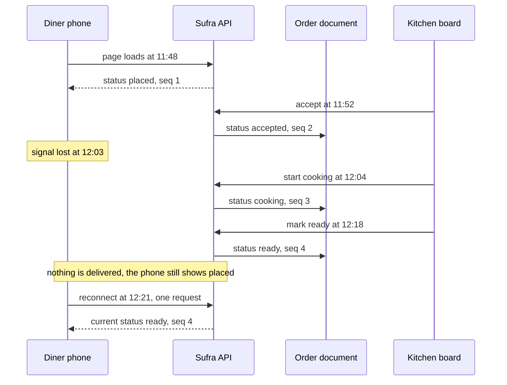

# Lunch on a weak connection

At 11:47 Lina orders a maqluba tray from Umm Yousef's kitchen for the 13:00 to 14:00 DeliveryWindow. She pays with a test card, checks the address, and puts the phone in her pocket. On the stairs the signal drops from three bars to one, then to nothing. She comes back into coverage at 12:21 with the page still open, and it says "Order placed". It said that at 11:48.

The order did not stay still. Umm Yousef accepted it at 11:52, started cooking at 12:04, and marked it ready at 12:18. She also corrected her own estimate once, when the rice took longer than she planned. The diner's screen shows none of it. The record on the server is right and the copy on the phone is stale.

That gap costs something real. Lina has to decide whether to leave work now, wait another twenty minutes, or ask for a refund, and every one of those decisions depends on the state of a meal she cannot see. Her cheapest option is to call the cook, which interrupts a person holding a hot tray and teaches Lina not to trust the app. The bug is invisible in a demo on office wifi and obvious on a phone in a stairwell.

The cook pays too, in a different currency. Umm Yousef has three orders in the same window and one phone. Every diner who cannot see the status calls her, and each call is a minute away from a pot. A kitchen that answers five calls per lunch service has less capacity than its DeliveryWindow says it has. Tracking is not a convenience screen on top of the marketplace; it protects the capacity the whole product sells.

## The record is already correct

Sufra already knows everything Lina needs. M22 built one transition function that changes the status and appends a timeline event with a sequence number in a single conditional update, and it refuses every edge that is not in its table. M19 stored the CapacityClaim, M20 recorded the payment, and M21 pushed slow work into a worker. The Order document holds the status, the `timelineSeq`, the `occurredAt` of each event, the DeliveryWindow times and the kitchen's IANA zone.

None of that reaches a phone unless the phone asks. Today the tracking page reads the order once when it loads, and again only if the diner pulls to refresh. That is honest and it is useless, because the diner does not know when to pull. This module adds delivery. It changes nothing about the state machine, the money or the capacity rules.

A useful way to hold the two ideas apart is this: the timeline is the fact and the stream is the postman. Every problem in this module is a postman problem. A lost message, a dropped connection, a proxy that holds bytes in a buffer: none of them change the fact, and all of them make the diner act on an old one.

## Why a refresh button is the wrong shape

The first fix is always a button. It costs one line, it is honest about what it does, and it puts the timing question on the person with the least information. Lina must guess when something changed, spend data to check, and guess again. On a weak link she will guess wrong.

A reload has a second cost on a phone. It loses her scroll position, it re-runs the page, and on a slow connection it can take eight seconds to show her the same status she already had. If she is standing in a queue, the screen goes blank exactly when she needs to answer a question about the meal.

## Why a timer is not much better

The next step is a timer: fetch the order every two seconds. The arithmetic explains why this feature is a data question and not only a latency question. These numbers are illustrative, and you should replace them with your own measurements later. A small JSON body is about 300 bytes, and request plus response headers add roughly 700 to 900 bytes once cookies and a user agent are included.

At one request every two seconds that is 30 requests a minute at about a kilobyte each, so roughly 30 kilobytes a minute and about 1.8 megabytes an hour, to learn that nothing changed in most of those minutes. The radio wakes 30 times a minute, which is where the battery goes on a phone that is already being asked to last a full day around power cuts. On a link that hangs instead of refusing, each wake can sit for twenty seconds before it gives up, and the next timer fires while the previous request is still open.

Worse, a timer on a bad link leaves a screen that is confidently wrong. A failed fetch leaves the last successful status on the screen with no visible change, so a diner cannot tell a quiet order from a dead connection. The UI looks identical in both cases, and only one of them deserves patience.

## The gap is in the transport

The diagram puts the two clocks side by side. The server column is what the database records. The phone column is what the screen can prove. Between 12:03 and 12:21 the phone knows nothing, and nothing it displays can change that.

What to notice is that the two halves fail separately. The write path worked three times while the read path did nothing, and nobody had to repair the database afterwards. The takeaway is that a tracking feature is judged by its catch-up path, not by its happy path, because the happy path is the one you can test on your desk.

## Two properties, one honest label

The first property is that a status change reaches the screen without the diner doing anything. That is the visible half and the easy half. The second property is that after any gap the screen catches up in the right order, with no duplicates, and never claims to be fresher than it is. The second property is where the work lives.

The honest label is part of the feature rather than decoration. A green dot and the word "live" on a dead connection is worse than a line that says "last updated two minutes ago", because the first one removes the diner's ability to reason. Lesson 23.4 builds three states with text and time, and the gate checks that the label was accurate during the offline test.

## What stays out of scope

Tracking here is status based. Live GPS and a rider app are stretch work, not core, for two reasons worth writing down. A position ping every few seconds is the most expensive thing a phone can send on a weak link, and it turns a status product into a location product with privacy questions this course does not answer. The timeline of the meal is enough for Lina to decide when to leave.

Push notifications through a service worker are also out of scope. They solve a different problem, which is reaching a diner whose screen is closed, and they bring their own limits on iOS. Here the diner has the page open, and the page is what must stay truthful.

## What this module builds

23.2 compares polling, long polling, server-sent events and WebSockets on direction, reconnect, proxies and data use, and records the decision: server-sent events down, normal POST requests up. 23.3 builds one `text/event-stream` connection per person, with a retry hint, a heartbeat comment, a snapshot on connect, deltas after it, and Redis pub/sub so any API process can reach the right diner. 23.4 adds the polling fallback with an ETag and the tracking screen with its timeline and honest connection label. 23.5 is the gate: sixty seconds offline while the cook advances two steps, then a catch-up in order with no duplicates.

Four things come from earlier modules. The window start and end in Asia/Gaza from M14, because "ready around 13:20" is a local time and not a UTC instant on a phone. The timeline and its sequence from M22, because the sequence is how the phone knows what it already holds. The paid barrier from M20, because a diner must never watch an unpaid draft move. And the stream isolation test you wrote in 8.3 at `tests/authz/stream-isolation.test.js`, where it sits as an expected failure until this module gives it a route to pass against.

The module is proven by a recording, not a screenshot. You will put the phone offline for a minute, move the order twice from the kitchen board, bring the phone back, and show the timeline arriving in order, once each, with a connection label that stayed honest. That recording is the hero evidence of this variant, and it is the first thing a reviewer should watch.
