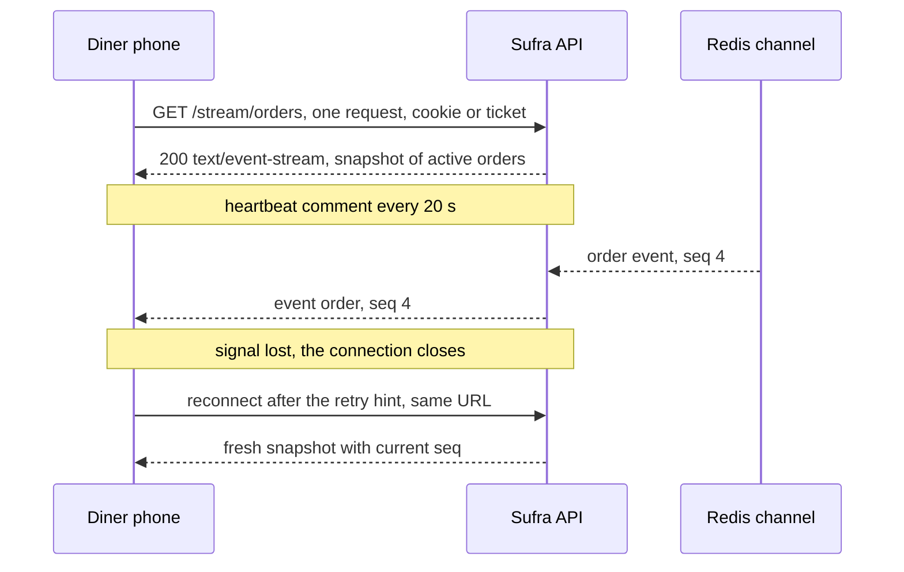

# Polling, long polling, SSE and WebSockets

Four transports can move one status update to one phone, and every one of them works in a demo on office wifi. The differences show up on a link that drops, behind a proxy that buffers, and in a data bundle that costs real money. Choosing by fashion here is expensive, because the wrong choice is not one bad decision in one file; it is a connection model the whole tracking feature inherits.

Start from the traffic instead of the technology. During the twenty minutes before lunch, the diner's screen needs four facts per order: the status, the sequence number, the instant of the change and the current estimate for when the meal is ready. That is a one-way flow, server to client, of a few hundred bytes per change. In the other direction the diner sends almost nothing. Placing the order, paying, and asking for help are separate commands that happen outside the tracking screen.

That asymmetry is the whole decision. Sufra needs a reliable way for the server to speak, and it already has a good way for the client to speak: `POST` with a JSON body, an idempotency key, a `409` for an illegal transition and a `403` for someone else's kitchen. M22 built that surface. Nothing in this module replaces it, and a transport that also carries client messages would tempt you to duplicate it.

## Polling

Polling is a timer and a `GET`. The client asks for the order every few seconds, and the server answers with the current state whether or not anything changed. It works through every proxy, needs no special server code, and composes with HTTP caching, so a conditional request can return `304 Not Modified` with no body.

Its costs are latency and waste. The diner learns about a change up to one interval late, and every interval spends a full request. The failure mode on a weak link is worse than the cost: if a request hangs for twenty seconds, and the timer fires every two seconds, the client builds a queue of overlapping requests that all fail together and retry together. Code that does not guard against this will also render old responses out of order, so a poll that started before a status change can land after the poll that saw it.

## Long polling

Long polling fixes the latency by inverting who waits. The client sends a `GET`, the server holds the response open until there is an event or until a timeout, then answers and the client immediately asks again. The update arrives at once, and the client spends headers once per cycle instead of once per second.

The cost moves to the server and to the gaps. Each waiting client holds a socket and a request object, so a few thousand diners is a few thousand held connections that you now have to size and monitor. Every cycle ends before the next one starts, and any event written during that gap is lost unless the client tells the server what it already has. A proxy or load balancer will cut an idle response at its own timeout, often sixty seconds, so the server must time out first and answer with an empty result. You end up writing the same reconnect, backoff and catch-up logic you would write for a socket, with an HTTP request per cycle on top.

## Server-sent events

Server-sent events keep one `GET` open and write a stream of small text frames into it. The response has the type `text/event-stream`, each frame is a few lines ending in a blank line, and the browser exposes them through `EventSource`. A `data:` line carries the payload, an `event:` line names the kind, an `id:` line sets the last event identifier, and a line that starts with a colon is a comment the browser ignores.

Two properties make it a good fit for a weak connection. The browser reconnects on its own after a dropped connection, and the server can send a `retry:` field that sets the wait in milliseconds before the next attempt. A comment line sent every twenty seconds keeps the connection from looking idle to a load balancer, and it costs about twenty bytes. The MDN guide on using server-sent events documents both the comment keep-alive and the format, and it warns about the connection limit described below.

The costs are real and specific. `EventSource` cannot set an `Authorization` header, so the stream needs an httpOnly cookie or a short-lived ticket in the URL. The connection is one-way, so the client must keep using normal requests for commands. And on HTTP/1.1 a browser allows six connections per origin across all its tabs, so a screen that opens one stream per order will starve the rest of the page; MDN states that limit plainly and notes that HTTP/2 negotiates a much higher stream count.

## WebSockets

A WebSocket upgrades one HTTP request into a two-way framed connection and stays open. It carries messages in both directions with less per-message overhead than HTTP, and it is the right tool when both sides speak often, for example a cook's board receiving new orders while the cook sends status changes on the same socket.

Everything that SSE gives you for free, a WebSocket makes you write. Reconnect and backoff are yours. Resubscribing after a reconnect is yours. Keeping the connection alive through network address translation needs a ping and pong loop. Authorization happens in the upgrade request, where the same header problem appears. Some corporate networks, captive portals and older mobile gateways break the upgrade, and the failure looks like a hang rather than a clean error. For a feed where the client speaks once every few minutes, that is a large amount of code for a small benefit.

| Transport | Direction | Reconnect | Proxies | Data use on a weak link | Role in Sufra |
|---|---|---|---|---|---|
| Polling every 2 s | client pulls | none needed, each request stands alone | plain GET, passes everything | high, headers per request | fallback only |
| Long polling | client pulls, server holds | new request per cycle, gap between cycles | needs a read timeout longer than the hold, buffering proxies cut it | medium, headers per cycle | not used |
| Server-sent events | server pushes | automatic, with a `retry` hint | needs no buffering, heartbeat for idle timeouts | low, one connection, small frames | primary |
| WebSockets | both ways | hand written | upgrade can be blocked or idle-cut | low per message, plus ping overhead | stretch spike |

Read the table by column rather than by row. The direction column decides whether you need a second protocol for commands, the reconnect column decides how much client code you own, the proxy column decides whether the feature survives a deploy behind a load balancer, and the data column decides what the diner pays. The third row wins on direction, reconnect and data use, and it pays for that with one configuration requirement on the proxy.

## The decision: SSE down, plain requests up



The diagram is the shape of the decision. One request opens the feed, the server writes frames down it, and the reconnect is the browser's job with a hint from us. The diner's screenshot now matches the server without a single extra endpoint.

The choice is one `text/event-stream` connection per diner for updates, and ordinary authenticated `POST` requests for everything the diner does. Why now: M22 already gives every status change a sequence number and a committed timeline, so the only missing piece is delivery, and delivery is one-way. What it buys: automatic reconnect, plain HTTP that most proxies already allow, a heartbeat that is nearly free, and a fallback that is a normal `GET` rather than a second protocol.

What it costs: the cookie or ticket problem, one-way only, the six-connection limit, and a proxy that must be told not to buffer. The credible alternative is long polling, which needs no new response type and fails the data and gap tests. The one most teams reach for first is WebSockets, which pass every technical test here and lose on the amount of client code you must write and debug on a phone.

When to switch: if the tracking screen ever needs to send a stream of its own, for example a rider position every five seconds, or if the deployed host refuses to pass a streaming response. The first condition is a product change, and the second is a deploy problem you should measure in M25 before you rewrite the client. Stretch S3 asks you to build the same feed over WebSockets and update the decision record, which is the honest way to test this choice.

<Callout type="warning" title="Do not open one stream per order">
The per-origin connection limit is counted across every tab of the browser, and the page needs connections for images, fonts and API calls. A diner with three orders from two kitchens must still hold one stream. The per-user channel in 23.3 exists partly because of this limit, not only because it is tidier.
</Callout>

## Data and reconnects on a weak link

The numbers are worth stating once, with illustrative values you can replace with measurements. An event frame carrying a status, an order ID and an instant is about 180 bytes. A heartbeat comment is about 20 bytes every twenty seconds, which is about 3.6 kilobytes an hour. A two-second polling loop is roughly 1.8 megabytes an hour by the estimate in 23.1. The difference is not a rounding error on a bundle that a fellow buys by the gigabyte.

Reconnects matter more than bytes on a link that drops. `EventSource` retries on its own after a short default wait, and the `retry:` field lets the server lengthen that wait, for example to five seconds, so a phone in a lift does not burn its battery reconnecting to nothing. A WebSocket implementation has to rebuild that behaviour, and the version people write first retries in a tight loop precisely when the network is worst.

There is one thing the transport cannot do, and it is the reason the next two lessons exist. A transport can tell you that the connection is open. It cannot tell you that you missed nothing while it was closed, and it cannot tell you that a message published on the server never reached you. Those are data questions, answered by a snapshot on connect and a sequence number the client compares against what it already holds. The next section takes the hardest case, a message that is published and then lost.

Redis makes this concrete in its own documentation. Pub/Sub is at-most-once delivery: once a message is sent there is no retry, and a subscriber that cannot handle it loses it permanently, which is why the same page points readers at Redis Streams when they need stronger guarantees. That one paragraph explains why Sufra treats the MongoDB timeline as the record and the stream as a notification. If the design treated a published message as the record, a five second blip between the API and Redis would lose an order status with no way to notice.

References: [Redis Pub/Sub delivery semantics](https://redis.io/docs/latest/develop/pubsub/), [MDN: Using server-sent events](https://developer.mozilla.org/en-US/docs/Web/API/Server-sent_events/Using_server-sent_events).

## The reconnect path, step by step

The trace below follows one dropped connection and shows where each fact comes from. Step through it before you write the handler, because every step becomes a line of code in 23.3 and 23.4.

<TraceRequest title="A dropped stream and the catch-up path">
  <TraceStep actor="Client" label="The stream errors out" detail="Lina enters a lift at 12:03 and the connection closes mid-stream" />
  <TraceStep actor="Client" label="Wait for the retry hint" detail="The browser waits five seconds and reconnects to the same URL by itself" />
  <TraceStep actor="API" label="Authorize the new connection" detail="The session cookie or the single use ticket identifies the diner" />
  <TraceStep actor="Server" label="Subscribe, then read the snapshot" detail="The subscription is registered before the snapshot query so nothing falls between them" />
  <TraceStep actor="Client" label="Drop what is already known" detail="Events with a sequence at or below the stored one are ignored, the rest apply in order" />
</TraceRequest>

The order in the fourth step is the subtle part. If the server reads the snapshot first and subscribes second, a transition that commits between the two writes is in neither the snapshot nor the feed, and the diner never learns about it until something else changes. Subscribing first means the client can receive a duplicate, which is harmless because it compares sequence numbers. Duplicates are cheap and gaps are expensive, so the design prefers the duplicate.

## Check the decision

The quiz below is the decision checkpoint for the module. Answer it before reading 23.3, because the next lesson assumes the transport choice and spends its time on the delivery rules that the choice makes necessary.

```quiz
type: mcq
id: sufra-tracking-q1
question: A cook marks an order ready while the diner's tracking page is open. Which transport carries that update unprompted and reconnects without custom client code?
options:
  - Server-sent events, one held GET per diner
  - Polling with a two second timer on the client
  - Long polling with a new request per cycle
  - WebSockets with a hand written reconnect loop
correct: 0
explanations:
  - The server writes the frame down an open response and the browser retries the request itself.
  - Polling carries the update only at the next timer tick, and the client owns every retry.
  - Long polling delivers it, but the client must start each new request and handle the gap.
  - The transport delivers it, but reconnect, backoff and resubscribe are all your code.
```

The next lesson builds the stream itself: one connection per diner, a snapshot on connect, deltas after it, and Redis pub/sub so that the API process holding the connection is not the only one that can publish. The question it answers is not "how do I send an event" but "how do I know the diner has the same facts the database has".

Before you move on, write the decision into `docs/stream-decisions.md`: the transport you chose, the four comparison axes, the two costs you accept, and the one condition that would make you switch. Keep it to a page. M25 will ask you to test it behind a real proxy, and S3 will ask you to revise it with evidence.
