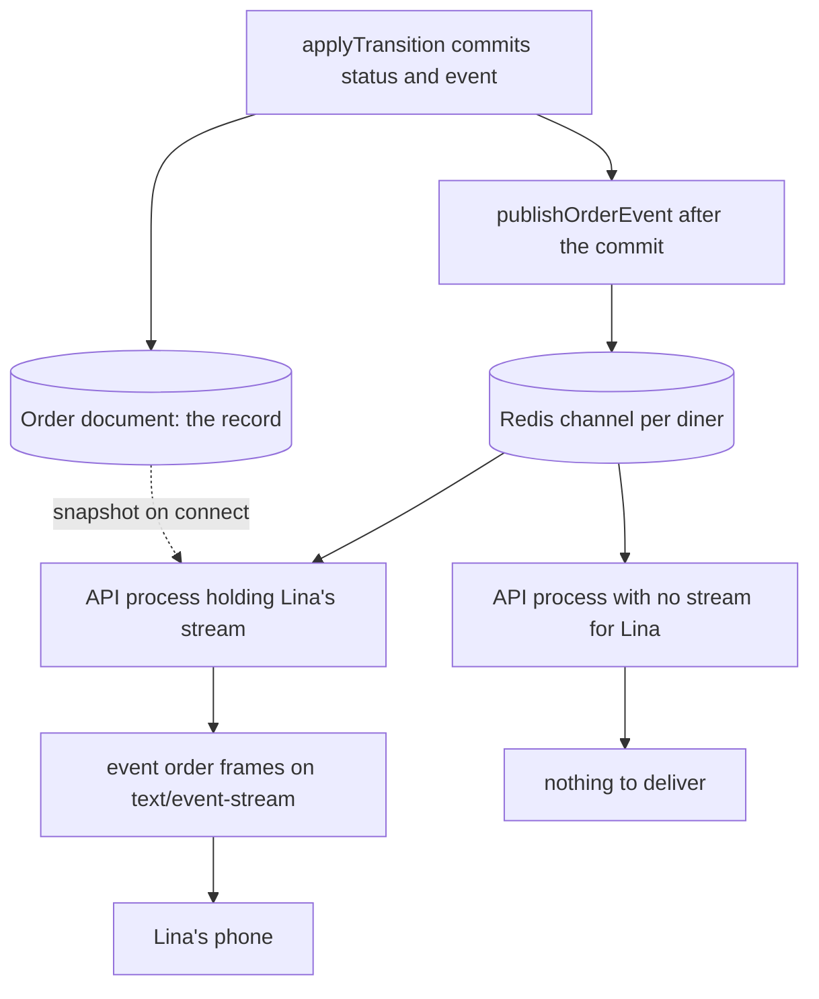

# One stream per user, snapshot then deltas

The first version of this feature is almost always one stream per order. It is the obvious mapping: the tracking screen shows an order, so it opens a connection for that order. Then Lina orders from two kitchens, the screen opens two, and a second tab opens two more. On HTTP/1.1 the browser allows six connections per origin, and the page also needs images, fonts and ordinary requests. The seventh connection waits, and the thing that waits is often the request that would have shown her the address.

There is a second, subtler mapping problem. Sufra runs more than one API process once you deploy, and each process holds only the connections it accepted. The process that commits Lina's transition is not necessarily the process holding her stream. A handler that keeps subscribers in a local array works perfectly on your laptop and silently stops working behind a load balancer, which is the worst kind of bug to find in front of reviewers.

This lesson fixes both by choosing the right unit and the right road. The unit is the diner, so one person holds one connection no matter how many orders or tabs they have. The road is Redis pub/sub, so any process can reach the process that happens to hold that diner's stream. The record stays in MongoDB, where M22 already writes the timeline and its sequence.

## Keep one connection per person

```txt
GET /api/v1/stream/orders
Cookie: sufra_session=4f8c2a91b7
Accept: text/event-stream

200 Content-Type: text/event-stream; charset=utf-8
    Cache-Control: no-cache, no-transform
    Connection: keep-alive
    X-Accel-Buffering: no

401 when the session is missing or expired
200 with an empty snapshot when the diner has no active order
```

The route returns every active order for the authenticated diner in one response, ordered by window start, so the screen needs nothing else to start. "Active" is a list you should write down rather than infer: `placed`, `accepted`, `cooking`, `ready` and `out_for_delivery`. A `delivered` or `rejected` order appears in the closing snapshot only if it changed while the stream was open, and after the last order reaches a terminal state the server may close the stream and tell the client to stop reconnecting.

Authorization is the part `EventSource` makes awkward, because the API cannot ask it for an `Authorization` header. If the client and the API share a site, use the httpOnly session cookie from the diner's login and start the connection with `withCredentials`. If they do not share a site, issue a single-use ticket from an authenticated `POST /api/v1/stream/tickets`, valid for about sixty seconds, and accept it as `?ticket=`. The query string ends up in proxy logs, so the ticket must be short lived, single use and bound to one diner; a long-lived token in a URL is a leaked token in a log.

The stream is scoped by the session and nothing else. There is no `dinerId` in the path or the body, and a request cannot ask for someone else's feed, because the only identity the handler trusts is the one it resolved itself.

## Write the frames as a contract

The response is text, one frame per message, each frame ended by a blank line. The format is small enough to read in a terminal, which is the point: when the gate fails you will be looking at raw frames.

```txt
retry: 5000

event: hello
data: {"dinerId":"65f2c1","serverNow":"2026-11-03T09:50:02.000Z"}

event: snapshot
data: {"serverNow":"2026-11-03T09:50:02.000Z","orders":[{"orderId":"6a1f90","kitchenName":"Umm Yousef","status":"accepted","timelineSeq":2,"windowStart":"2026-11-03T11:00:00.000Z","windowEnd":"2026-11-03T12:00:00.000Z","estimatedReadyAt":"2026-11-03T10:20:00.000Z"}]}

event: order
id: 6a1f90:3
data: {"orderId":"6a1f90","seq":3,"status":"cooking","occurredAt":"2026-11-03T10:04:31.000Z","estimatedReadyAt":"2026-11-03T10:20:00.000Z"}

: heartbeat 2026-11-03T10:05:00.000Z
```

Three fields carry the meaning. `retry: 5000` asks the browser to wait five seconds before reconnecting, which is enough for a phone to rejoin a network without hammering it. `event: snapshot` always describes the current state of every active order, and it is the only frame whose absence would lose history. `event: order` is a delta, and its `seq` is the order's `timelineSeq` from M22, so the client can compare it against what it already holds instead of guessing.

The `id:` line is optional here. The browser will send `Last-Event-ID` on its next reconnect, which is useful only if the server keeps a per-diner event log it can replay from. Sufra does not keep one, so the snapshot and the timeline query do the repairing instead, and the id is there for the network panel and your logs.

`serverNow` is not decoration either. The phone's clock may be wrong by minutes, and an estimate or a "last updated" label must not be computed from it. Every time the screen prints is either provided by the server or shown as a duration measured from the moment the frame arrived.

## Snapshot on connect, and subscribe before you read it

The snapshot query is deliberately boring: read the active orders for this diner, sorted by window start, with the fields the screen needs and nothing private.

```js
// server/src/modules/stream/snapshot.js (excerpt)
const ACTIVE = ['placed', 'accepted', 'cooking', 'ready', 'out_for_delivery'];

export async function loadActiveOrders(dinerId) {
  return Order.find({ dinerUserId: dinerId, status: { $in: ACTIVE } })
    .sort({ windowStart: 1 })
    .select('status timelineSeq windowStart windowEnd kitchenNameAtPurchase estimatedReadyAt')
    .lean();
}
```

The ordering of the two operations around that query is the part people get wrong. If the handler reads the snapshot and then subscribes to Redis, a transition that commits in between is in neither place: the snapshot was taken before it and the subscription started after it. Lina would then see nothing until the next status change arrives, which may be ten minutes later or never.

So subscribe first, buffer anything that arrives, then read the snapshot, then send the snapshot, then flush the buffer. A diner may now receive an event that the snapshot already contains. That is fine, because the client drops frames at or below the sequence it holds. Duplicates cost a few bytes; gaps cost correctness.

## Publish after the commit, not inside it

Publishing belongs after `applyTransition` has returned a committed document. It is a notification about the record, never a second copy of it.

```js
// server/src/modules/orders/transition-route.js (excerpt)
const result = await applyTransition({ Order, orderId, kitchenId, actor, action, expectedSeq, now: clock.now() });
if (!result.ok) return res.status(409).json(await loadOrderView({ orderId, kitchenId }));

// The transition is committed. A lost publish delays the news, it does not lose the fact.
publishOrderEvent(result.order).catch((error) => log.warn({ error, orderId }, 'stream publish failed'));
return res.status(200).json(toView(result.order, clock.now()));
```

```js
// server/src/modules/stream/publish.js (excerpt)
export const channel = (dinerId) => `sufra:stream:order:${dinerId}`;

export async function publishOrderEvent(order) {
  await redis.publish(channel(order.dinerUserId), JSON.stringify({
    type: 'order',
    orderId: String(order._id),
    seq: order.timelineSeq,
    status: order.status,
    occurredAt: order.updatedAt.toISOString(),
    estimatedReadyAt: order.estimatedReadyAt ? order.estimatedReadyAt.toISOString() : null,
  }));
}
```

```js
// server/src/modules/stream/hub.js (excerpt, same channel helper)
import { channel } from './publish.js';

const listeners = new Map(); // dinerId to the callbacks waiting on this API process

export async function subscribe(dinerId, onEvent) {
  if (!listeners.has(dinerId)) {
    listeners.set(dinerId, new Set());
    await subscriber.subscribe(channel(dinerId), (message) => {
      for (const listener of listeners.get(dinerId)) listener(JSON.parse(message));
    });
  }
  listeners.get(dinerId).add(onEvent);

  return async function unsubscribe() {
    listeners.get(dinerId).delete(onEvent);
    if (listeners.get(dinerId).size === 0) {
      listeners.delete(dinerId);
      await subscriber.unsubscribe(channel(dinerId));
    }
  };
}
```

The hub is the receiving half. Each API process keeps one Redis subscriber connection and a map from diner to the callbacks waiting on that process. When the last stream for a diner closes, the process unsubscribes, so an idle process does not pay for channels nobody listens to. The map is process local on purpose: a diner connected to process A has no entry in process B, and the publish reaches both, which is why no process needs to know where the connection lives.

The payload is small on purpose. It carries the status, the sequence, the order identity and the estimate, and none of the private parts of the order: no address, no cook's note, no phone number. The stream is authenticated, but a payload that travels through a socket buffer and a browser dev tools panel should still be something you would be comfortable printing.

Two rules keep this honest. Never publish before the commit, because a subscriber that reloads the order would read the old status and show it as new. And never make the response depend on the publish succeeding, because the transition is already durable and a Redis hiccup must not turn a successful status change into a `500` that invites the cook to tap again.

The diagram shows the split. The commit writes the record and then publishes a notification. Any API process can receive it, and only the one holding Lina's connection writes a frame.



Follow the dotted edge to see why nothing is fatal. The record can always be read again, so a lost notification becomes a late notification as soon as anything reconnects or asks. The solid edges are best effort; the dotted edge is the guarantee.

## Keep the connection alive through proxies

A load balancer or reverse proxy will close a response that looks idle, often at sixty seconds, and some of them buffer a response until a buffer fills, which means the heartbeat itself sits in a buffer. Three settings and one timer cover the common cases.

The response headers above already disable caching and transformation, and `X-Accel-Buffering: no` asks nginx not to buffer that response. Compression must not be applied to this route, or must be flushed per frame, because a compressor that waits for a block will hold a twenty byte comment until the block is full. Then the server writes a comment line every twenty seconds, which is shorter than any idle timeout you are likely to meet and costs about twenty bytes.

```js
// server/src/modules/stream/stream.routes.js (shape; shutdown, metrics and the ticket path are omitted)
router.get('/api/v1/stream/orders', requireDiner, async (req, res) => {
  const dinerId = req.user.id;
  res.writeHead(200, {
    'Content-Type': 'text/event-stream; charset=utf-8',
    'Cache-Control': 'no-cache, no-transform',
    Connection: 'keep-alive',
    'X-Accel-Buffering': 'no',
  });
  res.flushHeaders();
  res.write('retry: 5000\n\n');

  let snapshotSent = false;
  const pending = [];
  const unsubscribe = await hub.subscribe(dinerId, (event) => {
    if (snapshotSent) writeFrame(res, event);
    else pending.push(event); // keep everything that lands before the snapshot
  });

  writeFrame(res, { type: 'snapshot', serverNow: clock.now(), orders: await loadActiveOrders(dinerId) });
  snapshotSent = true;
  for (const event of pending.splice(0)) writeFrame(res, event);

  const heartbeat = setInterval(() => res.write(`: heartbeat ${clock.now().toISOString()}\n\n`), 20000);
  req.on('close', () => {
    clearInterval(heartbeat);
    unsubscribe();
  });
});
```

Two smaller rules belong in the same file. Cap the number of open streams per diner at two, so a phone that opens tabs in the background cannot exhaust the browser's connection budget or the server's memory. And when `res.write` reports that its buffer is full, do not queue without a limit: close the connection instead. A slow client then reconnects, receives a snapshot and recovers, which is better than a growing buffer holding stale frames nobody will read.

## When the message is lost

Redis pub/sub delivers a message at most once. A subscriber that is reconnecting, a network blip between the API and Redis, or a process restart can drop a frame, and nothing in Redis will retry it. The record is already committed, so the question is how the phone finds out.

Three mechanisms answer it, in increasing order of patience. The first is gap detection: the next delta carries a sequence that is more than one beyond what the client holds, so the client knows it missed something and asks the timeline route for every event after the sequence it holds. The second is a reconnect: any new connection begins with a snapshot, which carries the current status and sequence of every active order. The third is a silence watchdog, and it is the one people forget: if an event is lost and no further transition happens, the client sees no gap at all, because silence looks the same as a quiet order. So the client also treats ninety seconds with no frame as a reason to revalidate, and the cheapest revalidation is the polling query from 23.4.

Put the three together and the worst case is bounded: a lost message delays the screen by at most the watchdog interval, and the screen never invents a status. The record was never at risk. This is the answer to the viva question about a lost pub/sub message, and you should be able to give it in under a minute without notes.

## Drop what you already have

The client keeps the highest sequence it has applied per order, and treats that map as its memory of what the screen shows.

```js
// client/src/tracking/applyEvent.js (shape)
const seenSeq = new Map(); // orderId to highest sequence applied

export function applyEvent(state, event) {
  if (event.type === 'snapshot') {
    for (const order of event.orders) {
      const known = seenSeq.get(order.orderId) || 0;
      seenSeq.set(order.orderId, Math.max(known, order.timelineSeq));
    }
    return { ...state, orders: mergeBySeq(state.orders, event.orders), serverNow: event.serverNow };
  }
  const known = seenSeq.get(event.orderId) || 0;
  if (event.seq <= known) return { ...state, dropped: state.dropped + 1 }; // duplicate or older
  if (event.seq > known + 1) return { ...state, catchUp: { orderId: event.orderId, after: known } };
  seenSeq.set(event.orderId, event.seq);
  return { ...state, orders: patchOrder(state.orders, event) };
}
```

The identity of an event is the pair, not either half: an order id alone cannot tell a retransmitted frame from a new one, and a sequence alone cannot tell two orders apart, because both start at 1. Keying on the pair is what makes the offline test pass with no duplicates even though the diner may receive an event twice through the buffer flush.

## Test the two failures first

Write these before the handler works, and keep them failing until it does. The first is already written: 8.3 left an expected failure in `tests/authz/stream-isolation.test.js`, and this module is the owner that turns it into a normal test. The rule from that lesson still applies, which is that it must pass without edits. If you have to change the test to make the stream pass, the stream was designed around the test rather than around the diner. Keep its style as well; flipping `it.fails` to `it` is the only change that file should need.

```js
// tests/authz/stream-isolation.test.js (written in 8.3, flipped here)
it('diner B receives no events from diner A order', async () => {   // was it.fails in 8.3
  const stream = await openStream({ token: await loginAs(fixture.dinerB) });
  await advanceOrder(fixture.orderA, 'cooking');   // commits seq 3 and publishes
  const events = await stream.nextEvents(1000);
  expect(events).toHaveLength(0);
});
```

The second test is the one that looks trivial until it fails in production. A retransmitted frame that carries the same sequence but a newer status means one of two things: the publisher is wrong, or the record moved without the sequence moving. Both are bugs, and both are visible only if the client refuses out-of-order writes instead of accepting the last frame it saw.

Add a third test for the subscribe ordering: open a stream, commit a transition while the snapshot query is deliberately slowed, and assert that the frame arrives after the snapshot and that the client ends in the committed state. That test is the only cheap proof that the buffer before the snapshot exists.

## What this design costs

One connection per diner is cheap while the diner is looking at the screen and expensive when the diner has seven tabs open on a laptop. The per-diner cap of two is a blunt answer; the better answer is to close the stream when the page is hidden for a long time and reopen it on `visibilitychange`, which 23.4 adds.

Redis pub/sub gives fan-out across processes with almost no code and no persistence. The cost is that a published message can vanish, which is why every repair path in this course ends at the record rather than at the queue. The credible alternative is Redis Streams, which keeps a log each subscriber can resume from, and it would be the right choice if you needed the stream to survive a longer outage without a database read. For a meal that lives for a few hours, the snapshot query is cheaper than a log.

The last cost is psychological. This is more moving parts than `setInterval(fetch, 2000)`, and every part can fail. The gate exists because the failure is the feature: you are not building a live feed, you are building a feed that tells the truth about how live it is.

Next, the fallback query and the screen. The stream will not always connect, and on the days it does not, the diner still needs the timeline and an honest sentence about when it was last correct.
