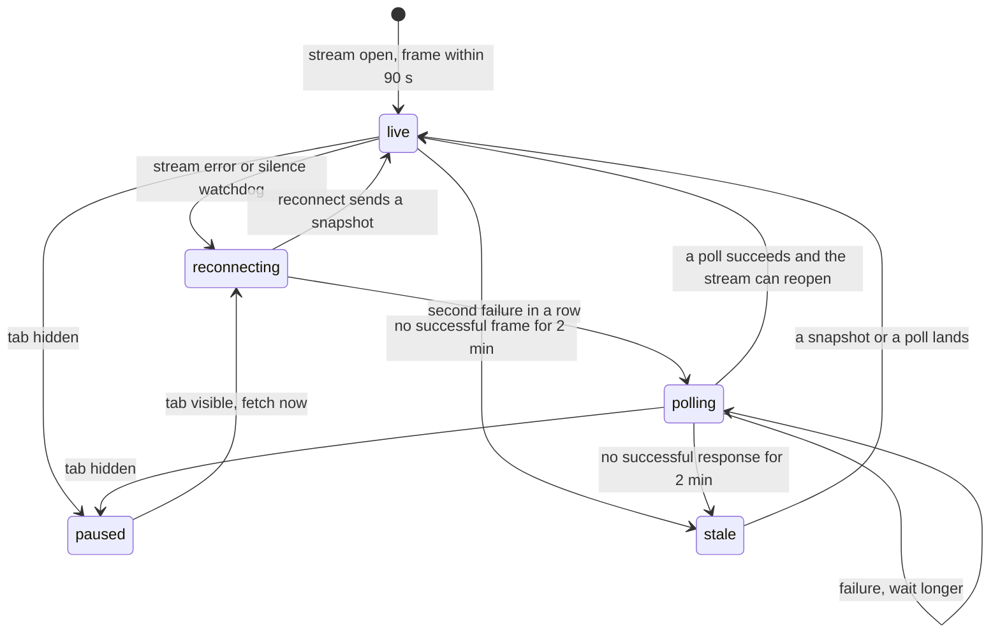

# Polling fallback and the tracking screen

The stream will fail for reasons you do not control. A hotel network buffers the response until it fills a buffer. A proxy closes it at sixty seconds because the heartbeat header never reached it. A phone suspends the browser when the screen turns off, and the tab comes back with a dead connection and no error the user can see. None of this is a bug in your handler, and all of it is a diner looking at a screen that has stopped moving.

So the fallback is not a second-class path you add if there is time. It is the path that runs on the days the primary path does not, and it must deliver the same facts: the status, the timeline, the estimate and the truth about when the screen was last correct. This lesson builds it as a query rather than a second stream, and then builds the screen that uses both.

## The fallback is a query

```txt
GET /api/v1/orders/:orderId/timeline?after=3
Cookie: sufra_session=4f8c2a91b7
If-None-Match: "6a1f90:3:3"

200 ETag: "6a1f90:4:3"
{ "orderId": "6a1f90", "status": "ready", "timelineSeq": 4,
  "serverNow": "2026-11-03T10:19:02.000Z",
  "estimatedReadyAt": "2026-11-03T10:18:00.000Z",
  "events": [ { "sequence": 4, "fromStatus": "cooking", "toStatus": "ready",
                "actorType": "cook", "occurredAt": "2026-11-03T10:18:04.000Z" } ] }

304 with an empty body when nothing was written after the cursor
404 for an order that does not exist or does not belong to this diner
```

The `after` parameter is the client's cursor, and it is the highest sequence the screen has already applied. The response contains only events above it, plus the current status and sequence, so one call repairs a gap and confirms the whole picture. A client with no cursor asks for everything it may see, which is what happens on a fresh page load with no stream.

The route is scoped by the authenticated diner, not by the order id alone. A diner who guesses another diner's order id gets the same `404` as one who guessed nothing, because the route must not confirm that an id exists. M22 applied the same principle to the cook's transition route, which returns `403` rather than `404` for a foreign order so that a cook cannot probe for ids.

## An ETag that belongs to the body it labels

An `ETag` is a validator: the client sends it back in `If-None-Match`, and the server answers `304 Not Modified` when the representation has not changed. That saves a body on every poll where nothing happened, which on a quiet order is most of them. It also has a trap that this route walks straight into.

The response body depends on the cursor. With `after=1` the body carries sequences 2 and 3, and with `after=3` the body is empty, even though the order itself has not changed between the two requests. If the validator is computed from the order alone, two different representations share one validator. A client that keeps one validator per order, or a cache configured to ignore the query string, then sends `after=3` with the validator it received for `after=1`, and the server answers `304` for a body the client never received. The screen keeps a gap it will never fill.

Include the cursor in the validator. `"6a1f90:4:3"` reads as order, current sequence and cursor, so a `304` can only ever mean "nothing was written after the cursor you asked about". Then mark the response `Cache-Control: private, no-store`, because this representation is about one diner and must never be reused for another.

```js
// server/src/modules/orders/timeline-route.js (excerpt)
router.get('/api/v1/orders/:orderId/timeline', requireDiner, async (req, res) => {
  const after = Number.parseInt(req.query.after ?? '0', 10);
  if (!Number.isInteger(after) || after < 0) return res.status(400).json({ code: 'BAD_CURSOR' });

  const order = await Order.findOne({ _id: req.params.orderId, dinerUserId: req.user.id })
    .select('status timelineSeq windowStart kitchenTimeZone estimatedReadyAt timeline')
    .lean();
  if (!order) return res.status(404).json({ code: 'ORDER_NOT_FOUND' });

  const etag = `"${order._id}:${order.timelineSeq}:${after}"`;
  res.set('ETag', etag).set('Cache-Control', 'private, no-store');
  if (req.headers['if-none-match'] === etag) return res.status(304).end();

  return res.status(200).json({
    orderId: String(order._id),
    status: order.status,
    timelineSeq: order.timelineSeq,
    serverNow: clock.now().toISOString(),
    estimatedReadyAt: order.estimatedReadyAt ?? null,
    kitchenTimeZone: order.kitchenTimeZone,
    events: order.timeline.filter((event) => event.sequence > after),
  });
});
```

One more detail belongs beside the validator. A `304` must come back with the same `ETag` header, or the browser keeps a validator that no longer matches what it holds. Some frameworks drop headers on an empty response, so assert it in a test rather than trusting it.

The quiz below is a checkpoint on that decision. It is worth answering with the code in front of you, because the mistake it describes is invisible in a demo where every poll finds a change.

```quiz
type: mcq
id: sufra-tracking-q2
question: Lina's screen holds sequence 1 and asks the timeline route for after=1. The order is at sequence 3. Which response repairs the screen?
options:
  - The whole timeline from sequence 1 again
  - A 304, because nothing changed since sequence 1
  - Events 2 and 3, validator has the cursor
  - Only sequence 2, because 3 arrives later
correct: 2
explanations:
  - It repairs the screen but re-sends an event the client holds and answers the wrong cursor.
  - The order did change after sequence 1, so a validator over the order alone would hide both events.
  - The cursor filters the body and the validator names the same cursor, so the next poll can be a 304.
  - Sequence 3 is already committed, so stopping at 2 costs a second request to reach the current status.
```

## Back off, and stop while the tab is hidden

Polling that runs at a fixed interval is the wrong shape for a fallback. When the network is down, every attempt fails at the same speed, and a fixed interval turns a dead connection into a steady drain on the battery. When the network is fine and nothing is happening, the same interval spends data on empty answers. Backoff and a visibility check handle both.

The schedule is one second, then two, four, eight, fifteen and thirty, with the cap held at thirty seconds and a little jitter so a thousand phones do not retry in the same second. Any successful response resets the schedule to one second, because a success proves the path works. Any failure increases it, because a failure is evidence about the path.

The pause is a separate rule. The Page Visibility API exposes `document.visibilityState` and fires `visibilitychange`, and MDN describes it as the supported way to avoid work in a hidden tab; browsers also throttle timers in hidden tabs, so a timer that keeps running is both expensive and unreliable. While the tab is hidden, the fallback stops scheduling. When it becomes visible, the client fetches once immediately, then reopens the stream. The `online` and `offline` events are useful hints for the label, but they are not proof: a phone can be on a wifi network with no route to the internet, so only a completed request counts as evidence.

The stream has the same pause problem, and it is worth handling in one place. A hidden tab holding a stream may have that stream cut by the browser or the network, and it will not notice until it becomes visible. Reopening on visibility, rather than trusting a socket that has been idle for twenty minutes, is cheaper than keeping it alive with heartbeats nobody reads.

## Name the states before you render them



Read the diagram as three honest answers rather than five technical ones. The screen is either live, trying, or out of date, and the third answer has to carry a time. The extra states exist so the code has one place to decide what to do, but the diner only ever sees the three labels.

| State | What the diner reads | What is true |
|---|---|---|
| live | "Live updates" | a frame arrived in the last 90 seconds |
| reconnecting | "Reconnecting, trying again in 5 seconds" | the stream closed and the client is retrying |
| stale | "Last updated 2 minutes ago" | nothing has arrived for two minutes or more |

The label is text, and the icon is decoration with an `aria-hidden` attribute. Colour may reinforce the label, but the label never depends on colour, because a diner in sunlight on a cheap screen and a diner using a screen reader both need the same sentence.

## Put the estimate on the server

"Ready around 13:20" is the most useful line on the screen and the easiest one to get wrong. Two rules keep it honest. The instant comes from the server, not from a phone-side subtraction, and the formatting uses the kitchen's own zone, because a window that starts at 13:00 in `Asia/Gaza` is 11:00 UTC, and a screen that printed 11:00 would have the diner expecting the meal two hours earlier than the kitchen meant.

The order stores `estimatedReadyAt`, computed when the cook accepts from the window start, the dish preparation minutes at purchase and a small buffer, clamped so it never lands after the window end. M19 already stores `kitchenTimeZone` at purchase for the same reason it stores prices: a kitchen that later moves or changes zone must not rewrite the history of an existing order.

```jsx
// client/src/tracking/ReadyEstimate.jsx (partial)
const timeFormat = new Intl.DateTimeFormat('en-GB', {
  timeZone: order.kitchenTimeZone, hour: '2-digit', minute: '2-digit', hour12: false,
});

<p className="text-base">
  Ready around <time dateTime={order.estimatedReadyAt}>{timeFormat.format(new Date(order.estimatedReadyAt))}</time>
</p>
```

The word "around" is part of the design. A kitchen is not a machine, and a precise promise that slips by six minutes costs more trust than a range that was right.

## Last updated, without trusting the phone's clock

The elapsed time in the label must not come from comparing the server's timestamp to `Date.now()`, because a phone with a clock five minutes fast would show "last updated five minutes ago" while the stream is live and healthy. Measure the duration locally from the moment the frame arrived, using a monotonic timer, and use the server's timestamps only for the absolute times the screen prints.

That split gives two different labels from one rule: "Live" while frames are arriving, and "Last updated two minutes ago" when they stop, with the number counting up from the last arrival. When a frame finally lands, the label resets to "Live" and the screen announces the new status in a sentence, not a chime.

## Make the screen usable at 360 pixels

The tracking screen is used one-handed, outdoors, on a phone that may be three years old. That shapes the build more than the visual style does.

The layout is one column with no horizontal scroll. Times use tabular figures so they do not jump as the seconds change, and long kitchen names wrap instead of pushing the layout wide. The timeline is an ordered list, because the order of events is the meaning, and each item shows the time in the kitchen's zone, the status in plain words, and one line of detail when there is something to say.

Keyboard and screen reader behaviour follows from three choices. The status summary is a `role="status"` region with `aria-live="polite"` and `aria-atomic="true"`, so a change is announced once and never interrupts an ongoing sentence. The timeline itself is not a live region, so the arrival of a frame does not re-announce six old events. And the manual refresh control is a real `button`, reachable by Tab in a sensible order, at least 44 pixels tall, with focus left exactly where the diner put it when an update arrives.

The connection label sits next to the status rather than in a corner, and it is the first thing that changes when the stream fails. Nothing pulses, nothing animates as the only signal, and any animation that remains respects `prefers-reduced-motion`. A diner who cannot see the colour still reads the word and the time.

```jsx
// client/src/tracking/ConnectionLabel.jsx (partial)
const COPY = {
  live: 'Live updates',
  reconnecting: 'Reconnecting',
  stale: 'Last updated',
};

<div role="status" aria-live="polite" aria-atomic="true" className="flex min-h-11 items-center gap-2 text-sm">
  <ConnectionIcon state={state} aria-hidden="true" />
  <span>{COPY[state]}</span>
  {state === 'stale'
    ? <time dateTime={lastFrameIso}>{elapsedLabel}</time>
    : <span className="text-muted-foreground">{nextAttemptLabel}</span>}
</div>
```

`elapsedLabel` is "2 minutes ago" and it updates on a timer of its own, at a low frequency, so a stalled screen keeps counting instead of freezing at "1 minute". That small loop is the difference between a label that is honest once and a label that stays honest.

## Build, then check against the criteria

Build in this order, because each step can be checked without the next.

1. The timeline route with the cursor, the validator and the two refusals.
2. The scheduler with backoff, jitter, reset on success, and the hidden-tab pause.
3. The stream-first client: open the stream, fall back after two failures, reopen when the tab becomes visible.
4. The screen: heading, status, timeline, estimate, connection label, manual refresh.
5. The watchdog that treats ninety seconds of silence as a reason to revalidate.

The acceptance criteria are specific enough to argue about. A known order with no new events returns `304` twice in a row, and the second response still carries the `ETag`. An `after` cursor returns only later sequences. Another diner's order returns `404` and no timeline. A hidden tab issues no requests for thirty seconds, and shows one immediately on becoming visible. A screen with the stream blocked and the network down reads "Last updated 2 minutes ago" after two minutes and never says "Live". At 360 pixels wide the title, status, estimate and timeline are all visible without horizontal scrolling, and every control is reachable with the Tab key.

```js
// server/test/orders/timeline.test.js (failing first)
it('serves only events after the cursor and validates per cursor', async () => {
  const order = await seedOrder({ dinerUserId: dinerA.id, timelineSeq: 3 });
  const first = await request(app).get(`/api/v1/orders/${order.id}/timeline?after=1`)
    .set('cookie', dinerACookie);
  assert.deepEqual(first.body.events.map((event) => event.sequence), [2, 3]);
  const etag = first.headers.etag;

  const second = await request(app).get(`/api/v1/orders/${order.id}/timeline?after=3`)
    .set('cookie', dinerACookie).set('if-none-match', etag);
  assert.equal(second.status, 200);                 // different cursor, different representation
  assert.deepEqual(second.body.events, []);
});
```

That test fails against the first version almost everyone writes, which computes the validator from the order alone and returns `304` to the second request. Keep it in the suite: it is the cheapest guard against a bug that only shows up as "the status updated late" in a bug report nobody can repeat.

The next lesson is the gate. You will take a real order, take the phone offline for a minute, move the order twice from the kitchen board, and show the timeline catching up in order with no duplicates and a connection label that was truthful throughout.

Before you close this lesson, check the decision record you started in 23.2 and add one line to it: which transport the screen is using when the label reads "reconnecting", and which one it is using when the label reads "last updated". If the answer is the same in both cases, the fallback is not wired yet.
