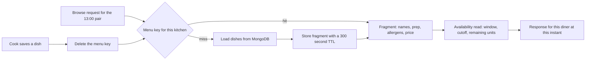

# What may be cached, and what never is

On a Friday at 11:40, forty diners in the same neighbourhood open Sufra within a few minutes. Each one picks the 13:00 lunch window and asks which kitchens can still feed them. The browse aggregation behind that question joins dated windows, kitchens and dishes, and most of the dish data it reads is identical for all forty requests. Umm Yousef's maqluba has the same name, the same ninety preparation minutes, the same nut warning and the same price for every one of them.

The part that is not identical is the part that matters. One diner's checkout can claim the last three units while another is reading. The 11:10 maqluba cutoff passes during the same ten minutes. A cook pauses her kitchen for the day after a gas shortage. A cache that serves the whole browse response makes the repeated reads cheap and makes the marketplace wrong, because it freezes the only values that were supposed to move.

This module draws the line once, in the schema, in the key names and in the tests. Cache the menu. Read availability fresh. Bust the menu when a cook saves a dish. Measure the difference before claiming one, and keep working when Redis is not there.

## The read that repeats and the read that cannot

A kitchen's public menu changes when the cook edits it, which happens a few times a week. It is read by every diner who opens that kitchen, which can be hundreds of times an hour in a busy window. That ratio, many reads for each write, is the condition that makes a cache worth its operational cost. The value is stable enough that a copy can be correct for minutes at a time, and the cost of a wrong copy is bounded, because a menu error is a display error that the cart corrects.

Capacity is the opposite. `remainingUnits` changes with every confirmed claim, and a claim happens far more often than a menu edit. A cutoff is not even stored as a value that changes: it is computed from the window start, the dish's preparation minutes and the travel buffer, and it becomes true at an instant whether or not anything is written. Caching "this dish is orderable" is caching the result of comparing two moving clocks.

Put the two side by side and the rule is almost forced. If the change is triggered by a write you control, a cache is safe, because you can invalidate on that write. If the change is triggered by the clock or by another diner's concurrent request, a cache is a lie with a timer on it.

## What goes in the menu cache

The cached value is a kitchen's public menu fragment: the dish IDs, names, prices in minor units with their currency, preparation minutes, allergen lists, dietary tags and photo URLs that a diner sees on a card or a dish page. It contains nothing about today's windows, nothing about remaining units and nothing about orderability.

A dish page may also be cached, keyed by dish ID with the same version prefix, and it holds the same durable fields plus the description and the cook's note. If the dish page shows "order by 11:30", that line is not part of the cached document. It is rendered from the availability read at request time, even though it sits on the same screen.

Two keys, two shapes, one rule: the menu fragment is an opinion about food, not about today. That separation is what lets you cache it aggressively without teaching the cache about time zones, cutoffs or the capacity counter.

```txt
sufra:menu:v1:{kitchenId}   -> { kitchenId, currency, dishes: [ ... ] }
sufra:dish:v1:{dishId}      -> { dishId, kitchenId, currency, name,
                                 prepMinutes, allergens, priceMinor, ... }
```

The `v1` segment is not decoration. When you change what the fragment contains, you change the prefix, and every old key becomes unreachable in one step. Without it, a deploy that adds a field will serve documents missing that field until each key expires, and the failure will look like a random client bug on some kitchens but not others.



The diagram puts the cache on one branch and the availability read on every response. A hit and a miss converge before the window, cutoff and units are read, so both paths build the same kind of answer and neither can carry a capacity number from five minutes ago. The arrow from the cook's save lands on the lookup rather than on the response, which is why invalidation is a delete and not a rewrite.

## What must never enter it

Four things must never be cached, and each one fails in a different way.

Remaining units fail loudly. A diner reads "few spots left", builds an order, and reaches checkout to a `409 WINDOW_FULL` from a window the screen described as open. In Module 19 you will see the claim refuse cleanly, and the system is correct, but the diner's experience is a promise withdrawn at the last step.

Cutoff state fails quietly. If the cached fragment says maqluba is orderable, a diner sees a dish that closed twenty minutes ago. The cart refuses it and she does not know why, because the browse screen never mentioned preparation time.

Orderable booleans fail in both directions and are worse than either. A stored `isOrderable` field needs a background job to flip it, and that job has to run on every kitchen's clock, for every dish, at every cutoff. When it lags by thirty seconds, the field is wrong for thirty seconds, and no one can say which diners saw which version.

Diner data must never be cached at all, not even with a short TTL. Carts, orders, addresses and tracking state belong to one person. A cache key that forgets the user ID serves Lina's cart to Omar, and that is not a performance defect, it is a privacy incident.

## Invalidate on write, and use a TTL as a backstop

A menu cache without invalidation is a cache with a delay you did not choose. If a cook raises the maqluba price from 45 to 55 shekels and the browse screen shows the old price for five more minutes, the diner is quoted one amount and the cart shows another. That is the exact class of mismatch the course keeps warning about, and a TTL alone cannot prevent it.

So the write paths bust the key. When a cook creates, edits, publishes, hides or deletes a dish, the dish route deletes the kitchen menu key and the dish key after the database write succeeds. When a cook changes a photo, the same path applies, because the photo URL is part of the fragment. Deletion is idempotent and cheap, and the next read rebuilds from MongoDB.

The TTL stays, but its job changes. It is a backstop for the invalidation you missed: a route added later that forgets to bust, a deploy that drops a message, a manual database edit during a demo. Set it in the low minutes, not hours. A five minute backstop means a forgotten invalidation costs a few minutes of stale prices rather than a day.

Order the two operations the same way every time. Write the database first, then delete the key. If you delete first and the database write fails, the next read rebuilds the old value and the cache looks correct while the intended change never happened. If the database write succeeds and the delete fails, the TTL eventually limits the damage and your logs should carry the failed invalidation so you can see it.

## When Redis is down

Every cache is an optimization, so every read path must have an answer that does not need it. Wrap the cache client so a connection error, a timeout or a refused command becomes a miss rather than an exception. The route then reads MongoDB, returns the same answer with a slower response, and logs the degradation once rather than once per request.

This is not a rare scenario in the fellows' environment. A Redis container that was not restarted after a power cut, a managed instance that hit its connection limit, or a network blip on the host are all ordinary. A browse screen that returns 500 because its cache is unavailable has made a dependency out of a convenience, and the diner cannot tell the difference between a broken marketplace and a slow one.

Set a short client timeout, one or two hundred milliseconds, so a hung Redis does not turn every request into a slow request. If you add a circuit breaker, keep it simple: after a few consecutive failures, skip the cache for a short period and try again later. The important part is the fallback, not the sophistication of the breaker.

## Search is an index, not a cache

Dish search looks similar and is a different problem. Lina types "maqluba" or "مقلوبة" and expects the tray from Umm Yousef. That is a query over dish names, and the answer changes when a cook edits a menu, which is the same trigger as the menu cache. But search is solved with an index in MongoDB, not with a cache, because a cache cannot answer a query it has never seen.

The index needs one decision that is specific to Sufra. Dish names arrive in both scripts, and the platform uses English labels with Arabic names in the seed data. MongoDB's text search applies language rules per index, and Arabic is not among the languages it stems. Setting `default_language: "none"` turns off stemming and the stop-word list, so a name is indexed as the tokens the cook typed. That is what we want here, because a dish name is a proper noun more often than it is a sentence.

Search results are then filtered by availability at request time, in the same way the browse cards are. A matching dish from a kitchen that is not cooking in the selected window does not appear, and the filter is not part of the index. Lesson 24.2 builds the index and the route, and the gate asks you to search in both scripts and show the before and after timings for the menu cache.

## What this module builds

The next lesson implements the cache module, the invalidation hook on the dish routes, the text index and the search route, and a small harness that measures menu reads before and after the cache with the database call count beside the latency. The gate asks you to show a saved dish that appears on the next read, a capacity value that never appears in a cached document, and a browse screen that still works with Redis stopped.

Do not start by measuring. Start by deciding what may be cached, because a fast wrong answer is worse than a slow correct one. The test you will write first is not a timing test, it is a test that reads a kitchen menu, changes a dish price through the cook route, reads again and expects the new price. That test fails until the invalidation is wired, and it is the one that stops this module from becoming a story about milliseconds.
