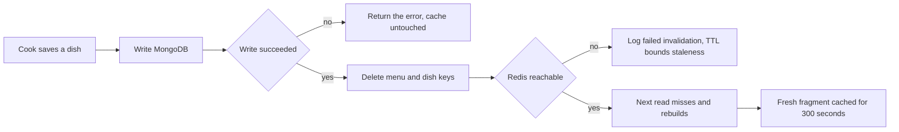

# Cache menus, bust on save, search dishes

Module 11 already has the dish routes, and Module 15 has the browse aggregation. This lesson adds three things in a fixed order: an invalidation test that fails, a cache module that passes it, and a search route over an index that has nothing to do with the cache. Doing them in that order matters. A cache written before its invalidation test is a performance improvement with an unknown staleness window, and nobody can tell you how long a diner sees a wrong price.

The fixture is the one from earlier modules: two kitchens in `Asia/Gaza`, Umm Yousef's maqluba at 4,500 minor units with 90 preparation minutes and a nut warning, and a falafel plate at 2,000 with sesame and gluten. Dish names exist in both scripts, so maqluba carries `name: "Maqluba"` and `nameAr: "مقلوبة"`.

## Start with the test that must fail

Write the test against the current code, before the cache exists. It reads a kitchen menu through the route, saves a new price as the cook, and reads again. With no cache it passes; once you add the cache without invalidation it fails, which is why it belongs in the suite first.

```js
// server/src/modules/menu/menu.routes.test.js
it('serves the new price as soon as the cook saves a dish', async () => {
  const first = await getMenu(kitchenId);
  expect(priceOf(first.body.menu, maqlubaId)).toBe(4500);

  const save = await saveDishAsCook(cookToken, maqlubaId, { priceMinor: 5500 });
  expect(save.status).toBe(200);

  const second = await getMenu(kitchenId);
  expect(priceOf(second.body.menu, maqlubaId)).toBe(5500);
});
```

Run it after the cache is wired but before the invalidation hook, and read the failure. The second read returns 4,500 from Redis while MongoDB holds 5,500. That is the whole defect in one line, and it is the defect that a TTL of five minutes would hide from a short demo and reveal to a diner at 11:58.

## One module owns the keys

Keep every key builder in one file so a typo cannot create a second, permanently stale key. The cache module owns the prefix, the TTL and the fallback, and the rest of the server asks it for a menu rather than calling Redis directly.

```js
// server/src/modules/cache/menuCache.js
const TTL_SECONDS = 300;

export const menuKey = (kitchenId) => `sufra:menu:v1:${kitchenId}`;
export const dishKey = (dishId) => `sufra:dish:v1:${dishId}`;

export async function readMenu(redis, kitchenId, loadFromDb) {
  const key = menuKey(kitchenId);
  try {
    const hit = await redis.get(key);
    if (hit) return { source: 'cache', menu: JSON.parse(hit) };
  } catch (error) {
    logCacheDegraded('menu.get', error);   // a cache failure becomes a miss
  }
  const menu = await loadFromDb(kitchenId); // MongoDB stays the source of truth
  try {
    await redis.set(key, JSON.stringify(menu), { EX: TTL_SECONDS });
  } catch (error) {
    logCacheDegraded('menu.set', error);
  }
  return { source: 'database', menu };
}
```

Three details in that sketch carry the lesson. A read failure returns a miss instead of throwing, so a stopped Redis cannot break browse. The `source` value is returned so the route can set a response header such as `X-Sufra-Cache: cache` or `database`, which the measurement harness reads. And `loadFromDb` is injected, so a test can count how many times MongoDB was actually asked.

The loader is the other half of the contract. It must project durable fields only, which means no windows, no capacity and no computed cutoff.

```js
export async function loadMenuFromDb(kitchenId) {
  const dishes = await Dish.find(
    { kitchenId, status: 'published' },
    { name: 1, nameAr: 1, priceMinor: 1, currency: 1, prepMinutes: 1,
      allergens: 1, dietaryTags: 1, photoUrl: 1 }
  ).lean();
  return { kitchenId: String(kitchenId), currency: dishCurrency(dishes), dishes };
}
```

That projection is an allowlist, not a blacklist. A field added to the Dish schema tomorrow does not enter the cache until someone adds it here, which is the safe direction for a document that other diners will read.

## Bust on save, after the write

The invalidation hook goes in the dish service, immediately after a successful database write, in one place that every dish route already calls. A hook duplicated across create, update and hide routes will drift, and the route added next month will forget it.

```diff
   const saved = await Dish.findOneAndUpdate(
     { _id: dishId, kitchenId },
     { $set: patch },
     { new: true, runValidators: true }
   );
+  if (saved) {
+    await invalidateMenu(redis, saved.kitchenId, saved.id);
+  }
   return saved;
```

Order is part of the design. The database write happens first, and the delete second. A delete before a failed write leaves the cache pointing at the old value and the next read rebuilds that old value, so the cache looks healthy while the cook's change disappeared. A delete after a successful write can fail on its own, and the TTL then bounds the staleness.

```js
// server/src/modules/cache/menuCache.js
export async function invalidateMenu(redis, kitchenId, dishId) {
  const results = await Promise.allSettled([
    redis.del(menuKey(kitchenId)),
    redis.del(dishKey(dishId)),
  ]);
  for (const result of results) {
    if (result.status === 'rejected') logCacheDegraded('menu.invalidate', result.reason);
  }
}
```

The save does not fail when Redis is down. The dish is saved, the cache keeps a stale copy for at most the TTL, and the log records a failed invalidation so the operator can act. Refusing a cook's edit because a cache is unavailable inverts the priorities of the system.



Read the diagram from the second box. Everything after the database write is best effort, and everything before it is the truth. That asymmetry is why the save never waits on a cache decision and why the nightly repair, if you add one, reads MongoDB rather than Redis.

## Prove the fragment carries no time

A payload test is cheap and catches the mistake that matters most. Cache the fragment in a test, stringify it, and assert that the forbidden names are absent. This is deliberately blunt: it fails on a field name anywhere in the document, including one nested inside a dish.

```js
it('never stores capacity or cutoff state in a menu fragment', async () => {
  const menu = await readMenu(fakeRedis, kitchenId, loadMenuFromDb);
  const payload = JSON.stringify(menu.menu);
  for (const field of ['remainingUnits', 'cutoffAt', 'orderableUntil',
                       'capacityHint', 'capacityUnits']) {
    expect(payload).not.toContain(field);
  }
});
```

Add the mirror test for the response. The browse route may be fast with a cache, and its cards must still contain a `capacityHint` and per-dish `orderableUntil` that came from the availability read, not from Redis. Assert that the hint changes when you decrement `remainingUnits` without touching any dish, and that the menu cache header still reports a hit. If the hint does not change, availability is coming from the fragment.

## Measure before and after, honestly

Write a small harness that logs in as a diner, requests one kitchen menu two hundred times, and records three numbers: the median latency, the p95 latency and the number of MongoDB dish reads. Count the reads with a counter inside `loadMenuFromDb`, because local latencies on a laptop flatter the cache and the database call count is the honest measure of what you removed.

Run it three times with the cache disabled, then three times with the cache warm, and keep the median of each. Record the raw output in `docs/cache-decisions.md` beside the commands you used. Do not copy a number from this page, and do not report a single run.

```txt
run      p50 ms   p95 ms   mongo dish reads
before   1        2        200
after    1        2        1
```

The shape of that table is the deliverable, not the values. If your `after` row still shows two hundred database reads, the cache is not being consulted on the path you measured: check the key prefix, the `EX` option syntax for your Redis client version and whether the route calls the loader directly. If the `before` row is already fast, say so and report the database read count as the finding, because on this laptop the query was never the bottleneck.

One more measurement is worth the five minutes: stop Redis and run the harness again. The requests must all succeed, the source header must say `database` and the log must show degradation notices that do not repeat once per request. That run is also the gate's fallback evidence.

## Add the text index and the search route

Search lives beside the menu read and shares its public field allowlist. The index covers both name fields, because MongoDB allows only one text index per collection and a query in either script should find the dish.

```js
// server/src/modules/dishes/dish.model.js
dishSchema.index(
  { name: 'text', nameAr: 'text' },
  { default_language: 'none', name: 'dish_name_text' }
);
```

`default_language: 'none'` is the Sufra-specific decision. A MongoDB text index applies one language's stemming and stop-word rules to every token it stores, and the default language is English. Dish names gain nothing from English rules: Arabic is not a language MongoDB stems, and stopping or merging name tokens can make two different dishes collide. With `none`, each name is indexed as the literal tokens the cook typed, and a query in either script matches the field it came from.

```txt
GET /api/v1/search/dishes?q=مقلوبة&area=gaza-city
                         &startAt=2026-03-03T11:00:00.000Z
                         &endAt=2026-03-03T12:00:00.000Z
  -> 200 { serverNow, query,
           results: [ { dishId, name, nameAr, kitchenId, kitchenName,
                        priceMinor, currency, orderableUntil } ] }
```

The route requires the interval, not just the text, and rejects a trimmed query shorter than two characters with a validation message before it touches the index. A search result without a delivery time cannot say whether the dish is orderable, and returning names with an empty deadline teaches the diner that search is a catalogue. With the interval present, the route runs the text query, then keeps only dishes whose kitchen has a dated window for that pair and whose own cutoff is still in the future on the server clock. That filter is the same Module 14 helper the browse route uses; do not write a second formula.

Run the query with `explain('executionStats')` once and save it, the same way Module 15 did. The text stage should appear with the index name, and the number of examined documents should be far below the total dish count. If the plan shows a collection scan, the index was not created: check that the model file was loaded before the connection opened and that the seed script runs on a database where the index build completed.

## Acceptance criteria

- A dish price saved through the cook route is visible on the next menu read, with no wait for the TTL.
- A cache hit and a cache miss return the same fragment shape, and the response says which one served it.
- The cached fragment contains no capacity, cutoff or orderability field, proven by a payload test.
- Browse cards still show a fresh capacity hint and per-dish deadline while the menu cache reports a hit.
- The harness records p50, p95 and database dish reads for a cold and a warm run, three times each.
- With Redis stopped, every read succeeds from MongoDB and the log records degradation.
- `GET /api/v1/search/dishes` finds a dish by its Latin name and by its Arabic name, and never returns a dish from a kitchen that is not cooking in the requested window.

Save the failing test output, the diff, the harness table, the search plan and the fallback run in `docs/cache-decisions.md`. The gate next asks you to demonstrate all four in one sitting, with the saved dish change visible, the forbidden field absent, the timings recorded and Redis stopped mid-demo.
