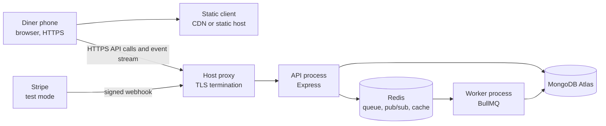

# Deploy the API, worker and client

Lina opens the link at 11:40, standing in a queue with one bar of signal. The page stays white. On your laptop the same release works: the client compiles, the API answers, the cook board fills with today's orders, and a Stripe test card produces two kitchen orders. The code is fine. The difference is the shape of the machine it runs on, and this module changes that shape.

Production is not a bigger laptop. It is a set of separate processes with public names, private credentials and clocks you do not control. Sufra needs three parts: an API process, a worker process and a static client. It also needs two managed services, MongoDB and Redis, plus Stripe for payment. Each piece has its own failure mode, and most first deploys fail at the seams between them rather than inside the code you wrote.

## What the laptop quietly provides

When you run `npm run dev` in two terminals, your machine supplies things you never configured. The browser trusts `http://localhost`, so no certificate is needed. The Vite dev server compiles files on demand, so a stale build is impossible. Both Node processes share one filesystem and one environment file, so the API and the worker cannot disagree about a queue name. MongoDB listens on `127.0.0.1:27017` with no network rule, and Redis accepts connections without a password. The Stripe CLI forwards webhooks to your laptop through a tunnel, so a public callback URL never has to exist.

None of that survives a deploy. The API must listen on the port the host assigns, not a fixed 4000. The client is built once and frozen, so its API address must be correct at build time. The database sits on another network and requires a credential plus an allowlist entry for the host's outbound address. Redis arrives as a URL with a password inside it. Stripe needs a real HTTPS endpoint before it will send a single event. The worker must be started by the host's supervisor, because nothing you type in a shell survives a restart.

That last point decides more gates than any other. If you start the worker with a background shell command inside the web service, you have not deployed a worker. The next restart removes it, cook notifications stop, hold expiry stops, and the deploy log still says green. Treat the worker as its own service with its own start command, its own logs and its own restart policy.

## The shape Sufra runs in

The diagram shows the pieces a deployed Sufra has. Follow the arrows: every browser call is HTTPS; the client is a folder of static files; the API owns all database and queue access; the worker has no public port at all.

Read the diagram for what is missing as much as for what is present. The browser never connects to MongoDB or Redis. The worker never receives a request from the internet. Stripe reaches the API through the same public host as the diner, which means the webhook travels through the same proxy, the same TLS certificate and the same body parsing rules as every other request. If you later add a rule that rewrites or buffers responses, it applies to payments too, and a buffered webhook is a payment that arrives late.

The event stream crosses the most layers, and it is the part of Sufra most likely to misbehave after deploy. A normal HTTP response ends, so a proxy can read it whole, compress it and send it on. A `text/event-stream` response does not end. It stays open for minutes while the cook moves an order from accepted to cooking. A proxy configured for buffering will collect those bytes and forward them when it has a block of them, which looks to Lina like a tracking screen that updates every thirty seconds or not at all. M25.02 fixes that at three layers: the API, the proxy and the compression middleware.

## Pick one host and write the decision down

You have two realistic paths. A platform such as Render or Railway runs the API and the worker as two services from one Git repository and gives you HTTPS, logs and restarts in a dashboard. A single virtual private server gives you a Linux machine where you install Node, a reverse proxy such as Caddy or Nginx, and a process manager such as PM2 or systemd. Both can host Sufra correctly. They fail differently, and the failure you can debug is the one to choose.

The platform path buys speed and removes certificate renewal from your week. It costs visibility: when the stream stalls, you cannot open a proxy configuration file, because the proxy belongs to the provider. You can still add response headers, and you can still prove the behaviour with the timing test in 25.02. The server path buys control and a stronger explanation in the viva, because you can show the exact directive that turned buffering off. It costs time on operating system updates, firewall rules, certificate renewal and a supervisor unit that starts on boot.

The alternative worth naming is a static host for the client plus a platform for the API and worker. That split is normal, and it creates one specific problem: the client and the API sit on different registrable domains, so an authentication cookie needs `SameSite=None; Secure` to travel between them, and some browsers restrict third-party cookies. If you can serve the client and the API from the same site, do that. If you cannot, expect to spend an hour on cookies and record what you chose.

Whatever you pick, confirm one thing before you build on it: has this host been tested with a long-lived streaming response on the plan you are paying for? A provider can be excellent for short API calls and still cut an idle connection at sixty seconds, or route through a proxy that does not forward a flush. Your instructors record this answer for each cohort, and the same answer belongs in your own `docs/deploy-decisions.md` with the date you checked. Do not discover it during the demo.

## The deploy contract for Sufra

Write these promises at the top of your README before you deploy anything. They are the gate, and they are also the checklist you run after every later release.

1. Client and API both answer on `https://` origins. An `http://` link fails, because cookies marked `Secure` and a professional demo both need the padlock.
2. Every credential lives in the host's environment settings. No secret is in Git, in the client bundle, or in a screenshot.
3. The API and the worker run the same Git commit. A queue name that changed in one and not the other produces jobs that never run.
4. The API binds `process.env.PORT`, and its readiness route fails when a required dependency is unavailable.
5. The Stripe webhook points at the deployed HTTPS origin and its signing secret matches that endpoint.
6. The browser can log in, order and track across the deployed origins, with the correct CORS origin and cookie attributes.
7. The event stream reaches the phone as it is written, with a heartbeat shorter than any idle timeout in front of it.
8. Restarting the API or the worker leaves no diner with a broken page and no paid order without a kitchen.

The list is short on purpose. Each line has a test in this module, and each test produces evidence you can paste into the gate. A deployment that satisfies "the deploy log is green" and none of these eight lines is not deployed; it is uploaded.

## The failures you will actually meet

The first failure is usually a white page. The client was built without `VITE_API_URL`, so the bundle calls `http://localhost:4000` from Lina's phone, where nothing is listening. The second is a blocked login: the API still allows only `http://localhost:5173`, so the browser refuses the response and the console shows a CORS error while curl works perfectly. The third is a login loop: the refresh cookie is `SameSite=Lax` across two different sites, so the browser declines to send it and the client retries forever.

Then come the quieter ones. Stripe charges the card but no order appears, because the webhook secret belongs to a different endpoint and every event fails signature verification. A cook sees nothing, because the worker is not running or points at a different Redis database number. The browse page spins, because the new host's outbound address is not on the Atlas allowlist. The tracking screen shows the status from two minutes ago, because the proxy buffered the stream and the heartbeat is sitting in a zlib buffer.

Each of these has one diagnostic move: look at the layer that owns the failure. A browser network tab shows CORS and cookie problems. A curl against `/health` shows API and database readiness. Worker logs show queue consumption. A timestamped stream probe shows buffering, because bytes that arrive in one burst every thirty seconds are a buffering problem, not a slow cook.

## What done looks like

Done means a URL a stranger can open on a phone, a paid test order that both cooks can see, a stream that updates while a cook taps, and a restart that heals itself. It does not mean a green dashboard, a screenshot of a deploy log, or a localhost address with the port changed.

This module does not teach autoscaling, zero-downtime releases, database backups or alerting. Sufra runs one API instance and one worker instance, which is enough for the cohort and honest for the viva. Backups and alerting are the first two things to add in a real launch, and saying that out loud is better than pretending the deploy is production grade.

The next lesson performs the deploy. It sets the environment, builds the client against the deployed API, starts the worker as a supervised process, verifies the stream through the proxy, and restarts the API while a diner is tracking an order.
