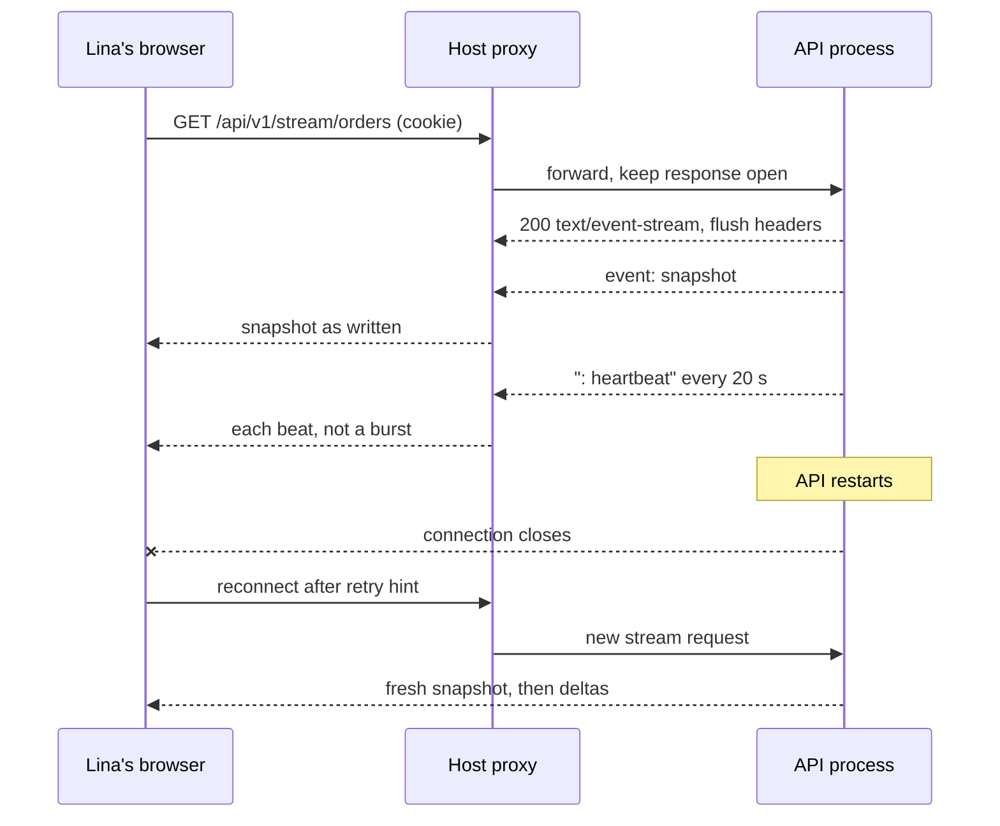

# HTTPS, secrets, and streams in production

This lesson performs the deploy. It has two halves that fail for different reasons. The first half is ordinary: build the client against the deployed API, start the API and the worker under a supervisor, put both behind HTTPS, and check that a diner can log in and a cook can see an order. The second half is specific to Sufra: one of its responses never ends. Lina's tracking screen holds a `text/event-stream` connection open for the length of a lunch window, and every layer between the API and her phone must pass bytes through instead of collecting them.

Do the halves in order, but do not treat the second as optional polish. A deploy where checkout works and tracking silently buffers passes every test a browser refresh can hide. You will prove the stream with timings, from outside the host, before you call this done.

## Build one release from one commit

Start by tagging the commit you intend to deploy. The API, the worker and the client must be built from it, because a queue name or a payload shape that differs between the API and the worker produces jobs that are enqueued and never consumed. Write the revision into your deploy notes before you start, so a rollback has a target that is not "something older".

Pin one Node major before you deploy and use it on every service. Record it in `engines` in `package.json`, and check the Node release schedule for the current LTS instead of copying a version from a blog post. This course's examples assume Node 22 LTS or newer, with the npm version that ships with that major. Use the lockfile's package manager, because mixing `npm install` and `npm ci` in one project can install a tree that never existed on your laptop.

```bash
# API service
npm ci --omit=dev
node src/server.js            # binds process.env.PORT

# Worker service, same commit, same env file
npm ci --omit=dev
node src/worker.js

# Client, built where the API URL is known
VITE_API_URL=https://sufra-api.onrender.com npm run build
# then upload client/dist to the static host
```

The client build is the step most people rush. `VITE_API_URL` is read at build time and compiled into the bundle, so a client built without it falls back to whatever local default the code contains. Check the built file rather than the source: `grep -r "localhost" client/dist/assets | head` should print nothing. That single command prevents the most common white page in this module.

## Put every credential in the environment

Production configuration is a list of names, and the values live in the host's settings. The API and the worker need the same database and Redis values; only the API needs the payment and webhook secrets, because only the API receives Stripe events. The worker still needs `MONGODB_URI` if its processors load orders.

| Key | Used by | Where the value comes from |
|---|---|---|
| `MONGODB_URI` | API, worker | Atlas connection string for a production database user |
| `REDIS_URL` | API, worker | Managed Redis URL with its password |
| `JWT_ACCESS_SECRET`, `JWT_REFRESH_SECRET` | API | Fresh random values, never the development ones |
| `STRIPE_SECRET_KEY` | API | Stripe test-mode secret key |
| `STRIPE_WEBHOOK_SECRET` | API | The signing secret of the deployed webhook endpoint |
| `CLIENT_ORIGIN` | API | The deployed client origin, used for CORS and cookies |
| `PORT` | API | Assigned by the host on most platforms |
| `TZ` | API, worker | `UTC`, so the host's region cannot move a cutoff |

`TZ=UTC` is not cosmetic. Sufra computes cutoffs from the kitchen's IANA zone stored in MongoDB, and it stores instants in UTC. A host whose process runs in another local zone will still be correct if the code is disciplined, but one accidental `new Date()` formatting call can shift a label by two hours and make a 12:00 cutoff look like 14:00. Fixing the process zone removes a class of bug you cannot reproduce on your laptop.

Two checks belong before the first deploy, not after. First, confirm no secret was ever committed: `git log -S 'sk_test_' --oneline --all` and `git log -S 'MONGODB_URI' --oneline --all` should return nothing. If they return a commit, rotate the key. Deleting the file in a later commit does not remove it from history. Second, confirm `.env` is ignored and that `.env.example` holds names only. A `VITE_` prefix makes a variable public, because it is inlined into the browser bundle, so `VITE_STRIPE_SECRET_KEY` would publish your payment key to every visitor.

Rotate the access and refresh secrets for production even if nothing leaked. A development secret that has appeared in a screen recording or a pasted error message is no longer secret, and rotating costs one redeploy while it invalidates every existing session.

## Start the worker as a supervised process

On the platform path, create a second service from the same repository and set its start command to `node src/worker.js`. It needs no public port and no health URL, but it does need the same `REDIS_URL`, the same database and the same commit. On a server, run it under PM2 or systemd as a second unit with the same environment file, and enable it so a reboot brings it back.

The evidence that the worker is correct is not its startup banner. It is one consumed job. Place a test order after the worker is up, tail its logs during the checkout, and match the job identity to the order. If the API returns 201 and the worker prints nothing, compare the Redis URL fingerprints, the queue name and the two revisions before you change any code.

Readiness deserves one decision. Your `/health` route should return success only when the API can reach the database. Whether Redis failure blocks readiness or degrades the service is a choice: Sufra can still serve browse and login without Redis, but checkout enqueues work and tracking fan-out uses pub/sub. For this course, report Redis state in the health body and fail readiness on database loss only, then state that choice in `docs/deploy-decisions.md`. A readiness route that always returns `ok` teaches you nothing during an incident.

## HTTPS is not finished until the browser agrees

Certificate and domain setup produce a padlock, and that is the easy part. The parts that break are CORS and cookies. Set `CLIENT_ORIGIN` to the deployed client origin, keep the credentials flag on, and decide the cookie attributes from the actual relationship between the two origins. If the client and API share a registrable site, `SameSite=Lax` works and is safer. If they do not, the refresh cookie needs `SameSite=None; Secure`, and you should test the login flow in the browser you expect Lina to use, not just in curl. A curl request that carries a cookie by hand proves nothing about whether a browser will store it.

Point the Stripe webhook at the deployed API origin, then copy that endpoint's signing secret into `STRIPE_WEBHOOK_SECRET`. The secret is per endpoint, so a value from a local CLI tunnel will reject every production event with a signature error. The symptom is specific and easy to misread: the card is charged in test mode, the attempt stays at `awaiting_payment`, and no cook sees an order. Check the API log for the signature failure before you debug the payment logic, which was already proven in M20.

Also confirm the raw body is preserved for the webhook path. A JSON body parser mounted before signature verification will re-serialize the payload, change its bytes, and invalidate the signature. That ordering was correct in development; a new host can tempt you to move middleware around while you fix CORS.

## The response that never ends

M23 built the stream. It sends a snapshot of the diner's active orders on connect, then deltas, with comment heartbeats to keep the connection alive. This module is where the stream meets a proxy, and the proxy is where it usually dies. The handler's job in production is to declare the response's nature and to flush it, not to wait until a buffer fills.

```js
// server/src/modules/stream/stream.routes.js, shape only
router.get('/api/v1/stream/orders', requireAuth, (req, res) => {
  res.status(200);
  res.setHeader('Content-Type', 'text/event-stream; charset=utf-8');
  res.setHeader('Cache-Control', 'no-cache, no-transform');
  res.setHeader('Connection', 'keep-alive');
  res.setHeader('X-Accel-Buffering', 'no');   // Nginx: do not buffer this response
  res.flushHeaders();
  // M23 owns the rest: authorize, write the snapshot, then deltas,
  // plus a ': heartbeat' comment every 20 seconds and a cleanup on req.close
});
```

Four details in that shape matter. `no-transform` tells intermediaries not to re-encode the body. `X-Accel-Buffering: no` is the header Nginx reads even when you cannot edit its configuration, which is the normal case on a platform. `flushHeaders()` sends the status line and headers immediately, so the browser's `EventSource` fires `open` instead of waiting for the first event. The heartbeat interval, 20 to 25 seconds here, must be shorter than the smallest idle timeout in front of it; many proxies cut an idle connection at 30 to 60 seconds, and the first symptom is a stream that reconnects every minute.

The sequence below shows the whole path, including the part this lesson tests. The proxy is a participant, not a wire.



The restart at the bottom is the second half of the gate. `EventSource` reconnects on its own after the delay in your `retry:` field, so the client needs no reconnect code and the server needs no session to resume. What it does need is a snapshot on every connect, so the reconnecting phone learns the current status instead of waiting for the next change. The client drops events it already applied by comparing order id and sequence, which is why a replayed delta after reconnect does not duplicate a timeline row.

## Three layers that will buffer you

The first layer is your own compression middleware. The `compression` package, version 1.7 or later, compresses `text/event-stream` because the MIME type is in its compressible list, and compression holds bytes until it has enough of them. A heartbeat of six bytes can sit in the zlib buffer indefinitely. Either skip compression for stream responses or call `res.flush()` after every write, which is the method that middleware adds to the response. The diff below is the safer of the two, because a skipped stream is uncompressed but always timely:

```diff
-app.use(compression());
+app.use(compression({
+  filter: (req, res) => {
+    const type = String(res.getHeader('Content-Type') ?? '');
+    return !type.startsWith('text/event-stream') && compression.filter(req, res);
+  },
+}));
```

The second layer is the proxy. On Nginx 1.26, the location that serves the stream needs buffering off, caching off, compression off for that response, and a read timeout longer than an idle lunch window:

```nginx
location /api/v1/stream/orders {
    proxy_pass http://127.0.0.1:4000;
    proxy_http_version 1.1;
    proxy_set_header Connection '';
    proxy_buffering off;
    proxy_cache off;
    gzip off;
    proxy_read_timeout 3600s;
}
```

Caddy does the right thing for this case: its documentation states that a response with `Content-Type: text/event-stream` is flushed immediately, whatever `flush_interval` is set to. On a platform you cannot edit either file, so the `X-Accel-Buffering` header plus the timing test is your whole defence. That is why the test matters more than the configuration.

The third layer is the browser's own connection handling, and here the fix is a heartbeat rather than a setting. Some mobile networks drop an idle connection after a minute even when the server never closes it. A comment line every 20 seconds keeps the connection visibly active on both sides. Comments are ignored by `EventSource`, so the heartbeat costs bandwidth and nothing else: about twenty bytes every 20 seconds, which is affordable on the connection Lina has.

One browser limit belongs in your deploy notes. Over HTTP/1.1 a browser allows about six connections per origin, so a diner who opens several Sufra tabs can exhaust them and stall the page. HTTP/2 negotiates a much larger limit. This is one more reason M23 serves one stream per user rather than one per order, and one more thing to check on the host: whether the stream is served over HTTP/2.

## Prove the stream with timings

A screenshot of a tracking page proves that one update arrived, not that the connection is live. Write a probe that measures arrival times from outside the host and fails when they are wrong. The version below is partial on purpose: it reads the raw body, records when each heartbeat comment arrives, and asserts two things that buffering cannot fake.

```js
// scripts/stream-probe.mjs, partial
const t0 = Date.now();
const res = await fetch(`${BASE}/api/v1/stream/orders`, {
  headers: { cookie },
  signal: AbortSignal.timeout(60_000),
});
if (res.headers.get('content-encoding')) fail('stream is compressed');
const reader = res.body.getReader();
const decoder = new TextDecoder();
let firstFrame = 0;
const beats = [];
for (;;) {
  const { value, done } = await reader.read();
  if (done) break;
  const text = decoder.decode(value, { stream: true });
  if (firstFrame === 0) firstFrame = Date.now() - t0;
  for (const line of text.split('\n')) {
    if (line.startsWith(': heartbeat')) beats.push(Date.now() - t0);
  }
  if (beats.length === 2) break;
}
assert(firstFrame < 3_000, 'first frame within 3 s');
assert(beats[1] - beats[0] > 15_000, 'heartbeats are spaced, not batched');
```

Run it before you change anything. A buffered deploy produces output like this, and the gap in the last line is the diagnosis:

```text
FAIL stream-probe: stream is compressed
  first frame at 30041 ms (limit 3000)
  heartbeat #1 at 30041 ms, heartbeat #2 at 30043 ms (gap 2 ms)
```

Bytes that arrive together after thirty seconds are not a slow server. They are one buffer releasing. Fix the compression filter first, because it is in your repository, then re-run. If the compression header is gone but the batch remains, the proxy is holding the response and `X-Accel-Buffering` plus a provider setting are the remaining levers. When it passes, the output shows a first frame in well under a second and two heartbeats about twenty seconds apart.

Also read the headers once with curl, because a header you believe you set is sometimes not the one that leaves the process. Copy your own session cookie from the browser into `SUFRA_COOKIE` first; never paste a token into a file you commit:

```bash
curl -sS -N -D - --cookie "$SUFRA_COOKIE" \
  https://sufra-api.onrender.com/api/v1/stream/orders | head -20
```

Look for `content-type: text/event-stream`, `cache-control: no-cache, no-transform`, and no `content-encoding`. A `200` with `content-type: application/json` means the request never reached the stream route, usually because the cookie or the auth guard rejected it and the error handler answered instead.

## Restart the API while a diner is tracking

Open the tracking screen for an order that is `cooking`. Start a terminal probe against the same stream so you have timestamps that do not depend on your eyes. Then restart the API: `pm2 restart sufra-api` on a server, or the restart control on the platform service. Do not restart the client host and do not touch the worker.

The API's log should show the first stream connection closing and a second one opening within about `retry` milliseconds plus the handshake. The screen should move from its live label to reconnecting and back, and the timeline should show the current status once, not twice. Then ask the cook to advance the order to `ready`. The new status should arrive on the second connection, which proves the subscription was rebuilt rather than only the page reloaded.

Three numbers belong in your evidence file: the time the restart was issued, the time the second connection was accepted, and the time the diner saw the post-restart status. A gap of a few seconds is normal. A gap of a minute means the client's retry hint is longer than you intended or the browser gave up, and a screen that stays on reconnecting means the cookie is not being sent on the reconnect request, which is a cookie problem rather than a stream problem.

## Record what you changed

Add four entries to `docs/deploy-decisions.md`: the host and plan, with the answer to whether long-lived streams were tested there; the environment key list with the source of each value and no values; the compression and proxy changes with the reason for each; and the restart test with the three timings. Then update the README's deploy section so a reader can repeat the release without reading this lesson. The gate uses all of it, and the docs you write now become the evidence file in M99.

References: [Nginx proxy_buffering](https://nginx.org/en/docs/http/ngx_http_proxy_module.html#proxy_buffering), [Caddy reverse_proxy streaming](https://caddyserver.com/docs/caddyfile/directives/reverse_proxy), [MDN using server-sent events](https://developer.mozilla.org/en-US/docs/Web/API/Server-sent_events/Using_server-sent_events).
