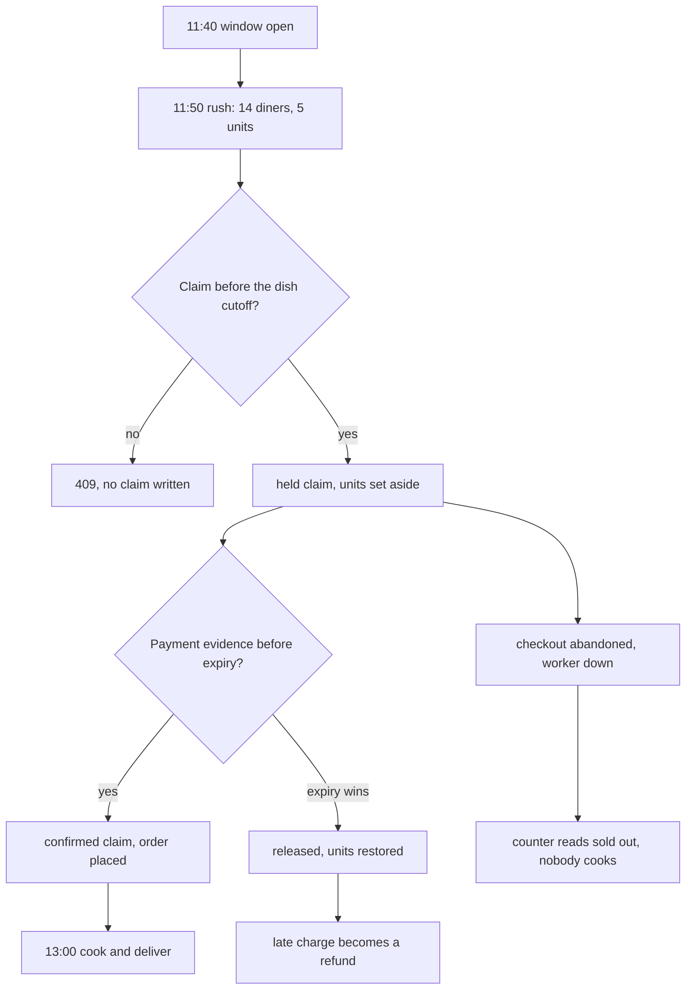

# The Friday lunch rush

Friday is the busiest lunch in Gaza, and Umm Yousef cooks for the 13:00 window. Her kitchen has five load units for that window. Maqluba uses three, falafel uses two, and that is the whole arithmetic of her afternoon. At 11:40 the window is open for orders. By 11:50 fourteen diners have looked at it, six have pressed checkout, and most of those were refused because the window no longer had two units to give.

The cook sees almost none of that. Her board shows placed orders, not claims. At 11:52 she sees one falafel order, which is two units, and she starts a batch. The counter says one unit remains, so she assumes there is room for a little more. There is not: nothing on her menu costs one unit. The number is true and useless, which is the small arithmetic fact this module keeps returning to.

## The diner's side is mostly waiting

Lina opens Sufra at 11:49 on a phone with two bars of signal. She picks today's 13:00 window and sees Umm Yousef's kitchen with the maqluba and a falafel wrap. The cart tells her the maqluba cutoff was 11:10, so that dish is gone; only the falafel remains orderable. She keeps the wrap and presses checkout. Her two units are now held.

Omar opens the same kitchen at 11:50. The card says one spot left. He picks a falafel wrap and presses checkout, and the server refuses: a falafel needs two units and one remains. Meanwhile Lina's bank asks for a confirmation code by SMS, and the message takes ninety seconds. Her hold survives the wait until the falafel cutoff at 12:00. If she abandons it at that instant, the unit it returns is already useless, because the window stops taking orders then too. Neither diner can see the other. Both screens say something true and incomplete.

This is the shape of a rush. It is not a thousand requests per second; it is a handful of people arriving in the same ten minutes, several of them pausing in the middle for a bank. Capacity is claimed before payment and confirmed after it, so the window's counter is a record of intentions as well as a record of food.

## The cook's side is a promise list

Umm Yousef's phone shows the orders she must cook, grouped by window, with the acceptance deadline from M22 and a "start cooking by" time derived from each dish's preparation time. She does not see held claims, and that is deliberate. A claim is another diner's unfinished purchase, and showing it would ask her to plan around money that may never arrive. She sees one placed order and starts.

The gap between what she sees and what the counter holds is where this module's problems live. A hold can sit on her window while an order is already placed, and another diner can be refused while that hold is still unpaid. Her board and the diner's browse screen are describing the same five units from two different angles, and nobody is comparing them. A claim that never confirms and never releases keeps a unit out of circulation while no food is cooked, and her board stays quiet because nothing was placed.

## Two families of failure

Once M19's atomic claim is in place, overbooking becomes rare. The counter is decremented in one conditional update, and two checkouts cannot both pass a filter that requires enough remaining units. The failure that survives a correct claim is the opposite one: units that are subtracted and never returned. Under a rush, that failure is common, because a rush is exactly when holds are created and abandoned.

The first family is a double promise. The counter goes down twice for one order, or a claim is created without a decrement, or a release adds units that were never subtracted. The window now promises more food than the kitchen can cook. Some diners will be told their order is placed and the cook will not have time. This family is loud: it produces a bad lunch and an argument.

The second family is a stuck unit. A hold is created and the diner disappears, and the expiry worker does not run or loses the race with a crash. A release increments the counter twice, so the number is higher than the truth and the next claim overbooks. A confirmation arrives for a claim whose counter was already restored, so the order exists with no capacity behind it. Most of this family is quiet: the counter drifts, browse shows fewer units than exist, and diners see "few spots left" while nobody is cooking.

The diagram follows one unit through a rush. Two exits from a held claim are legitimate, and one path leaks.

The leak at the bottom is not a missing feature. Every piece exists: the claim has a deadline, the worker releases it, and the release is idempotent. The leak is a failure of the pieces to agree, and it is invisible from either phone. Only a comparison between the counter and the claims reveals it.

## Why the rush is different from the test

The M19 test ran twenty parallel checkouts against a ten-unit window on a laptop. It proved that the conditional update works: exactly the units that fit were granted, the rest received a clean conflict, and the counter never went below zero. That test is necessary and it is not sufficient.

Three things change in production. The requests arrive through a proxy, so their interleaving is different and slower. The database is on another machine, so a read and a write in the same request may straddle another request's write. And the process can restart in the middle of a rush, which is exactly when the expiry worker is most likely to be behind. A local run that finishes in 400 milliseconds never exercises the window where a restart loses a delayed job.

The clock changes too. A laptop run happens at whatever time you start it, and a test that places an order at 11:09 is not the same test as one that places it at 11:10:00. The cutoff boundary is one second wide and it decides whether a kitchen is asked to cook something it cannot deliver by 13:00. This module tests that second from both sides.

## The numbers this module uses

Every figure here is illustrative and chosen to make the arithmetic visible, not measured from a real kitchen. The window has ten units for the load runs, because ten divides evenly by a two-unit falafel and gives a clean ending at zero. A single falafel order claims two units, so twenty requests for one wrap each oversubscribe the window four times: five can succeed and fifteen must fail. A mixed run with a three-unit maqluba produces a one-unit remainder that no dish can use, which is the arithmetic reason a counter can read one while the window is effectively full.

The cutoff run uses a 13:00 window with a 12:00 general cutoff and a maqluba with ninety minutes of preparation and a twenty-minute travel buffer, which puts its own cutoff at 11:10. Those are the same defaults as the window fill canvas in M14, so the numbers in the canvas match the numbers in the test. The race run places one checkout at 11:09:59 and one at 11:10:00 and asserts that only the first is accepted.

## What the module proves

By the end you will have four artefacts: a reconciliation job that compares each window's counter with its claims and repairs safe drift, a parallel checkout log from the deployed app, a cutoff race at one second either side of the boundary, and a written note explaining what each result means. The job is the part that turns a rush from a hope into an operation.

The gate asks for those four artefacts together, because each one alone can pass while the system is wrong. A load run passes when nothing else is happening. A cutoff test passes when the hold expiry is broken, because it never waits for a hold. A reconciliation report passes when the database was seeded by hand and never raced. Only the combination shows that the window's arithmetic survives people, time and restarts.

## What this module does not prove

It does not prove that the payment provider stays available, that the mobile network is stable, or that one API instance can serve a city. It runs on a deployed app with a small, declared load and a fake clock, and it measures correctness rather than throughput. If you want throughput numbers later, that is a load test with a different question and a different tool.

The next lesson puts the two clocks side by side. A hold can be made before a cutoff and paid after it, and the decision about what happens then is the difference between a promise Sufra can keep and one it cannot.
