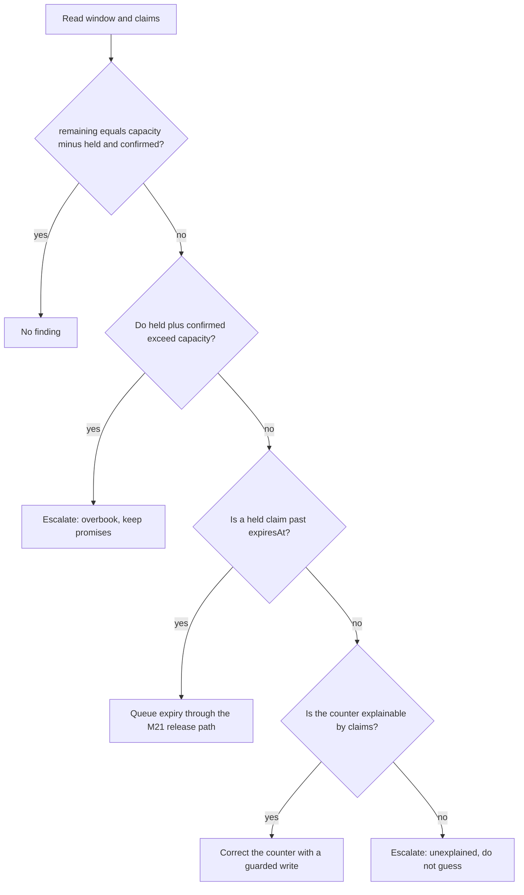

# Reconcile claims and prove the race

A window counter is a summary, and summaries drift. The claims in the same document are the detailed record, so the two can be compared at any moment. This lesson builds that comparison into a job, then uses it to check the results of two live experiments: twenty parallel checkouts on the deployed app and a checkout one second either side of a dish cutoff.

Do them in this order. The reconciliation job is how you know what the other two experiments left behind. A load run that looks clean but leaves a counter two units above its claims has not passed; it has hidden a defect until the next lunch.

## One equation for every window

For any dated window, the counter, the capacity and the claims satisfy one equation. `remainingUnits` equals `capacityUnits` minus the sum of units on claims whose state is `held` or `confirmed`. A `released` claim contributes zero but stays in the array, because it explains what happened to those units and support will ask later.

Three preconditions make the equation meaningful. `capacityUnits` is set when the window is generated and never edited afterwards, because a cook who lowers capacity mid-window must go through a cancellation flow rather than a silent edit. A claim's `units` never changes after creation, so a later dish edit cannot rewrite history. And every claim for a window lives in that window document, which is why M19 bounded the array and documented an archive policy. If a claim existed somewhere else, the equation would compare a counter with an incomplete list.

With the equation in place, each direction of mismatch names a different bug. A counter that is lower than the equation predicts means units were subtracted and not all were returned, or one subtraction was made twice. Diners see a full window and the kitchen cooks less than it could. A counter that is higher means units were returned twice or a subtraction was skipped. The window can oversell on the next claim. A negative counter means the conditional claim filter was bypassed. And a window whose held plus confirmed units exceed its capacity is an overbook, which is a promise problem and not an arithmetic one.

The last case needs its own category because the repair is not symmetric. Reducing `remainingUnits` in an overbook would only make the counter agree with a broken promise. The promises already made must stand, so an overbook is escalated with the window, the claim IDs and the amount, and a person decides which order to move to another window.

## A scan that explains before it fixes

The job reads a bounded set of windows, recomputes the equation, and writes one finding per mismatch. Keep the window selection small: yesterday, today and the next two days are enough for a lunch product, because older windows are history and future windows are empty. The finding is a document, not a log line, so a person can review it later.

```js
// server/src/modules/capacity/reconcile.js, shape only
export async function reconcileWindow({ Window, Finding, windowId, mode, now }) {
  const window = await Window.findById(windowId).lean();
  if (!window) return { kind: 'MISSING_WINDOW' };
  const held = sumUnits(window.claims, 'held');
  const confirmed = sumUnits(window.claims, 'confirmed');
  const expected = window.capacityUnits - held - confirmed;
  const observed = window.remainingUnits;
  // classify, then decide: fix, queue expiry, or escalate
}
```

The finding records `windowId`, `kitchenId`, `startAt`, `capacityUnits`, `observedRemaining`, `expectedRemaining`, `delta`, the claim IDs grouped by state, `detectedAt`, `action`, and a `mode` of `dry_run` or `repair`. The action is one of `fixed`, `queued_expiry` or `escalated`, and each one has a different meaning in the report.

The decision tree below is the whole policy. Note that only two branches write to the counter.



The order of the questions matters. Expiry comes before correction because a held claim past its deadline will change the counter legitimately, and repairing first would double count its units when the release runs. The overbook question comes first because an overbook makes every later comparison meaningless.

## Repair with a guarded write

A repair that reads the equation and then writes an absolute value can erase a claim that landed between the read and the write. That is not hypothetical: the reconciliation job runs during lunch, which is the busiest time for claims. The fix is a compare-and-set on the two values the calculation depended on.

Every claim mutation increments a `claimsVersion` field on the window, alongside its `remainingUnits` change. The repair then writes only if the counter and the version still match what it read. If the write matches nothing, the job does not retry blindly; it re-reads and recomputes, because the situation has changed.

```diff
-// repair overwrites a concurrent claim
-await Window.updateOne({ _id: windowId }, { $set: { remainingUnits: expected } });
+// repair applies only to the exact state it explained
+const applied = await Window.updateOne(
+  { _id: windowId, remainingUnits: observed, claimsVersion: observedVersion },
+  { $set: { remainingUnits: expected }, $inc: { claimsVersion: 1 } },
+);
+if (applied.modifiedCount === 0) return { kind: 'STALE_OBSERVATION' };
```

The test below is the one that fails against the first version of that code. It is worth running before you change anything, because the failure is a silent one in production: the only visible symptom is a counter that disagrees with the claims minutes later.

```js
test('repair keeps a claim that lands after the scan', async () => {
  const w = await seedWindow({ capacityUnits: 10, remainingUnits: 10, claimsVersion: 0 });
  const observed = await readWindow(w._id);       // remaining 10, version 0
  await claimUnits(w._id, 2);                     // concurrent: remaining 8, version 1
  await reconcileFrom(observed);                  // repair uses the stale read
  assert.equal((await readWindow(w._id)).remainingUnits, 8);
});
```

```text
FAIL repair keeps a claim that lands after the scan
  expected 8, received 10
  the repair wrote an absolute value and erased the concurrent claim
```

Run every repair in dry-run mode against a day of windows before you enable it. Read the findings by hand. A finding you cannot explain from the claims is a bug in the scan, not in the window.

## Run twenty checkouts against the deployed app

The load run exists because localhost interleaving is not production interleaving. A laptop finishes a checkout in tens of milliseconds, so the requests rarely overlap; through a proxy and a remote database they overlap for hundreds of milliseconds, which is when conditional updates and timeouts actually compete.

Use a test window with ten units and a dish that costs two units. Create twenty test diners in the seed data, because each diner has one cart and one attempt at a time. The script takes the deployed origin, the window ID and a concurrency count, and it records what the server answered.

```bash
node scripts/parallel-checkout.mjs \
  --base=https://sufra-api.onrender.com \
  --window=66a1f0c2b7d4c9a1e2f30001 \
  --diners=20 --dish=falafel \
  --out=docs/evidence/load-run-1.json
```

The script builds all twenty requests first, then releases them together, so the server sees a burst rather than a queue built by the client. Each request carries its own idempotency key and its own diner cookie. The response for a winner contains an attempt ID and a claim ID; the response for a loser contains a stable code that should be `WINDOW_FULL`.

```text
req  status  code          units  attempt            remaining
01   201     OK            2      att_9f2a           8
02   201     OK            2      att_9f2b           6
03   409     WINDOW_FULL   -      -                  6
04   201     OK            2      att_9f2c           4
05   409     WINDOW_FULL   -      -                  4
06   409     WINDOW_FULL   -      -                  4
07   201     OK            2      att_9f2d           2
08   409     WINDOW_FULL   -      -                  2
09   409     WINDOW_FULL   -      -                  2
10   409     WINDOW_FULL   -      -                  2
11   409     WINDOW_FULL   -      -                  2
12   409     WINDOW_FULL   -      -                  2
13   409     WINDOW_FULL   -      -                  2
14   409     WINDOW_FULL   -      -                  2
15   409     WINDOW_FULL   -      -                  2
16   409     WINDOW_FULL   -      -                  2
17   409     WINDOW_FULL   -      -                  2
18   409     WINDOW_FULL   -      -                  2
19   409     WINDOW_FULL   -      -                  2
20   201     OK            2      att_9f2e           0
```

The assertions are what make this evidence rather than a screenshot. Exactly five requests succeed, fifteen receive a conflict, the granted units total ten, `remainingUnits` ends at zero, and no sample of the counter during the run is negative. The script samples the window every 100 milliseconds while the burst runs, which is how a transient negative value gets caught even when the final number looks right.

Then run a mixed burst with twelve requests for a three-unit maqluba and eight for a two-unit falafel. The grant pattern depends on arrival order, but the sum never exceeds ten, and a leftover of one unit is possible. Assert that the leftover is never used: place one more falafel request, get a conflict, and confirm browse shows no orderable dish for that window while `remainingUnits` is one. That is the arithmetic from M26.01 in a live response.

Clean up by letting the holds expire. Do not hand-edit the counter afterwards: a manual edit would make the reconciliation report agree with a number you invented, which is the opposite of evidence.

## Race the cutoff one second either side

The clock is the second experiment. Sufra has an injectable clock from M4.18, and this is the test it was built for. Run it on a staging instance of the same release, or locally against the production build, with the fake clock allowed by an environment flag. The flag must be refused when `NODE_ENV=production`, and no route may accept a client-supplied time in a real environment; a public clock override is an outage waiting for a curious visitor.

```bash
ALLOW_FAKE_CLOCK=1 node scripts/cutoff-race.mjs \
  --base=http://localhost:4000 \
  --window=66a1f0c2b7d4c9a1e2f30002 \
  --at=2026-02-06T11:09:59+02:00 --out=docs/evidence/cutoff-before.json
```

Three assertions belong to this run, and the third is the one most implementations miss. At `11:09:59`, the checkout succeeds with `201` and its claim's `expiresAt` is at or before `11:10:00`. At exactly `11:10:00`, the checkout fails with `409 DISH_CUTOFF_PASSED`, the claims array length is unchanged, and the counter did not move. Then advance the clock to `11:10:00` with the first claim still held, run the expiry path, and assert the units return exactly once and a late verified payment on that attempt reaches `refund_required` rather than a placed order.

The last assertion connects the two lessons. A hold created one second before the cutoff has a one-second life, so the late-payment case is not an edge case invented for a lesson; it is what the boundary produces. Write the measured expiry into the evidence file next to the cutoff, because the two numbers together are the proof that no hold outlives its usefulness.

```quiz
type: mcq
id: sufra-capacity-q3
question: The reconciliation job finds a window whose held plus confirmed claims exceed its capacity. What is the correct action?
options:
  - Set remaining units to zero and close the window
  - Release the newest claim to restore the arithmetic
  - Escalate the overbook and keep every promise
  - Delete the claims array and regenerate the window
correct: 2
explanations:
  - The counter already agrees with an overbook, so this hides it.
  - Unilateral cancellation breaks a payment the diner already made.
  - A person decides which order moves, and the kitchen keeps its promises.
  - Regeneration would erase the evidence and duplicate capacity.
```

## Write the evidence while it is fresh

Create `docs/capacity-evidence.md` with five sections: the equation and the policy version, the load run output with its assertions, the mixed burst and the leftover unit, the cutoff race at both instants, and one deliberate drift drill. The drill uses a scratch window that no diner can reach, never a window from the load run, and it adds two units to the counter with a direct database update before you run the job. Then paste the finding, the repair and the audit row. A job that has never detected a planted defect is a job nobody has tested.

Keep the JSON outputs and the exact commands in `docs/evidence/`, and name the release revision in each file. Evidence without a revision cannot be reproduced, and a mentor who cannot reproduce a result will treat it as a story.
