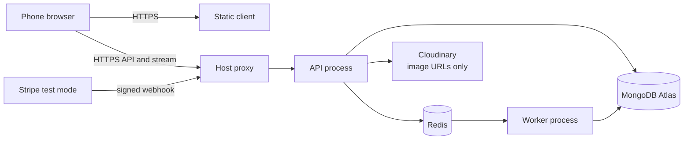
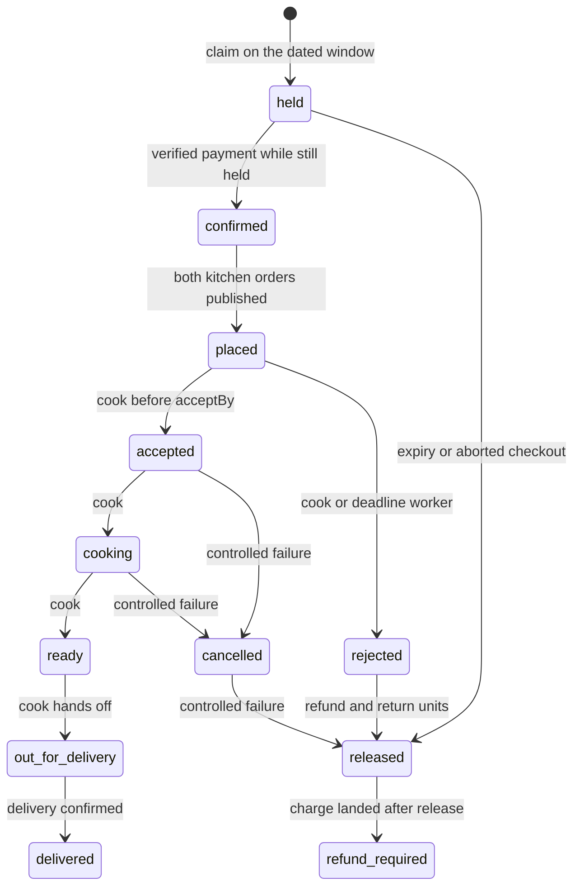

# Ship and document Sufra

The deployed Sufra is a running system. The repository is the argument that you understood it. A reviewer will not read two dozen modules of your work; they will open the README, look at one diagram, run the demo video, and ask you three questions about a number you wrote down. This lesson produces those artefacts while the decisions are still in your head.

Documentation here is not marketing. Each file answers a question that a mentor, an interviewer or a future you will ask: what runs where, why a dish has no stock field, how a hold expires, what happened when the two clocks disagreed. Write the answer next to the thing it explains, and cite the file or command that proves it.

## A README that answers the first minute

The top of the README has one job: let a stranger decide in sixty seconds whether to look further. Put the live client URL, the API health URL and the demo video link above everything else, because those are the three things a reader checks first. Then say what Sufra is in two sentences, without adjectives: home cooks sell cooked meals for dated delivery windows, diners pay once across several kitchens, and the hard constraint is cooking capacity per window rather than stock.

The skeleton below is the shape, not the finished text. Fill each heading with three to six lines, and delete any heading you cannot fill honestly.

```markdown
# Sufra

Home kitchens selling cooked meals for dated delivery windows.

## Live demo
- Client: https://sufra.vercel.app
- API health: https://sufra-api.onrender.com/health
- Demo video: unlisted YouTube link
- Seeded accounts: diner@example.test, cook@example.test (test data only)

## What this project demonstrates
- Dated delivery windows with per-dish cutoffs in Asia/Gaza
- Capacity claims per window, with holds, expiry and reconciliation
- One payment, several kitchen orders, partial refunds
- Order lifecycle with a cook acceptance deadline
- Server-sent events with a snapshot on every reconnect
- Two processes on HTTPS with secrets in the host environment

## Run it locally
## Deploy it
## Tests and evidence
## Docs
```

Two rules keep the README honest. Do not paste a credential, even a test one, and do not claim a feature you cannot demonstrate. If the poll fallback exists but is untested, say "implemented, tested manually" rather than listing it as equal to the stream.

The "Run it locally" section is where most READMEs fail a reviewer with a slow connection. Give the exact commands, the Node version, the two services that must both run, and the seed command that creates seven days of windows. A reader who cannot get a window with a future cutoff will see an empty browse page and conclude the project is broken.

## The environment file a reviewer can check

`.env.example` is a contract between the code and the person deploying it. It lists every required key, grouped by which service needs it, and the grouping says where each value comes from. Values stay empty, because a value in this file is a value in Git.

```dotenv
# Shared by API and worker
NODE_ENV=production
TZ=UTC
MONGODB_URI=
REDIS_URL=

# API only
PORT=
CLIENT_ORIGIN=
JWT_ACCESS_SECRET=
JWT_REFRESH_SECRET=
STRIPE_SECRET_KEY=
STRIPE_WEBHOOK_SECRET=
```

A file that drifts from the code is worse than no file, because it teaches a deployer to skip a key. Add a test that compares the keys the configuration loader requires with the keys documented in `.env.example`, and run it in the same suite as the rest. The failure is specific enough to fix in a minute.

```js
test('.env.example documents every required key', () => {
  const required = requiredConfigKeys();          // from the config loader
  const documented = envExampleKeys('.env.example');
  assert.deepEqual(required.filter((k) => !documented.has(k)), []);
});
```

```text
FAIL .env.example documents every required key
  missing: STRIPE_WEBHOOK_SECRET, TZ
```

The test also catches the reverse mistake, a key documented in the file that the loader ignores, which is how a deployer ends up setting a value that does nothing. Add that direction as a second assertion if your loader exposes the complete key set, including the optional ones.

## The architecture diagram and the three flows it explains

`docs/architecture.md` holds the architecture diagram and the prose that makes it readable. Draw the runtime processes, not the folders. The folder map belongs in a short list underneath, because a reader wants to know where checkouts live, not how the repository tree looks.



Three flows deserve a paragraph each underneath. The checkout flow starts at the cart, claims each kitchen's window conditionally, creates draft orders with price, name, preparation time and window times frozen, then creates one PaymentIntent. The tracking flow starts when a transition commits and publishes to Redis pub/sub, which any API process forwards to the right diner's stream. The expiry flow starts at a claim deadline, wakes the worker, and releases only a claim that is still held.

Then explain the two services that are easy to forget. The worker has no public port and is supervised separately, so a web restart does not remove it. Cloudinary stores images and MongoDB stores only the URL, which is why the diagram has no image bytes flowing through the API.

The diagram should also make one absence visible: there is no line from the browser to MongoDB, and no line from the browser to Redis. A reviewer who has seen insecure student projects will check, and the answer should be in the picture.

## The lifecycle diagram

The second diagram is the order lifecycle, and it is the one the viva will circle. It combines the order status machine from M22 with the capacity outcome from M19 and M20, because a status without its capacity state tells half the story.



Read it with the written rules beside it. A released claim is never revived, which is why there is no arrow from `released` back to `confirmed`. A rejection returns units through the same release path as expiry, which is why both end at the same state. A refund is a financial state attached to the attempt, not a replacement for the order status, so the diner can see "accepted" for one kitchen and "refund in progress" for the other.

Label the arrows with the actor or the evidence, as above. An arrow labelled "system" that hides which system is the kind of diagram that invites a question you cannot answer.

## The evidence index

`docs/EVIDENCE.md` is the map from each claimed outcome to the artefact that proves it. It is an index, not a second copy of every document. One row per outcome, with a link, a command or a short file path, and a status that is either proven, partially proven or not done.

| Outcome | Evidence | Status |
|---|---|---|
| Windows and cutoffs in the kitchen zone | `docs/window-decisions.md`, fake-clock test output | proven |
| No overbooking under parallel checkout | `docs/evidence/load-run-1.json` | proven |
| Late payment after release refunds | cutoff race output, M20 refund screenshot | proven |
| Stream survives restart | `docs/deploy-decisions.md` restart timings | proven |
| Poll fallback | endpoint implemented, no recorded test | partial |

The partial row is the most valuable one in the file. It tells a reviewer that you know the difference between built and proven, and it protects you from a question you would otherwise answer with a guess. Add a line under the table listing what is deliberately out of scope: rider tracking, cook payouts, real SMS, Arabic interface layout. Naming them is stronger than letting a reviewer discover the gaps.

Keep the evidence files small and dated. A JSON output with a revision, an origin and timestamps is enough; do not commit a 200 MB log, and never commit a response that contains a token or a card detail.

## The five-minute demo script

`docs/DEMO.md` is a script, not a description. It has five beats, each with a start time, the exact clicks, and the one sentence you say while they happen. Write it before you record, and rehearse it once with a timer.

The first beat is the window. The diner opens today's 13:00 window in `Asia/Gaza` and sees a slow dish already past its cutoff while fast dishes remain. Say the arithmetic: the maqluba closes at 11:10 because preparation and travel take that long, and spare capacity does not reopen it.

The second beat is the split purchase. Add a dish from two kitchens, pay with a Stripe test card, and show one payment with two kitchen orders, each with its own frozen price and preparation time.

The third beat is the two cooks. The first cook accepts. The second cook does nothing, and the order auto-rejects at `acceptBy` with a partial refund that you show in the Stripe test dashboard. This is the beat that proves the deadline is a job and not a badge.

The fourth beat is the weak connection. The first cook moves the order to cooking, you switch the diner's phone to airplane mode for thirty seconds, the cook marks the order ready and out for delivery, and the phone comes back. The timeline catches up in order with no duplicate rows.

The fifth beat is capacity. Run the parallel checkout script against a fresh window and show the counter filling exactly to capacity with clean conflicts for the rest.

Two phones or two browser windows are enough. Before recording, run a pre-flight: both services healthy, the worker consuming, a future window seeded, a Stripe test card ready, and one spare test order in case a beat fails. If the network drops during recording, stop and restart the take; do not narrate around a broken demo.

## Ship checks before the gate

Open the deployed client in a fresh browser profile with the network tab visible and confirm that no request goes to localhost. Check that the API health route reports the database, that the worker log shows a consumed job after your latest deploy, and that the Stripe webhook endpoint still points at the deployed origin. Run the stream probe once, because a deploy that buffered the stream will look fine until the demo.

The live URL is necessary and it is not sufficient. A reviewer who opens it and finds an empty browse page, a dead worker or a login that loops will not read the diagrams. The gate asks for the recorded demo and a defense without notes; both are easier when the artefacts above already exist.
