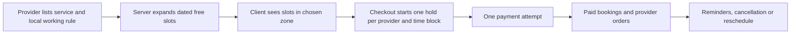

# Build SkillSlot, a marketplace for paid time

A client in Berlin needs a one-hour lesson with a tutor in Gaza. The tutor has free time on Monday morning, but each person reads a different clock. The client finds a slot, pays, and receives a confirmation. A second client chooses the same slot a moment later. If both confirmations succeed, the marketplace has sold one person's hour twice. If the hour is displayed in the wrong zone, even one successful booking may be missed. SkillSlot is built to keep both promises: show the same appointment correctly to each person, and give the provider's time to only one client.

SkillSlot is a multi-provider services marketplace. Tutors, designers, and electricians offer fixed-price sessions. A client can compare providers, select dated slots, put sessions from more than one provider in one cart, and pay once. The platform then gives each provider their own booking and order view. A booking is not simply a product with a smaller stock count. It claims an interval on one person's calendar and keeps that interval exclusive while the booking is active.

## The promise you are selling

A service listing describes an offer. It names the provider, duration, price, service area, and what the client receives. A booking is a separate promise for one dated interval. The listing can change later, but a paid booking must keep its price, duration, provider, and exact time. The provider may adjust future availability without moving an appointment already accepted. The client may change the zone used to display the appointment without changing when it happens.

The product has three people in its main journey. A **provider** publishes a service and working hours, blocks time off, accepts paid work, and can cancel under a clear policy. A **client** searches, compares times in their own zone, pays, and sees the confirmed appointment. The **marketplace** verifies who owns each provider record, calculates the price, claims calendar time, handles payment events, and tells both people about a change. A provider should never see another provider's private bookings. A client should never read another client's meeting link or home address.

Read this flow as a series of decisions, not as a promise that every request succeeds. A displayed free slot is an invitation to try. At checkout, the server must check again. It may reject a stale slot because another client won it, the provider added time off, or the hold expired. Payment success does not make an expired time free again. The later modules give each failure an explicit state and a recovery path.

## The first calendar decision

A provider in Gaza says, "I work Mondays at nine." That is a weekly rule in the provider's local zone. It is not one UTC timestamp and it is not the client's browser time. For a particular Monday, the server resolves the rule into one or more exact instants and excludes time off and bookings. A client in Berlin formats those instants in Berlin time. A client in Qatar formats the same instants in Qatar time. A confirmed booking stores one start and end instant in UTC, along with zone information that helps the people explain what they saw.

You will build this boundary before the booking API. It prevents an easy mistake: adding seven days to a previous UTC slot and calling it next Monday at nine. A region's offset from UTC may change between those dates. The provider's local promise remains nine, while the UTC value may move. The time module will show the conversion, test a clock-change week, and reject a local time that is missing or repeated. The booking engine will use its output rather than inventing a second conversion.

The hardest concurrency decision comes later. Suppose twenty clients submit checkout for the same tutor hour at once. A "find an empty booking, then insert" sequence can let several requests through. SkillSlot will give the server a unique claim for each small block of a provider's calendar. A transaction claims the required blocks together or claims none. The test target is concrete: one checkout succeeds and nineteen receive a conflict. The same rule applies when a client reschedules. The old interval must be released and the new interval claimed as one safe change, or the client could lose both.

## One cart, separate providers

A client may book a tutor and a designer in one visit. The cart groups requested sessions for display, but it does not reserve them for hours while someone thinks about paying. At checkout start, the server rechecks the slots, creates short holds, calculates totals from stored service prices, and starts one payment attempt. After a verified payment event, the system creates the paid bookings and per-provider orders. Each provider sees only the part they must deliver. A late payment, a failed payment, and an expired hold need different outcomes; the course will not hide them behind a generic "something went wrong" message.

This is why the product is still a marketplace, even though it sells time rather than goods. There are independent providers, a shared discovery and payment experience, provider-specific fulfilment, and platform rules that neither side can override. The shared engineering spine includes authentication, ownership, validation, pricing, payment, worker jobs, caching, deployment, and incident evidence. The domain changes the data model and the correctness tests. You will carry useful shared lessons only when their instructions still match SkillSlot.

## What the four weeks produce

In Week 1, both apps run, the database is available as a replica set, and you can explain a provider's local rule, a UTC instant, and a client's display label. You will seed providers in more than one zone and pass a clock-change test. In Week 2, a provider can register, publish services, set weekly hours and time off, and see a dated calendar. A client can compare providers and see free slots in their own zone. In Week 3, a client books services from two providers in one cart, pays with a Stripe test card, and each provider sees only their booking. A parallel test proves that the same provider time cannot be sold twice. In Week 4, cancellation, rescheduling, refunds, reminders, a live HTTPS deploy, and a demo make the system defendable.

The evidence matters more than a screen that looks finished. Keep an ERD, an authorization matrix, a record of time-zone decisions, a two-client race test, payment replay tests, and a deployment checklist in `docs/`. Record the inputs and outputs of each test so someone else can repeat it. A reviewer should be able to ask why a slot is free, why one client won a race, and what happens if Stripe reports success after a hold is gone. Your code and notes should answer without relying on a lucky demo.

## Boundaries that keep the course finishable

SkillSlot does not build a video-calling service. A provider may attach a meeting link to a booking, with access restricted to the parties, but streaming video is another product. It does not pay providers through Stripe Connect in the core path; that would add account onboarding and financial rules beyond the booking problem. It does not synchronize both ways with Google or Outlook calendars. The provider edits SkillSlot availability directly and may export a one-way calendar file. The course also avoids route planning for electricians; an in-person listing names a service area and visit buffer, not a map engine.

These boundaries are not excuses to ignore real failures. The core still needs safe payment handling, permission checks, useful error messages, and a way to recover from worker retries. An electrician's visit address is private. A tutor's meeting link is private. A provider's future time off must stop new bookings without rewriting an old receipt. The scope is small enough to ship, but the trust and time rules are real.

## Your first decision

Start `docs/product-brief.md` with one sentence: "SkillSlot lets clients book paid time from independent providers without a double booking or a time-zone surprise." Name one primary provider and one primary client you will use in examples. Write their IANA zones, a fixed-price service and duration, and the first dated appointment you would demonstrate. Then write three questions you cannot yet answer: when does a hold begin, who may change a booking, and what happens after a late payment succeeds? Do not guess the implementation now. Keep the questions visible as the course teaches the evidence needed to answer them.

Before you continue, explain the difference between a listing and a booking to another learner. A listing says what a provider offers; a booking says which exact interval that provider promised to one client. If that distinction is clear, the next lesson can show how to use the course, record decisions, and verify each module gate.
