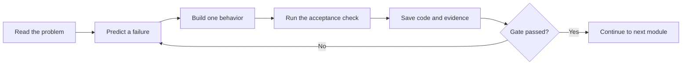

# How to use this course

This course is a build with decisions, not a list of pages to skim. Each module begins with the problem you need to solve, gives you a model, asks you to predict a failure, then has you implement and verify a small part of SkillSlot. The final gate asks for evidence that another person can inspect. You may read ahead, but build in order. A later booking test depends on the time module, and the payment module depends on the hold rules. Skipping a gate may leave a screen that looks right while its most important promise is broken.

Your product is SkillSlot, a marketplace for paid appointments. The course uses that name for a shared reference, but you may choose your own product name for your repository and portfolio. Keep the same domain rules when you rename it. A new logo cannot turn a booking into stock, and a theme choice cannot make a clock conversion safe. When a lesson shows a tutor in Gaza or a client in Berlin, keep the roles and zones in the test even if your app's visible name changes. Those details make the failure reproducible.

## The learning loop

A chapter may ask you to read, decide, build, check, or pass a gate. You should leave each one with something observable. In a Read chapter, write the question and a short answer in your learning log. In a Learn chapter, work the example before you reveal the explanation. In a Build chapter, make a small commit with one behavior and one test. In a Check chapter, answer before looking back at the page. In a Gate chapter, run the named proof and save the result. None of these steps require a long uninterrupted session; they do require an honest record of what worked.

The arrow back from a failed gate is normal. A failure tells you where your model differs from the running system. For example, a time-zone test may show that a Monday 09:00 rule moved to 10:00 after a clock change. Do not silence the test by changing the expected value until you can explain the conversion. Write the date, provider zone, client zone, expected instant, actual instant, and the code path that produced it. Then fix the rule and run the same check again.

## Keep a small engineering record

Create a `docs/LEARNING-LOG.md` file in your project repository. Give each module an entry with four lines: the decision you made, the reason, the proof you ran, and one thing you still need to check. This is not a diary of every keystroke. It is a map from a product promise to evidence. A useful entry might say: "M5: Availability rules keep provider local time and an IANA zone. A dated slot becomes UTC when the rule expands. The Berlin spring-week tests pass. We still need to test a provider zone change after bookings exist."

Put longer technical records in focused files. `docs/ERD.md` holds the data model and ownership. `docs/AUTHORIZATION.md` lists who may read and change each route. `docs/TIME-DECISIONS.md` records the policy for missing and repeated local times. `docs/EVIDENCE.md` links the race test, payment replay, deployment URL, and demo. These files are part of the capstone because a reviewer cannot infer every trust rule from screenshots. Keep them short enough to update when the code changes.

Commit after a behavior is both implemented and checked. A useful commit message names the result, such as `Reject duplicate slot claims during checkout`. A weaker message such as `finish booking` hides what changed. If a chapter asks for a screenshot, save the command and inputs that produced it as well. A green test copied from another machine is not evidence that your code passes. Run it in your environment and record the command, test count, and any service it needs.

## Work on a phone or unstable connection

Many fellows read on a phone or work around short power cuts. Before a build session, open the current chapter and write down the one next check you want to pass. A twenty-minute block can be enough to add a validation rule, run its test, and commit. When you return, `git status`, the latest commit, and your learning log should tell you where to resume. Avoid keeping the only copy of a decision in a browser tab or an unsaved chat message.

If a dependency download is expensive, share a cached workspace or plan the download for a better connection. You should still inspect the lockfile change and know which package the app uses. Never copy API keys into a screenshot, a learning log, or a commit to make a test pass. Use local environment variables and documented test values. A missing Stripe or image-storage key is an environment problem with a clear boundary; it is not a reason to replace payment or uploads with a fake success in the core path.

The course text must make sense even when a visual widget does not load. Read the surrounding explanation first. An interactive canvas lets you change a factor and observe its effect, but it does not own the only explanation. For the time canvas, predict which UTC hour changes when Berlin changes clocks, then move the week and describe why the provider's local 09:00 stays fixed. If the canvas cannot run on your device, work the two dated examples in the prose and compare with a peer later.

## Use the checks as questions, not scores

A quiz checks whether you can apply a rule to a new situation. Its point is to reveal a wrong assumption while the code is still small. A correct answer without a reason is a weak signal. After each question, write one sentence explaining why the tempting wrong choice fails. If you miss an ownership question, reproduce it with two provider accounts. If you miss a clock question, write a dated test with two zones. The best repair is a small piece of evidence, not reading the answer again and hoping to remember it.

A gate is stronger than a quiz. It asks for a running proof: the API responds, the second provider receives 403, a duplicate claim fails, or a payment replay creates no second booking. A gate may also ask for a learning-log answer so you can defend the decision. Mark it complete only after you have both the code and the observation. If an external service is unavailable, record the precise blocked check and continue only with work that does not depend on pretending it passed.

The module sequence follows the product's risk. Week 1 establishes a working repository, identity, data model, and reliable time representation. Week 2 builds the provider journey and a slot engine. Week 3 builds discovery, a multi-provider cart, payment, and bookings. Week 4 handles cancellations, reminders, performance, deployment, and a defense. You will see the same engineering ideas more than once. The authorization rule learned for provider profiles returns when booking details and private meeting links appear. The idempotency rule learned at checkout returns when a worker retries a reminder.

## What your mentor should be able to inspect

At the end of a week, your mentor should not need to guess which version you ran. Share the commit hash, a short demo path, the test command, and the evidence file. If a behavior is unfinished, name the missing acceptance check. A clear statement such as "The booking API rejects a duplicate SlotClaim locally, but the Stripe late-success path is not tested yet" is useful. It lets a reviewer focus on the remaining risk. A claim that everything works, without the exact test, makes the next review slower.

You may choose SkillSlot as a learner-selected variant or receive it as an assignment. That choice fixes the product path when you begin. Your progress and previous submissions stay with the version of the course you started. If the published course changes later, you should still be able to open your earlier chapters and explain the code you built. Keep your project repository aligned with your own learning path; do not paste a newer chapter's solution into an older branch without understanding the changes.

## Start now

Add the four headings `Decision`, `Reason`, `Proof`, and `Open question` to `docs/LEARNING-LOG.md`. Under `Decision`, write that the product sells dated provider time rather than an item with a stock count. Under `Reason`, name the double-booking and time-zone failures from the first lesson. Leave `Proof` empty for now and write the first test you will need: one provider hour, two competing checkout requests, one accepted booking. In the next chapter you will name the people who take part in that journey and the data each one may see.
