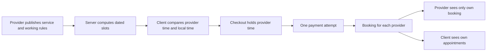

# The product and its people

A marketplace connects people who would otherwise arrange work in separate messages. SkillSlot does more than put a provider profile next to a booking button. It gives providers a reliable way to offer time and clients a reliable way to accept it. The two sides see different information and have different powers. Naming those differences now prevents a later mistake where a visible button is mistaken for permission to change somebody else's booking.

Use a tutor called Lina and a client called Sami for the first journey. Lina works in `Asia/Gaza`, offers a one-hour English lesson, and has weekly hours plus a blocked afternoon. Sami views the page from `Europe/Berlin`. He wants next Monday at a time he can attend, pays with a test card, and receives a booking. A second provider, Noor, offers a design review. Sami can book both in one cart, but Lina and Noor should each see only the booking they will deliver. The platform can reconcile the one payment without sharing every client's private details with every provider.

## Follow the provider

Lina starts as a user account. She proves access to that account, creates a provider profile, chooses the zone for her working rules, and adds a service with a duration and server-stored price. She writes weekly availability and adds exceptions for time off. A provider profile is not the same as a free slot: a profile tells a client who she is, while a slot is a dated interval calculated from rules, exceptions, and existing claims. SkillSlot should not advertise a provider as bookable until the profile has at least one service and useful hours.

When a paid booking arrives, Lina sees the time in her own zone, the service, the client's name, and only the contact details needed to deliver the session. A tutor may see a meeting link. An electrician who visits a home may see a visit address after payment, but someone merely browsing the service must not. Lina can block future time, cancel under policy, or complete work. She cannot rewrite Sami's payment amount, move a confirmed appointment by editing a weekly rule, or read Noor's private calendar.

A provider who owns two services still has one calendar. A one-hour lesson and a ninety-minute design review cannot occupy the same provider interval. The booking engine will claim small time blocks against the provider ID, not against a service ID. This choice follows the real scarce thing: Lina's time. The provider dashboard can group bookings by service for display, but the unique claim belongs to her calendar.

## Follow the client

Sami starts at discovery. He filters by the kind of help he needs, reads a provider's public profile and service terms, and chooses a dated slot. The page displays the slot in Sami's selected zone and also names Lina's zone. A label that says only "09:00" is incomplete. Before payment, Sami should see the service duration, provider, date, both relevant time labels, price, and cancellation terms. He should not need to guess whether "Monday" means his Monday or Lina's if they cross a date boundary.

Sami adds Lina's lesson and Noor's design review to one cart. The cart is an intention, not a permanent hold. At checkout, the server recalculates price from current service records, checks that both requested starts are still valid, and claims both calendars for a short period. If one slot is gone, the server explains which line failed and lets Sami choose another. If both holds succeed, the platform starts one payment attempt. A verified success creates separate bookings and per-provider orders. Sami sees both appointments in his own list and may later ask to cancel or reschedule within the published rules.

Notice the two branches after booking creation. The same booking can be shown to a provider and a client, but the API should shape each response for that audience. The provider may need the client's delivery details; another client does not. The client may need a receipt for the total payment; an individual provider should not automatically see every line in that payment. A shared database row does not imply a shared API response.

## The platform's work

The platform resolves identity, time, money, and failure. It authenticates each request before reading private records. It checks that a provider owns the profile or service they want to change. It turns local weekly rules into dated UTC slots and makes exclusive claims. It computes totals from stored prices and verifies payment events. It gives work to a queue when a notification can happen later and repeats a job safely if a worker restarts. It records enough evidence to answer a support report about a wrong time or a double charge.

These are server decisions. A React page may hide a button, but it cannot enforce ownership. A client can call an API directly. The server must derive the provider from the authenticated user and compare it with the booking's provider. The same principle protects Sami's booking: a request from another client must not succeed merely because it contains the right booking ID. You will write an authorization matrix before the sensitive routes, then run IDOR tests with two providers and two clients.

| Record | Public part | Private part | Who may change it |
|---|---|---|---|
| Provider profile | Name, approved summary, service area | Account email and moderation notes | Owning provider, subject to platform policy |
| Service | Description, duration, price | Draft state and internal notes | Owning provider |
| Availability rule | Bookable result for a dated range | Full rule and time-off reasons | Owning provider |
| Booking | None to strangers | Client, provider, exact time, meeting link or address | Controlled state transitions by the parties and server |
| Payment | None to strangers | Payment status, receipt and reconciliation data | Server after verified events |

The table is an early model, not the final schema. You will decide exactly which fields belong in each response after you draw the data model. It already shows a useful invariant: knowing a public provider page does not grant access to that provider's full calendar or client list. A provider needs enough information to do the job, and no more.

## A worked request boundary

Imagine Noor opens her dashboard and changes a service price. The browser sends a service ID and the new price. The server authenticates Noor, finds the service, checks that its provider ID belongs to Noor, validates the price, and writes the change. That price applies to future checkout starts. It does not rewrite an old paid booking's price snapshot. If Lina sends the same request with Noor's service ID, the server rejects it even if Lina can view Noor's public profile. The success and rejection are both test cases.

Now imagine Sami changes his selected display zone from Berlin to Qatar. The browser may store that preference and request appointments with a different label. It must not send a new booking `startAt` just to change the label. The API returns the same UTC instant; the UI formats it differently. If Sami instead requests a reschedule, that is a different action with an availability check, a state transition, and possibly a payment or refund decision. Calling both actions "change time" would hide the important boundary.

## Practice before building

Draw the two journeys in `docs/product-brief.md`. On the provider side, start with signup and end with a completed or cancelled session. On the client side, start with discovery and end with a receipt and a visible appointment. Mark each point where the server must make an authoritative decision. There should be at least one identity check, one time calculation, one inventory claim, one price calculation, and one payment-event check. If you cannot point to the server decision, ask whether the browser is silently being trusted.

Then choose one private field from the table, such as a meeting link or visit address. Write who may see it before payment, after payment, after cancellation, and as an unrelated user. This short exercise will become an authorization test later. The next lesson narrows the product scope. It decides which features make this four-week build strong and which tempting integrations would make the important booking rules harder to finish.
