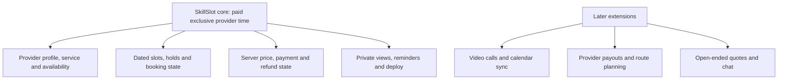

# Keep the booking product in scope

A marketplace can grow in many directions. SkillSlot could become a video-call app, a payroll system, a calendar sync service, a map of electricians, and a messaging network. Building all of those would hide the one claim this course must prove: a client can pay for a provider's dated time, and the platform will show the right time to both people without selling it twice. The scope is a tool for protecting that claim. It tells you which work belongs in the four-week build and which work should wait until the core is reliable.

The core has three service examples. A tutor offers a remote lesson, a designer offers a remote review, and an electrician offers an in-person visit in a named service area. They share one booking engine but expose different delivery details. The tutor may attach a private meeting link; the electrician may need a private address after payment. This is enough variety to test permissions without turning the course into three separate applications. Each service has one duration and one fixed price in the core. A provider can publish more than one service, but all of their bookings compete for the same calendar.

## What must work

A provider can register, create one profile, set an IANA time zone, publish a service, write weekly hours, and block time off. A client can find an active provider, see dated free slots in a chosen zone, place requested sessions from two providers in one cart, and start checkout. The server validates each slot again, holds the necessary provider time, calculates the total from stored prices, and starts one Stripe test payment. Verified payment creates the bookings and one provider-specific order per provider. The client sees receipts and appointment details. Each provider sees only the bookings and delivery data they need.

The hard paths are part of the core. Two clients racing for one slot must not both succeed. A retry of the same payment webhook must not create another booking. A late success after a hold expired must have a documented recovery and refund policy. A cancellation or reschedule must not leave a provider with two claims for one time or release another client's claim. A reminder worker may retry, so it must check current booking state before sending. These cases are not stretch features; they are the product promise under normal failure.

The diagram separates correctness work from extensions, not easy work from hard work. Payment replay and a two-client race are difficult, but they stay in the core because the product cannot safely sell time without them. Video calling can be impressive, but a meeting link is sufficient to demonstrate the booking contract. A polished chat feature would not repair a slot engine that can double-book a tutor.

## The out-of-scope decisions

SkillSlot does not host calls. A remote provider may add a meeting link to a confirmed booking, and the API protects it as private data. Building streaming, recording, moderation, and call quality would be a separate course. The core does not synchronize two ways with Google or Outlook calendars. That would require OAuth, token refresh, conflict resolution, webhook handling, and a rule for what happens when an external event moves after a SkillSlot booking is paid. A one-way calendar export can be a small extension after the local booking model is correct.

The course does not use Stripe Connect to pay providers. Money reaches a platform test account, and the app records what each provider should receive. Real payouts introduce onboarding, disputes, tax and legal obligations that depend on country and account status. You should not imply that the core app can pay providers merely because it splits orders in the database. In a demo, call this an accounting view, not a live payout. The course also uses one currency for a cohort so arithmetic, display and test cards have one clear contract. A multi-currency marketplace would need exchange rates and additional rounding rules.

The electrician service uses a service-area list and a fixed visit buffer. It does not calculate routes or travel time from maps. The buffer still matters: a one-hour job may occupy more than one hour of the provider's calendar. You will test that the claim includes the buffer and that the client sees only the promised session time. Taxes, invoices, provider subscriptions, bidding for a job, and open-ended quotes are also outside the core. They would change pricing and state transitions without helping the course prove its booking engine.

## A decision under pressure

Imagine a reviewer asks for Google Calendar sync in Week 2. You have a provider calendar page but no two-client race test yet. If you add sync first, you will have two sources of calendar truth and no proven rule for either one. The safer decision is to finish the SkillSlot database claim, test it under concurrency, and document that external sync is deferred. You can show the reviewer a future interface: a calendar adapter would import busy intervals and submit them through the same availability service. That architecture note costs little. Implementing OAuth and bidirectional reconciliation before the local rules work would cost the rest of the course.

Now imagine the reviewer asks for a second provider type. A fixed-price design review can use the existing service and booking model. It changes copy and perhaps a form field, not the core state machine. It is reasonable to add. An auction for a large renovation job does not fit. Its quotes, milestones, deposits, and disputes form another product. A scope decision should identify which invariant changes, not merely whether the requested screen looks small.

## What production quality means here

A small scope does not mean a fragile demo. The server validates all inputs, checks ownership at every private route, and never accepts a browser-supplied total as authority. Secrets stay outside Git. A confirmed booking has an immutable price and time snapshot. State changes are idempotent where retries are normal. Logs can correlate a checkout, PaymentIntent, booking and worker job without printing a private meeting link or address. The client gives a clear message when a slot is taken and lets the person choose again. The app can restart without losing confirmed appointments or making a reminder twice.

You will deploy both the API and client over HTTPS and run a short production check. A working local test does not prove that cookies, CORS, Stripe webhooks and the worker use correct deployed settings. The deploy module records environment variables by name, keeps actual values secret, and verifies one full test-mode booking from a browser. A live URL is one piece of evidence. The race test, authorization matrix and payment replay test explain why the URL is safe to show.

## Make your scope visible

Add a three-column table to `docs/product-brief.md`: `Core`, `Later`, and `Reason`. Put slot exclusivity, dated zone conversion, verified payment, provider isolation, cancellation, reschedule, reminders and deployment under Core. Put video calls, Connect payouts, two-way calendar sync, route planning, auctions and multi-currency under Later. Give each Later item a one-sentence reason that names the additional trust or state problem. Do not write only "too hard." The goal is to show that you understand the cost and have chosen the most important proof for this course.

Then choose one proposed feature not listed above and defend where it belongs. Ask: does it help a client pay for the right provider time, does it change the booking state machine, does it require new private data, and can it be demonstrated in the four-week evidence path? A clear answer makes the next module decisions easier. In the next chapter you will check the skills and tools you need before creating the repository, including a short repair path for JavaScript dates.
