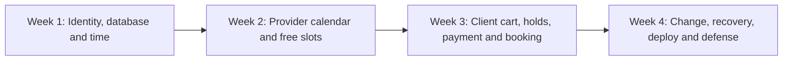

# Course outline and demo targets

You will build SkillSlot in four weeks. Each week ends with a demo that proves a stronger claim than the last. The demos are not slide shows of planned screens. They are short paths through running code with a test and a written decision behind them. This chapter lets you see the whole route before you open an editor. It also gives you a way to notice when an attractive feature is pulling time away from the product's hard promise.

A learner who finishes should be able to deploy and defend a marketplace where independent providers sell dated appointments. A client chooses time in their zone, pays once for sessions from two providers, and receives separate confirmed bookings. Concurrent checkout cannot sell a provider's time twice. Cancellation and rescheduling obey policy and leave payment and reminders consistent. The app can explain what happened after a retry, a late payment, or a worker restart. Every week builds one part of that statement.

The arrow from Week 1 to Week 2 matters. A provider calendar built before the time model may appear to work for the developer's zone and fail for a client elsewhere. The arrow from Week 2 to Week 3 matters because checkout can only hold a dated slot that the availability engine describes consistently. The arrow from Week 3 to Week 4 matters because a cancellation or reschedule is a change to a real paid booking, not a free-floating calendar edit.

## Week 1: know what the system means

Start a repository with separate server and client apps. Make a health route that a browser can call. Connect MongoDB as a replica set and seed providers, services, clients, and sample working rules. Draw an ERD before the schema grows. Build account registration and login, then check that one provider cannot edit another provider's service or time off. The time module distinguishes a weekly local rule from a dated UTC instant. Its tests include a normal conversion, a missing local time, a repeated local time, and a display in a second zone.

The Week 1 demo is small but strong. Show the client calling the health route; show the seed rows in the database; show a provider and client signing in; run a time test across a clock-change week; and show an IDOR request rejected with 403. Your mentor should be able to read `docs/ERD.md`, `docs/AUTHORIZATION.md`, and `docs/TIME-DECISIONS.md` and see how those checks relate to the data model. Do not claim the booking app works yet. At this point, the system has the foundations needed to make a booking trustworthy.

A common Week 1 trap is to use the browser's default time zone everywhere because the first screen looks right locally. Put the provider and client in different zones in seed data. Another trap is to keep a Mongoose connection that cannot run transactions while planning an atomic booking claim. The transaction smoke test should fail early if the local database is not a replica set. Repair the environment now, before a later concurrency test needs it.

## Week 2: let a provider offer real time

A provider opens a profile, adds a fixed-price service with duration, writes weekly hours, and adds time off. The server expands those rules for a dated range, excludes time off and bookings, and returns slots that a client can compare. The provider can upload a public profile or service image without making a private meeting link public. The client sees a provider page and free dates in their own zone, with the provider's zone named nearby. A provider's own calendar uses the same UTC instants, formatted for the provider.

The Week 2 demo shows a new provider going from signup to a bookable service. Add a blocked afternoon and show the slot disappear from the client view. Change the client display zone and show a different label for the same candidate instant. Run an availability test that covers a clock-change week and a provider with two services. The two services must compete for one provider calendar. Your evidence includes query-count notes and an ownership test, so a faster-looking UI cannot hide a cross-provider data leak.

This phase does not need a payment form. A slot shown as free is not a confirmed booking; it can become stale before checkout. Make the page honest about that. If a client opens two tabs, neither tab owns the slot merely because it painted a green button. The server will make the authoritative claim in Week 3. Week 2 succeeds when it gives checkout a clear dated slot contract, not when it pretends to reserve time in the browser.

## Week 3: make paid booking survive a race

Build a cart that can hold requested sessions from two providers. At checkout start, the server validates service prices, durations, slot instants, provider ownership, and current availability. It claims the required time blocks for a short period inside a transaction. It calculates one server-owned total and creates one payment attempt. A verified success produces paid bookings and provider-specific orders. A failed or expired attempt releases the claims under a stated rule. A webhook replay must not create another booking. A late success after the hold is gone must not silently force the appointment onto the provider's calendar.

The Week 3 demo uses a tutor and a designer in one cart. Pay once with a Stripe test card, then open each provider's view and show only their own booking. Open the client's appointment list and show both bookings with their local labels. Run twenty parallel attempts for one remaining tutor slot. Exactly one request should win and the rest should receive a conflict that a client can act on. Read the resulting SlotClaim and Booking rows and explain why a stale green slot did not become a second paid appointment.

A payment screenshot by itself is not enough. Save the Stripe test event ID, the checkout ID, the resulting bookings, and the replay test result without storing card secrets. The evidence should connect the money event to the calendar claim. If your test suite only checks that the checkout route returned 200, it does not prove the provider's time stayed exclusive.

## Week 4: change a booking and defend it

A paid booking may be cancelled, rescheduled, refunded, or completed. Build these as guarded state transitions. A reschedule claims the new time and releases the old time as one safe operation. A cancellation applies the published policy and records the refund result. Reminder jobs re-read booking state before sending so a stale job does not remind someone about a cancelled slot. Add cache behavior that helps browsing but never becomes authority for booking a slot. Deploy the API, client and worker over HTTPS and run a browser booking in the deployed environment.

The Week 4 demo begins with a confirmed appointment. Reschedule one booking and show that the old slot becomes available and the reminder moves. Cancel another inside the late window and show the partial refund in Stripe test mode and in the app. Run a race between cancel and reschedule and show that one transition wins. Restart the worker, replay a job, and show that it does not send an incorrect second message. End with the live URL and `docs/EVIDENCE.md`, then answer why a UTC instant, a provider local rule, and a client display label are three different records of time.

## Plan your evidence before the build

Create a table in `docs/product-brief.md` with one row for each week. Add columns for the user journey, the running test, the data record to inspect, and the question you must defend. Keep the table visible while coding. If a chapter adds a feature that does not move a weekly demo forward, ask whether it is a needed foundation, a stretch item, or a distraction. The course will ask you to revisit this table after each gate so the final demo grows from verified pieces rather than a last-day assembly.

The next chapter explains why time is the hardest constraint in this variant. You already know the four milestones. Now you will work through the failures that make a booking product different from a store selling objects with stock counts.
