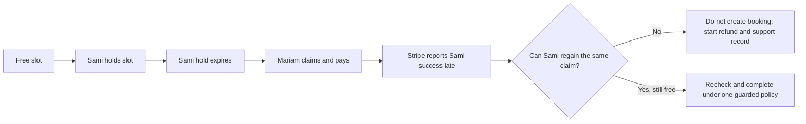

# Why time is the hard part

A grocery product can have ten units in stock. A service provider cannot have ten copies of Monday at 09:00. They have one calendar, and a session may occupy more than its advertised duration because setup or travel takes time. A client can view a slot in another zone, hold it briefly, pay, cancel, or reschedule. Every action changes what the next client may buy. The hard part of SkillSlot is keeping that time promise true while requests and external events arrive in an order the app cannot control.

Before reading each failure, write one prediction in your learning log. What could go wrong if two clients press Pay together? What could go wrong if a weekly rule is stored as a UTC hour? What could go wrong if Stripe reports success after a hold expires? Your answers can be rough. The worked cases below will give you a sharper model, and later modules will turn each case into a test.

## Failure one: two clients see one free slot

Lina has one hour free at 09:00. Sami and Mariam both load her page. Both browsers paint a green button. Sami checks out a moment before Mariam, but their requests overlap at the server. A naive handler queries for an existing booking, finds none, and then inserts a booking. If each request runs that query before either insert completes, both see the same empty result. Neither handler lied about what it read, but the final state is wrong: Lina has two paid clients for one hour.

<TraceRequest title="Two requests for one provider hour">
  <TraceStep actor="Sami" label="Check availability" detail="No booking found yet" />
  <TraceStep actor="Mariam" label="Check availability" detail="No booking found yet" />
  <TraceStep actor="Sami" label="Create booking" detail="First booking written" />
  <TraceStep actor="Mariam" label="Create booking" detail="Second booking also written unless the database prevents it" />
</TraceRequest>

The remedy is not to hide the button after Sami clicks. Mariam's browser may be on another phone, and a direct API caller can ignore browser state entirely. The server needs one authoritative way to claim the provider's time. SkillSlot will represent an interval as small blocks associated with the provider and store a unique claim for each block. A database transaction will claim all blocks needed by a session or claim none. A second request that collides with the same provider and block receives a conflict. The exact block size and transaction rules come later; the invariant is already clear: a paid active booking must have exclusive ownership of its provider interval.

The test is stronger than a single request. Run twenty parallel checkout starts for one remaining slot. Expect one success and nineteen conflicts, with one set of durable claims. Also check that a request for a different provider at the same UTC time can succeed. The unique key includes the provider identity; it does not freeze the entire marketplace whenever one tutor is busy. If a ninety-minute service needs six fifteen-minute blocks, either all six belong to that booking or none do.

## Failure two: the clocks describe different appointments

Lina writes a rule: Monday at 09:00 in `Asia/Gaza`. Sami in `Europe/Berlin` reads a dated slot in Berlin time. A developer stores the weekly rule as `07:00Z` because that is what one Monday converts to. Several weeks later a zone rule changes. The next Monday at `07:00Z` may no longer be 09:00 for Lina. The booking page can now promise Sami an instant that Lina never offered, even if the database claim is exclusive.

The weekly rule and the confirmed booking need different shapes. The rule keeps a weekday, local start and end, and the provider's IANA zone. It expresses what Lina normally offers in her own calendar. When the app asks for a dated week, it resolves the rule using the zone rules for each date. A confirmed booking keeps UTC start and end instants, plus zone snapshots needed to explain the receipt. Sami's chosen display zone determines a label, not the booking instant. If he travels to Qatar after paying, the local label changes while the stored start remains the same.

A particularly difficult case occurs when a local clock jumps forward or repeats an hour. A string such as `02:30` may have no matching instant, or two possible instants, on a change night. The app must not silently choose whichever answer a library returns first. SkillSlot will state an ambiguity policy, test it with a frozen date, and prevent a provider from publishing an invalid rule boundary without an explicit decision. Most weekday morning appointments are simple, but the engine's rule must be correct for the exceptions too.

The test should compare four values: provider local rule, dated UTC instant, provider display label, and client display label. Change only the client zone and assert that UTC stays fixed. Move the dated week across a clock change and assert that the provider local rule stays fixed while the UTC hour may move. These tests separate a formatter bug from a rule-expansion bug. A screenshot with a plausible-looking hour cannot make that distinction.

## Failure three: the hold and money disagree

At checkout, Sami's requested slot is free. SkillSlot gives him a short hold while he completes payment. His network drops, and the hold expires. Mariam then claims and pays for the same slot. After that, Stripe reports that Sami's earlier payment also succeeded. If the webhook simply creates a booking whenever it sees success, the app double-books Lina despite having a safe checkout-start claim. If it ignores the event, Sami has paid without a booking or a refund. The system needs an explicit late-success path.

The course will choose and document one policy for the last decision. The important part now is that payment success is a fact about money, not proof that the provider's calendar is still free. The webhook must verify its signature, identify the checkout attempt, read current hold and booking state, and make an idempotent decision. A replay of the same event must reach the same result without creating another booking or another refund. The customer should see a clear status while the system reconciles the outcome.

This is also why a cart is not a hold. If adding a service to a cart blocked a provider for hours, an idle visitor could make an entire day look unavailable. SkillSlot starts short holds at checkout, checks the server clock, and limits how many holds one client can create. The browser countdown helps the person, but the server expiry decides whether the claim still belongs to them. A stale tab can request checkout again; it cannot extend the old hold by sending its own timer value.

## Put the failures together

The three cases interact. A client may choose an hour displayed in the wrong zone, win a unique claim for that wrong instant, and then pay successfully. A concurrency test alone would pass, while the appointment is still wrong. Another client may see the right hour and lose a valid race, which should produce a useful conflict rather than a charge. A third may pay after expiry and need a refund. SkillSlot therefore has separate evidence for time conversion, exclusivity, payment reconciliation, and the user message. One broad end-to-end test is useful, but it cannot replace the smaller tests that identify which promise failed.

Write three test names in `docs/product-brief.md`: `one_provider_hour_has_one_winner`, `viewer_zone_does_not_move_booking`, and `late_success_does_not_steal_claim`. Under each, write the minimum input and the state you would inspect after the test. You do not have to implement them today. The final gate will ask you to explain why each belongs in a different part of the system. The next lesson sets a working rhythm so these hard cases receive time before the final demo rather than becoming last-day surprises.
