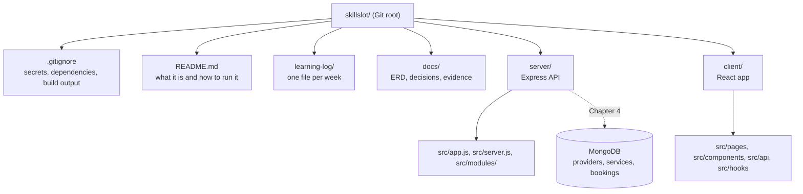

# 2.8 ,  Create the repo

> **[Build]** · Chapter 02 ,  Project skeleton · *Init git; root `.gitignore`; `README.md` stub*

**Why this step matters:** Everything you build for SkillSlot lives in a repo you own ,  not in the course guides folder. This step creates that root with Git, ignore rules, and a learning log so every later sub-chapter has a committed home and secrets stay out of history from day one.

<BigWordAlert term="Git repository" plainEnglish="Version-controlled project folder where every change is tracked and reversible." whyItMatters="SkillSlot lives in one repo from day one ,  commits mark chapter milestones you can demo or roll back." />

**Where the project is now:** You have no application repository ,  only the course materials you read. After this sub-chapter you'll have a Git root with ignore rules and a place for the learning log.

**After this step:** You own a Git repository with a root `.gitignore` that keeps secrets out, a README stub, and a `learning-log/` folder ,  the committed home every later sub-chapter builds inside.

## What you must do

Create a **new directory** for your marketplace application ,  **not** inside the course guides folder. Initialize Git, add a root `.gitignore`, and stub `README.md`.

## Why one repository and not two

SkillSlot ships as two programs, an Express API and a React client, so the obvious question is whether they belong in two repositories. Large teams split them once each app has its own deployment pipeline and a team that never touches the other side. You are not there yet, and copying that structure now costs you coordination in every sub-chapter.

A single repository gives you one history containing the API change and the client change that depend on each other. When Chapter 15 adds the availability endpoint and Chapter 17 consumes it, one commit shows both sides and a rollback restores a version that actually worked. The cost is honest: read access is all or nothing, and a clone fetches both dependency trees. For one owner and one mentor that is a fair trade, and you can split later when a real reason appears.

The rule for the root follows from the same reasoning. A file at the top either describes or configures the whole repository, or it belongs inside one of the two apps. Code lives in `server/` or `client/`, never loose at the top, because two apps sharing one root with no boundary ends with a helper that both halves import and neither half owns.

## The shape of the repository root

The diagram below is the picture to hold in your head for the rest of the course. Everything solid is what you create or commit in this sub-chapter; everything inside `server/` and `client/` arrives in 2.9 and 2.12, and the dashed arrow is the database that joins in Chapter 4. Notice that the ignore rules and the README sit beside the apps rather than inside one of them, because they describe the repository, not a single process.



Two things about that tree are worth saying out loud. First, the two app folders are siblings, not nested, which is what lets you open two terminals and run two independent processes without one depending on the other's working directory. Second, the repository root exists before either app does, so the first commit you make here is a commit about intent: an ignore policy, a README, and a folder for notes. That is a perfectly good first commit, and it is the one every later chapter builds on.

## Step 1 ,  Create the project directory

Choose a name matching your product ,  examples: `skillslot`, `skillslot-app`, `slotbook`.

```bash
mkdir skillslot
cd skillslot
```

This directory is the **monorepo root**. `server/` and `client/` will be created in the next sub-chapters.

The name you pick appears in your prompt, in the repository URL your mentor opens, and in the README title, so choose something you can type without thinking and that still describes a place where providers sell bookable time. No spaces, and no capitals that differ from the URL slug. If your product name is not settled, `skillslot` is a fine placeholder. Before you run the commands, run `pwd` and read the path out loud: it must not contain the course content folder, because everything from here is your application, not the textbook.

## Step 2 ,  Initialize Git

```bash
git init
```

Use the default branch name your Git version provides (`main` preferred). Do not commit secrets in this or any future commit.

`git init` writes one thing: a `.git` directory holding an empty history. Nothing is tracked yet, and `git status` lists whatever you create from now on as untracked until you stage it. That is why the ignore rules come before the first `git add`, because a rule cannot untrack a file that is already inside a commit.

If the branch name printed is `master` and you want `main`, run `git branch -M main` now, while the rename costs nothing. Once history exists, the same rename means a push, a default branch change on the host, and a broken link in your README.

If the terminal says `Reinitialized existing Git repository`, you are standing in a directory that already has a `.git`, usually your home folder. Stop, run `pwd`, remove the accidental `.git`, and initialise again inside the project, because a root three levels too high makes every path in this course wrong.

## Step 3 ,  Root `.gitignore`

Create `.gitignore` at the **repository root** with at least:

```gitignore
# Dependencies ,  reinstall from package.json
node_modules/

# Environment files ,  secrets never in Git
.env
.env.local
.env.*.local

# Logs
npm-debug.log*
*.log

# OS / editor
.DS_Store
Thumbs.db
.idea/
.vscode/*
!.vscode/extensions.json

# Build output
dist/
build/

# Optional: coverage
coverage/
```

That file is short, but every block in it answers a different risk. The dependency block keeps `node_modules/` out, because it is rebuilt by `npm install` and it is tens of thousands of files that would bury a review. The environment block is the security block: SkillSlot will hold `MONGODB_URI`, JWT secrets, and later a Stripe secret key and webhook secret, and any one of those in history is a leak you cannot undo by deleting the line. The log block keeps noise out of diffs, and also keeps accidental request logs, which can contain client emails and Booking identifiers, from becoming permanent. The editor and build blocks keep machine-specific paths and generated bundles out of every commit.

The order of operations is the part that catches people. Files already tracked by Git ignore `.gitignore` completely, so adding a rule after the fact protects nothing. That is why the check below runs before your first commit rather than after it: a `.env` caught now costs one command, and a `.env` caught after three commits costs a key rotation on every provider you have configured.

**✅ Do:** Verify ignore works *before* first commit:

```bash
touch .env
git status    # .env should NOT appear as untracked if ignored ,  
              # if it appears, fix .gitignore first
rm .env       # you'll recreate server/.env in Chapter 4
```

**❌ Don't:** `git add -f .env` "just once" ,  ever.

Read that output rather than skimming it. `.env` must be absent from the untracked list, and `.gitignore` must appear as a normal file you want in history. A pattern without a leading slash matches at any depth, so one `.env` line at the root also covers the nested environment files you create in Chapter 4.

## Step 4 ,  Stub `README.md`

Create a minimal root README you'll expand through the course:

````markdown
# SkillSlot

Marketplace where providers sell bookable time ,  MERN stack.

## Structure

The repo is split into two top-level folders, one per process ,  each with its own dependencies, config, and lifecycle:

- `server/` ,  Express API
- `client/` ,  React (Vite) frontend

## Run locally

(Completed in Chapter 2 ,  fill in after sub-chapter 2.16)

### API
```bash
cd server && npm install && npm run dev
```

### Client
```bash
cd client && npm install && npm run dev
```

## Author

Your name ,  course project
````

Replace **SkillSlot** with your product name if you chose a different one.

Writing the README now, while nothing runs, is not busywork. It forces you to state the product in one sentence and to name the two processes in the order a stranger starts them, and those are the two things a reviewer checks first. Keep the stub honest: the run commands are placeholders until 2.16 and the parenthetical says so, which is better than instructions that look finished and fail.

## Step 5 ,  Learning log folder

```bash
mkdir -p learning-log
```

The learning log is evidence, not a diary. The platform records your chapter answers, but a reviewer reading the repository in 28.1 wants the raw notes beside the code, so keep one file per week (`week-01.md`) and write a short paragraph after each chapter: what you built, what broke, how you found it. That habit pays for itself when a viva question starts with "why did you choose" and the honest answer is in a file you wrote at the time.

Git does not track empty directories, so create `week-01.md` now, otherwise the folder is missing from the commit below and you will wonder where it went.

## Step 6 ,  Optional `docs/` placeholder

```bash
mkdir -p docs
```

Empty is fine. Chapter 3 adds the ERD draft; Chapter 8 adds the authorization matrix.

The same empty-directory rule applies, so add `docs/.gitkeep` if you want the folder to exist in the commit. These documents are the ones a stranger reads after the README: the data model, the route permissions, and later the evidence index that records your race and hold expiry runs.

## Step 7 ,  First commit

```bash
git add .
git status    # review: no .env, no node_modules
git commit -m "chore: initialize repository with gitignore and learning log"
```

Run `git status` between the add and the commit every time in this chapter, and read the staged list. It should hold the ignore rules, the README, and your learning log, and nothing else. The message follows a shape worth copying: a type (`chore`, `feat`, `fix`), a colon, and what changed. You will read these messages again in 28.1 when you assemble the evidence index, and "initialize repository with gitignore and learning log" tells a reader more than "first commit" ever will.

## Verify

| Check | Expected |
|---|---|
| `git log` | One commit |
| `git status` | clean working tree |
| `.gitignore` lists `.env` | yes |

Each row is a claim provable in one command, and a reviewer will run all three. `git log` proves the history started here rather than arriving as a copy of someone else's project, and the commit date anchors every later claim about when a feature landed. `git status` proves nothing is half staged. The third row is the security claim: prove it before the commit with `git status`, and after it with `git log --all -- "**/.env"`, which must print nothing at all.

Submit the repository once the first commit is pushed. A private repository is fine, but your mentor must already have access to open it.

```openquestion
prompt: Paste the GitHub repository URL for your SkillSlot project and briefly confirm that the first commit is pushed and no secrets are tracked.
submissionMode: url_required
allowUrl: true
urlRequired: true
urlLabel: SkillSlot repository
urlHint: Paste a public or mentor-accessible GitHub repository URL. If it is private, give your mentor access before submitting.
minWords: 0
required: true
```

## Failure modes you will meet

The five failures below cover almost every broken repository at this stage, and each one has a visible symptom rather than a silent one.

**Git initialised one level too high.** `git status` lists your home folder, or the course folder, or thousands of files you never created. The cause is a `git init` run before the `cd`; remove the accidental `.git`, change directory, and initialise again.

**A secret committed before the ignore rule existed.** `git status` looks clean, but `git log --all -- "**/.env"` returns a commit. A later commit that deletes the file does not remove it from history, so treat the key as leaked and rotate it.

**`node_modules` staged.** The commit takes minutes and the diff is unreadable. Unstage the folder, confirm the rule is written as `node_modules/`, and commit again.

**The repository created inside the course folder.** App commits and textbook commits share one history, so a pull brings course edits into your project. Move the folder out and re-initialise.

**An empty folder that never appears.** You created `learning-log/` and the commit does not include it, because Git tracks files and not directories. Add a file inside and the folder appears.

## How a reviewer reads this step

A reviewer runs three commands before reading any code. `git log --oneline` shows whether the history is a series of small named steps or one large import. Counting the entries in `git ls-files` shows whether the committed file count is plausible for a skeleton, which catches a stray dependency tree. Searching that same list for an env file must return nothing, and it is the fastest proof that the ignore policy was in place from the first commit.

That is why this step ends with a verification table rather than a screenshot. A screenshot proves a command ran once on your machine; a command in a table proves the same fact is reproducible by anyone holding the repository. Everything in SkillSlot that you claim to have built should be provable the same way.

## ✅ Do / ❌ Don't

**✅ Do:** Commit after each major sub-chapter through Chapter 2 (2.11, 2.15, 2.16).

**❌ Don't:** Clone someone else's marketplace repo and erase their code ,  start empty; the course builds it with you.

**❌ Don't:** Put `server/` or `client/` outside this repo root ,  one product, one history.

## Hint

If `git status` shows thousands of files, you accidentally initialized Git in your home directory or parent folder. `cd` to the intended project folder only, remove mistaken `.git` if needed, and re-init **inside** `skillslot/`.

## What's next

**Sub-chapter 2.9:** Create `server/` folder skeleton ,  `src/app.js`, `src/server.js`, `modules/`, `shared/`.

Continue when first commit is done.
