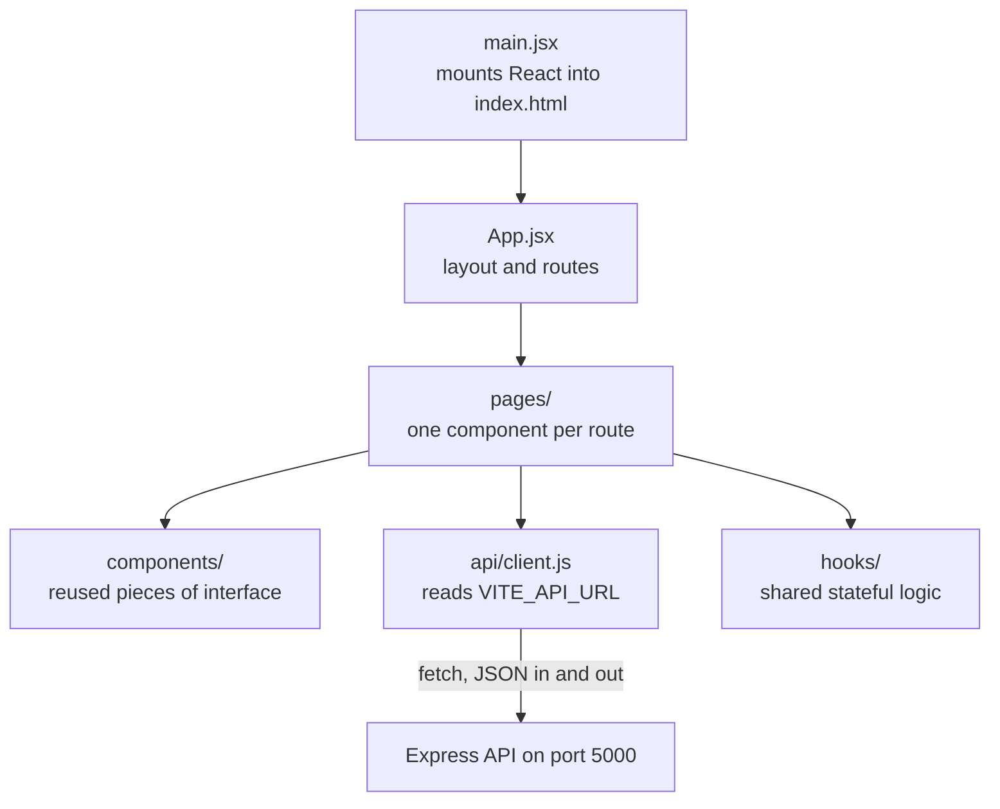

# 2.12 ,  Scaffold client folders

> **[Build]** · Chapter 02 ,  Project skeleton · *Vite React app in `client/`; `src/pages/`, `src/components/`, `src/api/`, `src/hooks/`*

**Why this step matters:** SkillSlot is a product customers see in a browser ,  not a headless API. Scaffolding Vite + React now establishes where login pages, shop screens, and API helpers live for the rest of the course.

<BigWordAlert term="React SPA shell" plainEnglish="A single-page app with routing and layout components but minimal pages ,  the UI skeleton." whyItMatters="SkillSlot's client starts as a shell; shop, cart, and vendor pages plug into the same router later." />

**Where the project is now:** Server runs; `GET /health` returns 200 JSON via curl.

**After this step:** Vite + React app exists in `client/` with `pages/`, `components/`, `api/`, `hooks/` folders.

## What you are building, and why it is a second app

The client is a separate program from the API, and this step is where that separation becomes real on disk. The server you built in 2.9 answers HTTP requests and owns the database; it never renders HTML for a person to click. The client owns what a person sees: the page a provider opens to publish weekly hours, the calendar a client uses to pick a slot, and the forms that send a booking or a cancellation. Two programs, two folders, two commands, one repository.

That split buys you a clean contract. The client reaches the server only through routes you define, so a missing endpoint shows up as a failed request instead of a mysterious crash inside a shared function, and the rule about who may see a Booking lives on the server where nobody can bypass it. The cost is two terminals: from 2.15 onward one stays in `server/` and one stays in `client/`, which is also why a client that quietly dies is easy to diagnose.

## Step 1 ,  Create Vite React app

From **repository root** (not inside `server/`):

```bash
npm create vite@latest client -- --template react
```

When prompted for a framework and variant, choose **React** and then **JavaScript** (not TypeScript) to match this course's MERN JS stack. The command above already asks for the JavaScript React template, so the prompt may not appear at all.

```bash
cd client
npm install
```

Official Vite scaffold creates baseline files ,  you'll reorganize slightly to match course convention.

Read the command before you run it, because every part of it is a decision. `npm create vite@latest` downloads the current Vite scaffolder and runs it once; it is not installed into your project. `client` is the directory it creates, and putting that name last is what stops the scaffolder from unpacking into the repository root and mixing its files with your `.gitignore` and README. Everything after `--` is passed to the scaffolder rather than eaten by npm, which is why `--template react` only works with the double dash.

The JavaScript choice matters more than it looks. The course writes `.jsx` files and plain JavaScript throughout, so the `react-ts` template would give you `.tsx` files and type errors on every later snippet. `npm install` is a separate step and not an optional one: the scaffolder writes `package.json` with React and Vite listed as dependencies but does not download them, so nothing starts until you install, which is why the first run prints a wall of package names and later runs print nothing.

## Step 2 ,  Target client tree after this sub-chapter

```
client/
├── index.html
├── package.json
├── vite.config.js
├── public/
└── src/
    ├── main.jsx
    ├── App.jsx
    ├── index.css          ← from Vite template; trim later
    ├── pages/
    │   └── .gitkeep
    ├── components/
    │   └── .gitkeep
    ├── api/
    │   └── .gitkeep
    └── hooks/
        └── .gitkeep
```

Compare that tree with what the scaffolder actually wrote. `index.html`, `package.json`, `vite.config.js`, `public/`, `src/main.jsx`, `src/App.jsx`, and `src/index.css` are Vite's files, and they stay because the dev server and the build expect them. The four folders in the lower half are yours and are empty on purpose: named places where later chapters add files, so no chapter ever has to say "put this somewhere". Two of the Vite files are worth knowing now: `index.html` holds the `<div id="root">` element and the script tag that starts `src/main.jsx`, and `vite.config.js` holds dev server and build settings that Chapter 23 will edit. Neither needs changing in this step.

## The four folders and how to choose between them

The four folders are a small convention with a large payoff, because they answer one question in one second: where does this new file go? A page is a whole screen that a route points at. A component is a piece of interface reused by more than one page. A module in `api/` is the only place that knows how to talk to the server. A hook is stateful logic that more than one component needs, wrapped so the logic is written once.

The diagram shows how those four relate at runtime. `main.jsx` mounts the app, `App.jsx` decides the layout and, from 2.13, the routes, a page renders the screen, and that page calls `api/` when it needs data. Hooks sit beside pages because both consume them, which is why they do not belong inside `pages/`.



Three rules follow from that picture, and they will save you a refactor in Chapter 15. First, if a file calls `fetch`, it belongs in `api/` and nowhere else, so the day the base URL changes you edit one file instead of twenty. Second, if a component appears on more than one screen, lift it into `components/`; if it appears on exactly one screen, it can live inside that page's file until a second user appears. Third, if two components need the same request and the same loading and error state, the shared part becomes a hook rather than a copy.

What you should not create yet is a `utils/` folder. It is the folder everybody creates and nobody can describe, and it becomes the place where unrelated helpers accumulate until no one knows what is safe to change. When a helper has a real home, the course names that home.

## Step 3 ,  Create course convention folders

```bash
cd client/src
mkdir -p pages components api hooks
touch pages/.gitkeep components/.gitkeep api/.gitkeep hooks/.gitkeep
```

The `.gitkeep` files look pointless and are not. Git tracks files, not directories, so an empty folder is invisible to `git status` and never reaches the commit. The name is only a convention: any file would work, and this one says why it is there. Without it, your folder structure exists only on your machine, and the next person to clone the repository gets nothing. `mkdir -p` makes the command safe to run twice, because an existing folder is not an error. Delete the `.gitkeep` files later when a folder holds real code; they are scaffolding, not architecture.

## Step 4 ,  Verify Vite dev server

```bash
cd client   # if not already
npm run dev
```

**Expected:** Terminal shows Local URL (typically `http://localhost:5173`). Browser shows Vite + React welcome content.

Stop with Ctrl+C after confirming.

Three lines of that output are worth reading properly. `Local` is the address on this machine and the one you open. `Network` is the address other devices on the same network can use, which matters when you test the client on a phone. The `ready in` timing line tells you the server compiled without errors, and it is the fastest way to notice a missing dependency.

If port 5173 is already in use, Vite does not fail; it picks the next free port and prints the new number. That is convenient and a trap, because the address you typed from memory is now wrong. Read the printed URL rather than assuming it, and keep it for the CORS setting in 2.15, where the server has to allow exactly the origin the client is served from. Leave the browser tab open while you work, since Vite reloads the page on save, and stop the process with Ctrl+C when you are done, because a dev server left in a closed terminal window is the usual reason a later port is taken.

## Step 5 ,  Client `.gitignore`

Vite template may include `client/.gitignore`. Ensure it ignores:

```
node_modules
dist
.env
.env.local
```

Root repo `.gitignore` already covers many patterns ,  duplicate in `client/` is fine.

Duplicating a rule is not a mistake here. The root file protects the repository as a whole, and the client file protects the client if it is later deployed or opened as its own project. The one rule that must never disappear is `.env`: a client environment file can hold a public API URL that is safe to expose, but it can also hold a key someone pasted "temporarily", and history keeps it forever.

## Step 6 ,  Commit

From repo root:

```bash
git add client/
git commit -m "chore(client): scaffold vite react app with folder convention"
```

Staging `client/` rather than `git add .` is deliberate. The narrower path makes the commit reviewable, and it cannot accidentally sweep up a stray file you created at the root. Before you commit, run `git status` and check that `node_modules` is absent from the staged list; if it appears, the ignore rule did not apply because the folder was staged with `-f` or the rule was written with a leading path that never matched.

## npm scripts (from template)

| Script | Purpose |
|---|---|
| `npm run dev` | Development server with HMR |
| `npm run build` | Production bundle → `dist/` |
| `npm run preview` | Serve production build locally |

You'll use `build` in Chapter 23 deploy.

The three scripts are the whole client lifecycle. `dev` serves modules unbundled and reloads on save, so it stays fast and stays the one you use all course. `build` writes the static files a host serves in production, and it is the script that catches import mistakes the dev server forgives. `preview` serves the built output locally so you can check the production bundle before deploying, and in Chapter 23 it is the last test before a real upload.

## What each client folder holds later

| Folder | Chapter 2 | Later |
|---|---|---|
| `pages/Home.jsx` | 2.13-2.15 | Browse, cart, login, provider dashboard |
| `components/` | empty | ServiceCard, Layout, slot picker |
| `api/client.js` | 2.14 | Central fetch + base URL |
| `hooks/` | empty | `useAuth.js` Chapter 7 |

That table is a promise about the shape of the client, and it is worth checking at the end of each chapter that names one of those folders. A page for browsing Services belongs in `pages/`, the card that renders one Service belongs in `components/`, and the call that fetches availability from the API belongs in `api/`. If you find a `fetch` inside a page and a second page needs the same call, that is the moment to move it, not three chapters later.

## Failure modes you will meet

**Vite fails to start with a Node version warning.** Older Node cannot run the current Vite, and the error names the required version. Run `node --version`, install a current LTS release, and start again from the `npm install` step.

**`npm create vite@latest` unpacks into the wrong place.** If you ran it from inside `server/`, or forgot the `client` name, the scaffold files land beside your server code. Delete the stray files, return to the repository root, and run the command again with `pwd` checked first.

**The template generates TypeScript files.** You picked the TypeScript variant at the prompt, or typed `react-ts`. Delete `client/`, run the same command again, and choose the plain React option so the extensions match the course snippets.

**The page loads but the console shows a failed request.** That is expected until 2.14 and 2.15: no API helper exists and no CORS rule allows the origin yet. Note the message, confirm the dev server is the one printing it, and continue; this is a later step, not a broken scaffold.

**The dev server starts from the wrong directory.** Vite prints an error about a missing `index.html` when it is started from `server/` or from the repository root instead of `client/`. Check the terminal prompt, `cd client`, and run the script again.

## ✅ Do / ❌ Don't

**✅ Do:** Keep `client/` as sibling of `server/` ,  not nested inside server.

**✅ Do:** Run client and server dev scripts in **separate terminals** simultaneously from Chapter 2.15 onward.

**❌ Don't:** Proxy API through Vite in this chapter unless you document it and skip CORS teaching ,  course uses explicit `VITE_API_URL` + CORS for clarity.

**❌ Don't:** Put Express code inside `client/` ,  ever.

## Verify

| Check | Expected |
|---|---|
| `client/package.json` exists | yes |
| `npm run dev` shows React page | yes |
| `src/pages`, `api`, `hooks`, `components` exist | yes |
| Committed to Git | yes |

Each row is proof you can gather with a single command, which is what makes it usable evidence later. The first row proves the scaffold wrote a real project manifest with scripts rather than an empty folder. The second proves the toolchain runs on your machine, and the printed URL is the origin you will allow in the CORS setting at 2.15. The third proves the convention survived to the committed state, and `git ls-files client/src` shows it without trusting your memory. The fourth proves the work is in history, which is what your mentor opens.

## Hint

If `npm create vite` fails, check Node version ≥ 18. Alternative: manual Vite setup from official guide ,  same outcome.

## Next

**Sub-chapter 2.13:** React Router shell + `pages/Home.jsx` placeholder (minimal ,  health fetch comes 2.15).
