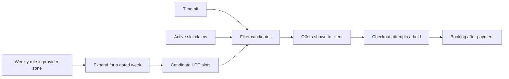

# Rules, slots and bookings

Your server and client can now exchange a health response. Neither can yet answer the question a client will ask most often: "Can I book this provider at 09:00 next Tuesday?" A database will remember providers, services and reservations between server restarts. Choosing one requires more than a list of collections. You must decide what a time rule means, what a displayed slot means and what counts as a promise to a paying client.

SkillSlot serves a tutor in Gaza, a designer who works online and an electrician who visits clients. Their calendars look similar in the browser, but the records behind them have different jobs. A tutor might teach every Monday from 09:00 to 12:00 in `Asia/Gaza`. That is a repeating rule. A client in Berlin might see three bookable starts for a particular Monday. Those are computed offers. When the client pays for 09:00, SkillSlot must store a booking and prevent another buyer from taking the same provider time. That is a durable commitment.

This module gives those three things separate names before any Mongoose model is written. Module 4 connects MongoDB. Module 5 teaches time-zone conversion. Module 6 implements the collections and their indexes. This module produces a reviewed draft at `docs/erd-draft.md`, so the later code has a design to follow.

Follow one arrow at a time. The rule is not a booking. A candidate slot is not a reservation. The offer displayed to a client is not a promise that it will still exist when they press Pay. The checkout path must try to claim the provider's time at the database boundary. If another checkout won first, the second attempt must fail clearly. The browser can refresh and show another start. It must not create two bookings and hope that a later cleanup job notices.

## A rule is a repeating local-time intention

An `AvailabilityRule` describes when a provider normally accepts work. It needs a provider ID, a day of the week, a local start and end time, an IANA zone such as `Asia/Gaza`, and a validity period. A Monday 09:00 rule is not one universal UTC hour. A zone's offset can change with its civil time rules. Expansion for a dated week creates actual UTC instants; it cannot just add seven days of milliseconds to the previous week's start.

Keep this distinction in the database even if the first demo uses only one provider. An electrician might block Friday afternoons for travel. A tutor might change weekly hours next month. A designer might work in one zone while a client views in another. If the rule stores only a fixed UTC offset, the browser may show an hour that the provider never offered after a clock change. If it stores only the client's displayed time, another client in a different zone may see a different appointment as though it were the same slot.

Module 5 will make the conversion explicit and test clock-change dates. For now, the ERD should mark the rule's local `HH:mm` values and zone as different from a booking's UTC `startAt` and `endAt`. Do not pretend that `2026-11-02 09:00` is a complete instant without a zone and a clear ambiguity policy.

## A slot is a computed offer, not a row to trust forever

For a selected week, the server expands rules, subtracts time off and active claims, and sends possible starts to the client. A 60-minute service can fit only if its whole interval, including any required buffer, is open. The server should send UTC starts and enough zone information for labels. The client's browser formats those instants in the client's chosen zone. It does not decide whether the provider is free.

The list is a snapshot of availability at one moment. Another client may start checkout before the first client presses a button. A provider may add time off. A held claim may expire. Therefore the final checkout request rechecks and claims time in the database. A green button shown five seconds ago is evidence of an offer, not evidence of ownership.

Imagine that SkillSlot materializes a permanent `Slot` document for every possible 15-minute start. It would need to regenerate many documents when the provider changes weekly hours, adds a day off or changes the service buffer. Two teams could update different copies and leave stale offers. A computed offer backed by a smaller set of authoritative rules and claims is easier to explain. Cache may speed the calendar later, but the claim collection remains the correctness boundary.

## A booking is an independent commitment

A `Booking` records one client's paid or held appointment with one provider. It needs a client, a provider, a service, start and end instants, a state, and links to the provider's order. It also needs snapshots of the price, duration, cancellation policy and relevant zones shown at purchase. The provider may rename a service next week; the receipt must still say what the client bought. The booking may be cancelled, rescheduled or refunded. Its history must survive those changes.

One cart may contain a tutor session and a designer session. Checkout splits the purchase into one order per provider, then creates a booking for each service line. The client sees both appointments, while each provider sees only their own. A booking is therefore more than a line inside a single customer order. It has its own state and an ownership chain that both participants need to inspect. The relationship lesson later in this module explains why this separate lifecycle changes the embedding choice.

The database does not decide the product policy for you. It can enforce uniqueness of a claim key, but it cannot decide whether a late cancellation gets half a refund or whether a provider may move a booking. Those policies belong in the application and must be tested. The ERD should expose the records needed to apply them, not hide all behavior in a `metadata` object.

## Work one date through the model

Use a neutral example rather than relying on a current Gaza offset. A provider publishes Monday 09:00 to 10:00 in their IANA zone. On a particular date, the time module resolves that local interval into two UTC instants. The calendar engine offers 09:00 and 09:30 starts for a 30-minute service. Client A clicks 09:00. Client B clicks 09:15 for another 30-minute service. Both browser views might have been generated before either click. Only the database claim attempt can choose the winner for the overlapping 09:15 block.

Write three labels beside this example in your learning log: rule, candidate and booking. Then answer what would be wrong if you stored all three as a single document called `slot`. You should notice different lifetimes. The rule might last months. The candidate exists only for a requested display range. The booking must remain inspectable after payment, rescheduling and refunds. A design that gives them one lifetime will either keep stale offers or erase history.

The next lesson compares a relational design with a document design for those lifetimes. The comparison is deliberately fair. PostgreSQL has a range constraint that fits overlapping appointments unusually well. MongoDB can still support SkillSlot when we model fixed block claims and use a unique index, but it does not provide the same interval rule by default. Your database decision must name that difference.

## Source check

Read MongoDB's explanation of [embedding related data](https://www.mongodb.com/docs/manual/data-modeling/embedding/) and [document relationships](https://www.mongodb.com/docs/manual/applications/data-models-relationships/). The first explains why closely related fields can live together. The second frames the choice between embedded data and references. In the next lessons you will apply that choice to a booking that has its own state and to a price snapshot that must stay frozen.
