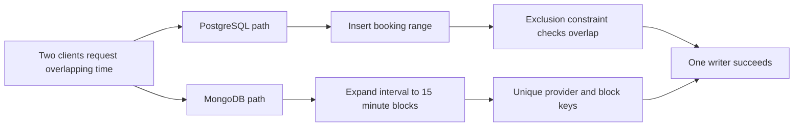

# Relational and document schedules

Two clients see the same tutor available at 09:00. They both press Pay. Your database choice matters most at that exact moment, when two requests disagree about who owns the time. PostgreSQL and MongoDB can each store users, providers, services and bookings. They differ in the constraint each can express directly. A fair comparison asks what each database can stop even if application code makes a mistake.

PostgreSQL has range types and exclusion constraints. A `tstzrange` represents a time interval using timestamps with time zones, and the overlap operator `&&` asks whether two ranges share time. An exclusion constraint can reject two overlapping rows for the same provider. MongoDB can enforce a unique compound key, such as provider plus a fixed block start. It cannot express an arbitrary no-overlapping-interval constraint with the same built-in unique index. SkillSlot chooses fixed 15-minute claims to turn an interval into several scalar keys.

That distinction does not make either database universally better. It tells us what work our model and tests must do. If you prefer PostgreSQL for a scheduling product, you have a strong reason. If you follow this course's MongoDB stack, you must own the block size, boundary alignment, claim cleanup and transaction behavior. Avoid the vague answer that documents are "flexible" and therefore schedules are easy.



Move the request through each path. Both can produce one winner. PostgreSQL checks the interval relationship directly. MongoDB checks that each required block key is owned at most once. The second path needs a rule that every reservable duration and buffer is a whole number of blocks, and that every request uses the same UTC block boundaries. If one code path skips the last block or rounds a start differently, a unique index cannot repair the missing claim.

<TraceRequest title="One provider, two overlapping requests">
  <TraceStep actor="Client A" label="Request 09:00 to 09:30" detail="Needs 09:00 and 09:15 blocks" />
  <TraceStep actor="Client B" label="Request 09:15 to 09:45" detail="Needs 09:15 and 09:30 blocks" />
  <TraceStep actor="Database" label="Both try 09:15" detail="Exclusion or unique claim rejects one writer" />
  <TraceStep actor="API" label="Return conflict to loser" status={409} detail="Do not promise a second booking" />
</TraceRequest>

Trace a different pair yourself: 09:00 to 09:30 and 09:30 to 10:00. Those intervals touch but do not overlap when modeled as half-open ranges `[start, end)`. Their claim sets are different. Both can succeed, provided no cleanup or service buffer extends the first appointment into the second. This small exercise is more useful than memorizing database slogans because it tests the boundary where real schedulers fail.

## What PostgreSQL can express directly

PostgreSQL's official range documentation uses reservations as an example. A table can store one range per booking and use a GiST exclusion constraint to reject overlaps. With a provider ID in the constraint, overlapping bookings for different providers remain valid. The `btree_gist` extension supplies GiST equality support for ordinary scalar values such as the provider key. This is a database rule, not just a check in an API controller.

The shape below is illustrative, not a migration for the MongoDB project. It shows why the relational option deserves respect:

```sql
CREATE EXTENSION IF NOT EXISTS btree_gist;

CREATE TABLE booking (
  provider_id text NOT NULL,
  during tstzrange NOT NULL,
  EXCLUDE USING gist (provider_id WITH =, during WITH &&)
);
```

This simplified table treats every row as blocking time forever. A real product needs an explicit rule for held, confirmed, cancelled and expired records. You might use a partial constraint for blocking states and update a row when a hold expires. You still need transaction and payment handling around the appointment. The range constraint solves overlap, not every checkout rule. A paid order, cancellation policy and reminder job still have their own lifecycles.

The code also assumes every interval has a sensible start and end. The application must reject an end that is not later than the start, choose half-open bounds, and resolve the provider's local wall time into UTC before insertion. A database constraint cannot infer the intended clock-change occurrence from an ambiguous local `01:30`. Module 5 teaches that conversion. The constraint starts protecting you after the time input is made unambiguous.

Read PostgreSQL's [range types and constraints](https://www.postgresql.org/docs/current/rangetypes.html). Notice the specific `tstzrange` type, the overlap operator and the section on exclusion constraints. You do not need to install PostgreSQL for this course. You do need to be able to explain in a design review why its interval constraint is an advantage for this problem.

## What MongoDB can enforce with claims

MongoDB's unique compound index can ensure that one combination of `providerId` and `blockStartAt` appears in at most one `SlotClaim` document. Suppose every claim is one 15-minute UTC block. A booking from 09:00 to 09:45 needs claims at 09:00, 09:15 and 09:30. A second booking from 09:15 to 10:00 needs 09:15, 09:30 and 09:45. Their sets overlap, so a unique insert must reject the second request if the first won.

The correctness condition is more precise than "check for existing bookings". A read query followed by an insert has a gap. Both clients can read an empty calendar before either writes. The database index is the final guard when they insert the same scalar key. The API should treat a duplicate-key error as a normal conflict response, not as an unexpected server crash. It should not retry blindly with a different key because that would change the appointment the client chose.

Claims for one booking must be created together with the held booking state. If the request needs four blocks and fails on the third, the first two must not remain reserved. MongoDB supports multi-document transactions on replica sets, which is why SkillSlot makes a replica set part of its local and hosted setup. Module 4 will run a transaction smoke test. Later checkout chapters will write the claims, booking and provider order in one transaction boundary where appropriate. A unique index still matters inside the transaction: it chooses the winner for a particular provider block.

The block model has costs. A 90-minute appointment plus a 15-minute cleanup buffer needs seven claim documents. A service with a 20-minute duration does not fit a 15-minute grid unless you change the product rule or block size. The course chooses services and buffers in whole 15-minute blocks. It also chooses one UTC rounding rule. Do not silently round a 09:07 request to 09:00. Reject inputs that are off grid and explain the allowed starts.

Read MongoDB's [unique index documentation](https://www.mongodb.com/docs/manual/core/index-unique/) and [transaction documentation](https://www.mongodb.com/docs/manual/core/transactions/). The index proves duplicate scalar keys are rejected across documents. The transaction gives an all-or-nothing boundary across several claim documents and the booking. Neither source says a unique compound index understands arbitrary overlapping time ranges. That part is our model's responsibility.

Before accepting this trade-off, make a small comparison table in your own notes with columns for a 09:00 to 09:30 appointment, a 09:15 to 09:45 appointment, and the database key or range each writes. In the PostgreSQL column, use two half-open `tstzrange` values and mark the overlap. In the MongoDB column, list two block starts for each request and circle the shared 09:15 key. Then repeat with appointments that touch at 09:30. The first pair should conflict in both models; the second pair should be allowed unless a service buffer extends the occupied interval. This is a transfer check: it proves you can apply the constraint to a new interval rather than recite its name.

Also distinguish claim expiry from a database constraint. A held appointment can expire by product policy, but an existing unique key still occupies its index entry until the claim is removed. A background TTL deletion is eventual work, so checkout must not assume the block became free at the exact expiry timestamp. A deliberate cleanup transaction can change the expired hold and release its claims before a new hold is attempted. PostgreSQL has a similar policy question about which states remain inside its exclusion constraint. Neither technology removes the need to define when time becomes sellable again.

## Decide what evidence would change your mind

For this course, MongoDB is already the database in the shared stack. The question is whether our model can make scheduling correct and explain its limits. If service durations become arbitrary to the minute, if travel buffers become irregular, or if the number of claim documents per booking becomes costly, the range constraint in PostgreSQL deserves another look. A migration would not be free. It would change the data layer and tests, but the reason would be tied to this product's hardest constraint rather than fashion.

Write two sentences in `docs/erd-draft.md` before the next lesson. First: "PostgreSQL can reject overlapping provider ranges with an exclusion constraint." Second: "SkillSlot uses MongoDB with a unique provider and UTC block claim key, plus a transaction for the whole hold." Add one condition under which you would reconsider. That note will stop a future teammate from describing MongoDB as though it provided the PostgreSQL rule automatically.
