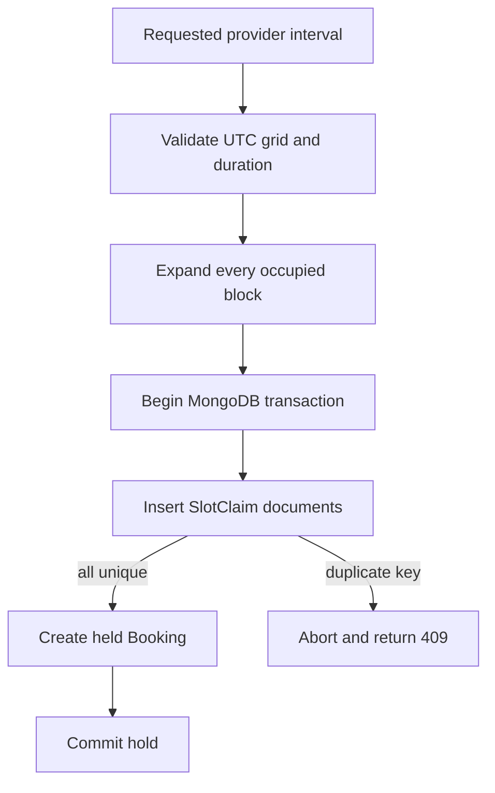

# The SkillSlot database decision

SkillSlot will use MongoDB because the course's server stack already uses it and because its document model fits the provider profile, service descriptions, snapshots and evolving policy fields we need to teach. That is a defensible choice only if we say how overlapping appointments are prevented. MongoDB's flexible document shape does not make two clients stop racing. The design must turn one requested interval into database keys that a unique index can protect.

Our rule is simple enough to test: every reservable service starts on a 15-minute UTC grid and has a duration and buffer that are whole multiples of 15 minutes. For each occupied block, checkout creates one `SlotClaim` with scalar `providerId` and `blockStartAt` fields. A unique compound index on those fields allows at most one claim document for a provider and block. Expired claims must be released before that key can be reused. Claims are the locking data. `Booking` is the client and provider's appointment record. The two collections have different jobs and must not be confused.

This module records the decision. Module 6 implements the collection and index. Later checkout modules implement transactions and conflict handling. If you only sketch a `Booking` collection now and assume a query will prevent races, you have missed the hardest part of the product. Put `SlotClaim` on the ERD as a first-class collection, not as a note beside Booking.

The diagram has a deliberate failure path. If any block collides, the transaction aborts all claims from that attempt. The client receives a conflict and can choose a fresh start. If the database is unavailable, the server does not create a booking from a cached calendar. A stale calendar is inconvenient. A double charge for an appointment that cannot be delivered is worse.

<TraceRequest title="Two checkouts for one tutor block">
  <TraceStep actor="Checkout A" label="Insert 09:00 and 09:15 claims" detail="Provider P, two-block lesson" />
  <TraceStep actor="Checkout B" label="Insert 09:15 and 09:30 claims" detail="Provider P, overlapping lesson" />
  <TraceStep actor="MongoDB" label="One 09:15 key wins" detail="Unique provider and block index rejects duplicate" />
  <TraceStep actor="Checkout loser" label="Abort transaction" status={409} detail="No partial claim and no held Booking" />
</TraceRequest>

Change Checkout B to start at 09:30 and run the trace again. Neither claim set now contains the same block. Both may succeed if the provider rule permits the full interval and no buffer extends Checkout A into 09:30. Then add a 15-minute buffer to Checkout A. Its claim set must include 09:30, so Checkout B loses again. The correct answer changes when the business rule changes, not when the database vendor changes.

## State the invariant before the schema

The invariant is: at most one active claim exists for each provider and UTC block start. An invariant is a fact the system must preserve after every successful request. It is stronger than a controller condition such as "if no booking was found, insert one." The controller condition can pass in two concurrent requests. The unique index makes duplicate keys a database error at the write boundary.

An active claim needs a lifecycle. A hold may expire before payment. A confirmed booking keeps its claims until cancellation or completion policy releases them. A reschedule swaps old claims for new claims as one coordinated operation. When a hold expires, an expiry worker removes or releases its claims and updates the booking state. A MongoDB TTL index may eventually remove old documents, but background deletion is not a precise appointment clock. The checkout path must explicitly handle expired holds before it promises the freed block to someone else.

Do not put all block starts for one booking into one array field and assume a unique multikey index solves the problem. MongoDB documents note that unique multikey behavior constrains keys across documents, but repeating keys generated within one document are a different case. Separate scalar claim documents make the invariant easier to reason about and test. The exact schema and index declaration arrive in Module 6; the decision here is to keep one claim per block.

The claim set should include the service's occupied time and its buffer. Suppose a 45-minute service starts at 09:00 and needs 15 minutes of cleanup. The held interval is 09:00 to 10:00. Its block starts are 09:00, 09:15, 09:30 and 09:45 in UTC. A second service starting at 09:45 conflicts even though the first client session ends then. A second service starting at 10:00 can fit if the provider's availability rule remains open. Half-open intervals `[start, end)` make that boundary predictable.

## Why a transaction is part of the decision

The unique index protects one block key at a time. A booking may need several keys, an Order row for the provider and a Booking row for the client. Without an all-or-nothing operation, the server could insert the first two claims, fail on the third and leave ghost time blocked. A multi-document transaction lets the application either commit the coordinated hold or roll it back. MongoDB documents multi-document transactions for replica sets and sharded clusters. SkillSlot will use a replica set in local development and in the hosted database so tests exercise the real boundary.

The transaction does not make a weak design strong by itself. It does not know what a 15-minute block means, whether a provider has time off, or whether payment later succeeds. Application code must validate those conditions and write the right documents. It also must retry the right failures and avoid retrying a duplicate-key conflict as if the same appointment could somehow become available. The database gives a trustworthy primitive. The product gives it meaning.

Work through the write path with three requests. Request A asks for 09:00 to 09:30 and claims 09:00 plus 09:15. Request B asks for 09:15 to 09:45 and claims 09:15 plus 09:30. Only one of them can own 09:15. Request C asks for 09:30 to 10:00 and claims 09:30 plus 09:45. If A wins, C can fit; if B wins, C conflicts on 09:30. This outcome follows from the committed claim set, not from which client opened the page first. Write these three sets beside your ERD and check them again when the concurrency test is implemented.

There is another race outside the unique key. A provider may add TimeOff after a client sees an offered slot but before the client checks out. The slot list is a preview, so checkout must revalidate against the provider's current rule and exceptions at the point it attempts the hold. A unique claim blocks competing client bookings; it does not block a provider's rule edit by itself. Later modules need a version or coordinated write policy so a rule change cannot silently coexist with a newly accepted booking it was meant to remove. Put that policy in the open-decisions section now rather than claiming the index covers it.

Finally, distinguish a transient database retry from a business conflict. A transaction may be retried according to driver guidance when a transient error occurs. A duplicate claim for the same requested time means the chosen slot is unavailable; retrying the identical request without any state change cannot create another legitimate winner. Return a stable 409 and let the client select a new offer. The payment side also needs an idempotency key so a network retry does not create two orders for one intended checkout. Those mechanics come later, but the distinction belongs in the design decision.

When the transaction commits, a held Booking can be shown as provisional. A payment callback may confirm it. If payment fails or the hold expires, a later transaction releases the claim set and updates state. The order and booking remain as history where the policy requires it; the claims represent the time currently occupied. Keep that separation in your ERD. Deleting the whole Booking on expiry would erase the evidence needed to explain a failed checkout or support request.

## Name the trade-off honestly

The approach writes more documents than one booking row. A long session with buffers creates many claims. The fixed grid also limits product flexibility. If providers need arbitrary seven-minute starts or if appointment lengths change per client, we may need a different constraint strategy. PostgreSQL's exclusion constraint is a serious alternative because it can reject overlaps on ranges directly. MongoDB remains a deliberate course choice, not a claim that it is always superior for calendars.

Add a decision record in `docs/erd-draft.md`. Name the user-visible requirement, the invariant, the index key, the transaction boundary and the cost. Then sketch the negative test you want Module 6 to pass: twenty parallel attempts for the same provider block, one success and nineteen conflicts. Do not write the concurrency test yet. A design document is ready when another developer can build that test without asking what "booked" means.

For the database facts behind this decision, use MongoDB's [unique compound index documentation](https://www.mongodb.com/docs/manual/core/index-unique/) and [transaction guidance](https://www.mongodb.com/docs/manual/core/transactions/). For the alternative, use PostgreSQL's [range constraint documentation](https://www.postgresql.org/docs/current/rangetypes.html). These sources support the primitives. The block size and release rules are SkillSlot product decisions that you must record and test.
