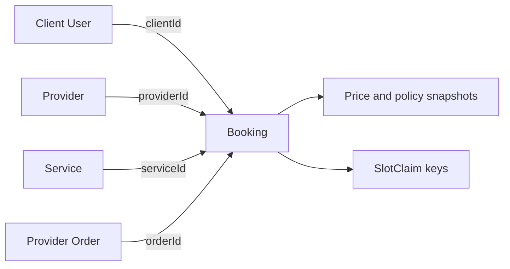

# Why a booking is its own document

In a shelf-stock marketplace, an order line can hold a frozen description of an item bought from one shop. That line belongs to the order's receipt. SkillSlot has a different object. A booking starts as a hold, may become paid, can be rescheduled, may be cancelled and can trigger a partial refund. Both provider and client need to find it directly. If it lives only as an embedded array item inside an Order, every appointment operation must find and edit that parent order first. That would hide the booking's independent lifecycle.

MongoDB allows either embedding related data inside one document or linking documents by IDs. Embedding is useful when data is read together and shares a lifecycle. Referencing is useful when the related thing changes independently, is queried from several directions or can grow beyond a comfortable parent document. SkillSlot needs both patterns. A Booking references Provider, Client, Service and Order by IDs, while it embeds purchase-time snapshots such as the agreed price and policy text. The snapshot belongs to that booking's history and must not follow later edits to the Service.

This is not a rule that every field must be normalized. It is a decision about which facts should remain live and which should remain true as of purchase. A provider's public display name can be looked up for the current profile page. A booking receipt can also store the name shown when the client paid, so an old receipt remains understandable after a rename. The two values answer different questions.

Read the arrows as ownership and lookup paths, not as instructions to copy whole documents. The client opens a calendar by `clientId`. The provider opens an agenda by `providerId`. An order screen follows `orderId` to its bookings. The service detail page may show the current duration and price, while the Booking snapshot shows what this client actually accepted. Claims point back to the Booking so expiry or cancellation can release precisely the blocks it owns.

<TraceRequest title="A service price changes after a paid booking">
  <TraceStep actor="Client" label="Pays for a 60-minute lesson" detail="Price and policy captured on Booking" />
  <TraceStep actor="Provider" label="Updates Service price next week" detail="Current catalogue changes" />
  <TraceStep actor="Receipt" label="Reads Booking snapshots" detail="Original price and policy remain visible" />
  <TraceStep actor="Agenda" label="Reads Booking.startAt" detail="Current service edit does not move appointment" />
</TraceRequest>

Run this trace with a cancellation rule instead of a price change. If the provider shortens the cancellation window next month, should it retroactively change a client contract accepted today? The course says no. The booking stores the policy version or concrete terms in force when purchased. Support can then calculate a refund from the accepted terms rather than a mutable current service document. The reference to Service is still valuable for a link back to the provider's current offering.

## The booking has two audiences and one identity

A provider needs an agenda with upcoming sessions across many clients and orders. A client needs a calendar with appointments across many providers. Those are two different query paths over the same bookings. Give each booking one ID and index the fields used by each path. If you put a separate copy under the provider and another under the client, you must synchronize two states through cancellation, reschedule and refund. If one update fails, the two people see different promises.

An Order is also not the right sole owner. One checkout can pay for a tutor and a designer. SkillSlot splits the cart into one order per provider so each provider sees only their own revenue and fulfillment. Each service line produces one Booking with its own time, state and reminder. A single provider order might contain two lessons on different days. Cancelling one should not erase the other. A Booking therefore references the provider's order and can carry the line-level facts needed for later refund allocation.

Keep the reference direction clear. The Booking stores `orderId`; the Order need not embed the full Booking objects. It may list IDs or a small receipt summary for efficient reads, but a status update has one authoritative Booking record. A client agenda query should not scan every Order just to find appointments on Tuesday. A provider agenda query should not read another provider's order. The ERD should show those access paths because they drive authorization checks later.

## Snapshot facts that must not drift

The booking's immutable purchase snapshot includes the service title, duration in minutes, price and currency, cancellation policy, provider zone, and possibly the client zone displayed at checkout. The exact list can be revised at the roadmap's data-model gate, but its purpose is fixed: an old purchase must remain explainable. If the provider edits the Service title from "English tutoring" to "Exam coaching," the booking receipt keeps the original description. If the provider changes their default zone, an existing UTC appointment does not move.

Avoid copying sensitive provider or client fields just because embedding is convenient. A home-visit address is visible only to participants who need it and only at the right stage. The authorization boundary belongs to the server. The snapshot should include enough to fulfill and support the booking, not a copy of the entire user profile. A shorter document is easier to review for accidental data exposure.

`AvailabilityRule` and `TimeOff` also have separate lives. A rule is an ongoing local-time intention and can be revised without rewriting past bookings. Time off is a dated exception, such as a blocked afternoon. Neither should be embedded inside every Booking. The booking may remember which rule produced its original offer for debugging, but the paid appointment's UTC interval is authoritative. A later rule edit must not silently reschedule a paid client.

## What embedding still does well

An order receipt contains small line snapshots because the lines are usually read with that order and describe the purchase as it happened. A Booking can contain a small state history array for an MVP if that history is bounded and written with the booking. If audit requirements or update volume grow, event records may deserve a separate collection. The choice should be based on access and growth, not a preference for nested JSON.

Test the ownership choice with a reschedule. A client moves a paid lesson from Tuesday at 10:00 UTC to Thursday at 11:00 UTC. The Booking keeps its identity and `orderId`; its appointment interval and claim set change through the reschedule workflow. The Order remains the payment record for the original purchase. If the Booking existed only as an order-line snapshot, a provider agenda would have to search order documents and decide which embedded copy is current. If the Booking had no purchase snapshot, the reschedule could accidentally show the Service's newly edited price as though it were the amount paid. The separate record with references and frozen terms avoids both mistakes.

Try a second transfer case with a provider rename. The public Provider profile now says "Amina Studio," while an old receipt says "Amina Design" because that was the displayed seller name when the client purchased. The Booking may retain the purchase-time display label and still reference the current provider profile for support or a new booking. Decide which label the upcoming agenda should show and state the policy in `docs/erd-draft.md`. A reference does not force every screen to display live data, and a snapshot does not require the application to hide the current profile. The query's purpose decides which fact to use.

When you draw the ERD, write one sentence for each join direction. `Booking.clientId` supports a client's agenda; `Booking.providerId` supports the provider's agenda; `Booking.orderId` supports a receipt; `Booking.serviceId` supports navigation to the current offer. Then list which snapshots must survive if the referenced Service is deactivated. This exercise catches a common mistake: adding references because the database supports them without checking whether the product can still explain a historical purchase after live documents change.

MongoDB's [embedding guidance](https://www.mongodb.com/docs/manual/data-modeling/embedding/) notes that related data can be retrieved and updated in one document operation. Its [relationship guidance](https://www.mongodb.com/docs/manual/applications/data-models-relationships/) frames when references fit. SkillSlot uses that distinction to make Booking an independently addressable record and to embed only the frozen facts that belong to it. The result is a model that supports both agendas, a truthful receipt and the later state transitions.

Add two examples to `docs/erd-draft.md`: a referenced `serviceId` and an embedded `priceCentsAtPurchase`. Beside each, write what happens if the provider changes the Service next week. Then sketch a query for the client's agenda and another for the provider's agenda. If either query begins by loading every Order in the marketplace, the Booking identity has not been separated enough. The next check will ask you to apply these choices to a short scenario before you draw the full ERD.
