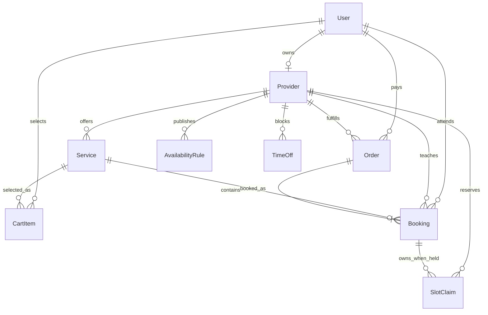

# Map the calendar actors to collections

You now have a data-model decision, but a reviewer cannot test a decision that lives only in prose. In this build, create `docs/erd-draft.md` in your SkillSlot project. It is a design artifact, not a set of Mongoose schemas yet. The document must show eight collections: Provider, Service, AvailabilityRule, TimeOff, CartItem, Order, Booking and SlotClaim. Draw their relationships, list the fields that make the relationships possible, and write the invariants that later code must enforce. Include User as an external identity box so it is clear who owns a Provider and who acts as a client.

Start by making a new `docs` directory if your project does not have one. Create the Markdown file and copy the diagram below as a first pass. Change field names if your existing skeleton already has a naming convention, but keep the meaning and cardinalities. Save the diagram in the file itself so a mentor can review the exact version committed with your code. Do not paste a screenshot as the only copy. The text beneath the diagram is just as important as its boxes, because a diagram alone cannot explain a race condition or a cancellation policy.

Read `User ||--o| Provider` as one account may own zero or one provider profile in this course. It does not say every account is a provider. The other side of the marketplace is a client account, represented by `User` references in CartItem, Order and Booking. An instructor is not a separate duplicate login collection. If the product later lets one business account manage several provider profiles, change that cardinality deliberately and revisit authorization. Do not let an accidental array in a schema make the decision for you.

## Write the collection notes

Under the diagram, add a short section for each collection. A Provider has `userId`, public name, home IANA zone, status and profile details. A Service has `providerId`, title, duration in minutes, price in minor currency units, currency, cancellation terms and active status. A provider can offer several services. The Service is the current catalogue offer, so a later price edit changes what a new buyer sees. It must not rewrite the price on an existing Booking.

An AvailabilityRule has `providerId`, local weekday, local start and end time, IANA zone, effective date range and rule status. It describes a repeatable intention, such as Monday from 09:00 to 12:00 in the provider's zone. Do not store only a UTC weekday and hour. An offset can change while the local business promise stays nine in the morning. `TimeOff` has `providerId`, a dated interval or dated local boundaries with a zone, reason category and status. It is an exception that removes offers. Decide whether its stored boundaries are already resolved UTC instants; write that decision beside the fields so future code cannot mix unresolved wall time with resolved instants.

CartItem has `clientId`, `providerId`, `serviceId`, proposed `startAt` and `endAt` UTC instants, creation time and expiry. It is a request for an appointment, not a lock. A cart can contain choices from more than one provider. Before checkout, a proposed interval may become stale because a provider edits a rule, adds time off or another client secures it. Your note must say that the server revalidates it. A CartItem should not be used as evidence that a time is reserved.

Order has `clientId`, exactly one `providerId`, payment and refund state, total and currency snapshots, and identifiers used for payment idempotency. A mixed-provider cart is split into separate provider orders. This gives each provider a clear order boundary and lets later payment reconciliation operate per provider. Do not draw one Order pointing to two unrelated providers. Each Order contains one or more Booking records, but the Booking has its own ID and state. Write down whether an Order can exist before payment succeeds and which status allows its Booking to become confirmed. That state transition will be implemented later; the ERD should make the question visible now.

Booking has `clientId`, `providerId`, `serviceId`, `orderId`, `startAt`, `endAt`, status and snapshots of the agreed title, duration, price, currency, policy and provider zone. The UTC interval is the dated appointment. It is not recomputed whenever an AvailabilityRule changes. The reference IDs support a client agenda, a provider agenda, service drilldown and an order receipt. The snapshots support a truthful old receipt after the live Service changes. Write both facts beside the Booking box, otherwise someone may remove one set as duplication.

SlotClaim has `providerId`, `blockStartAt`, `bookingId`, claim state and any expiry metadata needed for a pending hold. Use one document per occupied 15-minute UTC block, with a unique compound index on `{ providerId: 1, blockStartAt: 1 }`. A 30-minute booking beginning at 09:00 UTC owns the 09:00 and 09:15 blocks. A second booking beginning at 09:15 needs the 09:15 block and therefore conflicts. The interval convention is half open: the end boundary is not a claimed block. A booking that ends at 09:30 can be followed by one that starts at 09:30. If the product ever permits durations that do not align to the 15-minute grid, reject them or explicitly round and disclose the policy; do not silently leave a partial block unclaimed.

## Add the write-boundary contract

Below the field notes, write three invariants in your own words. First, an offered time is only a candidate until the database has accepted all its claims. Second, one provider and one UTC block may have at most one live SlotClaim. Third, booking state and claim ownership change together at a transaction boundary. A client cannot receive a confirmed booking if one required claim failed. If a pending hold expires, later cleanup must release all its blocks before another booking can own them. A time-to-live index may help trigger cleanup, but deletion timing is not an immediate exclusivity guarantee.

Draw a small sequence below the ERD. The server reads the service and provider rule, resolves a dated UTC interval, verifies time off and notice rules, then starts a transaction. It inserts each required SlotClaim and the Booking state appropriate to the payment flow. A duplicate-key error aborts the attempt and becomes a conflict response. The server must recheck any rule or service version that could have changed since the slot list was displayed. Later checkout lessons will choose the exact state and payment ordering. At this point, document the invariant rather than pretending the payment workflow already exists.

The uniqueness index is narrow on purpose. MongoDB unique indexes prevent duplicate values for indexed keys; they do not understand arbitrary overlapping time intervals. The grid converts an interval into shared scalar keys so overlap becomes a duplicate-key conflict. The transaction keeps a partially inserted block set from surviving if another block fails. Your ERD should therefore show SlotClaim as a collection and the compound unique key as a written constraint, not as a decorative note attached to Booking. See MongoDB's [unique index](https://www.mongodb.com/docs/manual/core/index-unique/) and [transaction](https://www.mongodb.com/docs/manual/core/transactions/) documentation for the underlying database behavior.

## Check the model with two stories

Write Story A under the ERD: A client buys a 30-minute service at 09:00 while another tries 09:15 for the same provider. List the claim keys each request needs. Circle the duplicate. Explain which request may succeed and why the result is not decided by the order in which their calendars were displayed. If both clients can pay for an exclusive 09:15 block in your story, the model is incomplete. If one request inserts its 09:00 block before losing 09:15 and leaves the first block behind, the transaction boundary is missing.

Write Story B: A provider edits a service price and weekly hours after a client bought a session. Identify the Service and AvailabilityRule fields that change. Identify the Booking snapshots and UTC interval that stay fixed. The provider's agenda must still find that Booking by provider and date, and the client's receipt must still show the accepted price. An ERD with only a Service reference cannot answer the receipt question. An ERD with only a copied service blob makes it hard to link to the current offer. Both the reference and snapshot have a job.

Finally, list three queries the product needs: provider agenda by `providerId` and date range, client agenda by `clientId` and date range, and claims by `providerId` and block. The first two imply practical Booking indexes to evaluate when schemas are built. The third is the unique compound constraint, not just a performance hint. Include a sentence on authorization for each query. A client may see their own bookings; a provider may see bookings for their provider profile; neither may query another provider's private agenda just by changing an ID. The module is ready for review when another learner can read your file and predict the two conflict stories without asking what `startAt` means.

Commit `docs/erd-draft.md` after the next checklist. The diagram is a draft: later implementation can refine fields and indexes. Keep a visible decision log in the same file for any changed cardinality or claim grid so the final model can be compared with this starting point. That trace helps you catch a dangerous change, such as replacing the unique claim with a calendar cache, before it reaches checkout.
