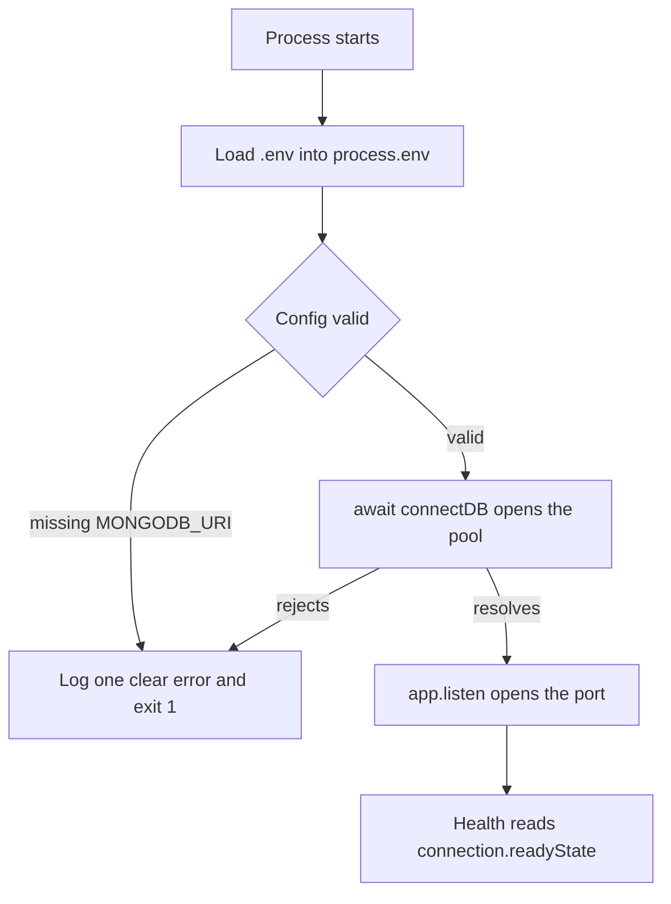

# 4.6 Prime your thinking

> **[Learn]** · Chapter 04 · Config & database · *Mandatory read: Mongoose connection docs*

Before you write `shared/db.js`, read how **Mongoose** expects connections to work in modern Node. The connection is the one piece of infrastructure every SkillSlot route depends on, so this sub-chapter is a mandatory reading assignment, not optional skimming. A provider editing an AvailabilityRule, a client holding a slot, and a worker expiring an old SlotClaim all reach the database through the same connection object you are about to create.

<BigWordAlert term="Connection pool" plainEnglish="A small set of open database sockets that the driver reuses for every query instead of opening a new one each time." whyItMatters="One connect per process serves every SkillSlot route, so a slow query can starve a booking request if the pool is sized carelessly." />

You already decided *why* MongoDB in Chapter 3. This read covers *how* the driver connects, so your boot sequence in 4.11 and 4.12 matches the official pattern instead of a remembered one.

```predict
prompt: "MongoDB is unavailable when SkillSlot starts. Which boot sequence tells the truth?"
options:
  - id: listen-first
    label: "Start listening first, then connect in the background"
  - id: connect-first
    label: "Connect to the database first, then start listening"
correctOptionId: connect-first
explanation: "Connecting first prevents the API from accepting requests it cannot complete. A failed connection should stop startup with a clear error instead of exposing a misleading healthy process."
allowRetry: true
```

## The problem this page prevents

A connection bug rarely announces itself as a connection bug. The first symptom is usually a 500 on a route that worked an hour earlier, with a message about buffering, or a health endpoint that answers 200 while every real request fails. Both come from the same root cause: the order in which the process loads configuration, opens the database, and starts accepting traffic. When those three steps are arranged by accident, the process spends its life in a state that looks healthy from the outside and is useless from the inside.

SkillSlot makes that failure visible in a specific way. A client opening the slot picker triggers a read of AvailabilityRule and TimeOff documents to compute offered starts. A provider saving weekly hours writes those rules. A checkout writes SlotClaim documents and a Booking. If the process is listening before the connection resolves, the slot picker request can arrive during the gap and fail with an error that mentions neither the database nor the boot order. You then spend an evening reading query code that was always correct.

## What a connection actually is

`mongoose.connect(uri)` opens a pool of sockets to the MongoDB deployment and hands that pool to every model in the process. One call per process is enough. The models you create in Chapter 5, including Service, AvailabilityRule, TimeOff, SlotClaim and Booking, do not hold their own sockets. They borrow from the pool when a query runs, which is why a single `connectDB()` helper in `shared/db.js` is the right shape and why a second connect call from a route file is a bug rather than an optimisation.

The call returns a promise. That promise settles when the driver has selected a server and is ready to accept operations, or rejects when it cannot reach one within its server selection timeout. Because it is a promise, `server.js` can await it. Because it can reject, the same await is where boot failure belongs. The docs formalise this as a connection state machine, and Mongoose exposes the current state as `connection.readyState`: `0` disconnected, `1` connected, `2` connecting, `3` disconnecting.

## The boot order that tells the truth

The order this course uses is fixed, and every later chapter assumes it:

```
load env -> validate config -> connect -> listen
```

Reading it as a sentence explains it. Load the environment first, because `MONGODB_URI` has to exist before anything reads it. Validate the configuration next, so a missing or malformed value fails with a message that names the variable, not with a driver error that names a host. Connect third, so the pool exists. Listen last, so no request can arrive before the pool does. Each step can only succeed if the previous one did, which is what turns a failed start into one clear line instead of a cascade.

A worked example makes the ordering concrete. Suppose `MONGODB_URI` points at a local server that is not running. With this order, the process prints one startup line naming the database connection, exits with a non-zero code, and the platform marks the release failed. Reverse the order and the process prints a listening line, the platform marks the release healthy, a client requests offered slots, the request fails inside the availability read, and the failure looks like a bug in code that Module 15 has not even been written yet.

The same ordering decides what a health check means later. A health endpoint that answers 200 while the pool is empty is worse than no health endpoint, because a deploy platform trusts it and routes traffic to a process that cannot serve any SkillSlot request.

## The same order as a diagram



Read the diagram as a claim about what may happen in which order. The exit path is drawn once and reached from two places, because a bad configuration and an unreachable database both mean the process must not serve traffic. The health node sits after listen, which is why health can never report a state that startup did not first establish.

<TraceRequest title="A health request during the connection gap">
  <TraceStep actor="Client" label="GET /api/health" detail="Deploy platform probe or a curious browser tab" />
  <TraceStep actor="API" label="Route reads connection.readyState" detail="Value is 2 while the driver selects a server" />
  <TraceStep actor="API" label="503 Service Unavailable" status={503} detail="Body names the database dependency, not a stack trace" />
  <TraceStep actor="Client" label="Probe retries on its own interval" detail="The process keeps retrying connect in the background" />
</TraceRequest>

Step through the trace and notice where the truth comes from. The API does not guess. It reads the driver's own state, which is `2` while a connection attempt is in flight, so the answer is a 503 with a reason rather than a 200 with an empty body. Once the pool is ready the same probe returns 200 and the platform starts sending real traffic. The client never needs to know which of the two happened; it only needs an answer that matches reality.

## Buffering, and why it hides bugs

While the driver is connecting, Mongoose queues operations instead of failing them. That behaviour is convenient in a script and dangerous in a server, because it converts a wrong boot order into a delayed timeout. The message you will meet is a buffering timeout, and its plain reading is that a query ran before a connection existed and the connection never arrived.

The habit that prevents it is to treat buffering as a detail you know about and do not rely on. Do not let a request handler depend on queued work completing once the database appears. Do not treat a queued query as evidence that the database is reachable. Do not use buffering to make a slow local start feel instant. The ordering in the diagram costs one await and removes the whole category.

## Health, states, and shutdown

Read `connection.readyState` in the health route, or keep a boolean that you set only after `connectDB()` resolves. Both are acceptable if the value is accurate. `readyState` is the stronger signal because the driver updates it when a connection is lost, while a boolean set once at boot keeps saying yes after the database is gone. For an endpoint whose only job is telling the truth, read the source that cannot go stale.

Read the disconnect section too, even though the MVP never shuts down gracefully. `mongoose.disconnect()` closes the pool after in-flight writes finish. A deploy platform sends a termination signal on every release, and a handler that disconnects lets a checkout transaction finish instead of being cut off mid-write. The lesson for now is recognition: when you meet a shutdown handler in a real codebase, you will know which resource it is closing and why.

## Debugging path from symptom to cause

Work from the outside in. A buffering timeout means a query ran before the connection existed, so check the order in `server.js` before reading the route. A rejection at startup naming a host means the URI or the network is wrong, so print the host and database name without the credentials. A 200 from health while routes fail means the health route is not reading the connection state, so fix the signal rather than the routes. A worked-then-failed pattern after a quiet period means the connection dropped, which is a pool or network question and not a query question.

| Symptom | First thing to check |
|---|---|
| Buffering timeout on a request | Whether listen happens before connect resolves |
| Startup rejection naming a host | The URI host and database name, with the password removed |
| Health 200 while routes return 500 | Whether the health route reads `readyState` |
| Works locally, fails on the platform | Whether the host allowlist accepts the platform IP range |

One line of evidence makes this faster than reading code. Log a single startup line after a successful connect, containing the database name and nothing else, and log one line when the connect promise rejects, containing the error name. Two lines, no secrets, and the difference between an ordering bug and a network bug is visible in the first ten seconds of a deployment.

## Common beginner mistakes

1. **Calling `listen` before `connect` resolves**: the first request races the pool and loses.
2. **Calling `connect()` from more than one place**: duplicate connection attempts and confusing logs.
3. **An empty catch around the connect call**: the process serves traffic with no database at all.
4. **Logging the full URI on failure**: the password ends up in terminal scrollback and log storage.
5. **Reading `.env` after importing config**: `MONGODB_URI` is undefined because the file was never loaded.

Chapter 4 build steps follow the same sentence every time: load env, validate config, connect, listen.

## What to extract for the implementation

While reading the Connections page, note the answers you will need in 4.11. Whether `connect()` returns a promise decides the await. What happens on an invalid URI decides the exit path. How you learn that a connection succeeded decides the log line and the health signal. Whether passing options such as a server selection timeout gives a clearer failure matters on a slow network. Whether one pool serves the whole process decides how many connects the codebase may contain.

Do not copy the documentation sample server into the repository. The sample inlines the connection in one file, while this project keeps configuration in `shared/config.js` and the helper in `shared/db.js`. Take the pattern and leave the layout. The docs also show the connection string format, which is worth a skim so that `mongodb://` against a local server and `mongodb+srv://` against Atlas are not a surprise in 4.5 and 4.11.

## Reflect in the learning log

After reading, answer these without reopening the docs. What is the difference between a connection error at startup and a query error after a successful connect? Why does `connectDB()` live in `shared/db.js` rather than inline in `server.js`? What does `mongoose.disconnect()` do, and which resource does it close?

If the second answer is not immediate, re-read the best practice section of the Connections page. The helper exists so that every consumer, from the API routes to the seed script in Chapter 5, uses one connection with one configuration. When a provider's AvailabilityRule write and a client's Booking read share a pool, a misconfigured URI breaks them in exactly the same way, and one fix repairs both.

## Time box and next step

Minimum twenty five minutes of focused reading plus the reflection questions. If you are rushed, read the connecting section, the error handling section and the disconnect section, and skip the advanced pooling notes. Keep the docs tab open while writing `db.js`.

**Sub-chapter 4.7:** the configuration and database knowledge check, then 4.8 opens the build cluster. Reading done, hands on keyboard.
