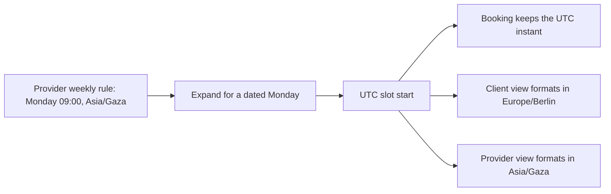

# A booking has two clocks

A tutor in Gaza tells SkillSlot that she works from 09:00 to 12:00 on Mondays. A client in Berlin opens her page and chooses what appears to be 09:00. They each arrive at a different time. The server accepted a string that looked like a time but never decided whose clock it belonged to. No payment bug or calendar design can repair that missed lesson after it happens.

This module gives time one owner at every boundary. The provider owns the weekly working rule. The booking owns an exact instant. The client owns a display preference. We will store each separately and make conversions in one tested server module before implementing provider schedules or checkout.

## The promise in the product

SkillSlot sells a promise that a particular provider will spend a particular interval with one client. A listing price and a duration are not enough. The client needs to know when to show up. The provider needs to know when to reserve their time. If either sees an ambiguous wall-clock value, the marketplace has sold two different promises under one booking ID.

Picture an English tutor whose provider zone is `Asia/Gaza`. She sets a weekly rule: Monday 09:00 to 12:00. This is a repeating local rule, not a UTC timestamp. The UTC offset that applies to a future Monday comes from the time-zone rules for that date. SkillSlot must not save `09:00+02:00` as if that offset applies forever. When a client in `Europe/Berlin` views a specific Monday, the API can offer concrete UTC starts and the browser can render each start in both zones.

The data has three shapes:

The arrows mark conversions, not copies of a string. One provider rule can produce many UTC slot starts on different dates. A booking selects one of those starts. The two screens format the same booking instant independently.

| Question | Stored shape | Example |
|---|---|---|
| When does this provider usually work? | Weekday, local start and end, provider IANA zone | Monday, 09:00 to 12:00, `Asia/Gaza` |
| When is this booking? | UTC start and end instants, plus zone snapshots for explanation | `2024-01-15T07:00:00Z` and `2024-01-15T08:00:00Z` |
| What should this client read? | The same instant formatted in their selected zone | 08:00 in `Europe/Berlin` on that date |

The January example is an illustration for that date, not a rule for Gaza or Berlin in every season. Both places can change their offsets. Use a time-zone library to compute a future date. Do not write a table of fixed offsets into the app.

## Three ways to fail

First, two clients can select the same provider hour at the same moment. A query that finds no booking and then inserts one is not enough: both requests may read an empty result before either writes. Later modules will use unique block claims and a database transaction to make one request win. The time module must produce the same block instants for both requests or the lock will be bypassed.

Second, a local clock can jump forward or repeat an hour. The string `02:30` can identify no instant or two instants on a transition day. A system that silently chooses one may sell a time the provider never intended. This module will reject an ambiguous or nonexistent local boundary until a person makes an explicit choice.

Third, a client can change their display zone. That changes the label on an appointment, not its stored UTC instant. An app that saves the displayed string as the booking time may move the appointment when the user travels. The contract is that a confirmed booking stays at the same instant unless the parties explicitly reschedule it.

## Why the cart makes the clock problem harder

One client can put a tutor at 09:00 and a designer at 11:00 in the same cart. Those providers may live in different zones. The cart cannot be priced and held by comparing only the printed local labels. It needs a UTC start for each requested service, the service duration, and the provider whose calendar is claimed. A client can see two labels that both say 09:00 while the bookings are hours apart. The product needs to show the provider's zone beside the client's zone before the client pays.

A cart line is a request, not a reservation. In the later checkout module, the server will re-evaluate the requested instants against the current rules, time off and existing claims. That decision must be made at the moment the hold starts. A screenshot of a green slot taken ten minutes ago is not authority to book it now. If another client won it, SkillSlot returns a clear conflict and offers fresh times. The time module makes that comparison possible because every candidate start is represented by the same kind of UTC instant.

This also changes what the app must log. A support report that says "the appointment said 09:00" is incomplete. To investigate a mistake, record the booking ID, UTC start, provider zone at booking, client zone shown at booking, and the source rule or explicit override that produced the slot. Do not log a client's private meeting link or address just to debug time. The fields needed for time explanation are different from the fields needed to deliver the service.

## A small incident to reason through

Assume two learners are building SkillSlot together. One changes the client display formatter to use the browser's default zone; another keeps the profile's selected zone. Both screens pass a visual review on a phone in Gaza. A client in Berlin reports a missed session after travelling. The first debugging question is not "which CSS label is wrong?" It is "what UTC instant did the paid booking store?" Read the booking row first. Then format that instant in the provider's zone, the selected client zone, and the browser's actual zone. If the three labels differ as expected, the bug is in the display policy. If the stored instant itself is wrong, inspect the rule expansion and ambiguity decision made before checkout. Keep these two investigations separate so a presentation bug cannot change a paid booking.

The product can communicate a zone mismatch without claiming certainty about the user's location. A line such as "Your selected zone is Europe/Berlin; this device currently reports Asia/Qatar" invites a check. It should not silently switch the zone or reschedule. The user chooses how to view time. The provider chooses where their working rule belongs. The server chooses the exact instant only after it has a dated rule and a valid zone.

## A five-minute practice

Write three candidate values for the tutor's Monday 09:00 rule: `09:00`, `2024-01-15T07:00:00Z`, and `09:00+02:00`. Circle the one that can repeat every Monday without assuming a particular date or fixed offset. It is the local 09:00 value, but it is incomplete until paired with weekday and `Asia/Gaza`. Now circle the value that can identify one already booked start. It is the UTC ISO value. The value with `+02:00` can identify an instant only when attached to a date; it is a poor replacement for the recurring zone rule.

This distinction is the foundation of the later concurrency test. When twenty clients race one slot, they must all attempt to claim the same UTC block keys. If one path uses browser-local strings and another uses server-local strings, the unique index cannot protect the intended hour. Our test evidence begins with correct time representation, then adds atomic claims.

## What you will produce

At the end of this module, `server/src/shared/time.js` will accept a provider's local date and time with an IANA zone and return a validated UTC instant. It will format a stored instant for any viewer zone. Tests will cover a normal day, a skipped local time, a repeated local time, and two places that change clocks on different dates. The test suite is the evidence for this module's gate. The actual availability engine comes later, after the provider and service models exist.

Start a short note in `docs/time-decisions.md` with these headings: **rule**, **instant**, **display**, and **ambiguity policy**. Under each, write one sentence in your own words. Do not copy the table. If you cannot yet explain why a weekly rule has no UTC timestamp, that is the question to carry into the next lesson.

## Check before moving on

A Berlin client changes their profile zone to `Asia/Qatar` after paying for a lesson. Should SkillSlot update `Booking.startAt`? Write your answer and the field that should change. The expected decision is that `startAt` stays fixed; only formatting changes. You will verify that claim with code, not trust it as a slogan.

References: [MDN on local-time ambiguity](https://developer.mozilla.org/en-US/docs/Web/JavaScript/Reference/Global_Objects/Temporal/ZonedDateTime), [Luxon API documentation](https://moment.github.io/luxon/api-docs/).
