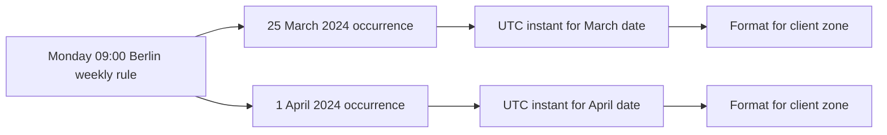

# Your time, their time

The provider chooses 09:00 in their own zone. The client sees a different label. If the client changes their display zone, another label appears. A diagram can show the three views, but you need to make a prediction when the date changes. This lesson uses one repeated rule, two dates and two clients so you can see exactly which values should change.

Use `Europe/Berlin` as the provider zone for this controlled clock-change example, because its published 2024 transition gives us stable historical evidence. Later, use `Asia/Gaza` for the actual seeded SkillSlot providers and ask the runtime for each dated offset. The lesson is about the conversion method, not memorising the offset of any region.

## A rule and a dated occurrence

The provider's rule is Monday 09:00 to 11:00 in `Europe/Berlin`. On Monday 25 March 2024, Berlin's clocks had not yet advanced for summer time. On Monday 1 April 2024, they had. The two dated 09:00 starts therefore fall at different UTC clock hours. A client in `Asia/Qatar` sees two local labels that differ by an hour even though the provider sees 09:00 on both dates. That is expected. The provider promised a repeating local time, not one repeating UTC time.

<InteractiveCanvas slug="skill-slot-your-time-their-time" />

Use the controls to change the dated week, provider zone and viewer zone. Read the provider label, resolved UTC instant and viewer label after each change. Predict which value will change before moving a control. The canvas is an exploration of the rule; the text trace and dated values below remain the accessible explanation when the canvas cannot run.

Notice that the rule branches before either UTC instant exists. Adding seven times 24 hours to the first UTC instant is not the same operation as expanding the next Monday's local 09:00. On the transition week, those paths can disagree. The schedule engine must use the provider's local rule for each date. Once a client pays for a specific dated slot, the booking stores that UTC instant and never re-expands the rule to decide when the meeting starts.

<TraceRequest title="Move the week across the clock change">
  <TraceStep actor="Provider rule" label="Monday 09:00" detail="Zone Europe/Berlin" />
  <TraceStep actor="Week one" label="Resolve 25 March" detail="Use that date's Berlin offset" />
  <TraceStep actor="Week two" label="Resolve 1 April" detail="Ask again after the transition" />
  <TraceStep actor="Client" label="Format each instant" detail="Use Asia/Qatar without changing the provider rule" />
</TraceRequest>

Before you run code, predict the direction of the change. In the first week Berlin is one hour ahead of UTC, so 09:00 Berlin corresponds to 08:00 UTC. In the second week Berlin is two hours ahead of UTC, so 09:00 Berlin corresponds to 07:00 UTC. Qatar is three hours ahead of UTC on those dates, so the client reads 11:00 for the first week and 10:00 for the second. Verify those values with the time module you will build in the next lessons. If a library returns something else, inspect the zone, date and runtime data before changing the answer.

## Change the viewer without moving the booking

Now imagine the client books the second week, 1 April. The booking stores the second week's UTC start. The client then changes their selected zone from `Asia/Qatar` to `Europe/London`. The provider still sees 09:00 Berlin. The client's label changes to London time for that same UTC instant. SkillSlot has not rescheduled anything. The payment receipt can retain the client zone used at purchase so support can explain what the customer saw then. The agenda can use the client's current chosen zone so they can plan now. Both screens must display an explicit zone label.

This distinction matters for reminders. A reminder worker schedules against `Booking.startAt`, not against a string such as "tomorrow at 09:00." If the client changes their time-zone preference, the reminder fires at the same instant. The message body can be formatted again for the client's current zone when sent. A scheduled job may need to be moved only when a booking is explicitly rescheduled, not when a label changes.

## Try a second case by hand

Write a new rule: Tuesday 15:00 to 17:00 in `Asia/Gaza`. Choose two historical dates at least a month apart and use the Luxon probe from the prior lesson to resolve each occurrence. Record the observed provider label, UTC instant, and Berlin client label in `docs/time-decisions.md`. Do not assume the Gaza offset in advance; use the zone data for each chosen date and note the runtime version. Explain in one sentence why the two UTC clock hours can differ without any provider edit.

Then change the client zone to `Asia/Qatar` while holding one of the UTC instants fixed. Record which displayed field changes and which stored field must not change. If you find yourself copying a displayed `HH:mm` value into `Booking.startAt`, stop. That is the bug this exercise is designed to expose.

## Failure and recovery

A useful failure test is to format the first week's UTC instant as if it were the second week's appointment. It will be one hour off in the provider's view after the transition. This is the result of the tempting `firstStartAt + 7 * 24 * 60 * 60 * 1000` algorithm. Keep that failure in the learning log, then replace the algorithm with dated rule expansion. The correction is not an arbitrary extra hour; it is a change in which time representation owns the recurrence.

## What the canvas changes and what it cannot change

Move the week control while keeping the provider zone at Berlin and the viewer zone at Qatar. The provider label should stay at Monday 09:00. The dated UTC start and Qatar label can change because the dated zone rule changed. Next keep the week fixed and change only the viewer zone from Qatar to London. The UTC start and provider label should stay exactly the same. Only the client label changes. Finally change the provider zone from Berlin to Gaza. That is a change to the rule itself; the dated UTC start may change, and the provider label still says 09:00 in its newly selected zone. These three interactions correspond to three different operations in the application.

Do not treat the canvas as a booking editor. It has no database transaction or claim index. It only demonstrates conversion. A client could view the correct time and still lose the slot to another checkout. The later availability engine generates candidate starts; the checkout flow checks them again and claims blocks atomically. The distinction keeps this chapter focused: first represent time correctly, then protect scarce time under concurrency.

A common mistaken prediction is that a confirmed booking will move when the provider zone changes. In the canvas you are changing a weekly rule before a dated offer becomes a booking. A paid booking's UTC start is a different object and stays fixed. If the provider wants to move a paid lesson, both parties need the rescheduling flow, which acquires the new interval and releases the old one under a guarded state transition. Write that distinction below your canvas notes.

## Make the result readable without color

For each control state, write a sentence with the date, provider label and zone, UTC instant, and viewer label and zone. The sentence should still make sense if copied into a plain text message. Avoid writing only "the green chip moved left." A time-zone bug can be difficult to reproduce on another person's device; explicit dates and zones let a mentor or support engineer replay the case. If the browser or screen reader cannot run the interactive canvas, the fixed Berlin example, diagram and text trace on this page still teach the relationship.

When a label changes, say why. A changed week asks the IANA rules for a new dated offset. A changed viewer zone formats one existing instant differently. A changed provider zone changes the interpretation of a repeating local rule. Those are the three sentences a learner should be able to say without looking at the canvas. If one feels unclear, return to the rule, instant and display table in lesson 5.1 and identify which row the control operates on.

For accessibility, the time comparison also has this text trace and the table you write with date, zone and UTC instant. A screen reader should not have to infer color or the position of a time chip. The canvas announces its selected inputs and computed labels, while the written exercise remains usable without it.

References: [Luxon API documentation](https://moment.github.io/luxon/api-docs/), [MDN on zoned date-time ambiguity](https://developer.mozilla.org/en-US/docs/Web/JavaScript/Reference/Global_Objects/Temporal/ZonedDateTime).
