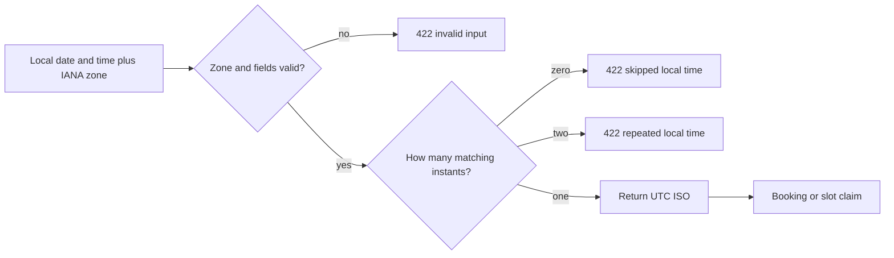

# Put time conversion behind one module

So far you have reasoned about time in notes. Now give every future SkillSlot route one implementation to call. If provider onboarding, the slot engine, checkout and reminders each parse dates differently, tests can pass in one module while a paid booking still moves in another. A shared time module creates one place for validation and one place to change a policy after review.

The file will live at `server/src/shared/time.js`. It will accept explicit date fields and an IANA zone for local input. It will return an ISO UTC instant or a structured error. It will also format an already stored UTC instant in a viewer zone. It will not read the process's default time zone, the browser's time zone or `Date.now()` as hidden inputs. The next lesson introduces an injectable clock for the few operations that really need "now."

## Install and choose the boundary

From the learner project's `server/` directory, run `npm install luxon`. Commit the changed `package.json` and lockfile. Luxon is used here for named-zone conversion and possible offsets, while JavaScript `Date` remains the persisted representation of a resolved instant in Mongoose. Keep only one date library in the server. If the codebase later adopts Temporal, this module is the boundary to replace; the route contracts can stay UTC ISO strings.

The converter receives `{ year, month, day, hour, minute, zone }`. Do not receive `"2024-03-10 02:30"` and hope the library guesses which fields belong to which zone. The caller must say the provider's zone. The function rejects a numeric offset such as `+02:00`, validates the calendar fields, and distinguishes a local gap from an overlap. The output is an ISO UTC string. The application can construct a `Date` from it for storage.



The check is deliberately stricter than what a general date library may allow. A library can choose a default occurrence for an overlap or normalize a skipped time forward. That is useful in some applications. SkillSlot sells paid time, so it asks for a clear decision instead of silently changing the provider's input.

## Implement the converter

Create `server/src/shared/time.js` with the following core. Keep the error codes as constants used by your route error mapper. The code does not import Express or Mongoose, so a unit test can call it directly.

```js
import { DateTime, IANAZone } from 'luxon';

export class TimeInputError extends Error {
  constructor(code, message) {
    super(message);
    this.name = 'TimeInputError';
    this.code = code;
  }
}

export function requireZone(zone) {
  if (typeof zone !== 'string' || !IANAZone.isValidZone(zone)) {
    throw new TimeInputError('INVALID_TIME_ZONE', 'Choose a supported named time zone.');
  }
  return zone;
}

export function localToUtc({ year, month, day, hour, minute, zone }) {
  requireZone(zone);
  const fields = { year, month, day, hour, minute };
  if (!Object.values(fields).every(Number.isInteger)) {
    throw new TimeInputError('INVALID_LOCAL_TIME', 'Enter a complete calendar date and time.');
  }
  const candidate = DateTime.fromObject(fields, { zone });
  if (!candidate.isValid) {
    throw new TimeInputError('INVALID_LOCAL_TIME', candidate.invalidExplanation || 'Invalid local time.');
  }
  const sameFields = value => Object.entries(fields).every(([key, wanted]) => value[key] === wanted);
  if (!sameFields(candidate)) {
    throw new TimeInputError('NONEXISTENT_LOCAL_TIME', 'This local time is skipped on this date.');
  }
  const matches = candidate.getPossibleOffsets().filter(sameFields);
  if (matches.length !== 1) {
    throw new TimeInputError('AMBIGUOUS_LOCAL_TIME', 'This local time occurs twice; choose another boundary.');
  }
  return matches[0].toUTC().toISO();
}

export function formatInZone(utcIso, zone) {
  requireZone(zone);
  const instant = DateTime.fromISO(utcIso, { zone: 'utc' });
  if (!instant.isValid || !utcIso.endsWith('Z')) {
    throw new TimeInputError('INVALID_INSTANT', 'Expected an ISO UTC instant ending in Z.');
  }
  return instant.setZone(zone).toFormat('yyyy-LL-dd HH:mm ZZZZ');
}
```

Read the gap check carefully. `candidate.isValid` alone is not the policy. `sameFields(candidate)` checks that a library did not move a skipped 02:30 to a later valid time. Then `getPossibleOffsets()` asks whether the same visible wall time has one or two corresponding instants. The function returns only when exactly one remains. The test suite in lesson 5.9 will verify the expected behavior against the installed Luxon version before this helper is used in checkout.

The formatter demands an ISO value ending in `Z` because the reader contract is a UTC instant. It should not accept a loose local date string and interpret it using the server host zone. The formatting string includes a zone marker. A production UI may choose a friendlier label, but it must keep the zone explicit on a booking action and receipt.

## Connect errors to the API

In your common error mapper, turn `TimeInputError` into HTTP 422 with its code and a short human message. The provider form can highlight the affected boundary. The client slot picker should never construct one of these local inputs itself; it receives vetted UTC starts. A 422 here says an input cannot be interpreted as requested. A 409 later says a once-valid slot was taken by another client. Keeping those responses separate helps the user decide whether to change a time or refresh availability.

Do not catch every error from `localToUtc` and return an empty slot list. An empty list means the provider truly has no bookable time; an invalid zone or ambiguous rule needs attention. Log the rule ID and date, then show a specific dashboard notice to the provider. Keep the client experience safe by omitting the invalid occurrence from public offers. This is a case where error handling changes what a person can sell, so it deserves a visible test.

## Review the function as if money depends on it

Read each branch with a concrete input. A noninteger minute should fail before Luxon sees it. An invalid calendar date should fail when the candidate reports invalid or formats back to different fields. A spring gap can look valid after normalization, so the field comparison must happen before accepting an offset. An autumn overlap can have two values with the same local fields; the function must count both. Only a count of one returns a UTC ISO string. Do not add a catch that turns an unexpected library exception into the same 422; an unexpected exception is a server defect that needs a log and a 500 response.

Check the code's dependency boundary. `requireZone` uses the library's recognition of an IANA name. `localToUtc` does not query the database or read the current clock. `formatInZone` does not look up a user profile. Routes gather those inputs and call this pure module. That makes the time policy usable in registration, provider setup, slot generation, checkout, reminders and support tools without copying logic. It also makes a focused test possible when a library or Node version changes.

One trade-off is that the first version rejects ambiguous boundaries instead of asking the provider to choose the earlier or later occurrence. That reduces the number of bookable starts on rare transition dates. It also prevents SkillSlot from silently selling a time that the provider may not mean. The error should tell the provider which dated rule is affected and suggest a nearby unambiguous boundary. A future version can support an explicit earlier/later choice, but then the UI, stored rule exception and tests must all carry that choice. Do not implement that complexity by selecting the first element of `getPossibleOffsets()`.

Another trade-off is where to validate time. The browser can preview a rule for immediate feedback, but the server must repeat validation. Clients can send stale or altered requests, and different browsers can carry different time-zone data. The server's accepted UTC instant is the one used for claims and bookings. Return it to the browser so the confirmation page can show exactly what will be paid for. A label computed before checkout should be treated as a preview, not the final contract.

If the app eventually supports a provider with hours that cross midnight, split the rule into dated local intervals before conversion and test the end date separately. This lesson's converter is intentionally one boundary at a time. It does not assume the end is on the same date as the start, and it does not calculate a service duration by subtracting local `HH:mm` strings. The availability module will decide how to expand and step through those intervals in absolute minutes.

For this course, an API response with an ambiguous boundary should contain a stable error code, the affected local date and the provider's zone. It should not contain a speculative UTC start. That allows a form to show a precise correction. A support log may include the rule ID and runtime version, but not the client's private address or meeting link. Time correctness and data minimization belong together at this boundary.

## Verify before the next lesson

Run a Node probe that imports `localToUtc` and `formatInZone`. Convert an ordinary `Europe/Berlin` date and format the result back in Berlin. The local fields should match. Change only the display zone to `Asia/Qatar`; the UTC ISO result must not change. Try `'+02:00'` as a zone and confirm the named-zone validation error. Record the three outputs in `docs/time-decisions.md` and commit the module. Do not wire it to routes yet. The following lessons give it a fake clock and a repeatable suite for the transition cases.

References: [Luxon API documentation](https://moment.github.io/luxon/api-docs/), [MDN on zoned time and ambiguous local input](https://developer.mozilla.org/en-US/docs/Web/JavaScript/Reference/Global_Objects/Temporal/ZonedDateTime).
