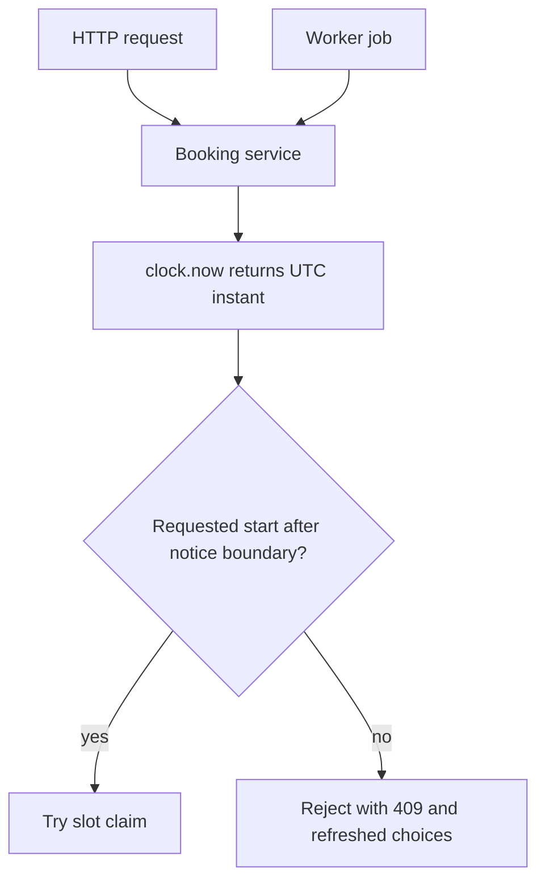

# Give the server one testable clock

The time module can convert a local rule into an instant. The next decision is whether an instant is still in the future and far enough away to book. If every handler calls `Date.now()` directly, a test that asserts "at exactly ten minutes before start" can fail depending on when the test runner reaches the assertion. A single clock boundary lets the server use real time in production and a fixed instant in tests.

This is a small dependency with a large consequence. The slot engine, checkout hold, hold-expiry job, cancellation cutoff and reminder scheduler all ask "what time is it now?" They must ask the same kind of question. They should not trust the client's phone clock. A client could have an incorrect setting, be offline, or send a request seconds after the UI's countdown reached zero. The server decides eligibility from its clock when it attempts the state change.

## Separate an instant from a source of instants

`new Date('2024-01-15T07:00:00Z')` is one stored instant. `new Date()` is a call to the host clock. The first belongs in a booking. The second is an environmental dependency. Give route and service functions a `clock` parameter whose `now()` returns a fresh `Date`. In production, use a system clock. In a test, use a fixed one. Do not make tests replace the global `Date` constructor; a global override can leak into unrelated tests and hide places that failed to declare their dependency.



The clock does not make a database race safe by itself. It makes the time comparison testable. The slot claim's unique index and transaction decide whether two clients can hold the same block. Keep those responsibilities separate: one checks whether a request is late, the other checks whether it conflicts with another request.

## Write a small clock module

Create `server/src/shared/clock.js`. This file has no database imports. It returns a new `Date` for each call, so a service cannot mutate one shared object and change later readings. A fixed clock in a test also returns copies to avoid accidental mutation between assertions.

```js
export const systemClock = Object.freeze({
  now: () => new Date(),
});

export function fixedClock(isoUtc) {
  const instant = new Date(isoUtc);
  if (Number.isNaN(instant.getTime()) || !isoUtc.endsWith('Z')) {
    throw new Error('fixedClock expects an ISO UTC instant ending in Z');
  }
  return Object.freeze({ now: () => new Date(instant.getTime()) });
}
```

In a function that computes the minimum notice boundary, accept the clock explicitly. This example does not know about a provider or service; it only compares instants. The booking route will supply the service's notice period later.

```js
export function isAfterNotice(startAt, noticeMinutes, clock = systemClock) {
  const start = new Date(startAt).getTime();
  if (!Number.isFinite(start) || !Number.isInteger(noticeMinutes) || noticeMinutes < 0) {
    throw new Error('Invalid notice comparison');
  }
  const boundary = clock.now().getTime() + noticeMinutes * 60_000;
  return start > boundary;
}
```

The strict `>` is a product decision: if minimum notice is ten minutes, a start exactly ten minutes away is too late under this rule. Another product could choose `>=`, but the API and UI must agree. Record this boundary in `docs/time-decisions.md` and test it at one millisecond before, exactly at, and one millisecond after. Do not leave the edge case to JavaScript's operator choice by accident.

## Use the clock at the right moment

The availability page may have loaded a minute ago. It can show a slot based on a past `now()`. Checkout must call the current server clock again immediately before trying to claim the slot. A client-side countdown helps people understand urgency, but it does not authorize the request. Return a clear error and new availability if the notice boundary has passed. A displayed slot is a view; the server owns the state-changing decision.

## One boundary in a multi-provider cart

A client may request a tutor at 10:00 and a designer at 13:00 in the same checkout. Each service can have its own minimum notice period. The checkout service reads the clock once at the start of the claim attempt, then evaluates both requested starts against that one `now` value. If it calls the clock separately for each line, a request arriving at a boundary can make one line pass and another fail for reasons that depend on loop order. The transaction must then release any claims already taken. Reading one instant does not eliminate the need for a transaction; it makes the eligibility decision consistent within the attempt.

The same cart can contain providers in different time zones. The notice period is a duration in minutes, so compare UTC instants. Do not subtract two local `HH:mm` strings. A 10:00 tutor slot in Gaza and a 10:00 designer slot in Berlin are not automatically simultaneous. The time module resolves each to UTC; the injected clock gives the current UTC instant; the claim service checks the distinct provider calendars. Keeping these inputs explicit makes a multi-provider test readable.

An expired hold is another boundary. A delayed worker may wake several seconds after `expiresAt`. It can release a claim only if the persisted claim is still held and its expiry is at or before the clock's current instant. If the payment webhook confirmed the claim first, the worker must not release it. If a late payment arrives after expiry, the payment handler must check claim state and either re-claim safely or refund. The clock tells each path when it ran, while the database state machine decides which transition is allowed. Tests freeze the clock on both sides of expiry and race the two transitions.

## Keep a trace in the decision log

For a ten-minute notice rule, choose a frozen `now` of 07:00 UTC. Record requests for 07:09:59.999, 07:10:00.000 and 07:10:00.001. Under the strict `>` policy, only the final request is eligible. Then change the provider zone and show that the truth values do not change, because these are UTC instants. Change the client's display zone and show the same result. Finally change the frozen clock to 07:01 UTC; the old 07:10:00.001 start should now be too soon. This four-step trace tests the boundary, not merely the formatting.

When reviewing a bug report, log the request's server `now`, requested UTC start, notice minutes and resulting code. Avoid logging the client's meeting link, home address or full cart contents. A short decision trace can explain why a slot disappeared without exposing private service details. It also lets support distinguish a past-notice rejection from a simultaneous-claim conflict. Those lead to different next actions for a client.

Workers use the same principle. A hold-expiry job may wake late after a restart. It checks the persisted `expiresAt` against the server clock and the claim's current state before releasing anything. It does not assume that a scheduled queue callback ran exactly on time. A reminder job checks the booking is still confirmed before sending, and a reschedule changes its target instant. The clock makes these boundary tests possible, but persisted state remains authoritative.

Avoid storing "minutes remaining" in MongoDB. It becomes stale immediately. Store UTC instants such as `startAt`, `expiresAt`, and `cancelFreeUntilAt`, then compute a duration at read time. Snapshot the cancellation policy used when the booking was paid so a later service-policy edit cannot change an already accepted refund promise. The policy calculation can accept the injected clock and a booking snapshot in a pure function.

## A failure drill

Temporarily make `isAfterNotice` call `Date.now()` instead of `clock.now()`. Run the exact-boundary test with a fixed clock. It should fail or become nondeterministic. Restore the injected clock and run the same test repeatedly. This exercise shows why the abstraction exists; it is not an extra wrapper for style. Search `server/src` for direct `Date.now()` calls in booking-sensitive code and list the ones that should receive a clock parameter. A logging timestamp does not need this abstraction, but eligibility and money decisions do.

The server host can be configured to display UTC for logs, yet correctness must not depend on `TZ=UTC`. A `Date` stores an instant independent of the machine's display zone. Run one test process with a different `TZ` and compare UTC results. If they differ, some code is parsing an unzoned string or formatting through the host default. Fix that boundary rather than requiring every deployment machine to use one local setting.

## Gate for this step

Commit the clock module and its first boundary test. Include a line in `docs/time-decisions.md` stating whether exactly-on-the-boundary starts are allowed. Verify that production code imports `systemClock`, while tests pass `fixedClock(...)` to pure functions. The next lesson expands this into a transition and cross-zone suite. That suite must fail if a developer accidentally reintroduces `Date.now()` inside a decision function.

References: [MDN `Date` semantics](https://developer.mozilla.org/en-US/docs/Web/JavaScript/Reference/Global_Objects/Date), [MongoDB transaction documentation](https://www.mongodb.com/docs/manual/data-modeling/enforce-consistency/transactions/).
