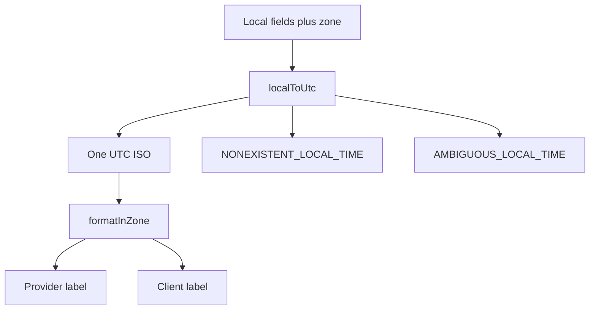

# Prove the clock and zone boundaries

A few examples in a Node console can show that the library runs. They do not prove SkillSlot will reject the dangerous inputs. This lesson turns the product's time policy into tests that can fail after a library upgrade or a refactor. Keep the tests beside the time module. Run them before authoring a slot engine, because every availability result and every claim key will depend on the same conversion.

The suite needs four kinds of evidence: an ordinary local time round-trips through UTC; a skipped local time is rejected; a repeated local time is rejected; and formatting one stored instant for two viewers never changes that instant. Add notice-boundary checks using a fixed clock. A unit test cannot prove the server host's clock is accurate or that its time-zone database is current, so the deploy checklist adds operational checks later. The unit suite proves the code's policy under a known runtime.

## Set up tests with the project's runner

Use the test runner already installed by the project skeleton. The examples below use Node's built-in `node:test` and `node:assert/strict` so the boundary logic is readable without a new test dependency. If the shared course has already installed another runner, translate `test` and `assert` to that runner's equivalent; keep the cases and expected error codes unchanged. Put the file at `server/src/shared/time.test.js` and ensure `npm test` runs it. A runner mismatch is a setup problem, not a reason to skip the cases.



The important fork is at `localToUtc`. The formatter has one UTC input and can produce many labels. It should not mutate its input. The tests should inspect both the returned label and the original ISO string so a future implementation cannot accidentally rewrite the stored value while trying to help the display.

## Implement the cases

Use fixed historical New York dates for gap and overlap behavior. The examples come from MDN's explanation of zoned time. Add a simple Berlin/Qatar display case on a January date. Do not use a future Gaza transition date as a hard-coded assertion because local time policy may change after the course is written.

```js
import test from 'node:test';
import assert from 'node:assert/strict';
import { localToUtc, formatInZone } from './time.js';
import { fixedClock, isAfterNotice } from './clock.js';

test('an ordinary local start round-trips', () => {
  const utc = localToUtc({
    year: 2024, month: 1, day: 15, hour: 9, minute: 0,
    zone: 'Europe/Berlin',
  });
  assert.equal(utc, '2024-01-15T08:00:00.000Z');
  assert.match(formatInZone(utc, 'Europe/Berlin'), /2024-01-15 09:00/);
});

test('a skipped local boundary is rejected', () => {
  assert.throws(() => localToUtc({
    year: 2024, month: 3, day: 10, hour: 2, minute: 30,
    zone: 'America/New_York',
  }), error => error.code === 'NONEXISTENT_LOCAL_TIME');
});

test('a repeated local boundary is rejected', () => {
  assert.throws(() => localToUtc({
    year: 2024, month: 11, day: 3, hour: 1, minute: 30,
    zone: 'America/New_York',
  }), error => error.code === 'AMBIGUOUS_LOCAL_TIME');
});

test('changing the viewer zone does not change the instant', () => {
  const utc = '2024-01-15T08:00:00.000Z';
  const berlin = formatInZone(utc, 'Europe/Berlin');
  const qatar = formatInZone(utc, 'Asia/Qatar');
  assert.notEqual(berlin, qatar);
  assert.equal(utc, '2024-01-15T08:00:00.000Z');
});

test('the exact notice boundary is closed', () => {
  const clock = fixedClock('2024-01-15T07:00:00.000Z');
  assert.equal(isAfterNotice('2024-01-15T07:10:00.000Z', 10, clock), false);
  assert.equal(isAfterNotice('2024-01-15T07:10:00.001Z', 10, clock), true);
});
```

The final assertion may need your `isAfterNotice` helper exported from `clock.js`. The example in lesson 5.8 showed its implementation; keep the export in the same file or adjust the import path consistently. Do not paste a test that imports from a file you never created. Running the suite is part of the chapter's evidence.

## Try the test that should fail

Add a temporary assertion that the second Monday after Berlin's March transition has the same UTC hour as the first Monday. The assertion should fail, because the local 09:00 rule moves relative to UTC. Remove the false assertion and replace it with a property test: both dated instants format back to 09:00 in Berlin. This catches the common mistake of adding seven 24-hour days to the first UTC instant to derive the next weekly opening.

Now run the suite with `TZ=UTC npm test` and then with `TZ=Asia/Qatar npm test` from the server directory. The time module receives an explicit zone, so both runs should return identical UTC instants and assertions. If they differ, search for `new Date('YYYY-MM-DD HH:mm')`, implicit `toString()` formatting, or a library call without `{ zone }`. An environment-dependent result means the system is smuggling the host's local zone into a paid booking decision.

## Test a bug before fixing it

Change the skipped-time converter temporarily so it checks only `candidate.isValid` and does not compare the returned fields to the requested fields. The gap test should now expose the unsafe normalization if your Luxon version moves 02:30 forward. Restore the field comparison. This test matters because a library's idea of a valid `DateTime` can differ from SkillSlot's product rule that the provider's exact wall-clock input must exist.

If the overlap test fails, print `candidate.getPossibleOffsets().map(value => value.toISO())` for the New York example. Verify that your Luxon version supports that method and returns two distinct instants. Do not change the expected error to the library's default choice. The product decision was to reject ambiguity and ask the provider. A failed test is evidence that the implementation does not yet express the decision.

## Save the evidence

Commit the test file and a short note in `docs/time-decisions.md` with the commands run, Node and Luxon versions, and the pass result. Include the two zone environments. If a future runtime changes historical time-zone output, investigate the environment before editing the expected value. The next module uses these helpers to model providers and bookings; the later availability engine must run the same suite before it can offer a paid slot.

## Extend the suite before calling it done

The five core tests protect the most visible policy, but they are not the whole input boundary. Add a table-driven test for a malformed zone, a numeric offset used as a zone, a missing minute, and an impossible calendar day. Each should fail with a stable code rather than leak a library exception or produce a UTC value. Add another ordinary local time in a second IANA zone to prove the helper does not depend on Berlin. The point is not to collect many assertions; it is to exercise every branch that can turn an invalid provider rule into a public slot.

Test a rule end boundary as well as its start. A provider may offer 01:00 to 03:00 across a clock change. If the end wall time is ambiguous, the rule expander should omit that dated occurrence and tell the provider which boundary failed. A converter test can call `localToUtc` for each boundary, but the later slot-engine test must check that it does not publish half a range after one conversion fails. Add this expectation to the test plan now so the data-model module does not silently assume a fixed-length local day.

Make a mutation test for the fixed clock. Replace the clock parameter with a direct `new Date()` call in `isAfterNotice`, run the exact-boundary test and confirm it fails. Restore the function. This demonstrates the test would detect the bug it claims to prevent. If it still passes, the assertion is not strong enough. Add a requested start far from the machine's current date so an accidental real clock cannot produce the expected result by chance.

## Review the runtime result, not a guessed offset

After the suite passes, print one human-readable probe for the seeded SkillSlot provider zone `Asia/Gaza` and one Berlin client zone on a chosen historical date. Save the exact UTC ISO input and both displayed strings. This is a smoke example for the mentor, not a hard-coded production rule. The code should ask the runtime's IANA data whenever it expands a new dated rule. Record the Node and Luxon versions used in the test evidence so someone can reproduce a difference after an upgrade.

If a future version of Luxon or Node changes the result for a historical date, do not immediately change the expected test to make it green. Check whether the old or new time-zone data is correct for that place and date. The code may be sound while its data changed, or the conversion may be wrong. That investigation belongs in a short decision note with the observed values and the chosen fix. For real upcoming bookings, confirmed UTC instants stay fixed while new unbooked openings can be recomputed from updated rules.

Finally, confirm that the test runner actually executed the new file. An `npm test` command that exits zero after running no matching tests gives false comfort. Look for the test names in output. Keep the commands in the module gate so another learner or mentor can repeat them. The lesson is finished when the converter, clock and test output agree on ordinary, gap, overlap and boundary behavior.

References: [MDN's gap and overlap examples](https://developer.mozilla.org/en-US/docs/Web/JavaScript/Reference/Global_Objects/Temporal/ZonedDateTime), [Luxon possible offsets API](https://moment.github.io/luxon/api-docs/).
