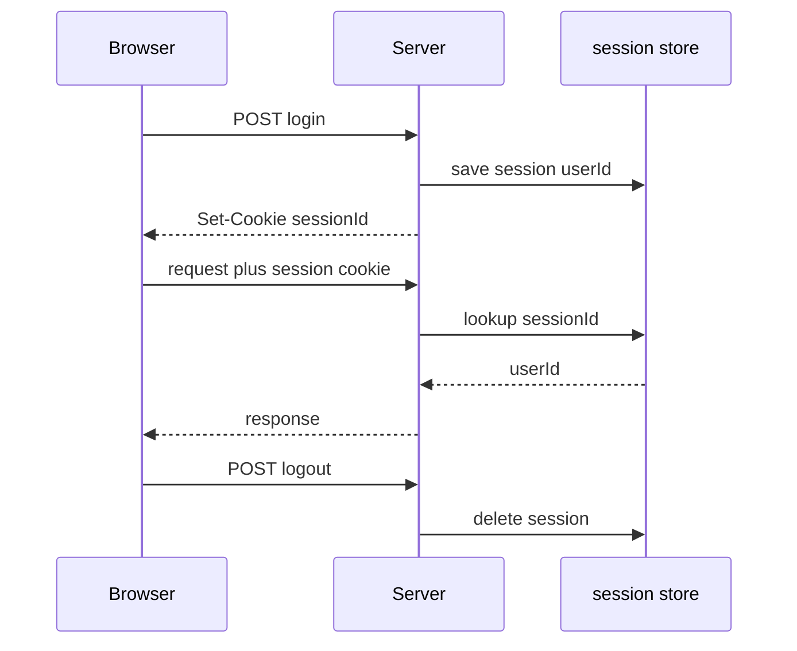
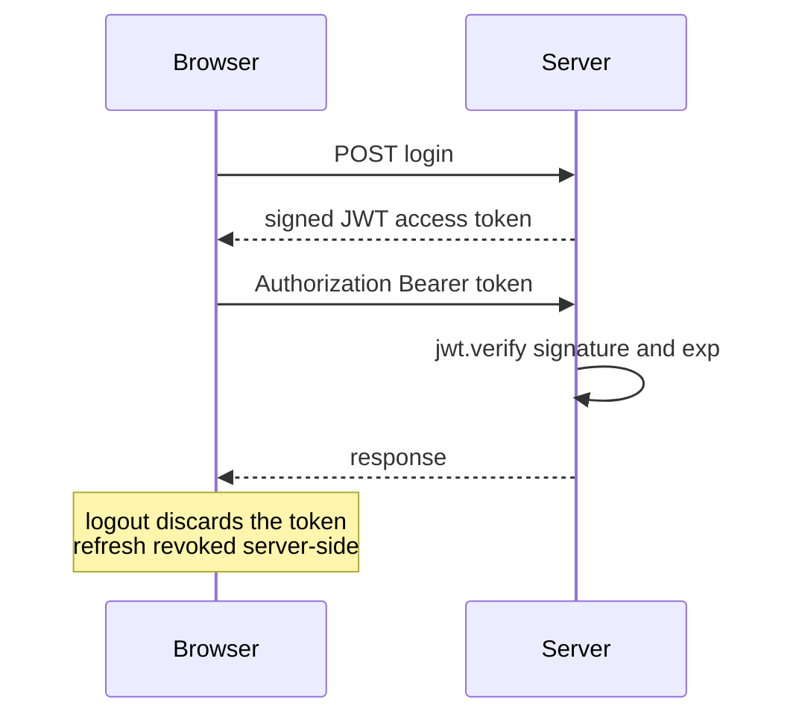

# 6.4 Sessions vs JWT

> **[Learn]** · Chapter 06 · Authentication API · *Stateful vs stateless, pros and cons, JWT for this course*

Every authenticated API has to answer one question on every request: how does the server know who sent this? The provider saving a Service, the client holding a slot, and the worker expiring a SlotClaim all arrive over the same HTTP server, and HTTP has no memory between requests. Two patterns dominate the answer. The first keeps the answer on the server and gives the browser a key to it. The second signs the answer and gives the browser the answer itself. This course mandates the second for SkillSlot, and this page explains what that choice buys and what it costs.

<BigWordAlert term="Stateless JWT" plainEnglish="A signed token the client sends on each request, and the server validates the signature without storing any session in memory." whyItMatters="SkillSlot uses JWTs so any API instance can authorize a request without a shared session store." />

## The problem, stated plainly

When a client logs in, the server verifies a password once. Every request after that needs the same identity without sending the password again. So the login response must hand the client something that proves the earlier verification happened. Both patterns do exactly that, and they differ in one decision: does the server write down who is logged in, or does it sign a claim and forget?

That single decision propagates. It decides whether a logout takes effect immediately or eventually. It decides whether a second API instance can answer a request that the first instance authenticated. It decides what a stolen credential is worth to an attacker, and it decides what you have to operate on a Tuesday night when a client reports that they cannot stay signed in.

## The two mechanisms side by side

<ComparePanel title="Sessions vs JWT">
  <CompareColumn label="Sessions">
    The server writes a record in Redis or a database and returns a cookie that names it. Every request carries the cookie, and the server looks the record up before it trusts anything. Logout deletes the record, so the next request finds nothing.
  </CompareColumn>
  <CompareColumn label="JWT (this course)">
    The server signs a token whose payload names the user and role, and the client sends it in an Authorization header. The server verifies the signature and the expiry, and trusts the payload without a lookup. Logout drops the token on the client and revokes the refresh token on the server.
  </CompareColumn>
</ComparePanel>

## Server-side sessions, traced

With sessions the server owns the state. Login writes a record, the browser holds a cookie that only names it, and each request causes a lookup. Because the lookup happens on every request, revoking access is a delete, and the effect is immediate for the next request that arrives.

| Pros | Cons |
|---|---|
| Immediate revoke, delete the record | Stateful, needs a session store |
| Small cookie, only the session id travels | Horizontal scaling needs a shared store |
| Server controls lifetime tightly | Extra infrastructure to operate and back up |

The cost is not the lookup itself. One indexed read against Redis is cheap. The cost is a second stateful system in the deployment, with its own availability, memory limit, eviction policy and backup story. When that store is unavailable, nobody can log in, and no amount of API replicas helps. Sessions are a good fit for a server-rendered monolith that already has a database it trusts.

## JWT, traced

With a JWT the server signs a claim and keeps nothing. Login returns a token, the client attaches it to each request, and the server recomputes the signature over the header and payload. If the signature matches and the expiry has not passed, the payload is trusted as it stands.

| Pros | Cons |
|---|---|
| No session lookup on each request | Hard to revoke before the expiry |
| Works across separate services | Payload is readable by anyone holding it |
| Natural fit for a browser client | Secret rotation needs care |

<TraceRequest title="One authenticated request, then an expiry">
  <TraceStep actor="Client" label="POST /api/auth/login" detail="Email and password over HTTPS" />
  <TraceStep actor="API" label="200 with access token and refresh cookie" status={200} detail="Access in the body, refresh in an HttpOnly cookie" />
  <TraceStep actor="Client" label="GET /api/bookings with Bearer token" detail="Access token attached as a header" />
  <TraceStep actor="API" label="jwt.verify passes, payload has sub and role" detail="No database lookup for identity" />
  <TraceStep actor="Client" label="Next day, GET /api/bookings" detail="The same in-memory token is gone after a reload" />
  <TraceStep actor="API" label="401 Unauthorized" status={401} detail="Token missing, so no identity can be established" />
  <TraceStep actor="Client" label="POST /api/auth/refresh, then one retry" detail="Cookie proves the session, a new access token is minted" />
</TraceRequest>

Read the trace twice. On the third step the API authorises without touching the database for identity, which is the whole promise of a stateless token. On the sixth step the failure is a 401 and not a 403, because the caller presented nothing that could be verified. On the last step the recovery is a refresh and exactly one retry, which Module 7 turns into client code. Nothing in this sequence required the server to remember a session between steps two and three.

## Why SkillSlot uses the hybrid pair

Neither token is enough on its own. A single long-lived access token is convenient and dangerous, because it cannot be revoked and it lives long enough to matter. A single short-lived token is safe and unusable, because a client would re-authenticate every fifteen minutes. The pattern used here splits the job: a short access token proves the session for minutes, and a long refresh token, stored hashed on the User document, proves the session for days.

| Concern | Sessions | JWT access with refresh |
|---|---|---|
| Revoke everything now | Delete the records | Clear refresh hashes, access lives until expiry |
| Database read for identity | Yes, on every request | No, signature verification only |
| Stolen token via script injection | Cookie is unreadable to scripts | Access token stays in memory |
| Cross site request forgery | Cookie session is exposed | Bearer header is not sent automatically |

The trade-off is stated honestly rather than hidden. Logout with this pattern is not instant for the access token. The client discards it, the server clears the refresh hash, and any copy of the access token that an attacker already holds keeps working until it expires. Fifteen minutes of exposure is the price of not running a session store, and it is a price this course accepts deliberately. If the requirement were instant global logout, sessions or a per request revocation list would be the correct answer, and the cost would move to operations.

The reason this pattern is the one to learn here is not that it is universally better. It is that the split matches the shape of the application: a React client that can hold a value in memory, an API that can be replicated without coordination, and a refresh token that gives the server one place to revoke. Redis appears in Module 23 for availability caching and search, not for sessions, so the deployment in Module 25 has one fewer stateful dependency.

## What goes in the payload

Include the user id, the role, and the issued and expiry timestamps. That is enough for a route to authorise a read of a Service, a write to an AvailabilityRule, or a hold on a slot. Exclude everything else, because a payload is encoded and not encrypted: anyone holding the token can read it, and the signature only proves it was not edited.

Never put a password hash in a payload. Never put the refresh token in the access payload. Prefer a `/me` endpoint for profile fields rather than carrying a display name in every request. A small payload is not an optimisation, it is a smaller leak, and it keeps the token short enough to travel in a header without ceremony.

## A worked example with two clocks

A provider logs in at 09:00 and receives an access token that expires at 09:15 and a refresh token that expires in seven days. At 09:14 they save a new AvailabilityRule and the write succeeds. At 09:20 they save another and the request fails with a 401. The client refreshes, receives a new access token that expires at 09:35, retries the save once, and the write succeeds. The provider sees a brief pause and nothing else.

Now change one detail. Suppose the client had stored the refresh token in JavaScript readable storage and a script read it. The attacker can mint access tokens for seven days without ever knowing the password, and clearing the refresh hash is the only move that ends it. That is why the refresh token gets the strongest protection the browser offers while the access token gets the convenient one.

## Failure modes worth recognising

A 401 that repeats after a refresh usually means the refresh cookie was not sent, which is a `credentials` option or a cookie attribute problem and not a signature problem. A 401 that appears only after a redeploy usually means the signing secret changed, which invalidates every outstanding token. A 403 in place of a 401 usually means identity was fine and ownership failed, so the token is not the suspect. A payload that is missing the role usually means the login route signed a partial object, and the fix belongs in the signing call rather than in middleware.

Debug by decoding before verifying. Paste the failing token into a decoder and read `exp` and the payload fields. If `exp` is in the past, the answer is already known and no middleware change will help. If `sub` is missing or is a different shape from the id the route expects, the signature may be perfect and the route still correct to refuse. Only after both checks look right is the signing secret the next thing to compare.

## Reflect in the learning log

What happens when a client taps logout while the access token is still valid, and how does refresh revocation limit the damage? Which of the two tokens would you protect more carefully, and why? Write the answer in your own words before the next sub-chapter, because the placement decision in Module 7 depends on it.

## Next

**Sub-chapter 6.5:** password hashing, bcrypt, salt and cost factor. The architecture is chosen, so the next lesson is the mechanism that keeps a stored password from being useful to whoever reads the collection.
