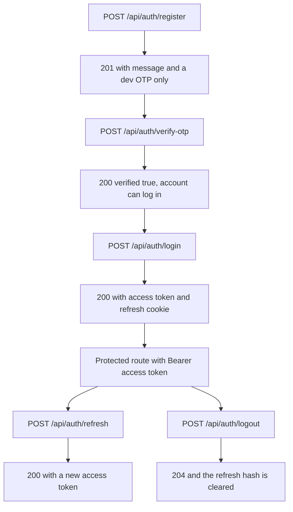

# 6.7 Prime your thinking

> **[Learn]** · Chapter 06 · Authentication API · *Mandatory reads: bcrypt and jsonwebtoken*

Before scaffolding auth routes, read how bcrypt and jsonwebtoken behave in Node, especially their async APIs and the errors they throw. Thirty focused minutes here prevents an evening of "invalid signature" and "buffering" style guesswork, because both libraries fail in narrow, recognisable ways once you have seen them fail on purpose.

<BigWordAlert term="Access vs refresh token" plainEnglish="A short lived access token for API calls, and a longer refresh token used to get new access tokens without asking for the password again." whyItMatters="SkillSlot access tokens expire in minutes, and the refresh token is what keeps a provider signed in across a working day." />

The four routes you are about to build share one job: prove an identity, then hand out a credential that proves it again without the password. Every read below is about that handing out step.

```predict
prompt: "A client's access token expires while their refresh token is still valid. What should SkillSlot do?"
options:
  - id: extend-expired
    label: "Keep accepting the expired access token until logout"
  - id: rotate-access
    label: "Use the refresh token to mint a new access token"
correctOptionId: rotate-access
explanation: "Short-lived access tokens limit exposure. A valid refresh token is the credential used to mint a replacement; an expired access token must not become valid again."
allowRetry: true
```

## Why these two libraries, and not one

A password and a token answer different questions. A password answer is checked once, at login, against a stored hash, and the server must never be able to recover the original. A token answer is checked on every later request, without the password and without a database read. bcrypt owns the first job because it is deliberately slow. jsonwebtoken owns the second because a signature can be verified quickly and without state.

Mixing the two up is a common and expensive mistake. Hashing an access token with bcrypt would make every request pay a hashing cost, which turns a cheap verification into a CPU spike under load. Signing a password with a JWT and storing it would put a reversible credential in the browser. Keep the boundary: slow and one way for passwords, fast and signed for tokens.

## The four routes and what each returns

The diagram is the shape of the whole chapter. Read it as a list of promises the API makes to a client.



Two properties fall out of that picture. Registration never returns an access token, because an unverified account must not be able to act on the marketplace at all. And refresh returns an access token without returning a new password proof, which is why the refresh token has to be guarded so carefully.

## bcrypt: what the cost factor buys

bcrypt takes the password, generates a random salt, and runs a key derivation loop whose cost is set by the work factor. `bcrypt.hash(password, 10)` means `2^10` rounds of that loop. The result is a string that carries the algorithm version, the cost, the salt and the derived hash, so `bcrypt.compare` can recompute the same derivation without a second column in the database.

The mechanism explains the trade-off directly. Raising the cost from 10 to 12 makes each hash four times slower for an attacker and four times slower for your login route. That is fine, because a login happens once per session while an attacker wants billions of guesses. What is not fine is running the synchronous variant inside a route handler. The synchronous call blocks the event loop for the whole derivation, so one slow login stalls every other request on that process, including a slot hold that a client is waiting on. Use the async form and await it.

Both functions are async and both can be awaited in a handler. `bcrypt.compare` resolves to a boolean rather than throwing on a mismatch, so a wrong password is a normal branch and not an exception. The failure you do have to handle is a malformed stored hash, which throws or resolves false depending on the version, so guard for a missing `passwordHash` before comparing.

A worked example makes the cost concrete. With a work factor of ten, one hash takes a few tens of milliseconds on a laptop. A login route therefore adds that time to a single request, while an attacker with a copy of the collection pays the same cost for every guess, which is why a stolen dump with a current work factor is expensive to attack and one with an old factor is not. When the factor is raised later, the stored strings keep their original cost marker, so old accounts verify slowly and stay valid. Nothing has to be rehashed in a migration, and that is a property worth knowing before you choose the number.

## jsonwebtoken: structure, expiry, and the two errors

A JWT is three base64url parts joined by dots: the header, the payload and the signature. The signature is computed over the first two parts with your secret. Nothing is encrypted, so the payload is readable by anyone holding the string, and `verify` only proves nobody changed it after signing.

`jwt.sign({ sub: userId, role }, secret, { expiresIn: '15m' })` returns a token that carries an expiry in the payload. `jwt.verify(token, secret)` returns the payload when the signature and expiry both pass, and throws when they do not. There are exactly two error names to catch in middleware, and knowing which is which prevents the wrong fix:

- `TokenExpiredError` means the signature was fine and the clock moved past `exp`. The client should refresh.
- `JsonWebTokenError` means malformed input, a wrong secret, or an edited payload. The client should log in again.

The distinction matters because the first is routine and the second is a defect. Treating an expired token as a signature failure sends learners hunting through configuration that was never wrong. Treating a bad secret as an expiry hides a deployment mistake behind an endless refresh loop, where every refresh returns another token that also fails.

## The failure path, traced

<TraceRequest title="Expired token through requireAuth">
  <TraceStep actor="Client" label="GET /api/services with Bearer token" detail="Token expired two minutes ago" />
  <TraceStep actor="API" label="requireAuth reads the Authorization header" detail="Scheme is Bearer, so the token is extracted" />
  <TraceStep actor="API" label="jwt.verify throws TokenExpiredError" detail="Signature was valid, exp is in the past" />
  <TraceStep actor="API" label="401 Unauthorized, generic body" status={401} detail="No stack trace, no secret, no payload echo" />
  <TraceStep actor="Client" label="POST /api/auth/refresh with the cookie" detail="Refresh token is still valid" />
  <TraceStep actor="API" label="200 with a fresh access token" status={200} detail="Refresh hash rotated, old one invalidated" />
  <TraceStep actor="Client" label="Retry GET /api/services once" detail="Second 401 would mean logout, not another loop" />
</TraceRequest>

Step through it and notice that no step inspects the database for identity. The only database work on the path is the refresh step, and that is deliberate: it is the one place where revocation lives. The response body on the failure step is the same for every reason, which stops an attacker learning whether a token was expired, edited or issued for another secret.

## Middleware order, and what must not be behind auth

Express runs middleware in the order it is registered, so the order is a security statement. JSON parsing first, then the auth router, and only later a protected router with `requireAuth` mounted in front of it. Health and public browsing must stay outside the protected tree, because a health check that requires a token fails during an incident, and a provider profile that requires a token cannot be read by the clients deciding whether to book.

Mount `requireAuth` on the router or per route, never globally. Global mounting looks tidy and forces every public read to carry a credential, which quietly turns a public marketplace into a private one.

## Validation belongs before the service layer

The schema file decides what each route is allowed to receive. Registration takes an email, a password, a role and an optional display name. Login takes an email and a password. OTP verification takes an email and a code. Refresh takes either a cookie or a body field depending on the chapter you are in.

| Route | Body fields |
|---|---|
| register | email, password, role, displayName optional |
| login | email, password |
| verify-otp | email, otp |
| refresh | refreshToken when in body mode |

Return a 400 with field level errors before the service layer runs. This is not decoration. A register route that accepts an unknown role can create an account that no authorization rule covers, and an OTP route that accepts any string can be brute forced with a loop.

## OTP storage, and the honest trade-off

Both options store the code on the User document. Storing the plain code is acceptable only for a development demo with a short expiry, because a database read then yields a working code for every pending account. Hashing the code like a password means a leaked dump yields nothing usable, at the cost of one compare per attempt.

Whichever you choose, write the rule down. A six digit code with a ten minute expiry and a limited attempt count is a reasonable default. A six digit code with no expiry and unlimited attempts is a permanent backdoor that looks like a feature.

## A note-taking template worth keeping

Write the service steps before the code, because the order is the specification:

```
register
1 validate body
2 check duplicate email
3 hash password
4 create user and profile
5 generate OTP with expiry
6 return message, plus the OTP in development only

requireAuth
1 read the Authorization header
2 extract the Bearer token
3 verify and attach req.user
4 answer 401 for every failure
```

That list is short enough to keep beside you, and every later debugging session starts by checking which step misbehaved.

## Time box and self check

Ten minutes on the bcrypt readme, fifteen on the jsonwebtoken readme, ten skimming the authentication cheat sheet, and fifteen mapping routes to service functions. Before the build cluster, confirm three things: you can sign and verify a token in isolation, you can hash and compare a password, and you can say why 401 is for a missing identity while 403 is for an identity that is not allowed.

**Sub-chapter 6.8:** the authentication and token safety knowledge check. Reading done, the build starts at 6.9.
