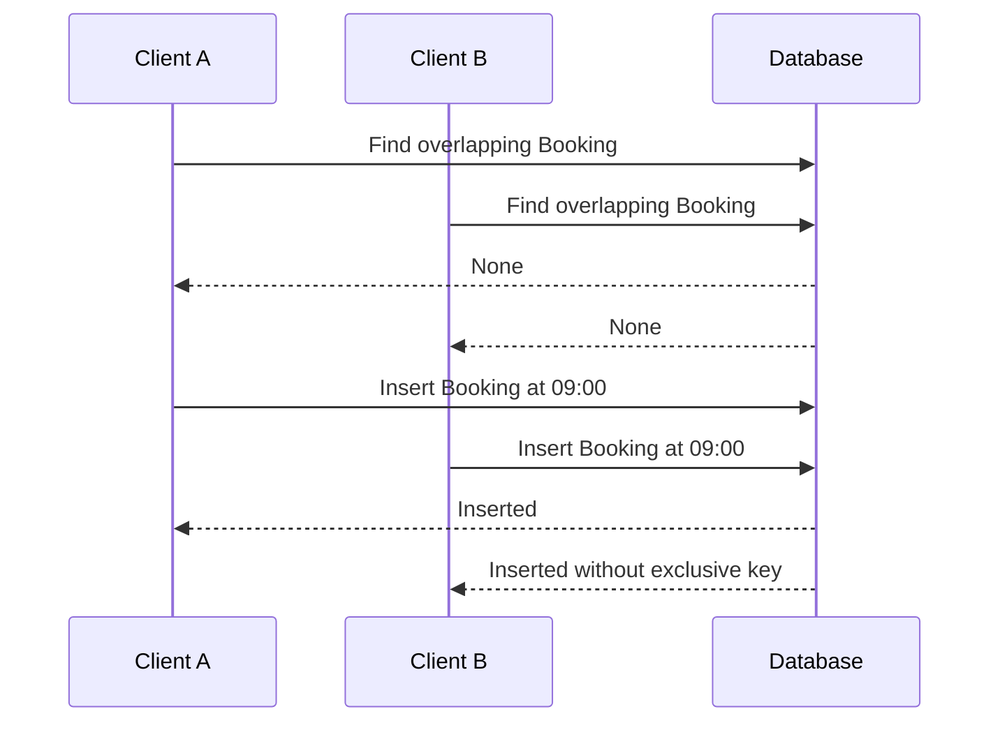

# The overlap trap

Two clients see the same tutor's 09:00 opening. Each presses the checkout button within a second. The server handling Client A asks MongoDB whether the tutor has an overlapping Booking and sees none. The server handling Client B asks the same question before A's insert commits and also sees none. Both create a Booking. Each controller followed the rule it was given, yet the tutor now owes two people the same hour. The mistake is not a missing calendar refresh. It is using a read as though it were an exclusive write.

This module creates the collections that make SkillSlot's promises explicit. A weekly AvailabilityRule says when a provider intends to work. TimeOff removes a dated part of those hours. A Service says how long an appointment and buffer occupy the provider. A Booking records a client's dated appointment and its lifecycle. A SlotClaim is the exclusive provider/block key that lets the database reject a second owner. The claim exists because an ordinary "find then insert" sequence has a race between the two operations.

The diagram is a possible interleaving, not a rare edge that can be solved by delaying one request. Real networks, server replicas and database scheduling make request order unpredictable. Even if each server process runs one line of JavaScript at a time, two processes can perform their reads before either writes. The system needs a database invariant that survives this interleaving. Module 3 chose one scalar SlotClaim document for each provider and 15-minute UTC block, with a unique compound index on provider and block start. Both overlapping appointments need at least one common key, so only one claim set may commit.

Do not confuse a generated slot with a claim. A 09:00 option on a calendar is a computed candidate based on a read of current rules and blockers. It can become stale immediately. A SlotClaim is durable ownership of one UTC block, linked to a hold or booking. A confirmed Booking is the human promise. This module defines the records; Module 15 computes candidates and Module 19 writes claim sets in transactions. Putting the concepts in separate collections lets each later step answer the question it owns.

## A booking is more than an order line

FreshMarket can put a frozen rice description in an Order line. SkillSlot's Booking has its own time, status, reminder and cancellation path. A client may reschedule one tutorial while another appointment in the same provider order remains unchanged. The provider needs an agenda across many orders; the client needs one across many providers. A Booking therefore has an independent ID and references the client, provider, service and provider-scoped order. It also embeds the price and policy accepted at purchase, so a later Service edit does not rewrite the old receipt.

The Order is a payment and fulfillment group for one provider. A cart may contain a tutor and a designer, but checkout splits it into one Order per provider. The SlotClaim key is also provider-scoped: a tutor and designer may both work at 09:00 without conflict. If you accidentally use only `blockStartAt` as a unique key, every provider in the marketplace would share one global calendar. If you use `serviceId` instead of `providerId`, two services from the same tutor could be sold over the same hour. The exclusive resource is the provider's time.

## The domain has two types of time

An AvailabilityRule stores the provider's local weekday and wall-clock boundaries with an IANA zone. "Mondays from nine" is a repeatable intention. Booking and SlotClaim store dated UTC instants. A 09:00 Monday in Gaza may resolve to different UTC hours on different dates if civil time rules change. A paid Booking's UTC instant remains fixed when a provider edits weekly hours or when a client's display zone changes. Module 5's converter gives us the boundary between these types. The model must not blur them into one `time` string.

TimeOff is a dated exception. A provider may block one afternoon after an internet outage. It should remove new offers without silently cancelling a paid appointment. The dashboard must show any existing bookings that conflict with the new exception so the provider can resolve them through an explicit cancellation or reschedule workflow. A TimeOff record is not a command to delete Bookings. This separation is part of the ownership chain you will draw in the ERD.

## What you will leave with

By the module gate, `server/src/modules/` will contain the identity/profile, provider, service, rule, time-off, claim, booking, cart and order models. You will have tested the unique SlotClaim index with a duplicate insert against a real database. A seed script will create five Gaza providers, clients in Gaza, Berlin and Qatar, services, hours and time off. You will inspect UTC values in Compass and convert two by hand. Finally, `docs/erd.md` will show the relationships, cardinalities and which facts are live references or purchase-time snapshots.

The seed is not decorative sample content. Later authorization tests need two providers and two clients so a cross-provider request can be rejected. Availability tests need a provider with a rule and a dated TimeOff. Time-zone tests need people in more than one zone. Checkout concurrency tests need a real unique index, not just a Mongoose validator. Stable seed identities make those tests repeatable; fake data that changes shape with every run makes a red test hard to reproduce.

Before creating models, write a two-column note. In the first column, list statements that can change for future offers: weekly hours, current Service price, provider profile, time off. In the second, list facts that should survive later edits: a paid Booking's UTC start, accepted price and policy, and the provider/block keys held for its occupied time. If a fact could fit in both columns, write why. The exercise is not about normalizing every field. It is about preserving the client's promise while allowing a provider to change what they sell next week.

Use the 09:00 race as a review question for every schema. Which document would Client A and Client B both try to create? What database rule rejects the second write? If the answer is "the controller checks the Booking list," the schema still leaves the race open. If the answer is "the browser hides the button," the server still leaves it open. The unique provider/block claim belongs in the database, and the transaction for all required blocks comes later.

The next lesson maps the ownership chain before you write schema code. A model can have all the right field types and still be unsafe if a route cannot prove that a provider owns the service it is changing, or if a client can read another client's booking by guessing an ID. Ownership fields are not merely arrows in a diagram; they become query predicates and authorization checks.

Try changing the race to two different services from the same provider. Client A asks for a 09:00 tutoring lesson, while Client B asks for a 09:15 portfolio review. A uniqueness key containing serviceId would let both requests succeed even though the provider cannot conduct both. This transfer case is why the claim key contains providerId and UTC block start. The Service determines how many blocks are needed; it does not define a separate calendar for each offering. Put this scenario beside the opening race in your notes and use it to challenge the index in the ERD.

Then change only the provider. Two tutors may each teach at 09:00. A global unique blockStartAt would reject a legitimate second provider. These two cases establish both halves of the compound key. Later, when the unique index is created, your test should include a same-provider duplicate that fails and a different-provider same-time insert that succeeds. A test with only the failure case could accidentally pass with an overly broad global lock.
