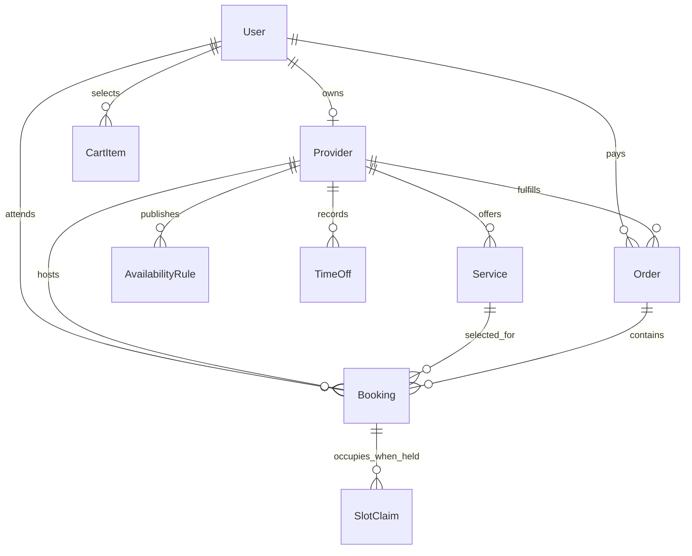

# Follow the ownership chain

An ObjectId reference says which record another document points to. It does not automatically prove that the logged-in person may read or change that record. SkillSlot needs a chain from the authenticated User to a Provider profile, from Provider to the Services it sells, and from a paid Order to each Booking it created. A client is also a User referenced by their CartItems, Orders and Bookings. Draw this chain before writing models so later routes can put the correct IDs in their database filters.

For the course MVP, one User may own at most one Provider profile. A provider may offer several Services and publish several AvailabilityRules and TimeOff intervals. A client may create several CartItems and Orders. Each Order belongs to exactly one provider, even if one checkout began with a mixed-provider cart. Each Booking belongs to one client, one provider, one Service and one Order. It keeps its own lifecycle. A SlotClaim belongs to a provider block and points back to the Booking or hold that owns it.

The diagram uses zero-or-many for several relationships because a new provider can exist before it has a service or booking. A Booking can have zero SlotClaims after cancellation or expiry while retaining its historical record. An active exclusive hold or confirmed booking should have all required claims. That is a state invariant to test in the checkout module, not a permanent database cardinality. The ERD should distinguish possible historical states from what is required during an active hold.

<TraceRequest title="A client asks to see a booking">
  <TraceStep actor="Client" label="Sends Booking ID" detail="Authenticated User ID is already known" />
  <TraceStep actor="API" label="Loads Booking" detail="Checks clientId or provider ownership" />
  <TraceStep actor="Provider" label="If provider path" detail="Provider.userId must match authenticated User" />
  <TraceStep actor="API" label="Returns allowed fields" detail="Private meeting link only to participants" />
</TraceRequest>

The trace turns arrows into a security rule. A route must not return a Booking just because the ID exists and the requester is logged in. A client can read a booking when `booking.clientId` equals their User ID. A provider can read it when the booking's `providerId` refers to their Provider profile. An admin may have a separately documented support path. Module 9 will implement these checks and need-to-know response fields. This module gives that later code a reliable set of reference fields.

## Keep one authoritative direction

Store `providerId` on Service and Booking. Store `clientId`, `providerId`, `serviceId` and `orderId` on Booking. An Order may contain booking IDs or small receipt summaries for efficient display, but Booking remains the state authority for rescheduling and completion. Do not keep two independently mutable Booking copies, one embedded under the provider and another under the client. A cancellation could update one copy and fail on the other, leaving the two people with different calendars.

A reference and a snapshot can coexist. Booking references the current Service for navigation and provider identity, while it embeds the agreed service title, duration, price, currency and cancellation terms from purchase time. A price edit next month should change the Service used for new offers, not the amount on a prior receipt. If the provider archives the Service, the old Booking remains explainable. The snapshot is historical evidence, not a second live catalogue.

Provider ownership must be enforced in the query. For example, an update route for a Service should first resolve the authenticated User's Provider profile and then update a Service with both `_id` and `providerId` predicates. Loading by service ID and trusting a request-body `providerId` allows an attacker to claim another provider's item. The `providerId` in a client request is untrusted data; the server should derive ownership from the authenticated account and saved relationships.

Likewise, Order should carry exactly one provider ID. Suppose a cart contains an English lesson from Provider A and a design session from Provider B. Split it into two Orders so Provider A's revenue and booking fulfillment can be scoped without seeing B's order lines. The payment workflow may coordinate the two as one client checkout, but an Order remains a provider share. A Booking links to the Order for its provider. A test should fail if a Booking's `providerId` differs from its Order's provider or its Service's provider.

## Query paths are part of the design

The client agenda queries Booking by `clientId` and a UTC date range. The provider agenda queries Booking by `providerId` and a UTC date range. A receipt follows Order to Bookings. The public availability engine queries rules, TimeOff and claims for one provider but does not expose their private contents. These query paths suggest indexes later. They also show why a Booking cannot be found only by traversing every Order in the database.

Do not choose indexes solely because a diagram has arrows. Add them where a real route filters or sorts. For example, `{ providerId: 1, startAt: 1 }` supports an agenda ordered by time. `{ clientId: 1, startAt: 1 }` supports the client's calendar. The unique `{ providerId: 1, blockStartAt: 1 }` on SlotClaim is stronger than a performance index: it expresses exclusivity. Later tests should distinguish a query being fast from a duplicate write being impossible.

Give User only authentication identity and roles; keep display name and the client's preferred IANA time zone on Profile. A client changing their display zone should update Profile without changing a Booking's UTC instant. A provider's own working zone is required on Provider because its weekly AvailabilityRules are interpreted there. The two zones may initially be the same, but they answer different questions. A provider may move or change working region later, and already confirmed bookings must not move silently as a side effect.

## Test the chain before coding

Write four sentences in `docs/erd-draft.md`. One says who can create a Service. One says who can see a Booking's meeting link. One says which provider an Order belongs to when the cart contains two providers. One says what happens to an old Booking when its Service is archived. For each, point to the stored reference or snapshot that supports the answer. If the answer depends on a field your ERD does not show, add it before creating a schema.

Try a negative case: Provider B guesses Provider A's Service ID and sends an update. The query should match zero records after provider scoping, regardless of whether the ID is valid. Try another: Client B guesses Client A's Booking ID. The API should return no private appointment fields. A well-designed ownership chain makes these checks possible without depending on the browser hiding links.

At this stage, the diagram is a design claim. The next build chapters create indexes and model validation; Module 9 tests authorization at the route boundary. Keep the chain in `docs/erd.md` and revise it when implementation reveals a missing field. The goal is not to freeze a diagram forever. It is to make changes deliberate and ensure one ownership rule remains true through seed data, API filters, provider dashboard and client calendar.

Reference: [MongoDB data-model relationship guidance](https://www.mongodb.com/docs/manual/applications/data-models-relationships/).

## Check a cross-provider cart on paper

Draw two CartItems for one client. The first refers to a tutor Service and a 09:00 UTC start. The second refers to a designer Service and a 14:00 UTC start. Group them by the server-loaded Service.providerId, then draw one Order for each provider and one Booking beneath each Order. Trace the client agenda: it queries both Bookings by clientId. Trace the tutor dashboard: it queries only the tutor Booking and Order by providerId. If your diagram makes the tutor load the entire mixed checkout to find their work, split the ownership boundary more clearly.

Now change the designer's Service price after checkout. The designer Booking's purchase snapshot keeps the old price, while the tutor Booking and Order are unaffected. This test exercises reference direction, payment grouping and historical terms at once. Record the expected query filters next to the ERD. Module 19 will implement the transaction; this lesson establishes the data shape that transaction must create.
