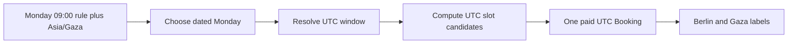

# Rules are local; appointments are instants

"I teach Mondays at 09:00" and "Amina's lesson is on 2024-01-15 at 08:00 UTC" are different kinds of statement. The first is a recurring local intention. The second is a dated instant in a specific client's and provider's history. If both are stored as one generic `date` field, later code has to guess whether changing the provider's zone should move a paid appointment. SkillSlot makes the distinction visible in its schemas and route contracts.

An AvailabilityRule stores ISO weekday, `HH:mm` local start and end, effective local dates, and the provider's IANA time zone. A TimeOff record represents a dated exception with UTC start and end instants after the provider's input has been resolved. A Booking stores dated UTC `startAt` and `endAt`. Each SlotClaim stores one UTC `blockStartAt` on the 15-minute grid. The provider's browser can show local labels while editing hours; the server resolves a rule only after selecting a calendar date.

The direction matters. A viewer's label is derived from a stored instant. It does not become the stored authority. The client may switch Profile.timeZone from Berlin to Qatar and see a different hour; the Booking.startAt remains the same UTC value. The provider may edit next week's rule from 09:00 to 10:00; new offers change, but the paid Booking does not move. An explicit reschedule is needed to change it.

<TraceRequest title="The same Monday rule on two dates">
  <TraceStep actor="Provider" label="Saves Monday 09:00" detail="Local wall time with IANA zone" />
  <TraceStep actor="Engine" label="Expands dated Monday A" detail="Resolve using that date's zone rules" />
  <TraceStep actor="Engine" label="Expands dated Monday B" detail="Resolve again, not plus 168 UTC hours" />
  <TraceStep actor="Booking" label="Client chooses one UTC start" detail="Stored instant remains fixed" />
</TraceRequest>

This is why a fixed offset such as `+02:00` is not a replacement for an IANA zone. It says how local and UTC related at one moment. It does not contain the place's future civil-time rules. Even places that do not currently shift clocks may change policy. The rule should carry a zone ID and local fields; the time library resolves each dated occurrence using its IANA data. Module 5's converter rejects nonexistent or repeated local boundaries rather than silently choosing one.

## Choose each field by what it means

`AvailabilityRule.weekday` is 1 to 7 in the provider's local calendar. `startLocal` and `endLocal` are `HH:mm` strings validated at quarter-hour boundaries for this course. `effectiveFrom` and `effectiveTo` are local calendar dates. They should not be represented as UTC midnight instants, because UTC midnight may be a different provider-local date. A rule may have an active flag so the provider can retire future openings without deleting the history of why earlier offers existed.

`TimeOff.startAt` and `TimeOff.endAt` are UTC Date values after the provider chooses a dated local interval. The write route asks the tested converter to resolve both boundaries in the provider zone. If a boundary falls in a gap or overlap, the route returns a specific validation error and asks the provider to choose a valid boundary. A TimeOff that begins before midnight and ends after it is still one UTC interval; overlap checks do not need a special local-midnight branch after resolution.

`Booking.startAt` and `Booking.endAt` are UTC Date values for the client-facing session, while an optional occupied end or buffer snapshot tells later workflows how long the provider remains unavailable. `SlotClaim.blockStartAt` values cover the full occupied time, including buffer. The Booking also snapshots the provider zone shown at purchase. That snapshot helps explain old receipts if the provider's working zone changes, but the appointment's UTC instant is still the actual date-time promise.

## Compare a rule edit with a reschedule

Suppose the provider changes Monday hours from 09:00 to 11:00 local to 10:00 to 12:00. The availability engine will compute new unbooked starts on future Mondays. It must still subtract claims for confirmed Bookings made under the old rule. The existing Booking does not adopt the new rule's time. If the provider wants to move a paid client, the reschedule workflow asks for consent, reserves new claims, releases old claims and changes Booking state through an explicit transaction. A weekly rule edit is not a shortcut around that workflow.

Now suppose the client changes their preferred zone from Europe/Berlin to Asia/Qatar. The provider rule remains in the provider zone. TimeOff remains UTC. SlotClaims remain UTC. Booking remains UTC. Only the display label and perhaps notification wording change. A test should assert these database fields are byte-for-byte unchanged while the formatted strings differ. If a profile setting mutates a Booking, the model has confused presentation with commitment.

The exact same principle applies to reminders. A reminder job should target a Booking.startAt UTC instant minus a chosen elapsed duration. It should not store "Monday 08:00 Berlin" as an unzoned string and hope the worker interprets it the same way next month. If a booking is rescheduled, the job moves because the Booking instant changes through a deliberate workflow. If a client changes display zone, the reminder may use a different local label but fires at the same scheduled instant.

## Test transition boundaries without guessing Gaza dates

Use historical New York dates from Module 5 to test the converter's gap and overlap policy. Then use the runtime's IANA data to inspect a seeded Gaza rule on a chosen dated week. Do not hard-code an unverified future Gaza offset into a schema default or lesson assertion. The schema stores `Asia/Gaza`; the test of a specific date records the Node and time library version used. A confirmed Booking keeps its resolved UTC value even if future civil-time data changes. Unbooked openings may be recomputed under new data.

In `docs/erd-draft.md`, add a table with one row each for rule, dated candidate slot, TimeOff, Booking, SlotClaim and viewer label. Include the type, owner, stored representation and what can change it. A candidate slot is computed and not stored as a permanent document. A viewer label is computed from UTC and a profile zone. If your table has a `Slot` collection as the only source of truth, revisit Module 3's decision and the difference between an offer and a hold.

Finish with one hand calculation: a provider rule says Monday 09:00 in Europe/Berlin on 2024-01-15. The tested converter gives 08:00 UTC. A Qatar client sees 11:00 local for that same instant. Put those three representations side by side and label which is weekly, which is dated and which is presentation. Then change the client zone; only the last column should move. The next quiz asks you to make this distinction before the model files are built.

References: [Luxon DateTime and named zones](https://moment.github.io/luxon/api-docs/index.html), [MDN zoned-date behavior](https://developer.mozilla.org/en-US/docs/Web/JavaScript/Reference/Global_Objects/Temporal/ZonedDateTime).

## Compare two reads of one appointment

Ask a Berlin client and a Gaza provider to open the same Booking. The API should send the same UTC startAt to both. Each interface formats it in the viewer's chosen zone and labels that zone visibly. If one screen sends a local `09:00` string without a zone, the other cannot reliably identify the same instant. Write a response fixture with one UTC ISO value and two derived labels. Change the client Profile.timeZone in the fixture; only the client's label changes. This is a useful integration check because it crosses persistence, API response and display without allowing any layer to invent a second appointment time.

Contrast that with a provider editing the Monday rule. The rule itself changes its local `startLocal` for future unsold dates. The availability engine will generate a new set of UTC candidates. A confirmed Booking from the earlier rule remains in the database and its SlotClaims still block the provider's occupied time. If the new rule no longer contains that Booking, the provider dashboard should show the mismatch, not erase the client promise. This is why the model keeps rule, claim and booking as separate records.

Finally, decide how to represent a provider's one-day exception. If they will not work next Monday morning, save a dated TimeOff interval after resolving the local input. Do not mutate the recurring Monday rule just to close one date. If they change all future Mondays, edit or replace the rule with an effective date. The two actions have different scopes, and separate model types make the UI question clear.
