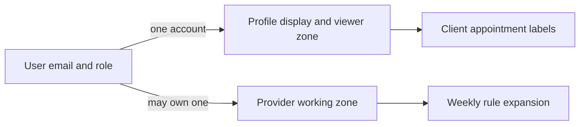

# Put identity and display zone in the right models

Start the model folder with User and Profile. User is the authentication identity: email, password hash, role and verification state. Profile holds display name, optional phone or avatar, and the person's preferred IANA time zone. A client in Berlin may change that zone to Qatar after moving; the setting changes how appointments are labelled, not when a paid Booking begins. A provider has a separate working zone in its Provider model because weekly hours belong to that business location. Keep the two zone fields distinct even if seed users initially choose the same value.

Create `server/src/modules/users/user.model.js` and `profile.model.js`, or adapt the existing files from the shared course if they are already present. Do not create duplicate Mongoose model names. The files should export registered `User` and `Profile` models. Authentication routes in Module 7 will own password hashing and tokens. This chapter defines persistence shape and tests validation; it does not implement a register endpoint.



Do not copy a password into Profile to make a display query convenient. A profile screen should be able to load its fields without exposing a password hash. User.email is normalized to lowercase and indexed uniquely. User.role is a small enum such as `client`, `provider` and `admin`; decide the exact names once with the auth module and use them consistently. If the shared auth chapters still call the provider role `vendor`, either retain that value and explain the UI language or migrate the role contract before writing routes. A schema enum and a route role check that disagree will make legitimate providers fail authorization.

## Add one viewer-zone field

Use the tested zone validation from Module 5. If its `requireZone` throws a `TimeInputError`, wrap it in a Mongoose validator that returns a boolean or produces a clear field error. Do not accept a numeric offset such as `+02:00` as a substitute for a named zone. The profile's zone is a presentation preference, but it still needs a valid IANA identifier to format dates reliably.

```js
import mongoose from 'mongoose';
import { requireZone } from '../../shared/time.js';

const { Schema } = mongoose;
const profileSchema = new Schema({
  userId: { type: Schema.Types.ObjectId, ref: 'User', required: true },
  displayName: { type: String, required: true, trim: true, minlength: 2, maxlength: 80 },
  timeZone: {
    type: String, required: true,
    validate: {
      validator(value) { try { requireZone(value); return true; } catch { return false; } },
      message: 'Choose a supported named time zone',
    },
  },
  phone: { type: String, trim: true },
  avatarUrl: { type: String },
}, { timestamps: true });

profileSchema.index({ userId: 1 }, { unique: true });
export const Profile = mongoose.models.Profile ?? mongoose.model('Profile', profileSchema);
```

Write User with `email` required, lowercase and trimmed, `passwordHash` required, a role enum agreed with auth, `isVerified` default false, and optional refresh-token hash. Add `{ email: 1 }` unique. Do not store a plaintext password or a test password in production seed data. Use a deterministic development password only after hashing it with the same approved auth helper, and mark the accounts as local test fixtures.

Mongoose's `unique` index is not an ordinary schema validator. A call to `validate()` can pass twice for the same email or userId; the database index rejects the duplicate write after the index exists. Tests must wait for index creation and then attempt two inserts. This matters because the product rule "one Profile per User" is a concurrency rule as well as a form rule. An application-only pre-check could race just like a booking overlap pre-check.

## Test the display promise

Create a Profile with `Europe/Berlin` and a fixed Booking.startAt fixture of `2024-01-15T08:00:00.000Z`. Format it for the profile and record the local label. Change Profile.timeZone to `Asia/Qatar`, save, and format the same Booking instant again. Assert the label changes and the stored UTC string remains identical. This test does not require the Booking model to be fully implemented yet; a plain fixture object is enough to protect the mental model. The full integration test arrives after the Booking schema.

Also test that a missing zone and `+02:00` fail validation, and a supported IANA zone passes. Do not hard-code one current offset for Gaza. The zone name is stable input to the time library, while offset rules can be updated. If a runtime update changes a display label for a future unsold slot, investigate the time-zone data. It should not mutate confirmed Booking instants.

Create two Profile documents with the same `userId` in an integration test. The second insert should fail with a duplicate-key error once the unique index is built. Repeat with two Users having the same normalized email in different letter case. The schema's lowercase setter should normalize both before the unique index applies. If your test uses an in-memory fake without real MongoDB indexes, it can test validation but cannot prove uniqueness. Use the scratch database configured in Module 4 for the index case.

## Map the later authorization path

When a client views their agenda, the server knows User._id from its session and queries Booking.clientId with that ID. It may join Profile for display zone and name. It should not accept a `clientId` query parameter from the browser as the ownership authority. When a provider opens a dashboard, the server resolves Provider.userId from the session and then queries provider-owned records. The User/Profile split supports both paths without copying identity fields into every public record.

Keep optional phone and avatar fields out of public availability responses. A provider's public profile may show a business name and portfolio, but a client's phone is not part of a slot calculation. Putting only the necessary fields into each model makes field-level filtering easier later. Module 9 will decide when a meeting link or home-visit address becomes visible to booking participants.

Add the two models and index definitions to `docs/erd-draft.md`. Mark the viewer time zone on Profile and the working time zone on Provider, which is built next. Show a one-to-one Profile relationship and zero-or-one Provider relationship from User. Run a schema validation test and a real duplicate-index test, then commit. The gate will inspect the seed's users in three zones and ask you to explain why a display setting cannot move a paid appointment.

References: [Mongoose schemas and indexes](https://mongoosejs.com/docs/guide.html), [Mongoose validation and the unique-index distinction](https://mongoosejs.com/docs/validation.html).

## Inspect a failed registration path

Suppose two register requests arrive for `CLIENT-BERLIN@test.local` and `client-berlin@test.local`. Both may pass a preliminary email lookup before either saves. The User schema normalizes email to lowercase, and the unique database index decides that only one normalized key can exist. The route maps the duplicate-key error to a useful conflict response. Do not expose whether an unrelated person's account exists in a sensitive authentication flow without considering the product's enumeration policy; the database invariant and the public wording are separate concerns.

If the first request creates User and crashes before creating Profile, the second attempt may find a User with no Profile. Decide whether registration uses a transaction or has a repair path, and write a test for that partial state. The one-to-one Profile index prevents duplicates but does not guarantee every User has a Profile. A route that assumes Profile always exists may crash or accidentally use the server's default zone. The safe behavior is a visible setup/repair state, not a guessed appointment label.

Use a Profile fixture with a missing `timeZone` from older data. A migration should ask the person to confirm a named zone or derive a tentative browser suggestion for review. It should not silently apply the server host zone to future appointment displays. The stored Booking instant remains correct, but the label would be misleading. A migration test can prove no appointment UTC field is touched while the Profile gains a valid zone.

## Keep identity reads narrow

An availability request should not fetch User.passwordHash just to show a provider name. The public route can read Provider.practiceName and zone through a projection. A client agenda query may join Profile for a display label, but it should select only display fields. Write one projection test or inspect the serialized response to make sure `passwordHash`, refresh-token hash and verification internals are absent. Splitting User and Profile reduces accidental exposure, yet route serialization still needs an explicit allowlist.

After saving the schema, run a quick manual query by `userId` and verify it returns exactly one Profile. Change only the profile zone, then re-query a seeded Booking by ID. Compare its raw `startAt` before and after. This is the simplest observable evidence for the separation you designed. If the Booking changed, look for a profile-save hook or route handler that should not be there.
