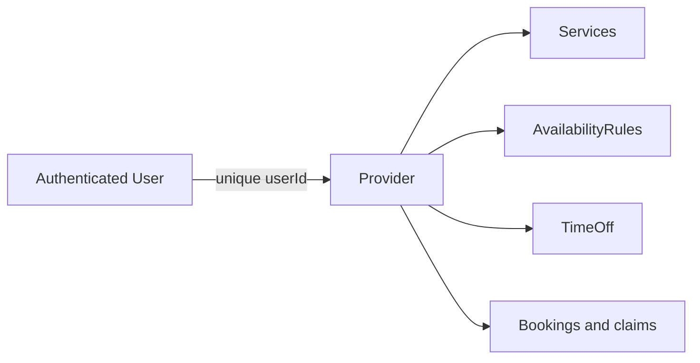

# Give each provider one working identity

A provider is the resource whose time SkillSlot sells. It is not just a role label on User. A provider profile holds a public practice name, category, location type, working IANA zone, minimum notice, booking horizon and listing status. Services, AvailabilityRules, TimeOff, Bookings, Orders and SlotClaims point to its ID. For this course, one account owns at most one Provider. That one-to-one rule simplifies authorization: the server resolves the authenticated User's Provider record and uses that ID to scope every provider action.

Create `server/src/modules/providers/provider.model.js`. Keep the profile separate from User's login details and Profile's viewer preferences. The Provider working zone is required because a weekly rule cannot be interpreted without it. A client profile may say `Europe/Berlin`, while the provider works in `Asia/Gaza`; neither zone replaces the other. Existing paid Bookings hold UTC instants even if the provider later changes its working zone. The zone change should trigger review of future rules and bookings, not silently shift old appointments.



The relationship gives the authorization path. A request to edit a Service should load Provider by the session's User ID, then update Service with both its ID and that Provider ID. Do not trust a `providerId` from the request body. A public request may use a provider ID to find listed Services, but private write routes derive ownership from the logged-in account.

## Define the provider fields

Use `userId` as a required ObjectId reference to User and give it a unique database index. Use `displayName` or `practiceName` as a trimmed public string. Keep `category` as a constrained value or validated string agreed with search. Use `locationType` with the exact three course values `online`, `at-home` and `at-workshop`. The first needs a meeting-link policy later; the second may need a client address visible only after confirmation; the third needs a workshop location. The type determines what fulfillment information a Booking may expose, so it is more than a cosmetic tag.

```js
import mongoose from 'mongoose';
import { requireZone } from '../../shared/time.js';

const { Schema } = mongoose;
const providerSchema = new Schema({
  userId: { type: Schema.Types.ObjectId, ref: 'User', required: true },
  practiceName: { type: String, required: true, trim: true, minlength: 2, maxlength: 100 },
  category: { type: String, required: true, trim: true },
  timeZone: {
    type: String, required: true,
    validate: { validator(value) { try { requireZone(value); return true; } catch { return false; } },
      message: 'Choose a supported named time zone' },
  },
  locationType: { type: String, required: true, enum: ['online', 'at-home', 'at-workshop'] },
  serviceArea: { type: String, trim: true },
  noticeMinutes: { type: Number, required: true, min: 0, max: 43200, default: 120,
    validate: { validator: Number.isInteger, message: 'Use whole minutes' } },
  horizonDays: { type: Number, required: true, min: 1, max: 365, default: 30,
    validate: { validator: Number.isInteger, message: 'Use whole days' } },
  status: { type: String, required: true, enum: ['draft', 'listed', 'suspended'], default: 'draft' },
}, { timestamps: true });

providerSchema.index({ userId: 1 }, { unique: true });
export const Provider = mongoose.models.Provider ?? mongoose.model('Provider', providerSchema);
```

If your course's earlier auth chapter still uses `vendor` as a role value, decide whether Provider.userId may point to that role and keep the adapter consistent. A reference alone does not enforce the referenced User's role. The provider-creation route later must check verified status and allowed role before insert. A schema can require an ObjectId shape and a unique userId; it cannot by itself guarantee the User document exists and is authorized without a route or transaction check.

The `noticeMinutes` and `horizonDays` fields feed Module 15's exact eligibility boundaries. Validate that they are integers as well as within the model ranges; Mongoose `min` and `max` alone allow fractional values. The course defaults are two hours of notice and thirty days of booking horizon, while the public route displays at most seven provider-local dates per request. A provider settings form may tighten these values, but it must not let a client submit them as part of an availability GET.

## Listing readiness is not an arbitrary boolean

Module 13 will list a provider only after at least one active Service and one valid AvailabilityRule exist. The `status` field records an explicit provider action or moderation state, but it should not bypass readiness. A public availability route must check both listing status and selected active Service. A provider in draft can still edit their practice and hours; clients should not see bookable starts until the required setup is present. Add this condition to the ERD note rather than treating `status: listed` as all the evidence needed.

Use a named zone in the seed. Five providers may all start in `Asia/Gaza` while their clients live elsewhere. Do not store a current numeric offset beside `timeZone` as a source of truth. An offset can be calculated for a date during display or debugging. The working zone's purpose is to interpret future local rules with the applicable civil-time data.

## Prove one provider per User

Write an integration test that creates a User and then two Provider documents with its `userId`. Wait for the index to build and assert the second insert fails with a duplicate-key error. A `findOne` before `create` is useful for a friendly 409 response but does not replace the index under concurrent requests. Then create another User and Provider and assert both accounts may own one. This test is the same database-level reasoning you will later apply to SlotClaim, but the exclusive key is userId rather than time.

Write a schema validation test for `+03:00` as a working zone, an unknown zone string, and a supported IANA zone. Test each location type and a misspelled value. If the provider has `at-home` as its location type, do not put a client's home address into this public profile. A later confirmed Booking can carry need-to-know location details with strict participant authorization.

Test a zone edit as a business action. Create an existing Booking fixture with a fixed UTC start. Change Provider.timeZone from one named zone to another in a controlled test. The Booking instant must remain unchanged. Future unbooked AvailabilityRule occurrences may need recalculation under the new zone, and the provider should see a warning before saving. This chapter does not implement that dashboard warning; it records the requirement for Module 13. A schema update that cascades to all Booking.startAt values would be a defect.

Add Provider to `docs/erd-draft.md` with its unique User link and one-to-many links to Service, rule, time off, Order, Booking and SlotClaim. Annotate which routes are public reads and which use the authenticated owner. Verify Compass shows one Provider for each seeded provider account and that the zone is a name rather than an offset. Commit the model and tests. The next lesson gives the Provider a Service whose duration and buffer can be turned into claim blocks.

References: [Mongoose schema and index definitions](https://mongoosejs.com/docs/guide.html), [Luxon named-zone support](https://moment.github.io/luxon/api-docs/index.html).

## Distinguish a working zone from a travel location

A provider who offers online lessons while living in Gaza may have clients in several countries. Their working zone is still the zone in which they set weekly hours. The client zone affects labels on the other side of the booking. A workshop location is a physical fulfillment detail; it does not itself determine the IANA zone if the provider has explicitly selected a different working region. The Provider model should keep `timeZone` as a named field rather than deriving it from a free-form service area or street address on every request.

Consider a provider who temporarily travels. If they change their working zone from `Asia/Gaza` to `Europe/Berlin`, existing confirmed bookings stay at their UTC instants. Future AvailabilityRules need a deliberate review because "Monday 09:00" under the old zone and the new zone are different UTC windows. One implementation can retire old rules at an effective date and create new rules under the new zone. Another can require the provider to edit each rule. The course chooses the explicit review path; add a dashboard warning requirement and a test that no paid Booking is rewritten by the Provider update.

## Keep listing state meaningful

Create a draft Provider with no Service. Even if `status` is accidentally set to `listed`, the public catalogue should not show it as bookable. Add one active Service but no AvailabilityRule and repeat; it still lacks hours. Add a valid active rule and confirm readiness becomes true. Archive the only Service and confirm it becomes unavailable again. These four states make the listing-readiness condition testable instead of a vague boolean. The Provider model records status, while a service function combines it with related collections.

The public profile can still show a short biography for a provider who has temporarily paused bookings if the product wants that. Decide whether the catalogue includes paused profiles separately from bookable results. Do not make the availability endpoint return empty starts while presenting an active "Book now" button without an explanation. That mismatch is a UI contract problem built on top of the same model fields.

## Check a same-account duplicate under concurrency

Two provider onboarding tabs may submit at almost the same time. Both can read "no Provider yet." The unique `userId` index makes one insert win. The losing route should load the existing Provider or return a clear conflict, not create a second profile by changing the user ID. This is a small version of the booking race and a useful index exercise before SlotClaim. Record the result in the model tests with actual duplicate-key code rather than only asserting a form-level error.
