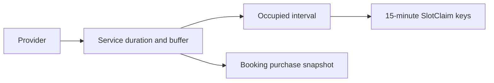

# Make a Service a priced time promise

A FreshMarket product has stock quantity. A SkillSlot Service uses a provider's time. Its duration and cleanup buffer determine which SlotClaim blocks a booking must own. Its price and cancellation terms determine what a client accepts at checkout. A Service belongs to exactly one Provider and can be archived for future sales while past Bookings remain. Create `server/src/modules/services/service.model.js` with fields that support those decisions rather than copying a grocery Product schema and renaming its label.

For this course, all service durations and buffers are whole 15-minute blocks. A 60-minute lesson with a 15-minute buffer occupies 75 minutes and five claim keys. A 20-minute duration cannot be represented faithfully on the chosen grid. Reject it on create and update; do not round to 15 or 30 without telling the provider. The checkout writer and availability engine will make the same defensive validation in case old or imported data bypasses the form.



Service.priceMinor is an integer number of the currency's smallest unit, such as cents for a two-decimal currency. Do not use a floating-point currency amount for payment arithmetic. Store a three-letter currency code and validate it against the currencies this course actually supports. A provider may change a live Service price; old Booking and Order snapshots keep the paid amount. The Service reference remains useful for navigation and current availability, while the snapshot explains the old receipt.

## Implement validation at the model boundary

Add required `providerId`, title, duration, buffer, price, currency, location type, policy and active/archived status. The example focuses on the fields that differ from groceries. Keep the exact cancellation policy names consistent with later refund chapters. The model can validate numeric ranges, but routes also need user-facing error mapping and ownership checks.

```js
import mongoose from 'mongoose';

const { Schema } = mongoose;
const blocks = (value) => Number.isInteger(value) && value >= 0 && value % 15 === 0;
const serviceSchema = new Schema({
  providerId: { type: Schema.Types.ObjectId, ref: 'Provider', required: true },
  title: { type: String, required: true, trim: true, minlength: 3, maxlength: 120 },
  description: { type: String, required: true, trim: true, maxlength: 3000 },
  durationMinutes: { type: Number, required: true, min: 15, max: 240,
    validate: { validator: blocks, message: 'Use whole 15-minute blocks' } },
  bufferMinutes: { type: Number, required: true, default: 0, max: 120,
    validate: { validator: blocks, message: 'Use whole 15-minute blocks' } },
  priceMinor: { type: Number, required: true, min: 0,
    validate: { validator: Number.isSafeInteger, message: 'Use whole minor units' } },
  currency: { type: String, required: true, enum: ['USD'], default: 'USD' },
  locationType: { type: String, required: true, enum: ['online', 'at-home', 'at-workshop'] },
  freeCancelHours: { type: Number, required: true, min: 0, max: 720 },
  lateRefundPercent: { type: Number, required: true, min: 0, max: 100 },
  rescheduleCutoffHours: { type: Number, required: true, min: 0, max: 720 },
  status: { type: String, required: true, enum: ['active', 'archived'], default: 'active' },
}, { timestamps: true });

serviceSchema.index({ providerId: 1, status: 1 });
export const Service = mongoose.models.Service ?? mongoose.model('Service', serviceSchema);
```

USD is a course fixture for the payment flow, not a claim that Gaza providers must price in dollars. If the product will support another currency, add it deliberately with Stripe test-mode support, price formatting and seed values. Do not mix currencies in an Order total. For this module, a single currency keeps the block and ownership reasoning in focus. Record the decision in `docs/erd-draft.md` so it is not mistaken for an internationalization guarantee.

The `blocks` helper allows zero for buffer but duration also has `min: 15`. Check that the schema actually runs both validators on create and update paths used later. Mongoose update validators can differ from document-save validation; route DTO validation should reject invalid updates before sending them to MongoDB. Add a test for `durationMinutes: 20` through the eventual update method, not only through `new Service().validate()`.

## Preserve terms on Booking

When a client pays, copy the accepted title, duration, buffer, price, currency and cancellation terms into Booking or the provider-scoped Order receipt. The live Service remains referenced by ID. Suppose a tutor changes price from 5000 to 6500 minor units and free-cancel hours from 24 to 12 after a client purchased. The old Booking still shows 5000 and 24. A refund calculation reads the purchase-time policy, not the current catalogue. A model without snapshots may look normalized but cannot answer a support question fairly.

Archiving a Service removes it from new public offers. It does not delete Bookings linked to it or release their SlotClaims. The provider may still need to fulfill sessions already sold. A provider dashboard should show an archive warning listing future bookings; a route test later checks the service cannot be booked again. Hard deletion would break historical receipts and references. Keep `status: archived` as an explicit state.

Location type should agree with Provider capability. A provider may offer online coaching and workshop sessions under one profile only if the product and fulfillment UI support both. The Service's location type records what this particular appointment requires. At-home sessions need an address policy; online sessions need a meeting-link policy. The Booking snapshot should retain the chosen location type so a later Service edit cannot change how an already purchased session will be delivered.

## Verify boundary values

Test 15, 60 and 240 minutes as valid durations, and 0, 15 and 120 as valid buffers. Test 0, 20, negative and fractional values where appropriate. `priceMinor` must reject 12.5 and values beyond safe integer range. Test a missing provider ID, blank title and invalid currency. Then create two Services for one provider to prove the one-to-many relationship. A Service for Provider B must not be writable through Provider A's authenticated route, which is a Module 12 authorization test but should be named now.

For a 45-minute service plus 30-minute buffer, calculate the claim count: five 15-minute blocks. Put the calculation in the model test or decision note. A later availability test should use this service as well as the common 60-plus-15 case, so no code can quietly hard-code five blocks for every offering. The database model constrains values; the engine computes intervals; the checkout transaction enforces exclusive ownership.

Add Service to the ERD with a Provider reference and a one-to-many relationship to Booking. Draw a dashed note or text label for the purchase-time snapshot. Run model validation and inspect one seeded Service in Compass. Check that `priceMinor` is an integer, duration and buffer are multiples of 15, and policy fields exist. Commit before building weekly rules, which supply the windows in which this Service may be offered.

References: [Mongoose numeric and custom validation](https://mongoosejs.com/docs/validation.html), [Mongoose schema indexes](https://mongoosejs.com/docs/guide.html).

## Test edits as a purchase-history threat

Create one Service at 5000 minor units with a 60-minute duration and 15-minute buffer. Build a plain purchase snapshot from it, then edit the live Service to 6500 minor units and a 30-minute buffer. The snapshot should still say 5000, 60 and 15. The next new offer should use the edited 30-minute buffer when computing provider occupancy. One object represents a past contract; the other represents the current catalogue. A test that checks only the live Service after update cannot detect a historical receipt drifting.

Consider a provider who tries to change duration while future Bookings exist. The update may be allowed for new sales, but it must not shorten or lengthen already paid sessions. Booking.endAt and purchase.durationMinutes stay fixed. A dashboard warning should list affected future bookings before the provider edits the Service, so they understand that those clients still have the old commitment. Do not change SlotClaims for confirmed bookings just because the Service buffer changed. Those claims were created under the accepted snapshot.

## Keep monetary validation separate from payment

The schema ensures `priceMinor` is a nonnegative safe integer and currency is supported. It does not prove that Stripe charged that amount, that a coupon was applied correctly, or that a refund follows the accepted policy. The checkout service computes the server total from current Service data and stores the accepted amount before payment. The payment webhook confirms the transaction. Later refund logic reads the purchase snapshot. Each stage has a different test. Do not name a schema validation test "payment works" simply because a price field saved.

Try an at-home Service with an online Provider default. Decide whether the product allows a Provider to offer both delivery modes; if not, reject the mismatch at the Service route. Either way, do not put the client's address on the public Service. That address belongs to a confirmed Booking participant view under need-to-know authorization. The model's `locationType` helps route that later decision without leaking fulfillment details into catalogue documents.

Record the decision in the Service test name so a later location-type expansion does not silently change which appointments are allowed.
