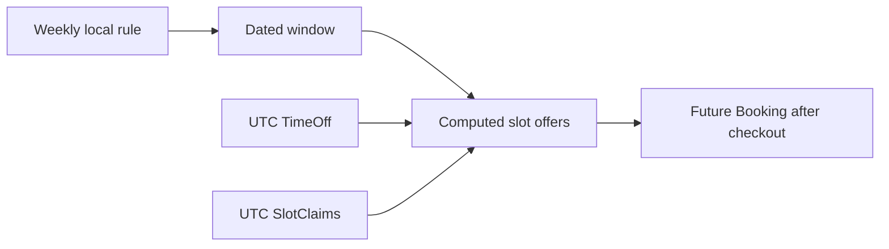

# Store weekly rules and dated time off

The provider has a Service to sell but no hours in which to sell it. Create `AvailabilityRule` for recurring weekly intentions and `TimeOff` for dated exceptions. The distinction carries Module 5's time model into MongoDB. A rule says "Monday from 09:00 to 12:00 in this provider's zone" and can generate different UTC intervals on different dates. TimeOff says "block this specific interval" and is stored after its local boundaries have been resolved to UTC instants. Neither is a paid Booking.

Put both models under `server/src/modules/availability/` as `availability-rule.model.js` and `time-off.model.js`, or use the module folder convention already established in your learner project. The two code excerpts below belong in separate files, each with its own Mongoose import. Do not store every future quarter-hour start as a document. Module 15 computes offers from rules, exceptions and current claims. A rule edit changes future unbooked offers without rewriting old Bookings. A TimeOff edit removes offers for its dated interval but must not silently cancel paid clients who already booked there.



The rule stores `providerId`, ISO weekday 1 through 7, `startLocal`, `endLocal`, effective local dates, active status and perhaps a version. Use the Provider.timeZone as the authoritative zone, or snapshot its IANA zone onto the rule with a documented policy for a provider-zone change. The course chooses a rule `timeZone` field so a historical rule's intention remains reviewable. The provider creation and rule API must keep it consistent with the working zone at the time the rule was saved. Do not save a numeric offset alone.

## Validate local boundaries before saving

Use an exact `HH:mm` pattern, hours 00 through 23 and minutes on 00, 15, 30 or 45 for this grid. The rule's end must be later than its start on the same local day for the first version. Overnight rules are not implemented; the UI should ask the provider to split them into two dated local rules if needed. Validate `effectiveTo` is not before `effectiveFrom`. The route must also reject overlapping active rules for one provider and weekday or choose a documented merge policy; Module 13 handles that cross-document check.

```js
import mongoose from 'mongoose';
const { Schema } = mongoose;
const quarterHour = /^(?:[01]\d|2[0-3]):(?:00|15|30|45)$/;
const ruleSchema = new Schema({
  providerId: { type: Schema.Types.ObjectId, ref: 'Provider', required: true },
  weekday: { type: Number, required: true, min: 1, max: 7 },
  startLocal: { type: String, required: true, match: quarterHour },
  endLocal: { type: String, required: true, match: quarterHour },
  timeZone: { type: String, required: true },
  effectiveFrom: { type: String, required: true, match: /^\d{4}-\d{2}-\d{2}$/ },
  effectiveTo: { type: String, match: /^\d{4}-\d{2}-\d{2}$/ },
  active: { type: Boolean, required: true, default: true },
}, { timestamps: true });
ruleSchema.index({ providerId: 1, weekday: 1, active: 1 });
export const AvailabilityRule = mongoose.models.AvailabilityRule ?? mongoose.model('AvailabilityRule', ruleSchema);
```

The snippet defines field shapes, not the entire rule validator. Add a document-level check for `endLocal > startLocal` and valid calendar dates, and call `requireZone` on `timeZone`. Lexical comparison works for canonical padded `HH:mm` values, but not for arbitrary strings. Validate the shape first. Use a date library for effective-date validity; `2024-02-30` matches a regex but is not a real calendar date. Include invalid-date tests. Do not assume a regex alone proves calendar correctness.

The `timeZone` field on a rule and Provider.timeZone can diverge after a provider moves. Decide whether old rules are retired and new rules created in the new zone. For this course, require the provider to review and republish hours when changing their working zone. Existing paid Bookings retain UTC instants. A silent update of every old rule's zone could move unbooked hours in a way the provider did not intend. Record the decision in the ERD note.

## Resolve TimeOff once

TimeOff stores `providerId`, UTC `startAt` and `endAt`, an active status, a short private reason and who created it. The provider form receives a dated local interval in the Provider zone. The server calls `localToUtc` for both boundaries, rejects gaps and overlaps, checks end after start, then stores UTC Date values. The model should defensively validate end after start for document saves. The reason is visible to the provider and authorized staff, not returned in public availability JSON.

```js
import mongoose from 'mongoose';
const { Schema } = mongoose;
const timeOffSchema = new Schema({
  providerId: { type: Schema.Types.ObjectId, ref: 'Provider', required: true },
  startAt: { type: Date, required: true },
  endAt: { type: Date, required: true },
  status: { type: String, enum: ['active', 'cancelled'], default: 'active' },
  reason: { type: String, trim: true, maxlength: 240 },
}, { timestamps: true });
timeOffSchema.index({ providerId: 1, startAt: 1, endAt: 1 });
export const TimeOff = mongoose.models.TimeOff ?? mongoose.model('TimeOff', timeOffSchema);
```

Add validation that `endAt > startAt`. Mongoose update operations need explicit update validation or route checks too. A TimeOff from 10:00 to 11:00 uses half-open overlap. A booking ending exactly at 10:00 does not intersect; one whose buffer continues to 10:15 does. These boundaries will be tested in Module 15. Do not round TimeOff to the claim grid. A provider may need to block 10:07 to 10:52; interval overlap can handle that precisely.

When a provider creates TimeOff over an existing paid Booking, save the exception only after showing the conflict list and asking for an explicit decision. The exception affects new offers, but it does not cancel or move the paid session by itself. The provider dashboard in Module 13 will show the conflict and direct the provider to the cancellation or reschedule workflow. This model keeps the exception and the booking as separate records so the human problem cannot be hidden by an automatic cascade.

## Test one date and one rule change

Create a Monday 09:00 to 12:00 rule in `Asia/Gaza` and a dated TimeOff covering one Monday afternoon. Run schema tests for invalid weekday, `09:07`, end before start, nonexistent effective date and invalid zone. In an integration test, query active rules for one provider and weekday. Then add another provider's rule and assert it is excluded. That provider scope will later prevent one tutor's calendar from affecting another's offers.

Use the Module 5 converter to inspect two dated occurrences of the same weekly rule. Record their UTC instants from your runtime rather than hard-coding an unverified future Gaza offset. Add a TimeOff at a fixed UTC interval and verify it stays the same Date value after a client changes display zone. The recurring rule and dated exception should behave differently by design; the test should make that visible.

Finally, draw both collections in `docs/erd-draft.md` with their Provider relationships. Label the rule's local fields and TimeOff's UTC fields. If a reviewer cannot tell which values are unresolved wall-clock intentions from the ERD, improve it before building claims. Module 15 will rely on this distinction when it expands windows across a clock-change week.

References: [Luxon DateTime](https://moment.github.io/luxon/api-docs/index.html), [Mongoose validation](https://mongoosejs.com/docs/validation.html).

## Exercise a power-cut exception

Suppose a provider has Monday 09:00 to 12:00 local hours and loses power from 10:07 to 11:02 on one dated Monday. The TimeOff route receives that local dated interval, resolves both boundaries to UTC, and stores one exact exception. Module 15 then removes every candidate whose occupied service plus buffer intersects it. The weekly Monday rule remains active for other weeks. A provider dashboard can show the blocked date without requiring a new rule version for one incident.

Now suppose the provider permanently changes Monday hours to 10:00 to 12:00 starting next month. That is not TimeOff for every future Monday. Create or edit an AvailabilityRule with an effective start date and retire the old rule at the prior local date. A test should show one week still expands under the old hours and a later week under the new hours. These two scenarios make the model choice observable: one dated exception versus a recurring schedule change.

## Verify invalid local input before UTC storage

Try adding TimeOff with a spring gap boundary and with a fall repeated boundary in a historical test zone. The Module 5 converter should return stable error codes. Do not save a Date after a library silently normalizes a skipped 02:30 to 03:30. The provider must see which dated boundary was invalid and choose a valid time. A model-level Date validator cannot detect that original intent once only a resolved Date is saved, so the route must validate before persistence.

Finally, inspect the document in Compass. A valid TimeOff should display `startAt` and `endAt` as Date values, not strings without a zone. The AvailabilityRule should display padded `HH:mm` values and a named zone. If the two records look identical in storage, revisit the schema. They answer different questions and feed different stages of the availability engine.

Save one exact raw example of each in your decision note.
