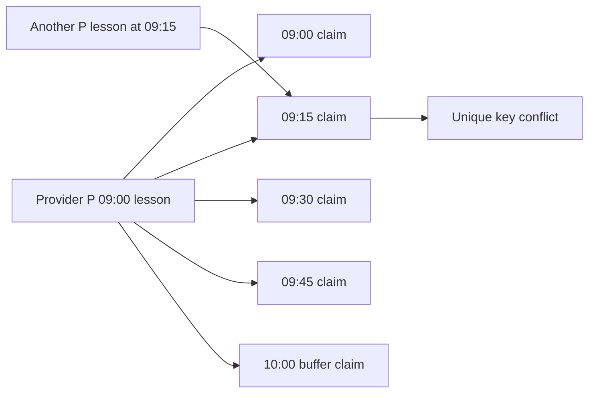

# Make a block claim unique in MongoDB

This is the model that closes the overlap trap. One SlotClaim document represents one 15-minute UTC block of one provider's occupied time. A unique compound index on `{ providerId: 1, blockStartAt: 1 }` prevents two documents with the same provider and block. A 60-minute service plus 15-minute buffer needs five such documents. Its later checkout transaction inserts all five or none. This chapter defines the collection and proves one duplicate insert fails in a real database; Module 19 will build the multi-claim transaction and parallel checkout test.

Do not store all block starts in one array and assume a unique multikey index has the same simple behavior. Separate scalar documents make the key and duplicate conflict obvious. Do not put `serviceId` in the unique key: one provider cannot sell two different services in the same exclusive block. Do not omit `providerId`: different providers may work at the same instant. The document may point to the Booking or hold that owns it, but the exclusivity key is provider and UTC block start.



The diagram includes the buffer claim because the provider cannot start another exclusive session immediately when a cleanup buffer is required. The interval is half open. The 09:00 booking occupies `[09:00, 10:15)` and does not claim 10:15. A second appointment starting 10:15 can fit if its own full interval lies inside a rule window. A second one starting 09:15 needs at least one existing key and must fail.

## Define the scalar schema

Create `server/src/modules/bookings/slot-claim.model.js` or use the agreed model folder. Store `providerId`, `bookingId`, `blockStartAt`, claim state or hold reference, and timestamps. Keep `blockStartAt` a Date representing a UTC instant. Validate its milliseconds align to a 15-minute UTC grid. Do not use a local `HH:mm` string, because different dates and zones can share that label. Use the same block size constant as the availability engine and checkout writer.

```js
import mongoose from 'mongoose';

const { Schema } = mongoose;
const BLOCK_MS = 15 * 60_000;
const slotClaimSchema = new Schema({
  providerId: { type: Schema.Types.ObjectId, ref: 'Provider', required: true },
  bookingId: { type: Schema.Types.ObjectId, ref: 'Booking', required: true },
  blockStartAt: {
    type: Date, required: true,
    validate: { validator(value) { return value instanceof Date && Number.isFinite(value.getTime()) && value.getTime() % BLOCK_MS === 0; },
      message: 'Use a UTC 15-minute block boundary' },
  },
  state: { type: String, enum: ['held', 'confirmed'], required: true },
}, { timestamps: true });

slotClaimSchema.index({ providerId: 1, blockStartAt: 1 }, { unique: true });
slotClaimSchema.index({ bookingId: 1 });
export const SlotClaim = mongoose.models.SlotClaim ?? mongoose.model('SlotClaim', slotClaimSchema);
```

The `state` field is informational; the unique index applies to every document regardless of state. When a hold expires or a booking is cancelled under the release policy, a transaction must remove or otherwise release its claims before that key can be reused. Do not mark a claim `expired` and leave it behind while treating the block as free in an availability GET. The database would still reject a new insert. A partial unique index on active states is another possible design, but it must be reflected in every read and write path; this course uses deletion on release for a simpler exclusive key.

A TTL index can help clean old records eventually, but its background deletion does not happen at an exact appointment deadline. The hold-expiry worker must perform a deliberate state transition and release. If the worker is delayed, the safest result is a temporarily unavailable block, not a double booking. Do not tell the client a slot is free just because a stored `expiresAt` is in the past while its unique claim document still exists.

## Prove the index, not just validation

Run a test against the scratch replica set. Create one Provider and Booking fixture, wait for SlotClaim indexes to build, insert a claim at `2024-01-15T09:00:00.000Z`, then try a second claim for the same provider and block. The second write must reject with MongoDB duplicate key code 11000. Create a claim for another provider at the same instant; it must succeed. Create another block for the first provider at 09:15; it must succeed. This four-write test demonstrates both the exclusive key and its proper scope.

Call `validate()` on the second duplicate document before inserting it and observe that Mongoose validation may pass. The unique rule is enforced by the database index, not by a synchronous document validator. If your test framework starts writes before indexes exist, it may produce misleading results. Await model initialization or explicitly create indexes in the scratch database before asserting duplicate behavior. A test that never reaches MongoDB cannot establish the concurrency guarantee.

Test an off-grid `09:07` Date and expect model validation to fail. Then verify checkout also rejects such a client request before attempting claims; a model validator is a backstop, not the public API contract. Use a 45-minute service with 30-minute buffer and calculate its five keys. A different duration should not require a new schema. The collection stores uniform blocks; the service model supplies how many are needed.

The unique index alone does not make a multi-block booking atomic. If a request inserts 09:00 and 09:15, then fails on 09:30, two ghost claims could remain. Module 19 wraps the complete set and Booking hold in one transaction so a failed attempt rolls back. Module 4's replica-set smoke test is a prerequisite. Record this remaining work beside the index test rather than calling checkout safe after one duplicate insert.

Also record the provider-rule edit race. A provider can add TimeOff while a client is claiming an interval. The unique claim blocks competing clients, but it does not by itself coordinate a new provider exception. A later write policy must recheck or version rules and exceptions at the claim boundary. The model gives one strong invariant, not every calendar policy.

Add SlotClaim to the ERD with a Provider link and Booking ownership. Show the unique index textually; Mermaid cardinality alone cannot express it. Keep the test output and index definition in your gate evidence. If the index is missing in Compass after seed, stop before implementing a checkout route. A controller cannot safely compensate for an absent exclusive key.

References: [MongoDB unique compound indexes](https://www.mongodb.com/docs/manual/core/index-unique/), [Mongoose index definitions](https://mongoosejs.com/docs/guide.html), [MongoDB transactions](https://www.mongodb.com/docs/manual/core/transactions/).

## Walk a multi-block failure without code

Client A asks for 09:00 through 10:15 occupied time and needs five keys. Client B asks for 09:45 through 11:00 and also needs five keys. They share 09:45 and 10:00. If B has already committed, A's transaction may insert 09:00, 09:15 and 09:30 before meeting the duplicate 09:45 key. The transaction must abort those first three tentative inserts, or the provider's calendar will appear partly blocked by a Booking that never existed. The unique index selects a winner for each key; the transaction makes the whole appointment attempt all or nothing.

An availability GET after B commits should remove starts whose needed sets touch B's claims. A GET before B commits may still show 09:00. Both behaviors are consistent because the read is advisory. The checkout write must not skip the claim insert merely because its earlier GET said free. Put this timeline in the index test notes so the learner can distinguish a database uniqueness guarantee from a stale display.

## Repair without creating a second truth

If a support script finds a confirmed Booking with fewer claims than its duration and buffer require, treat it as a data-integrity incident. Do not decide that Booking or SlotClaim is automatically the winner and quietly expose the missing blocks. Pause new sales for that provider interval, inspect history and repair under a controlled transaction. The same applies to a claim pointing to a missing Booking. A consistency check can calculate expected blocks from the Booking purchase snapshot and compare IDs; it should report differences, not mutate production data without review.

Add a test that a 09:00 booking and a 10:15 booking can both own claims for the same provider when the first occupied interval ends exactly at 10:15. That adjacent success protects the half-open end rule. Add a test that a 10:00 second start fails because it needs the first booking's buffer block. Together they show the index is neither too weak nor too broad.
