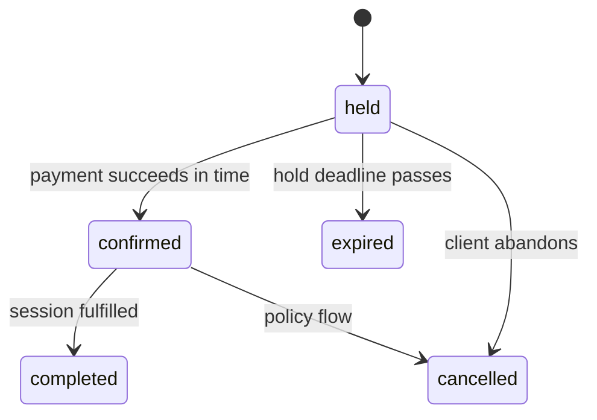

# Give Booking an independent lifecycle

A Booking is the dated appointment the client and provider both care about. It may begin as a held slot, become confirmed after payment, be completed, cancelled or expired, and later support a reschedule. It is not just a line of text inside an Order. A provider agenda must find it by provider and date; a client agenda must find it by client and date; a refund workflow must find its accepted price and policy. Create `server/src/modules/bookings/booking.model.js` with one stable ID and those query paths.

The Booking references `clientId`, `providerId`, `serviceId` and `orderId`. It stores UTC `startAt` and `endAt` for the client session, plus the occupied buffer snapshot or an `occupiedEndAt` if your implementation needs it. It snapshots the Service title, duration, buffer, price, currency, location type and cancellation terms accepted at purchase. The references point to current identity and catalogue; the snapshots preserve the past. A Service price edit must not rewrite a confirmed Booking's receipt.



The state diagram shows allowed categories, not a complete payment implementation. A late payment webhook after expiry needs a deliberate policy; Module 20 handles it. A reschedule may keep the Booking ID and move claims through a coordinated transaction, with history recording old and new instants. Do not let a generic `status` update endpoint jump from expired back to confirmed without reclaiming time. Model states make illegal transitions visible, while service-layer methods enforce them.

## Define the historical snapshot

Use an embedded `purchase` subdocument to group facts that were true when the client accepted the offer. Keep the current Service reference outside it. A price field named `priceMinorAtPurchase` is clearer than a generic `price`, which a later developer might accidentally refresh from Service. The provider's working zone at purchase is useful for an old receipt. Do not copy the provider's whole private profile or the client's password-related fields into Booking.

```js
import mongoose from 'mongoose';

const { Schema } = mongoose;
const purchaseSchema = new Schema({
  title: { type: String, required: true },
  durationMinutes: { type: Number, required: true },
  bufferMinutes: { type: Number, required: true },
  priceMinor: { type: Number, required: true },
  currency: { type: String, required: true },
  cancellationPolicy: {
    freeCancelHours: { type: Number, required: true },
    lateRefundPercent: { type: Number, required: true },
    rescheduleCutoffHours: { type: Number, required: true },
  },
  locationType: { type: String, required: true },
  providerZone: { type: String, required: true },
}, { _id: false });
const bookingSchema = new Schema({
  clientId: { type: Schema.Types.ObjectId, ref: 'User', required: true },
  providerId: { type: Schema.Types.ObjectId, ref: 'Provider', required: true },
  serviceId: { type: Schema.Types.ObjectId, ref: 'Service', required: true },
  orderId: { type: Schema.Types.ObjectId, ref: 'Order', required: true },
  startAt: { type: Date, required: true },
  endAt: { type: Date, required: true },
  status: { type: String, required: true,
    enum: ['held', 'confirmed', 'completed', 'cancelled', 'expired'], default: 'held' },
  holdExpiresAt: { type: Date },
  purchase: { type: purchaseSchema, required: true },
  history: [{ at: { type: Date, required: true }, from: String, to: String, reason: String }],
}, { timestamps: true });

bookingSchema.index({ clientId: 1, startAt: 1 });
bookingSchema.index({ providerId: 1, startAt: 1 });
bookingSchema.index({ orderId: 1 });
export const Booking = mongoose.models.Booking ?? mongoose.model('Booking', bookingSchema);
```

The nested purchase schema prevents an entire purchase snapshot from being omitted and gives the three policy fields explicit names. Create this snapshot from server-loaded Service data through an allowlisted builder, never by spreading a client request body. A purchase snapshot is a contract record and should not acquire unexpected properties from input. Add any agreed travel or meeting terms needed to explain fulfillment, while keeping private location details behind participant authorization.

Validate `endAt > startAt`, `holdExpiresAt` for held states, and that purchase duration corresponds to the client session interval. Model validation can catch malformed documents; a transaction service must still check state transitions, provider/service/order relationships and claims. A Booking with `providerId` for Tutor A and an Order for Designer B has individually valid ObjectIds but violates domain ownership. Build an integration test after all models exist.

## Keep history useful but bounded

Each state change adds a small history entry with server UTC timestamp, previous state, new state and reason code. Do not take a timestamp from the browser as authority. A held Booking that expires should retain a record explaining why the hold disappeared, while its SlotClaims are released. A cancelled paid Booking should retain the amount and policy used for the refund. A provider support screen can inspect history under authorization. A public availability response should not reveal it.

An embedded history array is acceptable for the course MVP if transitions are few and bounded. If a production system needs a long legal audit trail or heavy event volume, move events to a separate immutable collection with retention rules. The learning point is that a Booking's lifecycle deserves an identity and trace, not that every event must live in one MongoDB document forever.

## Test the two agendas

Seed two clients and two providers with bookings at different UTC instants. Query `{ clientId, startAt: range }` and assert one client cannot retrieve another's booking. Query `{ providerId, startAt: range }` and assert a provider sees only their own agenda. These are repository scoping tests; Module 9 still must enforce the authenticated actor at the HTTP boundary. Add index declarations for both patterns and inspect query plans later if performance becomes a concern.

Create a Booking snapshot from a Service priced at 5000 minor units. Change Service.priceMinor to 6500 and archive it. Reload Booking and assert its purchase price, title and policy remain unchanged. Then format Booking.startAt for Berlin and Qatar clients without saving either label into the Booking. The UTC instant should be identical. These tests protect two independent promises: money terms do not drift and a display-zone change does not move an appointment.

Add SlotClaims for a held Booking in a later transaction test. When the Booking becomes expired, release those claims atomically with the state transition. Do not use `holdExpiresAt` as if it automatically frees time. A document past its deadline can still occupy a unique index entry until cleanup runs. The safer temporary failure is an unavailable slot, not two sold appointments.

Write the Booking box in `docs/erd-draft.md` with all four reference IDs, UTC interval and purchase snapshot. Add a note that an active exclusive hold or confirmation owns every required claim block, while a cancelled or expired historical Booking may own none. Commit the model and tests. The next lesson gives the Booking a provider-scoped Order and the pre-purchase CartItem that requested its time.

References: [MongoDB embedding](https://www.mongodb.com/docs/manual/data-modeling/embedding/), [Mongoose schema validation](https://mongoosejs.com/docs/validation.html).

## Test a cancellation without deleting history

Create a confirmed Booking with a 09:00 UTC start, a provider-scoped Order and five claims through its buffer. Run a cancellation transition under the later policy. The Booking should become cancelled with an appended server-timestamped history entry; its accepted price and policy should remain visible for refund calculation; its claims should be released according to the cancellation rule. A hard delete would erase the evidence needed for support and could leave the Order pointing to nothing. This is why Booking.status and history are part of the model even before the cancellation API exists.

Now create a held Booking and let its deadline pass under a fake clock. The expiry worker will mark it expired and release claims through a transaction. `holdExpiresAt` is data for that workflow, not a magic MongoDB timer that makes the document disappear exactly then. If cleanup is delayed, the block may remain unavailable temporarily. The safe outcome is a lost sale rather than two clients promised the same provider. Put this failure mode in the state-transition test plan.

## Keep the identity through rescheduling

When a client reschedules, the Booking ID can remain stable so links, support records and Order relationship continue to work. Record the old and new UTC interval in history, acquire the new claim set and release the old one as one coordinated operation. Do not make the client agenda show two active Booking documents for one paid appointment unless the product explicitly models a replacement chain. A stable identity with a clear history is easier to reconcile with reminders and refunds.

The purchase snapshot still describes what was paid. If rescheduling changes service duration or price by policy, that requires an explicit adjustment and a new snapshot event; it must not happen because the live Service changed in the meantime. Later modules will implement the policy. This schema should be able to show both the original agreement and the authorized change rather than silently overwriting one value without a trace.

Add a test that an unauthorized user cannot request that history through the public availability route. The private lifecycle record and the public slot list have separate purposes.
