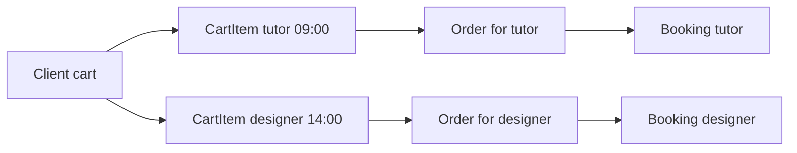

# Separate a requested slot from a provider order

A client clicks 09:00 on a tutor's page and adds the session to a cart. That CartItem is a proposal. It does not reserve the tutor's time. Another client may claim a block before checkout, a provider may add TimeOff, or the service may be archived. The cart API will revalidate the proposal, and checkout will attempt the full claim set. Treating CartItem as a lock would make abandoned carts block calendars indefinitely. Create a CartItem model that records intent without pretending it has exclusive authority.

An Order has a different role. It groups a provider's share of one checkout, payment state and receipt totals. A mixed-provider cart becomes one Order per provider, each linked to its own Bookings. One checkout may have a parent correlation ID across those Orders, but each provider sees only their own fulfillment and revenue record. A Booking has its own dated appointment state and references its Order. These boundaries let a tutor's cancellation or refund be handled without exposing a designer's separate sale.



Store `clientId`, `providerId`, `serviceId`, proposed UTC `startAt`, optional `endAt` and `createdAt` on CartItem. Keep a request ID for idempotent cart updates if the UI retries. Do not copy the current price as final authority: checkout must load the active Service and calculate the accepted total on the server. A cart display may show a provisional price snapshot with a "price changed" warning after revalidation. It must not silently charge an old amount or trust a client-supplied total.

## Create the pre-purchase record

Put CartItem in `server/src/modules/cart/cart-item.model.js`. The proposed start must be a UTC Date aligned to the service grid, but full eligibility belongs to the route and availability engine. The client may add two services from different providers, so CartItem keeps providerId for grouping; the server verifies it matches the referenced Service. A stale cart line remains useful as a prompt to choose a new slot, but checkout must refuse it until revalidated.

```js
const cartItemSchema = new Schema({
  clientId: { type: Schema.Types.ObjectId, ref: 'User', required: true },
  providerId: { type: Schema.Types.ObjectId, ref: 'Provider', required: true },
  serviceId: { type: Schema.Types.ObjectId, ref: 'Service', required: true },
  startAt: { type: Date, required: true },
  status: { type: String, enum: ['proposed', 'stale'], default: 'proposed' },
}, { timestamps: true });
cartItemSchema.index({ clientId: 1, createdAt: -1 });
```

The snippet is a schema fragment; import Mongoose and export a model using the same pattern as earlier files. Do not use a unique index on provider and proposed start here. Several clients may have the same proposed CartItem, and that is acceptable until one wins a SlotClaim at checkout. A unique CartItem key would turn a read-only shopping action into an accidental reservation or make a second client unable to express interest in a still free time.

## Define a provider-scoped Order

Store `clientId`, `providerId`, checkout correlation ID, payment status, currency, `totalMinor`, refund totals and payment provider IDs on Order. Keep one currency per Order and calculate totals from server-side accepted Service values. A purchase-time line summary may embed title and price for receipt rendering, but the Booking remains the appointment authority. Add an index on `{ clientId: 1, createdAt: -1 }` for purchase history and `{ providerId: 1, createdAt: -1 }` for provider fulfillment. If payment calls can retry, add a unique idempotency key scoped to the intended checkout or provider order.

Use an enum such as `pending`, `paid`, `partially-refunded`, `refunded` and `failed` only after the payment chapter defines transitions. Avoid setting `paid` when the browser returns from Stripe; a verified webhook or server-side payment confirmation must establish that state. In this module, a seed Order can be a clearly labelled historical fixture with a matching Booking. Do not seed inconsistent "paid" documents with no payment evidence and then use them as reference behavior for checkout tests.

An Order for Provider A must never contain a Booking for Provider B. This is a cross-document invariant. When checkout creates provider orders, it groups lines by provider from server-loaded Services, not from request-body strings alone. Add a test with two Services from different providers. Expect two Orders and one Booking under each. Verify a provider-scoped query for A returns only A's Order. This test will be implemented more fully in Module 19, but the model and ERD should support it now.

## Separate staleness from failure

A CartItem can become stale when the service is archived, the requested time passes notice, or a SlotClaim appears. Stale does not mean the client paid and failed. It means the proposal needs revalidation before checkout. A Booking hold that expires is a different state with historical and claim-release consequences. An Order payment failure is different again. Keeping the three records separate prevents a UI from treating a cart refresh as a booking cancellation.

Write a scenario in `docs/erd-draft.md`: Client A puts a tutor at 09:00 in CartItem. Client B checks out first and claims one of the needed blocks. Client A's cart still shows the old proposal until refresh, then marks it stale. Client A has no Booking and no Order from that proposal. This sequence is ordinary product behavior. If your data model requires deleting Client A's cart line to explain it, the cart and hold concepts are probably blurred.

Run model validation for missing client/service/provider IDs and a malformed start. Run an integration query for client cart isolation and provider order isolation. Add CartItem and Order to the ERD with their reference directions. Commit before writing the seed script, which will create both a pre-purchase example and a historical provider order for inspection.

Reference: [MongoDB relationship modeling](https://www.mongodb.com/docs/manual/applications/data-models-relationships/).

## Review one abandoned cart

A client adds an online coaching session for next Tuesday and closes the browser. The CartItem may remain until a normal cleanup policy expires it, but it must not own SlotClaims. A second client can still buy that time. When the first client returns, the cart API rechecks active Service status, notice, rule, TimeOff and claims. If the time is gone, it marks the proposal stale and offers a new start. The client should not see a cancelled Booking because none existed. This scenario is a simple test of whether CartItem has been confused with a hold.

Try a network retry during cart creation. If the browser sends the same request twice, an idempotency token can prevent duplicate display lines. That is a cart cleanliness guarantee, not provider time exclusivity. A unique cart token should be scoped to the client and request intent. It must not reject another client's proposed line for the same provider start. The later checkout idempotency key has a stronger role: it prevents a retry from making a second payment or Order for the same intended purchase.

## Check Order totals against provider ownership

Suppose a cart has two tutor sessions at 5000 minor units each and one designer session at 7000. The server should create a tutor Order totaling 10000 and a designer Order totaling 7000 before discounts and tax. A provider must not be able to see or refund the other's amount by querying a shared mixed Order. If a coupon is provider-funded, apply it to the correct provider share. This small arithmetic example will matter again in the payment and promotion modules.

Store the payment provider's transaction identifiers in the Order, but do not let them become the only link to Bookings. A Stripe webhook may arrive more than once or after a hold deadline; the Order's idempotency and status help reconcile it, while each Booking keeps its own appointment state. The model is prepared for those workflows without claiming they are implemented in this module.

One final consistency check: every Booking's `orderId` should point to an Order with the same `clientId` and `providerId`. Mongoose references do not enforce that cross-document rule automatically. Add a service-layer assertion at creation and a seed-integrity test now. A valid ObjectId that points to the wrong provider is still a domain error.
