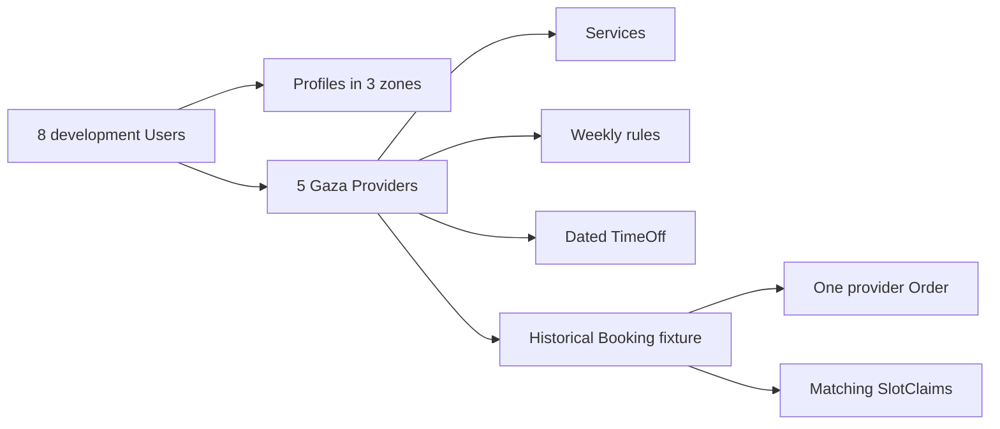

# Seed people, rules and a dated appointment

The models exist, but an empty database hides relationship errors. Write a development seed that creates five Provider accounts working in `Asia/Gaza`, clients whose Profile zones are `Asia/Gaza`, `Europe/Berlin` and `Asia/Qatar`, active Services, weekly rules and at least one dated TimeOff. Include a clearly marked historical appointment fixture to inspect Booking, Order and SlotClaim relationships. The seed should be repeatable: running it twice should update the same fixture records, not double the provider count or hit a duplicate block key unexpectedly.

Use stable test emails under a reserved local domain such as `tutor-one@test.local` and `client-berlin@test.local`. Never seed real personal addresses or plaintext passwords. If auth utilities already exist, hash one documented development password through the same helper. If auth is not implemented yet, create development-only accounts with a known unusable hash marker and re-seed them after Module 7. Do not put a working default password into production deployment scripts.



Five providers are not arbitrary decoration. Give them different services and hours so later tests can distinguish provider scope. One can teach languages online, another offer design reviews, another run a workshop. Keep every Service duration and buffer on the 15-minute grid. Give one provider a Tuesday morning rule, another a different weekday, and one a dated TimeOff that removes part of a rule window. This variety makes a public availability query, provider agenda and cross-provider authorization test capable of failing for meaningful reasons.

## Use stable fixture identities

Create `server/src/scripts/seed.js` or the project's existing seed location. Wrap the script in a guard that refuses to run against the production database. Read the database URI from the same validated config as the server, and require an explicit development/test environment marker. The seed is an authorized local fixture operation; it should never be part of an automatic production migration. Print the target database name and a summary count before writing, without printing credentials from the URI.

Upsert User by normalized email. Upsert Profile by userId. Upsert Provider by userId. Upsert Service by a stable seed key or provider/title pair that cannot accidentally match a real item. Upsert rules by a seed key including provider, weekday and local interval. Upsert TimeOff by a seed key or provider/date pair. A `seedKey` field restricted to development fixtures can make this explicit, or the script can hold deterministic IDs in a local fixture map. Do not delete all collections on each run; a blanket delete erases a learner's own work and makes debugging harder.

```js
const accounts = [
  { email: 'tutor-one@test.local', role: 'provider', zone: 'Asia/Gaza' },
  { email: 'tutor-two@test.local', role: 'provider', zone: 'Asia/Gaza' },
  { email: 'tutor-three@test.local', role: 'provider', zone: 'Asia/Gaza' },
  { email: 'tutor-four@test.local', role: 'provider', zone: 'Asia/Gaza' },
  { email: 'tutor-five@test.local', role: 'provider', zone: 'Asia/Gaza' },
  { email: 'client-gaza@test.local', role: 'client', zone: 'Asia/Gaza' },
  { email: 'client-berlin@test.local', role: 'client', zone: 'Europe/Berlin' },
  { email: 'client-qatar@test.local', role: 'client', zone: 'Asia/Qatar' },
];
```

The array is the fixture contract, not the full script. Write functions such as `upsertAccount`, `upsertProvider` and `upsertRule` that take a fixture record and return saved IDs. A later test can import the email constants rather than guessing which seed User is the Berlin client. Make the script print `users: 8, providers: 5` and the number of Services, rules and TimeOff records created or updated. Run it twice and compare counts.

## Choose dated examples carefully

Use historical fixed dates for an inspectable Booking and its UTC claims so future time-zone policy changes do not make the fixture move every day. Label it as a historical seed, not a currently bookable appointment. Resolve a chosen provider-local date through the tested `localToUtc` helper and record the UTC result once in the seed fixture note. Do not invent a future Gaza offset from memory. A completed historical Booking can retain its purchase snapshot and Order relationship without active claims under the release policy. If you want the SlotClaim collection populated for Compass inspection, create a separate, clearly marked test hold on a fixed historical UTC interval and give it a consistent Booking state; do not use that fixture as evidence of live checkout behavior.

The seed may create one CartItem marked stale on the same historical interval to show that a proposal is distinct from a Booking. It should not create a paid Order without any payment fixture explanation. Use `pending` or a documented simulated state so a learner cannot mistake local sample data for a verified Stripe event. The later checkout and payment modules will create real test-mode evidence with idempotency and webhooks.

For TimeOff, pick a fixed date and resolve local start and end boundaries to UTC. Show the provider-local input and stored UTC values in a seed comment or `docs/seed-fixtures.md`. This makes later Compass inspection a conversion exercise. A TimeOff with only a local `09:00` string would defeat Module 5's model; a rule with only a fixed UTC hour would also be wrong. Seed both kinds and let the learner compare them.

## Verify relationships and unique keys

After the first seed run, query all five Providers and confirm each has one User. Query Services by provider and confirm no Service points to an unknown Provider. Query rules and TimeOff by provider and inspect their different time representations. Query the historical Booking and confirm its client, provider, service and Order IDs form one ownership chain. If you populated claims, confirm every claim's provider matches the Booking and every block start is on the UTC grid. A seed script that merely exits zero without these checks can still create misleading data.

Run the seed a second time. Counts should remain stable. The unique Provider.userId and SlotClaim provider/block indexes should not fail, because the script upserts or recognizes its existing fixture records. If a second run creates another provider for the same user, the index should reveal the mistake. Do not remove the index to make the seed pass; fix the seed's lookup key.

Add one negative fixture test with a Service that points to Provider B but is placed in Provider A's Order construction. The script or relationship validator should reject it before saving. Remove the negative fixture from normal seed output. This test helps establish that references are not just syntactically valid ObjectIds; they must agree about who owns an appointment. Later checkout tests will enforce the same relationship under real requests.

Commit the script and a short fixture note with the stable emails, zone names and historical date. Do not commit secrets or a production URI. The next lesson runs the seed, inspects two UTC values in Compass and traces them back to local labels by hand. That inspection is a model check: if the records are difficult to explain, improve the field names and note before building APIs on top of them.

References: [Mongoose models and upserts](https://mongoosejs.com/docs/guide.html), [Luxon DateTime](https://moment.github.io/luxon/api-docs/index.html).

## Make fixture failure legible

If one provider upsert fails halfway through the script, print which stable seed key failed and exit nonzero. Do not continue to a cheerful "seed complete" message with four providers. A later authorization test might then fail for a missing fixture instead of a product bug. Use a transaction for a group of related fixture writes when the development replica set is available, or make each upsert idempotent and verify the final counts before success. The test should rerun after an interrupted first attempt and converge to the same records.

Keep the seed fixture note short but exact. List the stable emails, roles, profile zones, provider working zone, one Service duration and buffer, and the dated TimeOff input plus stored UTC values. A teammate can then reproduce a calendar test without reading the whole script. If a fixture changes, update the note and the test expectation in the same commit. Seed data is part of the course's executable reference, not an invisible convenience.
