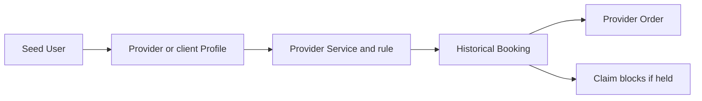

# Inspect the seed as a calendar model

A green seed command proves only that the script finished. It does not prove the data represents the product correctly. Open the development database in MongoDB Compass or use an equivalent read-only query. Trace one provider from User to Provider to Service and AvailabilityRule. Trace one client from User to Profile to a historical Booking and its provider-scoped Order. Inspect at least two UTC Date values and convert them to local labels using the tested time helper. Record what you saw in `docs/seed-fixtures.md` or `docs/erd.md`.

Run the seed from the learner project's server directory using its documented script, for example `npm run seed`. The command should print the database name, fixture counts and whether it created or updated records. It must not print the URI password. Run it twice. If the second run changes counts or fails on a unique index, repair the idempotency key before continuing. A repeatable seed makes later authorization, availability and checkout tests reproducible; a destructive reset that changes IDs each time makes failures hard to compare.

Use the diagram as a checklist, not as proof that every arrow exists. In Compass, click the User for `tutor-one@test.local` and copy its `_id`. Query Provider by `userId` and expect exactly one document. Copy Provider._id and query Service and AvailabilityRule by `providerId`. Confirm the Service's duration and buffer are whole 15-minute multiples. Confirm the rule stores local `HH:mm`, weekday and IANA zone rather than an invented fixed UTC hour. If Provider.timeZone and an active rule's zone disagree, investigate the seed or zone-change policy before running availability tests.

## Read two kinds of time side by side

Pick a historical Booking.startAt UTC Date and a TimeOff.startAt UTC Date. Write their exact ISO `Z` strings. Use `formatInZone` from Module 5 to show each in `Asia/Gaza` and one client zone such as `Europe/Berlin`. The two labels for one UTC value differ, but the stored instant is unchanged. Record the date and runtime versions. Do not infer a Gaza offset from today's clock and apply it to the historical fixture; ask the time library for that date.

Then inspect an AvailabilityRule. It has no single `startAt` UTC Date because it is weekly. Choose one effective provider-local date, call `localToUtc` on its local fields and write the resulting UTC value. Choose a second date and repeat. Depending on the zone's rules, the UTC clock hour may differ even though the local rule still says 09:00. If the chosen two dates happen to have the same offset, that is fine; use the historical New York test from Module 5 to demonstrate a transition rather than inventing a Gaza change.

One hand-worked conversion should have this shape: "The stored instant is `2024-01-15T08:00:00.000Z`. In Europe/Berlin on that date the local label is 09:00; in Asia/Qatar it is 11:00. It remains the same Booking.startAt." Use the exact date and zone names. An explanation such as "the time changes for the client" is ambiguous: the label changes, not the appointment instant. The model's purpose is to make that sentence precise.

## Inspect exclusivity and state

Open the SlotClaim collection and its indexes. Confirm the unique compound `{ providerId: 1, blockStartAt: 1 }` index exists. If the seed includes a held fixture, every claim should point to the same Booking and cover consecutive 15-minute UTC blocks through its buffer. A historical completed Booking may have no active claims under the release policy. Do not label an old expired hold as free while leaving a claim document that still occupies a unique key. The database index will continue to reject a new write for that key.

Try the duplicate insert test from lesson 6.9 against the scratch database, then remove the temporary duplicate attempt. Confirm code 11000 is treated as expected evidence in the test output, not as an unhandled server crash. If the duplicate insert succeeds, check that the index was created on the collection you are inspecting. Mongoose schema declarations are not enough if index creation is disabled or failed in the database.

Inspect the Booking purchase snapshot and live Service. Change the Service price in a scratch fixture, reload the Booking and verify its accepted price remains the old value. Do not modify a real provider's production data for this exercise. The seed's purpose is to give a safe, local place to see why both reference and snapshot exist. If a Booking has no snapshot or an Order points to a different provider, update the model and seed before proceeding.

## Count and record what matters

Write a short inspection table with collection, expected count, observed count and one relationship checked. Include eight Users, eight Profiles, five Providers, at least five Services, several rules, TimeOff, and the fixture CartItem, Order and Booking if your seed creates them. Record the SlotClaim index separately because a collection count cannot prove uniqueness. Avoid copying every document into the note; that creates noisy personal data and makes review harder.

Run a provider-scope query for two different provider IDs and compare results. One provider's Service and TimeOff should not appear under the other ID. Run a client-scope query for the Berlin and Qatar users and compare their Booking and CartItem records. This is a data-level check; HTTP authorization still comes later. It catches a seed script that accidentally reuses the first provider ID for all fixtures.

If Compass displays Date values in your computer's local zone, switch to the raw ISO view or copy the exact stored value before making the conversion. A GUI label can be helpful, but it should not become the authority for the database type. The fields named `startAt`, `endAt` and `blockStartAt` should be Date values whose ISO representation ends in `Z`. The rule's `startLocal` should remain a string paired with an IANA zone.

Commit the seed fixture note and the passing second-run output summary. The final gate asks a mentor to select any two records and hear you explain their owner, time representation and lifecycle. If the explanation depends on an unstated assumption, add it to `docs/erd.md`. The goal is an inspectable foundation for the later provider dashboard and availability engine, not a gallery of sample accounts.

## Explain one surprising result

Choose a record whose GUI display initially surprised you. Maybe Compass showed a different local hour than the raw ISO string, or a weekly rule had no UTC Date at all. Write the raw value, the zone used for display and the conversion step that explains it. Then state which data should remain fixed if a client changes their Profile zone. This note is more valuable than a screenshot without labels, because another learner can repeat the calculation under a known runtime.

Also inspect a Service after a seeded historical Booking. Compare the live price and the Booking purchase snapshot. They may be equal in the initial seed, so change only the live Service in a disposable scratch run and see that the snapshot stays unchanged. Restore the fixture or rerun the idempotent seed. This exercise proves the model has two different meanings for price even when the initial values happen to match.

For a final isolation check, look up the Berlin client's raw User ID and query CartItem and Booking by that ID. Repeat with the Qatar client. A count difference is acceptable if the fixture plan says so; a document from one client appearing under the other's ID is not. Then query the two providers' Orders. Each Order should have exactly one providerId. If the seed's mixed checkout example has one Order with both provider IDs, the data model has drifted from its ownership contract. Record the query predicates and result counts so the later HTTP authorization test can reuse them.
