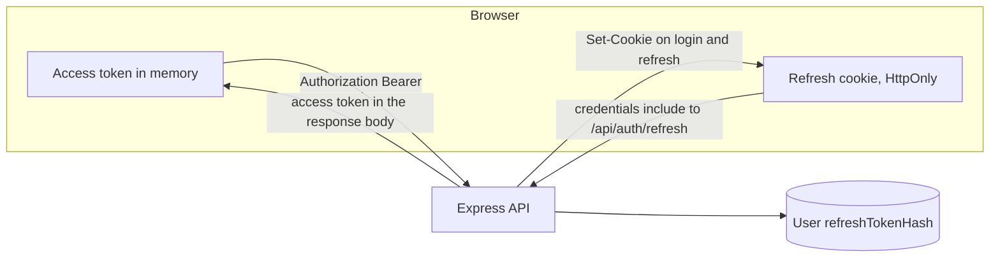

# 7.4 Where tokens live

> **[Learn]** · Chapter 07 · Login & registration · *Access in memory, refresh in an HttpOnly cookie*

This page is the concrete storage map for the SkillSlot client, and you implement it in 7.10 and 7.14. Two credentials come back from login, they last for very different lengths of time, and each one gets a different home in the browser. Getting the map right once removes a whole category of session bugs before the interceptor is written.

<BigWordAlert term="localStorage trade-off" plainEnglish="Browser storage that survives a reload but is readable by any script on the page, which makes it a target for cross site scripting." whyItMatters="SkillSlot keeps the access token in memory instead, so one injected script cannot lift a working credential out of storage." />

## Why this matters

Vague authentication state is the most common beginner SPA bug, and it always looks like three different bugs. A token sits in localStorage and survives a reload, but a script can read it. A refresh path is missing, so every reload logs the user out. A refresh call runs on the login page, so a wrong password starts a cascade of refreshes and redirects. Each symptom comes from the same missing decision: nobody wrote down where each credential lives and when it is set or cleared. This page writes that down.

## The mechanism: match the home to the lifetime

The access token expires in about fifteen minutes and is sent with every API call. The refresh token lives for days and is only ever sent to one endpoint. That asymmetry decides the placement, and the reasoning is worth stating as a rule rather than a preference.

A credential that a script can read is a credential that an injected script can steal. The access token is in the browser's working memory on every page, so it is the value an attacker most wants, and it is also the value that expires soonest. Put it somewhere a script can hold but not persist, and a theft has a short life. The refresh token is the opposite: it is long lived, it can mint new access tokens repeatedly, and it is requested rarely. It needs protection that survives a reload while staying unreadable to code, which is exactly what an HttpOnly cookie provides.

## Access token in memory only

The access token lives in a JavaScript variable inside the auth provider, and it never touches localStorage, sessionStorage or a script readable cookie.

**Location:** a `useRef` or a closure variable in the provider. `useState` also works, and the only difference is re-renders on rotation.

**Set when:** login succeeds, a refresh succeeds, or the boot refresh succeeds.

**Clear when:** the user logs out, a refresh fails, or a retry after refresh still returns 401.

**Never:** localStorage, sessionStorage, or `document.cookie` from script.

The cost of this choice is that a page reload wipes the value, because memory belongs to the page and the page is gone. That cost is paid back by the boot sequence, which rebuilds the token from the cookie before any route renders. Choosing between `useRef` and `useState` is a smaller decision than it looks: `useRef` avoids a re-render of the whole tree when a silent refresh rotates the token, and plain state is simpler to read. Pick one, use it consistently, and note the reason in the learning log.

## Refresh token in an HttpOnly cookie

The refresh token is written by the server through `Set-Cookie` and stored by the browser. The client never reads the value, because it cannot. When the API client calls the refresh endpoint with `credentials: 'include'`, the browser attaches the cookie on its own, and React needs no token plumbing at all.

**Set by:** the server on login and on every successful refresh.

**Read by:** the browser automatically, on a request that opts in with `credentials: 'include'`.

**Client code:** never reads the value, which is the point.

Because the value is opaque to the client, debugging moves out of the console and into the network panel. If the cookie exists, the refresh request shows it in the request headers and the response shows `Set-Cookie`. If it does not exist, no amount of client code reading will fix it, and the question becomes a server question about attributes, path or origin.

## The two homes in one picture

The picture makes the asymmetry visible. Both credentials end up at the same API, but only one of them travels on ordinary requests, and only one of them is refreshed by a server response. The database row on the right is what makes revocation possible at all, because clearing it ends the chain even while an access token is still valid elsewhere.

<TraceRequest title="A page reload rebuilds the session">
  <TraceStep actor="Client" label="Browser reloads a protected route" detail="All JavaScript state is discarded, memory is empty" />
  <TraceStep actor="React" label="Auth provider mounts and calls refresh" detail="isLoading is true so no route redirects yet" />
  <TraceStep actor="Client" label="POST /api/auth/refresh with credentials include" detail="The HttpOnly cookie is attached by the browser" />
  <TraceStep actor="API" label="Compares the hashed refresh token on the User" detail="A match means the session is still real" />
  <TraceStep actor="API" label="200 with a new access token" status={200} detail="Refresh hash rotated and the cookie reissued" />
  <TraceStep actor="React" label="Stores the access token in memory" detail="isLoading becomes false and routes render signed in" />
</TraceRequest>

Step through the trace and note where the truth comes from. The client does not decide the session is valid because it has a token; it asks the server and waits. The `isLoading` flag exists for exactly this window, because a route that renders during step two would see an empty token and bounce the user to the login page for no reason.

## The cookie spec on the server side

| Attribute | Development | Production |
|---|---|---|
| HttpOnly | true | true |
| Secure | false on localhost | true |
| SameSite | Lax | Lax |
| Path | /api/auth | /api/auth |
| Max-Age | 7 days | 7 days |

The name is `refreshToken`, and it is documented as a constant on both sides so the client and server do not drift. `Secure` is false only because a local development server runs on plain HTTP, where a secure cookie would never be stored at all. `Path` is scoped to the auth routes so the cookie is not attached to catalogue reads or booking writes, which reduces the number of places it could be observed.

## Logout has two halves

Logging out is symmetric with logging in, and skipping either half leaves something usable behind. The client drops the access token from memory, which ends the session in that tab. The server clears the cookie and the stored refresh hash, which ends the ability to mint new access tokens.

- Client clears the in-memory access token and any cached user.
- Client calls the logout route with `credentials: 'include'` when the route exists.
- Server clears the refresh cookie and the stored refresh hash.
- Client redirects to the login page.

If only the client half runs, the refresh token still works, and an attacker who captured it can keep minting access tokens after the user believed they signed out. Clearing the hash is the operation that ends the session everywhere.

Rotation is the other half of that protection. Every successful refresh should replace the stored hash and set a new cookie, so the previous refresh token stops working the moment it is used. A stolen refresh token then has a limited window, because the legitimate client will rotate it and invalidate the copy. If the same refresh token keeps working forever, an attacker can wait and lose nothing.

## Failure modes and the path to the cause

A reload that logs the user out points at a missing boot refresh, so check that the provider calls refresh before rendering protected routes. A refresh that always returns 401 in the browser but works in curl points at a missing `credentials: 'include'` or a cookie path mismatch, because curl does not enforce either rule. A refresh loop on the login page means the interceptor is firing on public auth routes, so a wrong password triggers a refresh that also fails and a redirect that lands back on the same form. A cookie that exists but is never sent usually has a `Path` that does not cover the endpoint, or a `SameSite` value that drops it on a cross site request.

Debug in this order: does the response contain `Set-Cookie`, does the browser store it, is it attached to the refresh request, and does the server find a matching hash. Each answer removes half of the remaining possibilities, and none of them requires reading React code.

## Dual mode while Chapter 6 returns a body token

You may be wiring the client while the server still returns the refresh token in the JSON body. That is acceptable as a stepping stone and unacceptable as a destination. Setting the cookie from client code is less secure, because the value has to be visible to JavaScript first. Say so in the learning log, and treat the server side `Set-Cookie` as the target state for the gate.

## Self check

- [ ] I can say which token lives in a cookie and which never should.
- [ ] I can explain why localStorage is the wrong home for the refresh token.
- [ ] I know the two cookie flags that matter on a deployed site, `Secure` and `HttpOnly`.
- [ ] I can describe the boot sequence from a cold reload to a rendered protected route.

## Next

**Sub-chapter 7.5:** the 401 retry loop, refresh once and otherwise log out. With the placement settled, the next decision is the algorithm that runs when a request arrives with a token that is no longer valid.
