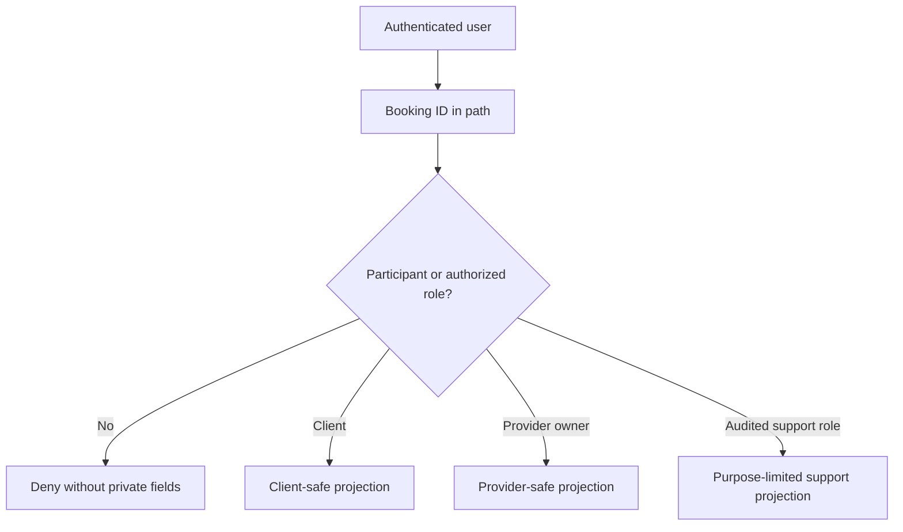

# Whose booking is this?

Sara is a tutor who sometimes visits clients at home. Amal books a 15:00 session and enters an address that should be visible to Sara only when the Booking is confirmed. Rami has a different account. If the API accepts `GET /api/bookings/:id` from any logged-in user and simply looks up the ID, Rami can substitute Amal's Booking ID and read her address. A long random ID makes guessing less convenient, but it is not a permission check. IDs leak into browser history, notifications, screenshots, logs and shared links. The API must decide whether the authenticated person may read this particular Booking and which fields they may see.

Count how often a Booking ID leaves the API and the scale of the problem becomes clear. The confirmation email prints it in a link. A reminder message repeats it a day before the session. A support agent pastes it into a ticket. A client screenshots the confirmation and sends it to a family member who booked the session on their behalf. Log aggregators collect it as part of the request path. None of these habits can be removed from a product that sends reminders and lets people share plans. That is why the defense cannot be secrecy of the identifier; it has to be a permission check on every read and write that names one.

The same Booking may contain a client ID, provider ID, Service ID, Order ID, UTC start and end, a provider time-zone snapshot, status, cancellation policy and contact information. The client should see their own appointment and payment state. The provider who owns it should see the information needed to deliver the session. Another provider, even one in the same category, should see nothing. A public visitor may see aggregate availability but never a private Booking row. A support role may need a narrow audited view for a dispute. These are different permissions on one object, not separate objects with magically secure IDs.

## One route, several mistakes

First mistake: route-level authentication only. `requireAuth` confirms Rami has a valid session but does not relate him to Amal's Booking. Second mistake: role-only authorization. `requireRole('provider')` may let Omar, a music teacher, inspect Sara's tutoring Booking. Third mistake: object-level permission with a broad response. Sara may be allowed to see the Booking but not a private client note before confirmation. Fourth mistake: checking permission on GET but forgetting PATCH or export. A caller may fail to read Amal's address yet still cancel her session by changing an ID in a write request.

All four mistakes share one cause: the check sits where the author remembered the risk, not where the data is read. A route that authenticates, calls `Booking.findById`, then trims fields in a serializer depends on every future edit to that serializer. Six weeks later someone adds a calendar export, copies the service call, and skips the trimming because a file download does not look like a JSON response. The pairing that survives that kind of drift is a single function that accepts the principal, the target ID and the action, and either returns an authorized relation or throws before any document is handed back. The route then has one place to call and one place to review.

OWASP calls this [broken object level authorization](https://api-security.owasp.org/editions/2023/en/0xa1-broken-object-level-authorization/). The risk exists whenever an API receives an object ID and performs an action without checking the user's permission on that object. SkillSlot's Booking IDs, provider Service IDs, Order IDs, TimeOff IDs and checkout IDs all create such boundaries. This module focuses on the most sensitive Booking path and turns the same pattern into reusable owner and participant helpers.

What should Rami see if he guesses a Booking ID? The product can choose 403 for a known but forbidden object or a nonrevealing 404 for private object routes. Use one documented policy consistently. This exercise uses 404 for a Booking that is absent or not visible to the caller, so the response does not confirm whether Amal has an appointment. A logged-out caller receives 401 before object lookup. A provider who owns the Booking but requests a forbidden operation may receive 403 when their relation is already known. Do not rely on status code choice alone; the query and response body must avoid private details.

## The participant chain

M6's ownership graph gives the authorization path. A Booking has `clientId` pointing to a User and `providerId` pointing to a Provider. A Provider has `userId` pointing to its owner. Therefore a client is a participant when `Booking.clientId === session.userId`; a provider is a participant when the Booking's Provider belongs to `session.userId`. Never compare the session user ID directly with a Provider ID; they are different record types. Never trust a `clientId` or `providerId` included in the request body as proof of ownership. The server derives the caller's identity from the authenticated session and verifies the database relationship.

Resolving the caller's Provider record costs one extra small query on each provider request. The alternative is to copy `providerId` into the session when the user signs in, which is faster but goes stale the moment a provider profile is transferred or suspended. SkillSlot keeps the session free of provider state and pays the query, because a stale session would quietly keep an old owner's authority alive after a transfer. Write that decision down next to the helper. A caching layer added later for performance can reintroduce the staleness without anyone noticing that a security property depended on the lookup being fresh.

For an at-home Service, the client address is a need-to-know field. The provider receives it only after confirmation, within an appropriate time window and under the delivery policy. For an online Service, a meeting link may be visible to both confirmed participants but not to another client inspecting a public provider profile. A workshop Service may expose a public venue instead. The `locationType` snapshot helps choose the projection, but status and participant relation still matter. A single generic `Booking.toJSON()` response is unlikely to enforce all of these rules.

## Walk a malicious request

Rami signs in normally and copies a Booking ID from a leaked URL. He sends `GET /api/bookings/<amal-id>`. The auth middleware attaches `session.userId`. The Booking service performs a scoped lookup that checks `clientId` or the caller's owned Provider ID. Neither matches. The route returns its nonrevealing 404. It does not first load the full Booking, serialize it, and then filter fields in the browser. The browser is controlled by the caller; front-end hiding is only presentation, not access control.

Now Rami tries `PATCH /api/bookings/<amal-id>/cancel` with `clientId` set to Amal's ID in JSON. The cancellation route ignores that claimed identity and checks the authenticated session against the Booking's participant and action policy. It denies Rami. Sara, the actual provider owner, may have a cancellation right under a separate rule, while Amal has her client right. Both rights can depend on Booking status and policy snapshot. This module builds the authorization boundary; the later cancellation module defines the business state transition.

When a denial is missing, reproduce it before reading any code. Sign in as Rami, take the exact path from a request that works for Amal, and replay it with Rami's token in a fresh HTTP client. A 200 with Amal's address means the object check is absent or the query is unscoped. A 404 with the address still present inside a nested Order or Service object means the check is fine and the serializer is wrong, which is a smaller and different repair. A 401 means the token, not the policy, was the problem. That three-way split tells you which file to open, and it takes about two minutes with two seeded accounts.

## What the reviewer should be able to say

By this module's gate, a reviewer can point to an authorization matrix row for every Booking read and write. They can identify the caller principal, the object, the action, the relationship checked and the response projection. They can run direct HTTP requests as two clients and two providers and see every cross-party request denied. They can confirm that a provider's calendar view includes only their own Bookings and that a client cannot fetch another client's Order through a related ID. They can explain why a valid JWT is only the beginning of the decision.

Record a short learning-log sentence: "Being signed in proves who called; it does not prove whose Booking was named." Then list two private fields that require a narrower rule than simply being a participant. The next lesson separates the various IDOR paths and shows where the object check belongs in the route, query and response. Keep the human impact visible: a leaked address or unexpected meeting visitor is not merely a failed unit test.

