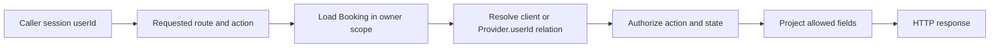

# Object checks on every booking route

An insecure direct object reference is often demonstrated with one `GET /bookings/:id` request. Real applications expose the same Booking through a client list, provider agenda, Order detail, cancellation form, reminder job, calendar export and support view. A fix on one route does not protect the others. Start by inventorying every path that accepts or derives a Booking ID, then write the object-level check and response projection for each. A parent Order ID or Provider ID in the URL is also untrusted input until its relationship is verified.

Do that inventory with a search rather than from memory. Search the router files for `bookingId`, `:id` and `orderId`, then list every match beside the handler it reaches. Teams usually find a route or two that nobody remembered, and the forgotten ones are predictable: a reminder preview, a calendar download, a support lookup, an internal page from an earlier sprint. The count matters more than the list, because a route that no one can name is a route no one has tested. Record the count in `docs/AUTHORIZATION.md` and update it when it changes.

<TraceRequest
  method="GET"
  path="/api/bookings/booking-amal"
  request='{"sessionUser":"rami"}'
  response='{"status":404,"code":"BOOKING_NOT_FOUND"}'
/>

The trace uses a human label for clarity; the real ID is an opaque database identifier. Rami's authenticated session is valid. The server still returns 404 because the Booking does not belong to him and he does not own its Provider. The response has no address, meeting link, Service note or indication that the ID exists. The same result should appear for a well-formed nonexistent ID under the course's nonrevealing policy.

## Query in the caller's scope

For a client-facing detail route, a scoped query can include both `_id: bookingId` and `clientId: session.userId`. For a provider-facing route, first resolve the Provider owned by `session.userId`, then query Booking by `_id` and `providerId: ownedProvider._id`. A combined participant route can perform a controlled two-branch lookup. Avoid a bare `Booking.findById(id)` followed by a broad `res.json(booking)` before the check. A disciplined service may load then authorize internally, but the query-scoped form reduces the chance that a future refactor accidentally serializes a forbidden object.

The scoped filter is stronger than it looks. A query with `_id` and `clientId` together cannot return a document that fails the second condition, because the database applies both predicates before it hands back a row. The rejection is a property of the query, not of the programmer remembering to compare fields afterwards. Load-then-check has the same result when it is written correctly, but its safety lives in a line of application code that a later edit can move, reorder or delete. When you review a booking query, ask which of the two shapes it uses. If the answer is load-then-check, look for the comparison and for the serializer immediately after it.

Validate the ID format before querying, but do not mistake a valid ObjectId for permission. A malformed ID can receive 400 or a nonrevealing 404 under the route policy. A valid ID owned by someone else must not return data. For list routes, never accept `clientId` or `providerId` from a query string as the authorization scope. The caller may filter their own view by date or status, but the base owner filter comes from the session and database ownership chain. A query parameter such as `?providerId=sara` cannot turn Rami into Sara.

## Cover nested paths

Suppose `GET /api/orders/:orderId/bookings` first loads an Order and then fetches its Booking children. The route must verify that the caller owns the Order as client or provider share before listing children. A bug where the parent Order is scoped but child query uses an arbitrary `providerId` could leak another share. Likewise, `GET /api/providers/:providerId/agenda` must verify Provider.userId for private details; a public provider profile route may show computed availability but no client names. Object checks must follow the data relationship across nested resources.

Walk one nested case slowly. Rami sends `GET /api/orders/<amal-order>/bookings`. The handler loads the Order, confirms that Rami is neither its client nor its provider, and returns the denial. That is the easy half. The hard half is the version where the parent check passes for a legitimate buyer who bought from two providers in one attempt. The child query then decides what they see, and if it is written as `Booking.find({ orderId })` the parent check has become decoration. Carry the scope down: filter children by the Order ID and by the caller's participant relationship in the same query, then project each child through the provider-share or client view.

Exports are easy to forget. A calendar `.ics` route may embed client names, addresses or meeting links in a downloadable file. It needs the same participant and field rules as JSON detail. A reminder preview route may generate text from a Booking ID; it must not be public merely because it does not return the raw document. Signed share links, if added later, need explicit scope and expiry. Do not treat obscurity of a URL as a replacement for participant authorization.

OWASP's [API1 guidance](https://api-security.owasp.org/editions/2023/en/0xa1-broken-object-level-authorization/) says every endpoint receiving an object ID should check permission for the object and action. Its [authorization cheat sheet](https://cheatsheetseries.owasp.org/cheatsheets/Authorization_Cheat_Sheet.html) recommends deny by default and checking every request. Translate that into a test inventory, not a general claim that the framework handles it. Express middleware can authenticate a session, but the booking service must know the Booking and provider relation to decide object rights.

## Action and state both matter

The same participant may be allowed to read but not perform every mutation. Amal can read her Booking; whether she can cancel a confirmed Booking depends on the accepted policy and time before the session. Sara can read a confirmed attendee address if the at-home service requires it, but may not change the client's charged amount. A provider may mark their own completed session as delivered under a defined workflow, not mark another provider's session. An admin action should be explicitly named, audited and reasoned, not a wildcard role that bypasses every check.

Write a route table with columns method/path, object, caller relation, allowed action, state predicate and projected fields. Include at least detail GET, client list GET, provider agenda GET, cancellation POST, reschedule POST, Order detail GET and calendar export GET. Mark routes not yet implemented as future controls. The table should identify a security test for each current route, including a direct ID swap. A route that only appears in the UI when authorized still needs a direct HTTP denial test.

## Compare two denial styles

For private Booking detail, use the same `BOOKING_NOT_FOUND` response for nonexistent and foreign IDs. For a logged-in provider attempting a forbidden operation on a Booking they own, 403 can explain that the action is disallowed in the current role or state, if that does not reveal another person's object. Keep errors structured and do not echo private fields in validation messages. The exact 403 versus 404 choice is less important than consistent policy and no data leakage. Tests should assert both status and response body projection.

Add a timing check only if the implementation introduces a significant existence oracle. A foreign ID query may be slightly slower than a nonexistent ID for ordinary database reasons; constant-time responses for every route may be impractical. The primary control is scoped lookup and no identifying response. Avoid expensive extra queries solely to make timing equal without evidence of a concrete risk. Log denied attempts with request IDs and safe principal/object identifiers for operations, but do not log client addresses.

At the end, ask a peer to invent a new route: `POST /api/bookings/:id/send-reminder`. The peer should be able to place it in the table, choose an authorized principal, decide whether status permits the action, and state which participant fields the notification worker may use. If the answer is only "requireAuth is on the router," the module has not established object-level authorization yet. The next lesson separates roles, ownership and field-level projection into a reusable decision model.

