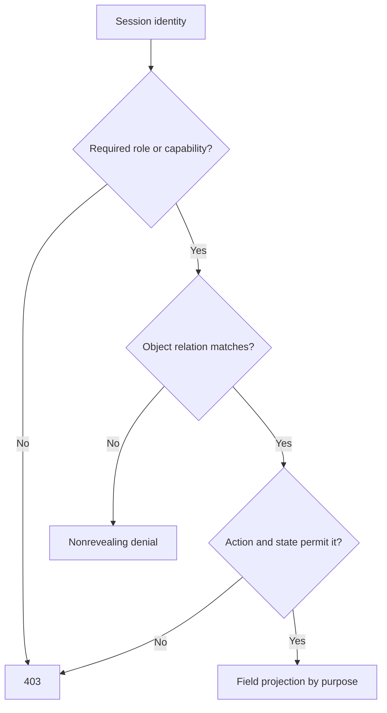

# Authentication, roles and ownership

Authentication answers "Who is calling?" A role answers "What kind of capability might this account have?" Ownership or participation answers "May this person act on this exact object?" SkillSlot needs all three. A logged-in client may view their own Bookings but not another client's. A provider account may edit its own Services and see its own confirmed Bookings but not a competitor's. A support role may have a narrow audited lookup for a dispute. Treating `role: provider` as blanket permission for all provider data is a category error.

<TraceRequest
  method="PATCH"
  path="/api/providers/provider-sara/services/service-1"
  request='{"sessionUser":"omar","priceMinor":5500}'
  response='{"status":404,"code":"SERVICE_NOT_FOUND"}'
/>

Omar may also be a provider, so he passes a provider-role check. He does not own Sara's Provider record, so he cannot edit her Service. The route should derive Omar's Provider `_id` from his authenticated user ID and constrain the Service update by that ID. A path `provider-sara` cannot expand his authority. The trace illustrates why roles and object relationships must both be checked on direct API requests.

## Derive the principal from the session

The auth middleware from M7 validates the token or session and attaches a principal with `userId` and trusted role claims. A client-supplied `userId`, `providerId` or `role` in JSON is input data, not identity. If a token's role can become stale when an account is suspended or a provider loses status, decide which operations re-read current account state. Sensitive provider writes and payment-related Booking actions should use current database status or a short-lived session policy. Do not allow an old token to retain an administrative capability after it is revoked.

Picture the suspension in time. A provider is suspended at 10:00 for repeated no-shows. Their access token was issued at 09:40 and stays valid for another twenty minutes. If every provider route trusts the token's role claim, that account can still edit Services and TimeOff during those twenty minutes. If the route re-reads the Provider row through `assertProviderOwner`, the suspended status is visible immediately and the write fails. The trade-off is a query per request against a window of stale authority. SkillSlot accepts the query on provider writes and payment-adjacent Booking actions, and tolerates the token's role claim on ordinary reads where a stale claim cannot change another person's data.

The M6 Provider model has unique `userId`, so `Provider.findOne({ userId: principal.userId })` resolves the caller's provider profile. A Service belongs to a Provider. A Booking belongs to one client User and one Provider. A provider Order belongs to one Provider and one CheckoutAttempt. These relationships form the authorization proof. The proof should be visible in helper names and tests, not hidden in a generic `isOwner` function that compares unrelated IDs.

## Define capabilities by action

Use a matrix with rows such as `service:create`, `service:update`, `booking:readClient`, `booking:readProvider`, `booking:cancelClient`, `booking:cancelProvider`, `order:readProviderShare`, `checkout:readClient` and `timeOff:update`. Columns include public visitor, authenticated client, provider owner and audited support. A checkmark alone is insufficient; write the required relation and state. For `booking:readProvider`, the relation is `Provider.userId === principal.userId` and the projection may depend on confirmation. For `checkout:readClient`, the relation is `CheckoutAttempt.clientId === principal.userId`.

Some accounts can be both client and provider. Do not force one global role to decide which view they are in. The route action and object relation choose the correct permission. A provider buying a music lesson from another provider is the client on that Booking. Their provider profile gives no extra access to the music teacher's private dashboard. Tests should include such a dual-role user because it exposes assumptions hidden by fixtures where every User has exactly one role.

## Ownership is not the same as participation

A Booking is not "owned" solely by the provider or client in the same way a Service is owned by its Provider. Both are participants with different rights. The client can see the charge and their appointment; the provider can see fulfillment details and their Order share. Neither should change the other party's identity or immutable purchase snapshots. The platform may need an audited support path for dispute resolution. A helper called `assertBookingParticipant` can establish the relation, then an action-specific policy decides what that participant may do.

For pre-confirmation holds, the provider may see blocked time and limited Service context, but not necessarily the client's home address or meeting link. After confirmation, delivery details can become visible under the need-to-know policy. A cancellation may remove future access to a meeting link while preserving the historical Booking record. Authorization therefore includes field projection and state, not just a Boolean "can see Booking." Module 9.7 builds this projection explicitly.

## Place enforcement near protected data

Express can chain middleware, and its [middleware guide](https://expressjs.com/en/guide/using-middleware/) explains how a function can end a request or pass control onward. Use route middleware for authentication and broad capability, then call an object-scoped service or helper before data access and mutation. A provider dashboard can hide a button, but direct API requests must enforce the same rule. The [OWASP authorization guidance](https://cheatsheetseries.owasp.org/cheatsheets/Authorization_Cheat_Sheet.html) recommends deny by default and validating permissions on every request. A service helper that defaults to allow when a relation is missing violates that principle.

Route middleware is enough when the ownership appears in the path. A route shaped as `PATCH /api/providers/:providerId/services/:serviceId` can compare the path's provider ID against the caller's owned Provider before the handler runs, and that check is cheap and easy to read. A Booking route cannot do the same, because `GET /api/bookings/:bookingId` carries no ownership in the path; the relation lives inside the Booking document. The handler has to load the Booking before it can decide, so the decision belongs in the service next to that load. Choosing the wrong layer produces one of two failures: a middleware that cannot see the object and passes everything, or a service check that a new route forgets to call. Put the check at the layer that already holds the object.

Consider an update route implemented as `Service.findByIdAndUpdate(serviceId, body)`. Even if a previous middleware checked that the caller has a Provider profile, the update does not constrain the Service to that Provider. Replace it with a filter including `_id: serviceId, providerId: ownedProvider._id`, and allowlist mutable fields. The result's absence means no owned Service matched. Do not distinguish "belongs to someone else" from "does not exist" in the public response. A separate support audit route may log the deeper reason.

## Prove denial and useful access

Seed Client A, Client B, Provider A and Provider B. Give each provider a Service and each client a Booking with one provider. Call every matrix action with the rightful participant and a cross-party user. The rightful participant should get the expected narrow fields; cross-party users should receive denials without private data. Include a provider acting as a client on another provider's Booking. Tests need positive cases too: a helper that denies everyone may look secure but prevents the product from working.

When a rightful participant is denied, debug in a fixed order. First confirm the principal carries a `userId` and not a provider ID. Second confirm a Provider row exists for that user, because a missing row makes every provider rule deny. Third compare record types: an ObjectId compared to a string with `===` is always false, and that single mistake causes most unexplained denials. Fourth check the Booking's own fields, since a Booking created before a seed repair may point at an old Provider. Fix the cause the order reveals; widening the rule to make the denial disappear is how a helper acquires its first bypass.

As a final exercise, write the following sentence in your design note and fill the blanks: "For action ___ on object ___, the caller is authenticated as ___, has capability ___, relates to the object through ___, and may receive fields ___." Use one client Booking detail and one provider Service edit. If the relation phrase is only "the ID was in the URL," the rule is not ready. The next chapter checks this model with scenarios before the build lessons implement it.

