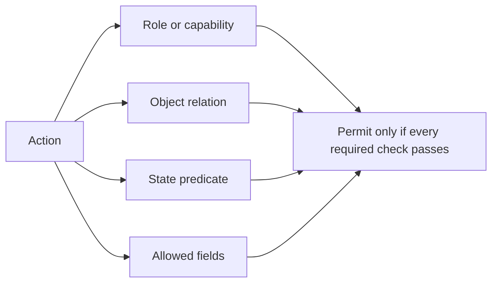

# Write the authorization matrix

Create `docs/AUTHORIZATION.md` before scattering `if (user.role)` conditions across controllers. The matrix is a decision record: for each action, name the caller capability, the exact object relationship, any state condition and the fields returned or changed. It turns a vague requirement such as "providers see bookings" into a rule that a developer can implement and test. A provider should see only Bookings for their own Provider record, and a held Booking may reveal less than a confirmed one.

Without a written matrix, each controller invents its own answer. The provider agenda route checks `providerId` from the path. The Booking detail route checks `clientId` or a Provider lookup. The Order route checks whichever field was convenient the week it was written. Each check looks reasonable alone, and the set of them is inconsistent. The cost appears later, when a private field is added and someone has to decide which of six routes should include it. A matrix makes that decision once and gives the next developer somewhere to look before writing a seventh answer.

Start the document with the principal model: an authenticated User has a trusted `userId`; some Users own a Provider whose `userId` is unique; a Booking has `clientId` and `providerId`; a Service belongs to a Provider; an Order belongs to one provider share and a client CheckoutAttempt. State which routes are public and which require authentication. Public Provider discovery can show listed practice name, category, active Service summary and computed offers. It cannot show private Bookings, TimeOff reasons, client addresses or payment state.

Use a table like this as a skeleton, then expand it for current routes:

| Action | Caller relation | State rule | Response or mutation |
|---|---|---|---|
| `booking:readClient` | `Booking.clientId === userId` | Any owned status | Client projection, own price and policy |
| `booking:readProvider` | `Provider.userId === userId` and Booking.providerId matches | Held or later | Provider projection; delivery details only when confirmed |
| `service:update` | Service.providerId is caller's Provider | Active provider account | Allowlisted commercial fields |
| `order:readProvider` | Order.providerId is caller's Provider | Any own Order | Own share only, no other provider totals |
| `checkout:readClient` | CheckoutAttempt.clientId matches userId | Any own state | Attempt state and own Orders, limited payment data |

The table should not imply a provider can update Booking payment state. A signed Stripe webhook and payment service own that transition. A client can request cancellation, but the later cancellation module must apply the accepted policy and temporal state. The matrix can mark such actions as "future route, policy pending" rather than inventing permissive behavior. Deny by default for actions absent from the matrix. A new route needs a new row and a test before it ships.

## Separate role, relation and state

For `timeOff:create`, a provider role is necessary but insufficient. The caller must own the Provider whose calendar will be blocked. The provider must be in a status that allows schedule edits. The new interval must satisfy M13 validation. For `booking:readProvider`, role may be inferred by the owned Provider record, but the Booking's providerId still needs to match. For `booking:cancelClient`, the caller is the Booking's client and the Booking must be cancellable under its snapshot policy. These examples show why one Boolean column named Allowed cannot carry the full decision.

Follow one row to the code and the shape becomes concrete. Take `booking:readProvider`. The relation column says the caller's Provider `userId` matches the session and the Booking's `providerId` matches that Provider. The state column says held or later. The projection column says delivery details only when confirmed. In the handler that becomes three things: a Provider lookup scoped by `principal.userId`, a Booking lookup scoped by the owned Provider `_id`, and a serializer chosen by status. If you cannot name those three artefacts from the row, the row is a wish rather than a specification. That test takes a minute per row and it finds the vague rows before a reviewer does.

Specify response fields. A client Booking view can include their charged amount, cancellation policy, provider name, UTC instant and formatted local labels. A provider held-calendar view can include occupied time, Service summary and hold expiry without the client's home address. A confirmed provider view may include the address or meeting link needed to deliver the Service. A public availability response includes no Booking ID. If the matrix only describes route access, a serializer may still leak object properties after the route allows a participant.

Define support and admin access narrowly. A support agent may need to inspect a disputed Order after recording a case ID and reason. The matrix should list read-only fields needed and require an audit event; it should not grant a generic wildcard to every account with `role: admin`. Seed tests for an ordinary admin-like role if the project has one. If it does not, mark the support path out of scope for this module. Do not silently add a broad bypass because it makes development convenient.

## Derive matrix tests

For every row, write one positive test and at least two negative cases: unrelated client and unrelated provider. Add a state negative when the row depends on held versus confirmed. For `booking:readProvider`, test Sara's own held Booking shows time but no address, Sara's own confirmed at-home Booking shows the required address, and Omar's request for Sara's Booking returns no data. For `service:update`, test Sara's successful change, Omar's attempted change by direct ID, and a client role's attempted change. The matrix becomes executable evidence rather than prose stored in a forgotten file.

Why a Markdown file rather than a permissions library? A library such as CASL or Casbin expresses rules as code, which is a good fit when the same rule set drives many clients and roles. SkillSlot has four principals, one Product and a handful of routes, so a library would add a dependency, a rule syntax and a second place to read policy. The Markdown table is readable in a pull request by someone who does not know the library, and the tests carry the enforcement. The cost is real: a table does not fail when it drifts out of date, so the only guard is the review question and the test naming convention. If the product later grows to a dozen partner integrations, revisit it.

Include list and export routes. A client list must be scoped to session userId before date or status filters. A provider agenda must use the owned Provider ID. An `.ics` export can leak meeting links as easily as JSON. A cancellation preview may return a refund amount; it belongs only to a participant, and the exact amount may differ between client and provider projections. Keep these rows even if implementation arrives later, labeled with owner module and test status.

The [OWASP authorization cheat sheet](https://cheatsheetseries.owasp.org/cheatsheets/Authorization_Cheat_Sheet.html) recommends default denial and per-request permission checks. Use that as a review question: which matrix row authorizes this route, and where is the check enforced? If the route cannot point to a row, it should not be public by accident. If a row cannot point to a test, add one before claiming the policy is implemented.

When the matrix and the code disagree, believe the code and repair the matrix in the same commit. Read the running behaviour first: send the request as the rightful participant and as a cross-party user, then note the status and the keys that came back. That observed pair is the current rule, whether or not the document says so. Then decide which one is wrong. Usually the code is stricter than the table, and the table needs a state column it never had. Less often the code is looser, and the fix belongs in the helper. Either way the diff must touch both files, because a matrix updated alone leaves the runtime unchanged and a helper updated alone leaves the next reader misled.

Have a peer choose a random Booking ID from the seed and try to reach it through every listed path as Client B and Provider B. Update the matrix if a path was omitted. The document should name the M6 field relationship, not use a fuzzy phrase such as "same account." Finish by committing the matrix next to tests and adding a short section called Open routes for future cancellation, reschedule, reminders and support. Clear gaps are safer than assumed permissions.

