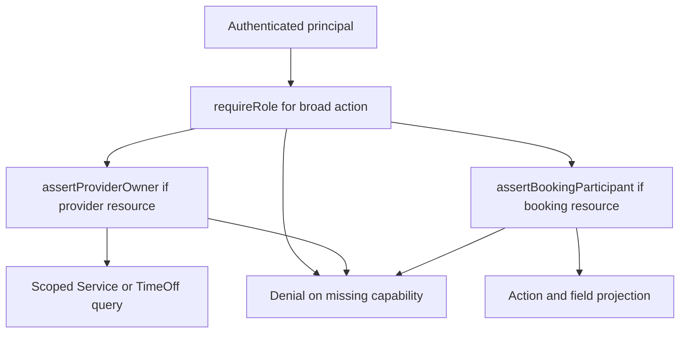

# Build role and ownership helpers

Build three small helpers: `requireRole`, `assertProviderOwner` and `assertBookingParticipant`. They are not interchangeable. `requireRole` checks a trusted capability from authentication. `assertProviderOwner` resolves the Provider whose `userId` matches the caller and verifies the target Provider ID. `assertBookingParticipant` resolves the Booking's client or provider ownership chain for a specific action. Each helper should fail closed when a field, document or session is absent. A generic helper that returns true when it cannot resolve a Provider is a serious authorization bug.

The temptation is to collapse all three into one `can(user, resource)` function. Resist it, because the three checks take different inputs and fail for different reasons. `requireRole` needs only the principal and never sees an object, so it cannot fail closed on a missing document. `assertProviderOwner` needs a target ID from the path and a Provider row from the database. `assertBookingParticipant` needs the Booking plus an action, and its answer depends on Booking status. One combined function would accept every input, choose which branch to run, and return an untyped answer that each caller interprets again. Three small functions each return one thing, and a route that skips one of them is visible in review.



Keep the principal type narrow. It contains an authenticated User ID, trusted role claims and request ID for audit. It does not contain a caller-supplied Provider ID from JSON. A request handler may read a target Provider ID from a URL, but `assertProviderOwner` compares it to a Provider row loaded by principal.userId. The M6 unique Provider.userId index makes the relation unambiguous. If no Provider row exists, the helper denies provider actions even if a stale token still says the User has a provider role.

```ts
async function assertProviderOwner(principal, targetProviderId) {
  const owned = await Provider.findOne({ userId: principal.userId })
    .select('_id status').lean();
  if (!owned || String(owned._id) !== String(targetProviderId)) {
    throw notFound('PROVIDER_NOT_FOUND');
  }
  if (owned.status === 'suspended') throw forbidden('PROVIDER_SUSPENDED');
  return owned;
}
```

This is a teaching outline. The response choice may use nonrevealing 404 for cross-owner requests and 403 for known suspended own profiles. The actual helper can accept an action to apply more precise status policy. Normalize ObjectId comparison or query with `_id` and `userId` together; do not rely on JavaScript object identity for two ObjectId instances. Return a safe Provider projection or ID to the caller, not an unrestricted document with private fields.

For a Booking, a client participant matches `clientId` to principal.userId. A provider participant resolves a Provider owned by the principal and matches its `_id` to Booking.providerId. Then an action-specific rule checks Booking status. For example, `booking:readProvider` can allow a held or confirmed Booking but choose different fields. `booking:markCompleted` may require confirmed status and provider participation. `booking:readClient` is not granted to any provider merely because they are a provider somewhere else in the system.

Trace the Omar request through all three. Omar sends `PATCH /api/providers/provider-sara/services/service-1`. The route calls `requireRole(principal, 'provider')`, which reads a trusted claim and passes. It then calls `assertProviderOwner(principal, 'provider-sara')`, which loads the Provider whose `userId` is Omar's and compares `_id`. Omar owns a different row, so the helper throws and the handler stops. The Service document is never loaded, no price changes, and the response is the nonrevealing 404. Now imagine the second helper were missing. Omar would pass the role check and the update would match on `service-1` alone, which is the exact bug this lesson exists to prevent.

## Place the check before side effects

Call the helper before changing a Service, cancelling a Booking, generating a calendar file or sending a reminder. For a mutable resource, prefer an owner-scoped database filter in the final update as well: `{ _id: serviceId, providerId: ownedProvider._id }`. A check that happens far before the write may become stale if ownership or state changes. The final update's predicate gives defense at the write boundary. For Booking cancellation, include current status in the conditional update and use a transaction when related Order, claim or refund records must change together. Authorization and business state are separate predicates, but both must hold.

Express routes can chain authentication middleware and these helpers. The [Express middleware guide](https://expressjs.com/en/guide/using-middleware/) explains that a middleware can end a request or pass it onward. Be deliberate about error handling: an async rejection must reach the central error handler rather than leave a hung request or fall through to a later unprotected handler. Test an absent principal, an expired token, a User without Provider, a suspended Provider, malformed target ID and a foreign but valid target ID. None should invoke the protected service method.

The fail-closed promise depends on every rejection reaching the error middleware. Express 5 forwards a rejected promise from an async handler to that middleware, so a throw becomes a mapped error instead of a hung request. Do not rely on that alone. A handler that catches the helper's error and responds with the document it already loaded has undone the check, and the helper cannot see that from inside. Let the rejection travel, map the error type at one place, and confirm that an unexpected 500 carries no Booking fields. Fail closed means the caller learns nothing and the server records the request ID.

## Avoid an accidental wildcard

An admin or support role may need special access, but do not put `if (principal.role === 'admin') return true` at the top of every helper. A support read should require an explicit capability, a case reference and a narrower projection. A support write such as refund or cancellation may require additional approval outside this module. If the current product has no support path, leave it unimplemented and documented. A generic bypass will make future private fields visible without a deliberate policy change.

The helper should return a decision context, not merely a Boolean, when field projection depends on participant type. For example `{ relation: 'client', booking }` or `{ relation: 'provider', booking }` lets a serializer select the correct fields. Do not let a route guess relation again using a client-provided role flag. Centralizing this decision reduces inconsistent response shapes between detail and list routes. Keep `booking` internal until projection is complete.

Test a dual-role User who owns one Provider and books another Provider's Service as a client. The same principal can be client participant for one Booking and provider participant for another. The helper must decide from each Booking's relationships, not from a global preference like `activeRole: provider`. This case catches the common error of always taking the provider branch when a Provider profile exists, which would deny their own client purchase or reveal the wrong fields.

## Log denials safely

Log request ID, action, principal User ID and a hashed or bounded object ID for investigation, but not a client address or meeting link. Do not tell the caller that a foreign Booking exists. Metrics can count denied object access by action and route to spot a missing UI permission or probing. Avoid logging raw JWTs. A helper used everywhere gives consistent safe denial messages and observability, but only if each route actually calls it; the authorization matrix review supplies that coverage.

A green test can pass for the wrong reason, and that is the failure mode to design against. Suppose a denial test asserts status 404 and the helper throws 404, but so does ID validation when the fixture used a stale Service ID. The test stays green after someone deletes the helper call, because validation now rejects the request first. Make the test name the reason it expects and spy on the service method underneath the route. If the denied request still reaches `updateService`, the boundary is decorative no matter what status came back. Check that the spy was not called before you check the status code.

Finish with a test that enumerates every protected route in the matrix and spies on the corresponding service. Make one cross-party request per route and assert no mutation or sensitive read occurs. Then add positive tests for rightful client and provider participants so the helpers do not simply deny everything. Commit the helper module, tests and the matrix together. The next chapter uses the returned relation to project only the information each participant needs.

